<!-- Generated by scripts/sync_dvnanima_gallery.py. Edit animations.catalog.json. -->

```{=html}
<div class="lecture-catalog animation-catalog">
  <p class="lecture-catalog-lead">Scientific animations of NeutrinoHit by topic. A frame plays its video right on the page; the buttons below the description open the other videos of the story and the versions in the other language.</p>
  <nav class="anim-topics" aria-label="Gallery topics">
    <a href="#neutrino-particles">Neutrinos and particles<span>27</span></a>
    <a href="#fields-waves">Fields, waves and oscillators<span>26</span></a>
    <a href="#relativity-atom-spin">Relativity, the atom and spin<span>8</span></a>
    <a href="#math-dynamical-systems">Mathematics and dynamical systems<span>6</span></a>
    <a href="#accelerator-optics">Accelerators and magnetic optics<span>4</span></a>
    <a href="#visual-stories">Visual stories<span>3</span></a>
  </nav>
  <p class="anim-total">74 stories · 148 videos</p>
  <section class="anim-section" id="neutrino-particles">
    <div class="anim-section-head">
      <span class="course-tile-status is-ready">27 stories · 51 videos</span>
      <h2>Neutrinos and particles</h2>
      <p>Neutrino oscillations, showers, nuclear processes and interaction diagrams.</p>
    </div>
    <div class="anim-grid">
      <article class="anim-card" id="animation-neutrino-particles-neutrino-oscillations">
        <div class="anim-media"><a class="anim-poster" href="../assets/animations/dvnanima/neutrino-particles-neutrino-oscillations-triangle.mp4" data-play data-poster="../assets/animations/dvnanima/neutrino-particles-neutrino-oscillations-triangle.jpg" aria-label="Play: Neutrino oscillations"><span class="anim-play" aria-hidden="true"></span></a></div>
        <h3 class="anim-title">Neutrino oscillations</h3>
        <p class="anim-text">A geometric visualization of two- and three-flavour neutrino oscillations.</p>
        <div class="anim-chips"><a class="anim-chip is-current" href="../assets/animations/dvnanima/neutrino-particles-neutrino-oscillations-triangle.mp4" data-play data-poster="../assets/animations/dvnanima/neutrino-particles-neutrino-oscillations-triangle.jpg" title="MP4, 1.5 MB">Overall evolution</a><a class="anim-chip" href="../assets/animations/dvnanima/neutrino-particles-neutrino-oscillations-electron.mp4" data-play data-poster="../assets/animations/dvnanima/neutrino-particles-neutrino-oscillations-electron.jpg" title="MP4, 1.5 MB">Electron flavour</a><a class="anim-chip" href="../assets/animations/dvnanima/neutrino-particles-neutrino-oscillations-muon.mp4" data-play data-poster="../assets/animations/dvnanima/neutrino-particles-neutrino-oscillations-muon.jpg" title="MP4, 2.1 MB">Muon flavour</a><a class="anim-chip" href="../assets/animations/dvnanima/neutrino-particles-neutrino-oscillations-tau.mp4" data-play data-poster="../assets/animations/dvnanima/neutrino-particles-neutrino-oscillations-tau.jpg" title="MP4, 2.1 MB">Tau flavour</a></div>
      </article>
      <article class="anim-card" id="animation-neutrino-particles-neutrino-oscillation-phases">
        <div class="anim-media"><a class="anim-poster" href="../assets/animations/dvnanima/neutrino-particles-neutrino-oscillation-phases-phases.mp4" data-play data-poster="../assets/animations/dvnanima/neutrino-particles-neutrino-oscillation-phases-phases.jpg" aria-label="Play: Neutrino oscillations with phases"><span class="anim-play" aria-hidden="true"></span></a></div>
        <h3 class="anim-title">Neutrino oscillations with phases</h3>
        <p class="anim-text">A phase picture of three-flavour neutrino oscillations.</p>
      </article>
      <article class="anim-card" id="animation-neutrino-particles-quantum-chameleon">
        <div class="anim-media"><a class="anim-poster" href="../neutrinophysics/introduction/ru/slides/assets/05_vacuum_oscillations/quantum_chameleon.mp4" data-play data-poster="../neutrinophysics/introduction/ru/slides/assets/05_vacuum_oscillations/quantum_chameleon.jpg" aria-label="Play: The neutrino, a quantum chameleon"><span class="anim-play" aria-hidden="true"></span></a></div>
        <h3 class="anim-title">The neutrino, a quantum chameleon</h3>
        <p class="anim-text">A humorous picture of the neutrino as a quantum chameleon that changes its colour to match its surroundings.</p>
        <div class="anim-chips"><a class="anim-chip is-code" href="https://github.com/NeutrinoHit/neutrinophysics/tree/main/introduction/ru/slides/assets/05_vacuum_oscillations" rel="noopener">Code</a></div>
      </article>
      <article class="anim-card" id="animation-neutrino-particles-mass-hierarchy">
        <div class="anim-media"><a class="anim-poster" href="../assets/animations/dvnanima/neutrino-particles-mass-hierarchy-scales.mp4" data-play data-poster="../assets/animations/dvnanima/neutrino-particles-mass-hierarchy-scales.jpg" aria-label="Play: Neutrino mass ordering"><span class="anim-play" aria-hidden="true"></span></a></div>
        <h3 class="anim-title">Neutrino mass ordering</h3>
        <p class="anim-text">A balance diagram of the normal and inverted mass orderings.</p>
      </article>
      <article class="anim-card" id="animation-neutrino-particles-juno">
        <div class="anim-media"><a class="anim-poster" href="../assets/animations/dvnanima/neutrino-particles-juno-survival.mp4" data-play data-poster="../assets/animations/dvnanima/neutrino-particles-juno-survival.jpg" aria-label="Play: JUNO"><span class="anim-play" aria-hidden="true"></span></a></div>
        <h3 class="anim-title">JUNO</h3>
        <p class="anim-text">Animations about the JUNO detector, reactor neutrino oscillations and the path of a neutrino to an event.</p>
      </article>
      <article class="anim-card" id="animation-neutrino-particles-air-shower">
        <div class="anim-media"><a class="anim-poster" href="../assets/animations/dvnanima/neutrino-particles-air-shower-air-shower-en.mp4" data-play data-poster="../assets/animations/dvnanima/neutrino-particles-air-shower-air-shower-en.jpg" aria-label="Play: Extensive air shower">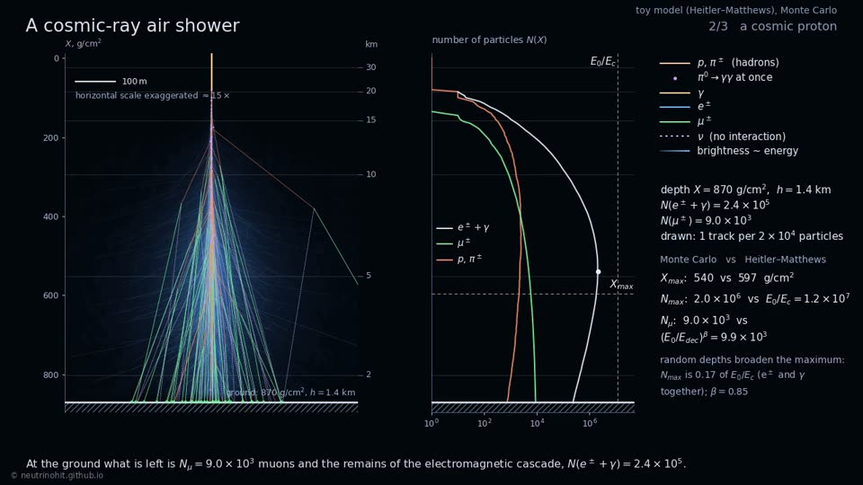<span class="anim-play" aria-hidden="true"></span></a></div>
        <h3 class="anim-title">Extensive air shower</h3>
        <p class="anim-text">The Heitler–Matthews toy model: the electromagnetic cascade of one photon, a Monte Carlo shower of a 10^15 eV proton, the N(X) profile and Heitler&#x27;s estimates, a ground detector array, fluorescence and Cherenkov light.</p>
        <div class="anim-chips"><a class="anim-chip is-current" href="../assets/animations/dvnanima/neutrino-particles-air-shower-air-shower-en.mp4" data-play data-poster="../assets/animations/dvnanima/neutrino-particles-air-shower-air-shower-en.jpg" title="MP4, 2.7 MB">EN</a><a class="anim-chip" href="../assets/animations/dvnanima/neutrino-particles-air-shower-air-shower.mp4" data-play data-poster="../assets/animations/dvnanima/neutrino-particles-air-shower-air-shower.jpg" title="MP4, 2.8 MB">RU</a></div>
      </article>
      <article class="anim-card" id="animation-neutrino-particles-earth-shield">
        <div class="anim-media"><a class="anim-poster" href="../assets/animations/dvnanima/neutrino-particles-earth-shield-earth-shield-en.mp4" data-play data-poster="../assets/animations/dvnanima/neutrino-particles-earth-shield-earth-shield-en.jpg" aria-label="Play: The Earth as a shield: muons stop, neutrinos pass">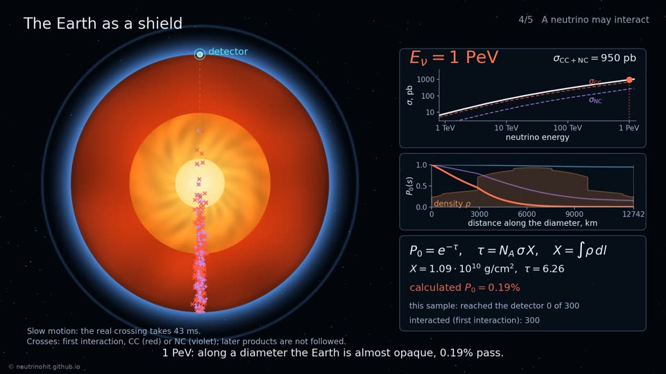<span class="anim-play" aria-hidden="true"></span></a></div>
        <h3 class="anim-title">The Earth as a shield: muons stop, neutrinos pass</h3>
        <p class="anim-text">Cosmic rays and their showers over the whole atmosphere; a cut of the planet through the detector (PREM layers); a muon stops within a few kilometres of rock while a neutrino gets through; Monte Carlo: the probability of no interaction along a chord, $P_0=e^{-\tau}$, at 1 TeV, 100 TeV and 1 PeV (CSMS cross-sections) and its dependence on the zenith angle.</p>
        <div class="anim-chips"><a class="anim-chip is-current" href="../assets/animations/dvnanima/neutrino-particles-earth-shield-earth-shield-en.mp4" data-play data-poster="../assets/animations/dvnanima/neutrino-particles-earth-shield-earth-shield-en.jpg" title="MP4, 2.2 MB">EN</a><a class="anim-chip" href="../assets/animations/dvnanima/neutrino-particles-earth-shield-earth-shield.mp4" data-play data-poster="../assets/animations/dvnanima/neutrino-particles-earth-shield-earth-shield.jpg" title="MP4, 2.2 MB">RU</a></div>
      </article>
      <article class="anim-card" id="animation-neutrino-particles-jet-launch">
        <div class="anim-media"><a class="anim-poster" href="../assets/animations/dvnanima/neutrino-particles-jet-launch-jet-launch-en.mp4" data-play data-poster="../assets/animations/dvnanima/neutrino-particles-jet-launch-jet-launch-en.jpg" aria-label="Play: From a star to a jet: where the power comes from">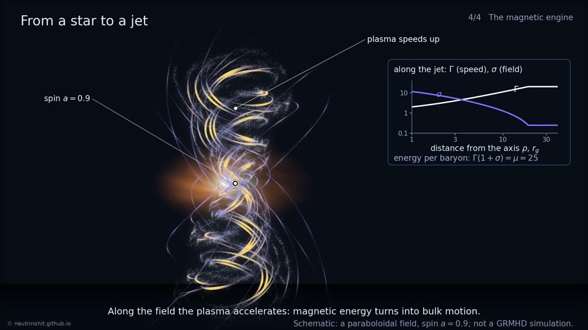<span class="anim-play" aria-hidden="true"></span></a></div>
        <h3 class="anim-title">From a star to a jet: where the power comes from</h3>
        <p class="anim-text">A black hole, its ergosphere and disk; a star is torn apart by tidal forces and matter falls back as $t^{-5/3}$; the spinning hole winds up the magnetic field, the Poynting flux carries energy away and plasma is accelerated along the field (the jet of a tidal disruption event, Swift J1644+57).</p>
        <div class="anim-chips"><a class="anim-chip is-current" href="../assets/animations/dvnanima/neutrino-particles-jet-launch-jet-launch-en.mp4" data-play data-poster="../assets/animations/dvnanima/neutrino-particles-jet-launch-jet-launch-en.jpg" title="MP4, 2.1 MB">EN</a><a class="anim-chip" href="../assets/animations/dvnanima/neutrino-particles-jet-launch-jet-launch.mp4" data-play data-poster="../assets/animations/dvnanima/neutrino-particles-jet-launch-jet-launch.jpg" title="MP4, 2.2 MB">RU</a></div>
      </article>
      <article class="anim-card" id="animation-neutrino-particles-star-in-jet">
        <div class="anim-media"><a class="anim-poster" href="../assets/animations/dvnanima/neutrino-particles-star-in-jet-star-in-jet-en.mp4" data-play data-poster="../assets/animations/dvnanima/neutrino-particles-star-in-jet-star-in-jet-en.jpg" aria-label="Play: A star in the jet: one way to make neutrinos">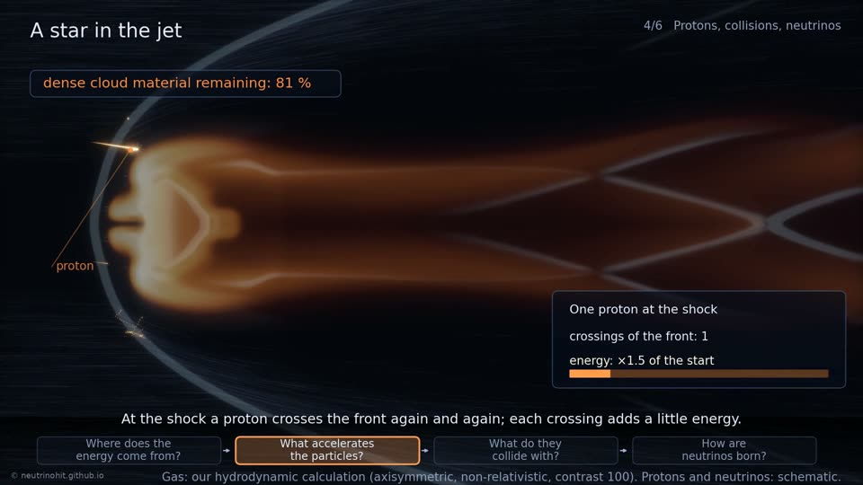<span class="anim-play" aria-hidden="true"></span></a></div>
        <h3 class="anim-title">A star in the jet: one way to make neutrinos</h3>
        <p class="anim-text">A black hole with an accretion disk launches a jet, and a star with a wind enters it; an axisymmetric hydrodynamic calculation of the disruption of the star at the shock; protons accelerated at the front collide with the matter of the cloud and produce neutrinos and gamma rays; single-pass numbers $\tau_{pp}$, $\kappa\tau_{pp}$; the neutrinos fly to the Earth.</p>
        <div class="anim-chips"><a class="anim-chip is-current" href="../assets/animations/dvnanima/neutrino-particles-star-in-jet-star-in-jet-en.mp4" data-play data-poster="../assets/animations/dvnanima/neutrino-particles-star-in-jet-star-in-jet-en.jpg" title="MP4, 4.3 MB">EN</a><a class="anim-chip" href="../assets/animations/dvnanima/neutrino-particles-star-in-jet-star-in-jet.mp4" data-play data-poster="../assets/animations/dvnanima/neutrino-particles-star-in-jet-star-in-jet.jpg" title="MP4, 4.3 MB">RU</a></div>
      </article>
      <article class="anim-card" id="animation-neutrino-particles-milky-way-neutrinos">
        <div class="anim-media"><a class="anim-poster" href="../assets/animations/dvnanima/neutrino-particles-milky-way-neutrinos-milky-way-neutrinos-en.mp4" data-play data-poster="../assets/animations/dvnanima/neutrino-particles-milky-way-neutrinos-milky-way-neutrinos-en.jpg" aria-label="Play: The Milky Way in neutrinos">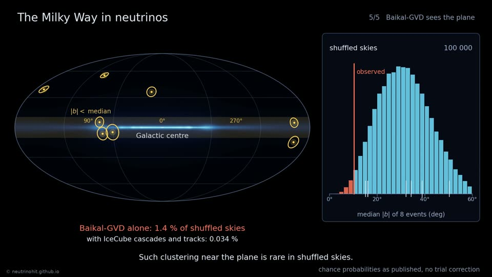<span class="anim-play" aria-hidden="true"></span></a></div>
        <h3 class="anim-title">The Milky Way in neutrinos</h3>
        <p class="anim-text">Cosmic-ray protons wander in the Galactic disk and collide with nuclei of interstellar gas; pions are produced, then neutrinos that fly straight. From inside the disk the whole Galaxy is a band across the sky: the map is the integral of “gas × cosmic-ray density” along the line of sight in an illustrative model. From the north the Galactic Centre is below the horizon most of the day (Baikal-GVD 75 %, KM3NeT ARCA 63 %, IceCube 0 %), that is, it is seen through the Earth. Eight Baikal-GVD cascades above 200 TeV lie closer to the plane than in scrambled skies: the median $|b|$ is smaller in only 1.4 % of them (0.034 % together with IceCube data).</p>
        <div class="anim-chips"><a class="anim-chip is-current" href="../assets/animations/dvnanima/neutrino-particles-milky-way-neutrinos-milky-way-neutrinos-en.mp4" data-play data-poster="../assets/animations/dvnanima/neutrino-particles-milky-way-neutrinos-milky-way-neutrinos-en.jpg" title="MP4, 1.3 MB">EN</a><a class="anim-chip" href="../assets/animations/dvnanima/neutrino-particles-milky-way-neutrinos-milky-way-neutrinos.mp4" data-play data-poster="../assets/animations/dvnanima/neutrino-particles-milky-way-neutrinos-milky-way-neutrinos.jpg" title="MP4, 1.3 MB">RU</a></div>
      </article>
      <article class="anim-card" id="animation-neutrino-particles-source-emerges">
        <div class="anim-media"><a class="anim-poster" href="../assets/animations/dvnanima/neutrino-particles-source-emerges-source-emerges-en.mp4" data-play data-poster="../assets/animations/dvnanima/neutrino-particles-source-emerges-source-emerges-en.jpg" aria-label="Play: A source emerges">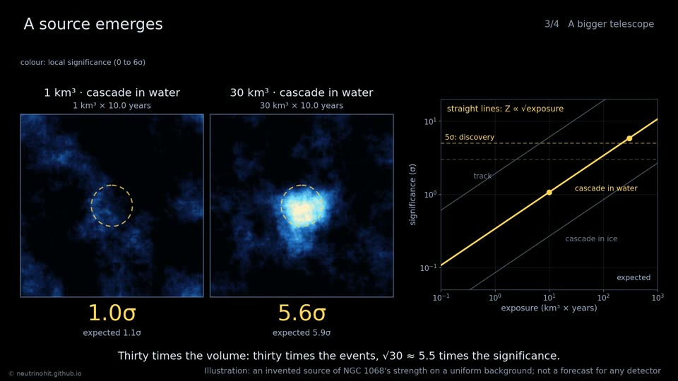<span class="anim-play" aria-hidden="true"></span></a></div>
        <h3 class="anim-title">A source emerges</h3>
        <p class="anim-text">Neutrinos arrive one by one; almost all are atmospheric background, a few come from the source. We count events in a circle around the source and compare with the expected background: the excess grows in proportion to time and the noise as its square root, so the significance grows as √t. The same source over the same years looks different with different direction resolution: a cascade in ice (half of the events within 10°), a cascade in water (2.5°), a track (0.4°). A 30 times larger volume gives √30 ≈ 5.5 times the significance: water cascades invisible in 10 years in 1 km³ pass 5σ in 30 km³. The rule: $Z\propto\sqrt{\text{exposure}}/\sigma_\theta$ while the background dominates.</p>
        <div class="anim-chips"><a class="anim-chip is-current" href="../assets/animations/dvnanima/neutrino-particles-source-emerges-source-emerges-en.mp4" data-play data-poster="../assets/animations/dvnanima/neutrino-particles-source-emerges-source-emerges-en.jpg" title="MP4, 1.4 MB">EN</a><a class="anim-chip" href="../assets/animations/dvnanima/neutrino-particles-source-emerges-source-emerges.mp4" data-play data-poster="../assets/animations/dvnanima/neutrino-particles-source-emerges-source-emerges.jpg" title="MP4, 1.4 MB">RU</a></div>
      </article>
      <article class="anim-card" id="animation-neutrino-particles-pp-cycle">
        <div class="anim-media"><a class="anim-poster" href="../assets/animations/dvnanima/neutrino-particles-pp-cycle-pp-to-d.mp4" data-play data-poster="../assets/animations/dvnanima/neutrino-particles-pp-cycle-pp-to-d.jpg" aria-label="Play: The proton–proton chain"><span class="anim-play" aria-hidden="true"></span></a></div>
        <h3 class="anim-title">The proton–proton chain</h3>
        <p class="anim-text">Three key reactions of the solar pp chain.</p>
        <div class="anim-chips"><a class="anim-chip is-current" href="../assets/animations/dvnanima/neutrino-particles-pp-cycle-pp-to-d.mp4" data-play data-poster="../assets/animations/dvnanima/neutrino-particles-pp-cycle-pp-to-d.jpg" title="MP4, 205.4 KB">p + p → D + e⁺ + νₑ</a><a class="anim-chip" href="../assets/animations/dvnanima/neutrino-particles-pp-cycle-d-p-he3.mp4" data-play data-poster="../assets/animations/dvnanima/neutrino-particles-pp-cycle-d-p-he3.jpg" title="MP4, 160.7 KB">D + p → ³He + γ</a><a class="anim-chip" href="../assets/animations/dvnanima/neutrino-particles-pp-cycle-he3-he3.mp4" data-play data-poster="../assets/animations/dvnanima/neutrino-particles-pp-cycle-he3-he3.jpg" title="MP4, 183.5 KB">³He + ³He → ⁴He + 2p</a></div>
      </article>
      <article class="anim-card" id="animation-neutrino-particles-solar-photon-diffusion">
        <div class="anim-media"><a class="anim-poster" href="../assets/animations/dvnanima/neutrino-particles-solar-photon-diffusion-en.mp4" data-play data-poster="../assets/animations/dvnanima/neutrino-particles-solar-photon-diffusion-en.jpg" aria-label="Play: How light escapes the Sun">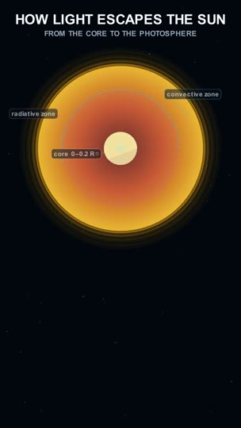<span class="anim-play" aria-hidden="true"></span></a></div>
        <h3 class="anim-title">How light escapes the Sun</h3>
        <p class="anim-text">A one-minute physical visualization of radiative transport: a random walk in the core, radiative diffusion, the temperature profile and the transition to the convection zone.</p>
        <div class="anim-chips"><a class="anim-chip is-current" href="../assets/animations/dvnanima/neutrino-particles-solar-photon-diffusion-en.mp4" data-play data-poster="../assets/animations/dvnanima/neutrino-particles-solar-photon-diffusion-en.jpg" title="MP4, 5.1 MB">EN</a><a class="anim-chip" href="../assets/animations/dvnanima/neutrino-particles-solar-photon-diffusion-ru.mp4" data-play data-poster="../assets/animations/dvnanima/neutrino-particles-solar-photon-diffusion-ru.jpg" title="MP4, 5.1 MB">RU</a></div>
      </article>
      <article class="anim-card" id="animation-neutrino-particles-bbn">
        <div class="anim-media"><a class="anim-poster" href="../assets/animations/dvnanima/neutrino-particles-bbn-bbn-animation.mp4" data-play data-poster="../assets/animations/dvnanima/neutrino-particles-bbn-bbn-animation.jpg" aria-label="Play: Big Bang nucleosynthesis"><span class="anim-play" aria-hidden="true"></span></a></div>
        <h3 class="anim-title">Big Bang nucleosynthesis</h3>
        <p class="anim-text">A stylized picture of BBN: the deuterium bottleneck, the synthesis window and neutrons bound in He-4.</p>
      </article>
      <article class="anim-card" id="animation-neutrino-particles-feynman-scattering">
        <div class="anim-media"><a class="anim-poster" href="../assets/animations/dvnanima/neutrino-particles-feynman-scattering-nu-mu-electron.mp4" data-play data-poster="../assets/animations/dvnanima/neutrino-particles-feynman-scattering-nu-mu-electron.jpg" aria-label="Play: Scattering diagrams"><span class="anim-play" aria-hidden="true"></span></a></div>
        <h3 class="anim-title">Scattering diagrams</h3>
        <p class="anim-text">Animated Feynman diagrams of typical scattering processes.</p>
        <div class="anim-chips"><a class="anim-chip is-current" href="../assets/animations/dvnanima/neutrino-particles-feynman-scattering-nu-mu-electron.mp4" data-play data-poster="../assets/animations/dvnanima/neutrino-particles-feynman-scattering-nu-mu-electron.jpg" title="MP4, 172.6 KB">νμ + e → νe + μ</a><a class="anim-chip" href="../assets/animations/dvnanima/neutrino-particles-feynman-scattering-nu-mu-z.mp4" data-play data-poster="../assets/animations/dvnanima/neutrino-particles-feynman-scattering-nu-mu-z.jpg" title="MP4, 171.1 KB">Neutrino scattering via Z</a><a class="anim-chip" href="../assets/animations/dvnanima/neutrino-particles-feynman-scattering-electron-electron.mp4" data-play data-poster="../assets/animations/dvnanima/neutrino-particles-feynman-scattering-electron-electron.jpg" title="MP4, 160.4 KB">e + e</a><a class="anim-chip" href="../assets/animations/dvnanima/neutrino-particles-feynman-scattering-quark-quark.mp4" data-play data-poster="../assets/animations/dvnanima/neutrino-particles-feynman-scattering-quark-quark.jpg" title="MP4, 182.0 KB">q + q</a></div>
      </article>
      <article class="anim-card" id="animation-neutrino-particles-nucleus-shapes">
        <div class="anim-media"><a class="anim-poster" href="../assets/animations/dvnanima/neutrino-particles-nucleus-shapes-shape-morphs.mp4" data-play data-poster="../assets/animations/dvnanima/neutrino-particles-nucleus-shapes-shape-morphs.jpg" aria-label="Play: Shapes of nuclei"><span class="anim-play" aria-hidden="true"></span></a></div>
        <h3 class="anim-title">Shapes of nuclei</h3>
        <p class="anim-text">Morphing between spherical and deformed nuclear shapes.</p>
      </article>
      <article class="anim-card" id="animation-neutrino-particles-pmt">
        <div class="anim-media"><a class="anim-poster" href="../assets/animations/dvnanima/neutrino-particles-pmt-pmt-schematic.mp4" data-play data-poster="../assets/animations/dvnanima/neutrino-particles-pmt-pmt-schematic.jpg" aria-label="Play: Photomultiplier"><span class="anim-play" aria-hidden="true"></span></a></div>
        <h3 class="anim-title">Photomultiplier</h3>
        <p class="anim-text">A schematic electron trajectory in a PMT from numerical data.</p>
      </article>
      <article class="anim-card" id="animation-neutrino-particles-pmt-multiplication">
        <div class="anim-media"><a class="anim-poster" href="../assets/animations/dvnanima/neutrino-particles-pmt-multiplication-avalanche-en.mp4" data-play data-poster="../assets/animations/dvnanima/neutrino-particles-pmt-multiplication-avalanche-en.jpg" aria-label="Play: Electron multiplication in a PMT">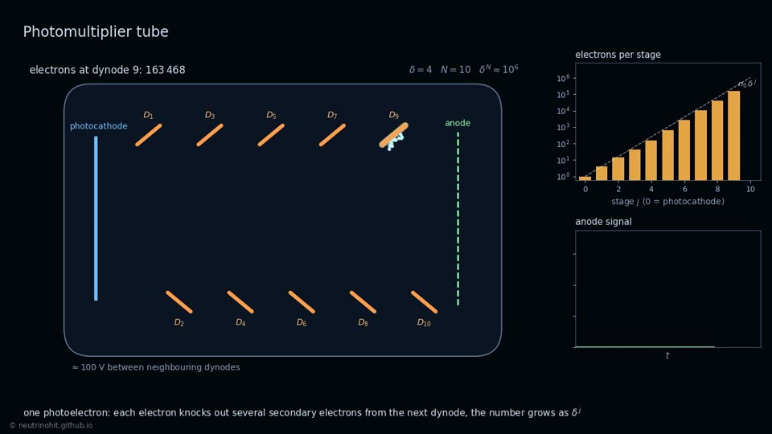<span class="anim-play" aria-hidden="true"></span></a></div>
        <h3 class="anim-title">Electron multiplication in a PMT</h3>
        <p class="anim-text">One photoelectron becomes an avalanche: each dynode knocks out on average δ = 4 secondary electrons, ten dynodes give a gain of ≈ 10⁶; then three scintillator flashes and the pulse amplitude, on average proportional to the number of photoelectrons.</p>
        <div class="anim-chips"><a class="anim-chip is-current" href="../assets/animations/dvnanima/neutrino-particles-pmt-multiplication-avalanche-en.mp4" data-play data-poster="../assets/animations/dvnanima/neutrino-particles-pmt-multiplication-avalanche-en.jpg" title="MP4, 1.1 MB">EN</a><a class="anim-chip" href="../assets/animations/dvnanima/neutrino-particles-pmt-multiplication-avalanche.mp4" data-play data-poster="../assets/animations/dvnanima/neutrino-particles-pmt-multiplication-avalanche.jpg" title="MP4, 1.1 MB">RU</a></div>
      </article>
      <article class="anim-card" id="animation-neutrino-particles-mac-e-filter">
        <div class="anim-media"><a class="anim-poster" href="../assets/animations/dvnanima/neutrino-particles-mac-e-filter-uniform-field.mp4" data-play data-poster="../assets/animations/dvnanima/neutrino-particles-mac-e-filter-uniform-field.jpg" aria-label="Play: Electrons in a magnetic field and the KATRIN MAC-E filter"><span class="anim-play" aria-hidden="true"></span></a></div>
        <h3 class="anim-title">Electrons in a magnetic field and the KATRIN MAC-E filter</h3>
        <p class="anim-text">Exact relativistic helical motion, reversible magnetic collimation and electrostatic analysis of electrons in the KATRIN spectrometer.</p>
        <div class="anim-chips"><a class="anim-chip is-current" href="../assets/animations/dvnanima/neutrino-particles-mac-e-filter-uniform-field.mp4" data-play data-poster="../assets/animations/dvnanima/neutrino-particles-mac-e-filter-uniform-field.jpg" title="MP4, 1.4 MB">Helical motion in a uniform field</a><a class="anim-chip" href="../assets/animations/dvnanima/neutrino-particles-mac-e-filter-katrin-collimation.mp4" data-play data-poster="../assets/animations/dvnanima/neutrino-particles-mac-e-filter-katrin-collimation.jpg" title="MP4, 645.9 KB">Magnetic collimation in KATRIN</a><a class="anim-chip" href="../assets/animations/dvnanima/neutrino-particles-mac-e-filter-katrin-electric.mp4" data-play data-poster="../assets/animations/dvnanima/neutrino-particles-mac-e-filter-katrin-electric.jpg" title="MP4, 752.9 KB">MAC-E: transmission and reflection</a></div>
      </article>
      <article class="anim-card" id="animation-neutrino-particles-project8-cres">
        <div class="anim-media"><a class="anim-poster" href="../assets/animations/dvnanima/neutrino-particles-project8-cres-cres-event.mp4" data-play data-poster="../assets/animations/dvnanima/neutrino-particles-project8-cres-cres-event.jpg" aria-label="Play: Project 8: cyclotron radiation of an electron"><span class="anim-play" aria-hidden="true"></span></a></div>
        <h3 class="anim-title">Project 8: cyclotron radiation of an electron</h3>
        <p class="anim-text">A schematic visualization of CRES: a trapped electron, cyclotron microwave radiation and a rising frequency track as the electron loses energy.</p>
      </article>
      <article class="anim-card" id="animation-neutrino-particles-cherenkov-cone">
        <div class="anim-media"><a class="anim-poster" href="../assets/animations/dvnanima/neutrino-particles-cherenkov-cone-cylinder.mp4" data-play data-poster="../assets/animations/dvnanima/neutrino-particles-cherenkov-cone-cylinder.jpg" aria-label="Play: The Cherenkov cone"><span class="anim-play" aria-hidden="true"></span></a></div>
        <h3 class="anim-title">The Cherenkov cone</h3>
        <p class="anim-text">The geometry of Cherenkov radiation in a cylindrical scene.</p>
      </article>
      <article class="anim-card" id="animation-neutrino-particles-cherenkov-radiation">
        <div class="anim-media"><a class="anim-poster" href="../assets/animations/dvnanima/neutrino-particles-cherenkov-radiation-huygens-en.mp4" data-play data-poster="../assets/animations/dvnanima/neutrino-particles-cherenkov-radiation-huygens-en.jpg" aria-label="Play: Vavilov–Cherenkov radiation">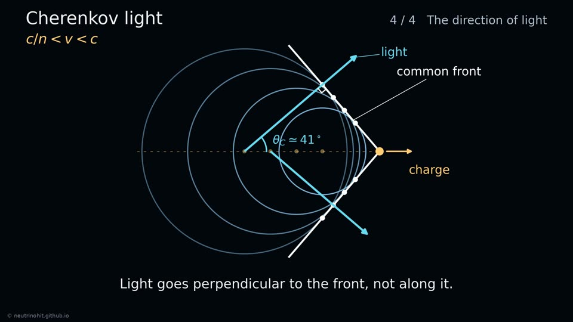<span class="anim-play" aria-hidden="true"></span></a></div>
        <h3 class="anim-title">Vavilov–Cherenkov radiation</h3>
        <p class="anim-text">Four wavefronts, two separate runs at constant speed and pauses for explanation. A slow particle stays inside the fronts; a fast one overtakes them. The common tangent forms the surface of a cone, and the light goes across it. No plot and no ring on a detector.</p>
        <div class="anim-chips"><a class="anim-chip is-current" href="../assets/animations/dvnanima/neutrino-particles-cherenkov-radiation-huygens-en.mp4" data-play data-poster="../assets/animations/dvnanima/neutrino-particles-cherenkov-radiation-huygens-en.jpg" title="MP4, 1.3 MB">EN</a><a class="anim-chip" href="../assets/animations/dvnanima/neutrino-particles-cherenkov-radiation-huygens.mp4" data-play data-poster="../assets/animations/dvnanima/neutrino-particles-cherenkov-radiation-huygens.jpg" title="MP4, 1.4 MB">RU</a></div>
      </article>
      <article class="anim-card" id="animation-neutrino-particles-scattering-experiment">
        <div class="anim-media"><a class="anim-poster" href="../assets/animations/dvnanima/neutrino-particles-scattering-experiment-collider-en.mp4" data-play data-poster="../assets/animations/dvnanima/neutrino-particles-scattering-experiment-collider-en.jpg" aria-label="Play: A scattering experiment: e⁺e⁻ → μ⁺μ⁻">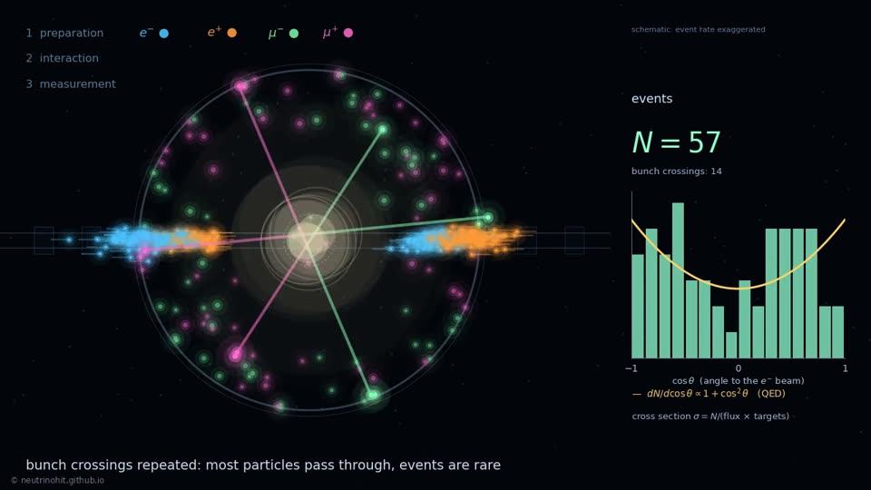<span class="anim-play" aria-hidden="true"></span></a></div>
        <h3 class="anim-title">A scattering experiment: e⁺e⁻ → μ⁺μ⁻</h3>
        <p class="anim-text">Three stages of a collider experiment: the beams are accelerated, interact in a small region (almost all particles fly through) and the muons are detected. From many events the angular distribution 1 + cos²θ builds up.</p>
        <div class="anim-chips"><a class="anim-chip is-current" href="../assets/animations/dvnanima/neutrino-particles-scattering-experiment-collider-en.mp4" data-play data-poster="../assets/animations/dvnanima/neutrino-particles-scattering-experiment-collider-en.jpg" title="MP4, 2.9 MB">EN</a><a class="anim-chip" href="../assets/animations/dvnanima/neutrino-particles-scattering-experiment-collider.mp4" data-play data-poster="../assets/animations/dvnanima/neutrino-particles-scattering-experiment-collider.jpg" title="MP4, 2.9 MB">RU</a></div>
      </article>
      <article class="anim-card" id="animation-neutrino-particles-pi0-double-dalitz">
        <div class="anim-media"><a class="anim-poster" href="../assets/animations/dvnanima/neutrino-particles-pi0-double-dalitz-planes-en.mp4" data-play data-poster="../assets/animations/dvnanima/neutrino-particles-pi0-double-dalitz-planes-en.jpg" aria-label="Play: The decay π⁰ → e⁺e⁻e⁺e⁻">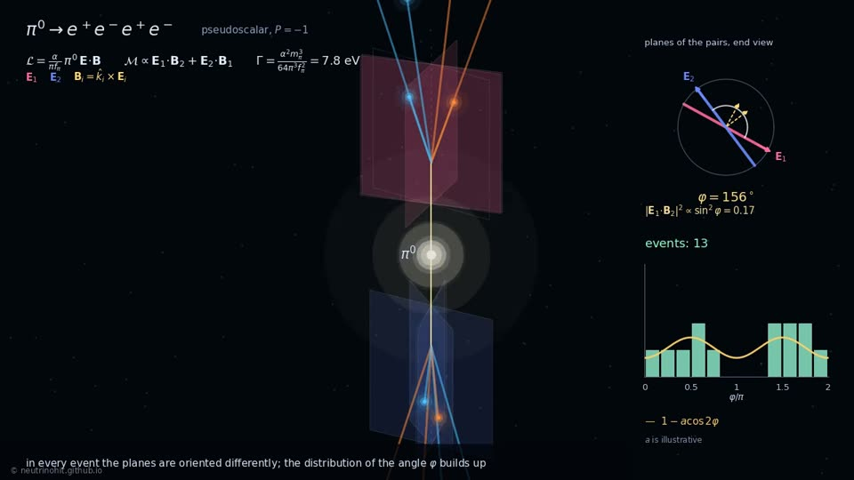<span class="anim-play" aria-hidden="true"></span></a></div>
        <h3 class="anim-title">The decay π⁰ → e⁺e⁻e⁺e⁻</h3>
        <p class="anim-text">Two e⁺e⁻ pairs from virtual photons lie in planes containing the polarization (E) of their photon. For the pseudoscalar π⁰ the amplitude is ∝ E₁·B₂ + E₂·B₁ ∝ sin φ (the planes are perpendicular), for a scalar ∝ E₁·E₂ − B₁·B₂ ∝ cos φ (parallel); the distribution in the angle φ builds up. Two versions: Russian and English.</p>
        <div class="anim-chips"><a class="anim-chip is-current" href="../assets/animations/dvnanima/neutrino-particles-pi0-double-dalitz-planes-en.mp4" data-play data-poster="../assets/animations/dvnanima/neutrino-particles-pi0-double-dalitz-planes-en.jpg" title="MP4, 1.5 MB">EN</a><a class="anim-chip" href="../assets/animations/dvnanima/neutrino-particles-pi0-double-dalitz-planes.mp4" data-play data-poster="../assets/animations/dvnanima/neutrino-particles-pi0-double-dalitz-planes.jpg" title="MP4, 1.5 MB">RU</a></div>
      </article>
      <article class="anim-card" id="animation-neutrino-particles-z-decay-asymmetry">
        <div class="anim-media"><a class="anim-poster" href="../assets/animations/dvnanima/neutrino-particles-z-decay-asymmetry-film-en.mp4" data-play data-poster="../assets/animations/dvnanima/neutrino-particles-z-decay-asymmetry-film-en.jpg" aria-label="Play: Asymmetry in Z boson production and decay">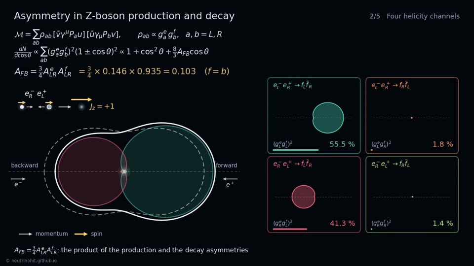<span class="anim-play" aria-hidden="true"></span></a></div>
        <h3 class="anim-title">Asymmetry in Z boson production and decay</h3>
        <p class="anim-text">Four helicity channels e⁺e⁻ → Z → f f̄ with weights (g_a g_b)², the distributions (1 ± cosθ)² and their sum, the forward–backward asymmetry A_FB, Monte Carlo events and the dependence A_FB(√s) with γ–Z interference.</p>
        <div class="anim-chips"><a class="anim-chip is-current" href="../assets/animations/dvnanima/neutrino-particles-z-decay-asymmetry-film-en.mp4" data-play data-poster="../assets/animations/dvnanima/neutrino-particles-z-decay-asymmetry-film-en.jpg" title="MP4, 1.7 MB">EN</a><a class="anim-chip" href="../assets/animations/dvnanima/neutrino-particles-z-decay-asymmetry-film.mp4" data-play data-poster="../assets/animations/dvnanima/neutrino-particles-z-decay-asymmetry-film.jpg" title="MP4, 1.7 MB">RU</a></div>
      </article>
      <article class="anim-card" id="animation-neutrino-particles-kaon-oscillations">
        <div class="anim-media"><a class="anim-poster" href="../assets/animations/dvnanima/neutrino-particles-kaon-oscillations-film-en.mp4" data-play data-poster="../assets/animations/dvnanima/neutrino-particles-kaon-oscillations-film-en.jpg" aria-label="Play: Neutral kaon oscillations">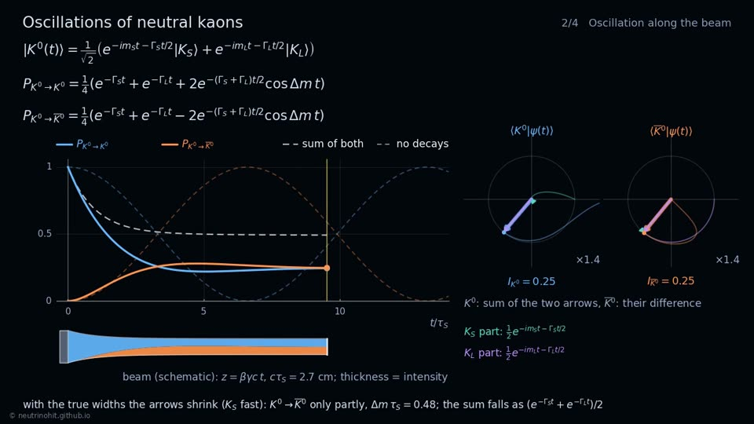<span class="anim-play" aria-hidden="true"></span></a></div>
        <h3 class="anim-title">Neutral kaon oscillations</h3>
        <p class="anim-text">A K⁰ is produced in a strong reaction as a superposition of K_S and K_L; two-level evolution with H = M − iΓ/2 (integrated numerically), strangeness oscillations along the beam, the detector (K̄⁰N → Λπ) and the lepton charge, K_S regeneration.</p>
        <div class="anim-chips"><a class="anim-chip is-current" href="../assets/animations/dvnanima/neutrino-particles-kaon-oscillations-film-en.mp4" data-play data-poster="../assets/animations/dvnanima/neutrino-particles-kaon-oscillations-film-en.jpg" title="MP4, 3.1 MB">EN</a><a class="anim-chip" href="../assets/animations/dvnanima/neutrino-particles-kaon-oscillations-film.mp4" data-play data-poster="../assets/animations/dvnanima/neutrino-particles-kaon-oscillations-film.jpg" title="MP4, 3.2 MB">RU</a></div>
      </article>
      <article class="anim-card" id="animation-neutrino-particles-humanity-cube">
        <div class="anim-media"><a class="anim-poster" href="../assets/animations/dvnanima/neutrino-particles-humanity-cube-en.mp4" data-play data-poster="../assets/animations/dvnanima/neutrino-particles-humanity-cube-en.jpg" aria-label="Play: All of humanity in half a cubic kilometre">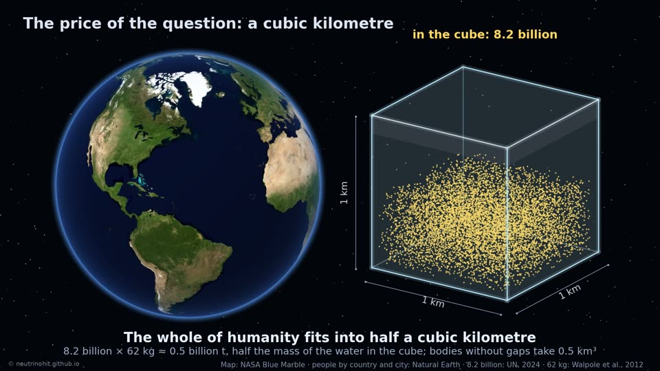<span class="anim-play" aria-hidden="true"></span></a></div>
        <h3 class="anim-title">All of humanity in half a cubic kilometre</h3>
        <p class="anim-text">A neutrino telescope needs a target of a cubic kilometre. A rotating globe (NASA Blue Marble) is covered with dots where people live (Natural Earth countries and cities), one dot is a million people, 8200 dots are all of humanity (8.2 billion, UN 2024). A glass cube with a 1 km side appears next to it (not to scale with the planet), and all the dots are drawn into it at once. At 62 kg per person (Walpole et al., 2012) humanity weighs 0.51 billion tonnes, half the mass of the water in the cube, and the bodies without gaps fill half the cube. Then the camera dives into the cube: the dots turn into a crowd of people from all continents (shares by the population of Natural Earth countries; the appearance of the people is conventional).</p>
        <div class="anim-chips"><a class="anim-chip is-current" href="../assets/animations/dvnanima/neutrino-particles-humanity-cube-en.mp4" data-play data-poster="../assets/animations/dvnanima/neutrino-particles-humanity-cube-en.jpg" title="MP4, 25.1 MB">EN</a><a class="anim-chip" href="../assets/animations/dvnanima/neutrino-particles-humanity-cube-ru.mp4" data-play data-poster="../assets/animations/dvnanima/neutrino-particles-humanity-cube-ru.jpg" title="MP4, 24.7 MB">RU</a></div>
      </article>
    </div>
  </section>
  <section class="anim-section" id="fields-waves">
    <div class="anim-section-head">
      <span class="course-tile-status is-ready">26 stories · 48 videos</span>
      <h2>Fields, waves and oscillators</h2>
      <p>Electromagnetic fields, wave packets, coupled oscillators and simple electronic circuits.</p>
    </div>
    <div class="anim-grid">
      <article class="anim-card" id="animation-fields-waves-scalar-qed">
        <div class="anim-media"><a class="anim-poster" href="../assets/animations/dvnanima/fields-waves-scalar-qed-single.mp4" data-play data-poster="../assets/animations/dvnanima/fields-waves-scalar-qed-single.jpg" aria-label="Play: Scalar QED: wave packets"><span class="anim-play" aria-hidden="true"></span></a></div>
        <h3 class="anim-title">Scalar QED: wave packets</h3>
        <p class="anim-text">Attraction and repulsion of wave packets as the interference of the free wave and the interaction wave: the field of a packet, the eikonal phase, the shift of the momentum distribution.</p>
        <div class="anim-chips"><a class="anim-chip is-current" href="../assets/animations/dvnanima/fields-waves-scalar-qed-single.mp4" data-play data-poster="../assets/animations/dvnanima/fields-waves-scalar-qed-single.jpg" title="MP4, 447.1 KB">One packet and its field</a><a class="anim-chip" href="../assets/animations/dvnanima/fields-waves-scalar-qed-attraction-en.mp4" data-play data-poster="../assets/animations/dvnanima/fields-waves-scalar-qed-attraction-en.jpg" title="MP4, 2.0 MB">Attraction: opposite charges</a><a class="anim-chip is-lang" href="../assets/animations/dvnanima/fields-waves-scalar-qed-attraction.mp4" data-play data-poster="../assets/animations/dvnanima/fields-waves-scalar-qed-attraction.jpg" title="MP4, 2.0 MB">RU</a><a class="anim-chip" href="../assets/animations/dvnanima/fields-waves-scalar-qed-repulsion-en.mp4" data-play data-poster="../assets/animations/dvnanima/fields-waves-scalar-qed-repulsion-en.jpg" title="MP4, 1.5 MB">Repulsion: charges of the same sign</a><a class="anim-chip is-lang" href="../assets/animations/dvnanima/fields-waves-scalar-qed-repulsion.mp4" data-play data-poster="../assets/animations/dvnanima/fields-waves-scalar-qed-repulsion.jpg" title="MP4, 1.5 MB">RU</a></div>
      </article>
      <article class="anim-card" id="animation-fields-waves-standard-model-field-mattress">
        <div class="anim-media"><a class="anim-poster" href="../assets/animations/dvnanima/fields-waves-standard-model-field-mattress-field-stack-en.mp4" data-play data-poster="../assets/animations/dvnanima/fields-waves-standard-model-field-mattress-field-stack-en.jpg" aria-label="Play: Fields of the Standard Model">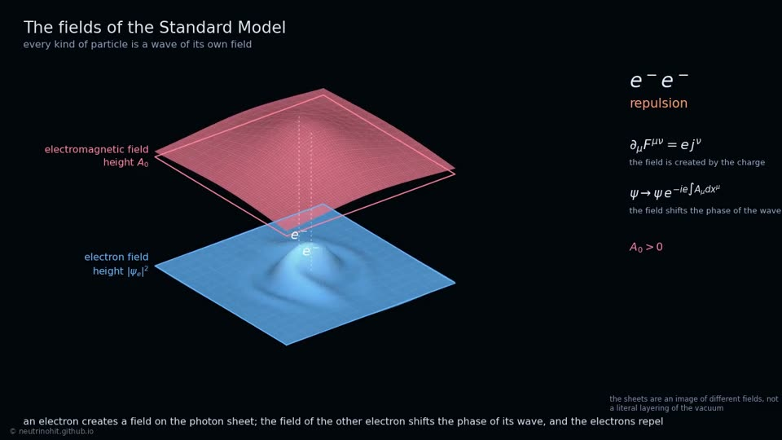<span class="anim-play" aria-hidden="true"></span></a></div>
        <h3 class="anim-title">Fields of the Standard Model</h3>
        <p class="anim-text">The 17 fields of the Standard Model as sheets of one stack; a particle is a wave packet on the sheet of its field; two fields close up: e⁻e⁻ (repulsion) and e⁻e⁺ (attraction) in the scalar QED model, then e⁻e⁺ ↔ γγ as energy flowing between the fields.</p>
        <div class="anim-chips"><a class="anim-chip is-current" href="../assets/animations/dvnanima/fields-waves-standard-model-field-mattress-field-stack-en.mp4" data-play data-poster="../assets/animations/dvnanima/fields-waves-standard-model-field-mattress-field-stack-en.jpg" title="MP4, 7.4 MB">EN</a><a class="anim-chip" href="../assets/animations/dvnanima/fields-waves-standard-model-field-mattress-field-stack.mp4" data-play data-poster="../assets/animations/dvnanima/fields-waves-standard-model-field-mattress-field-stack.jpg" title="MP4, 7.4 MB">RU</a></div>
      </article>
      <article class="anim-card" id="animation-fields-waves-mediator-interaction">
        <div class="anim-media"><a class="anim-poster" href="../assets/animations/dvnanima/fields-waves-mediator-interaction-with-interaction.mp4" data-play data-poster="../assets/animations/dvnanima/fields-waves-mediator-interaction-with-interaction.jpg" aria-label="Play: Interaction through a mediator field"><span class="anim-play" aria-hidden="true"></span></a></div>
        <h3 class="anim-title">Interaction through a mediator field</h3>
        <p class="anim-text">Two particles and the dynamic field through which their interaction shows up.</p>
      </article>
      <article class="anim-card" id="animation-fields-waves-free-wavepackets">
        <div class="anim-media"><a class="anim-poster" href="../assets/animations/dvnanima/fields-waves-free-wavepackets-single.mp4" data-play data-poster="../assets/animations/dvnanima/fields-waves-free-wavepackets-single.jpg" aria-label="Play: Free wave packets"><span class="anim-play" aria-hidden="true"></span></a></div>
        <h3 class="anim-title">Free wave packets</h3>
        <p class="anim-text">A single Gaussian packet and a pair of freely propagating packets.</p>
        <div class="anim-chips"><a class="anim-chip is-current" href="../assets/animations/dvnanima/fields-waves-free-wavepackets-single.mp4" data-play data-poster="../assets/animations/dvnanima/fields-waves-free-wavepackets-single.jpg" title="MP4, 5.2 MB">One packet</a><a class="anim-chip" href="../assets/animations/dvnanima/fields-waves-free-wavepackets-two.mp4" data-play data-poster="../assets/animations/dvnanima/fields-waves-free-wavepackets-two.jpg" title="MP4, 2.2 MB">Two packets</a></div>
      </article>
      <article class="anim-card" id="animation-fields-waves-schrodinger-packet">
        <div class="anim-media"><a class="anim-poster" href="../assets/animations/dvnanima/fields-waves-schrodinger-packet-spreading-en.mp4" data-play data-poster="../assets/animations/dvnanima/fields-waves-schrodinger-packet-spreading-en.jpg" aria-label="Play: A free Gaussian packet: spreading">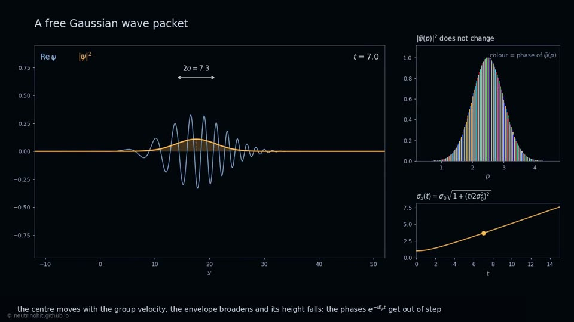<span class="anim-play" aria-hidden="true"></span></a></div>
        <h3 class="anim-title">A free Gaussian packet: spreading</h3>
        <p class="anim-text">Exact evolution of the Gaussian packet of a free particle (ħ = m = 1): the centre moves with the group velocity, the width grows as σ₀√(1 + (t/2σ₀²)²), and |ψ̃(p)|² does not change; a narrow packet spreads faster than a wide one.</p>
        <div class="anim-chips"><a class="anim-chip is-current" href="../assets/animations/dvnanima/fields-waves-schrodinger-packet-spreading-en.mp4" data-play data-poster="../assets/animations/dvnanima/fields-waves-schrodinger-packet-spreading-en.jpg" title="MP4, 1.5 MB">EN</a><a class="anim-chip" href="../assets/animations/dvnanima/fields-waves-schrodinger-packet-spreading.mp4" data-play data-poster="../assets/animations/dvnanima/fields-waves-schrodinger-packet-spreading.jpg" title="MP4, 1.5 MB">RU</a></div>
      </article>
      <article class="anim-card" id="animation-fields-waves-coupled-chain">
        <div class="anim-media"><a class="anim-poster" href="../assets/animations/dvnanima/fields-waves-coupled-chain-chain-en.mp4" data-play data-poster="../assets/animations/dvnanima/fields-waves-coupled-chain-chain-en.jpg" aria-label="Play: A chain of coupled oscillators">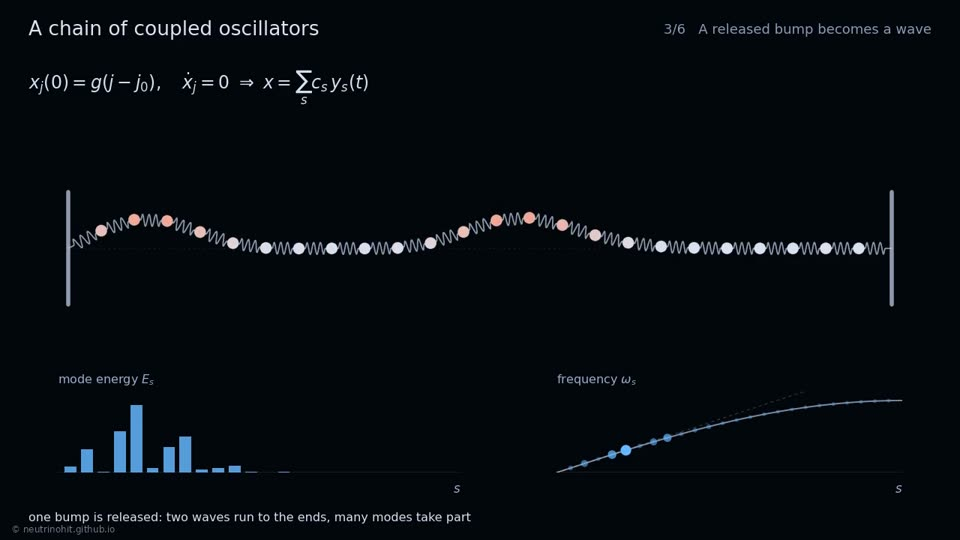<span class="anim-play" aria-hidden="true"></span></a></div>
        <h3 class="anim-title">A chain of coupled oscillators</h3>
        <p class="anim-text">A chain of N masses: normal modes and dispersion, a wave from a released displacement, colliding waves in a linear chain (free particles) and with a cubic term (energy exchange between modes), the limit N → ∞ and the field.</p>
        <div class="anim-chips"><a class="anim-chip is-current" href="../assets/animations/dvnanima/fields-waves-coupled-chain-chain-en.mp4" data-play data-poster="../assets/animations/dvnanima/fields-waves-coupled-chain-chain-en.jpg" title="MP4, 2.1 MB">EN</a><a class="anim-chip" href="../assets/animations/dvnanima/fields-waves-coupled-chain-chain.mp4" data-play data-poster="../assets/animations/dvnanima/fields-waves-coupled-chain-chain.jpg" title="MP4, 2.1 MB">RU</a></div>
      </article>
      <article class="anim-card" id="animation-fields-waves-coupled-lattice-2d">
        <div class="anim-media"><a class="anim-poster" href="../assets/animations/dvnanima/fields-waves-coupled-lattice-2d-lattice-en.mp4" data-play data-poster="../assets/animations/dvnanima/fields-waves-coupled-lattice-2d-lattice-en.jpg" aria-label="Play: A two-dimensional lattice of coupled oscillators">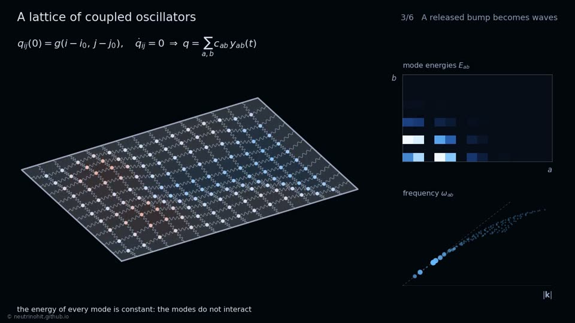<span class="anim-play" aria-hidden="true"></span></a></div>
        <h3 class="anim-title">A two-dimensional lattice of coupled oscillators</h3>
        <p class="anim-text">A lattice of 14×10 masses on springs: normal modes and the map of their energies, circular waves from a released displacement, colliding waves in a linear lattice and with anharmonic terms (energy redistributed between modes), the limit N → ∞ and the field.</p>
        <div class="anim-chips"><a class="anim-chip is-current" href="../assets/animations/dvnanima/fields-waves-coupled-lattice-2d-lattice-en.mp4" data-play data-poster="../assets/animations/dvnanima/fields-waves-coupled-lattice-2d-lattice-en.jpg" title="MP4, 4.8 MB">EN</a><a class="anim-chip" href="../assets/animations/dvnanima/fields-waves-coupled-lattice-2d-lattice.mp4" data-play data-poster="../assets/animations/dvnanima/fields-waves-coupled-lattice-2d-lattice.jpg" title="MP4, 4.8 MB">RU</a></div>
      </article>
      <article class="anim-card" id="animation-fields-waves-coupled-lattice-3d">
        <div class="anim-media"><a class="anim-poster" href="../assets/animations/dvnanima/fields-waves-coupled-lattice-3d-lattice-en.mp4" data-play data-poster="../assets/animations/dvnanima/fields-waves-coupled-lattice-3d-lattice-en.jpg" aria-label="Play: A three-dimensional lattice of coupled oscillators">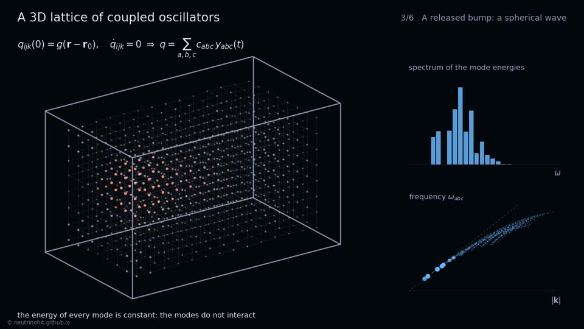<span class="anim-play" aria-hidden="true"></span></a></div>
        <h3 class="anim-title">A three-dimensional lattice of coupled oscillators</h3>
        <p class="anim-text">A box of 14×8×8 masses on springs: normal modes and the spectrum of their energies, a spherical wave from a released displacement, colliding waves in a linear lattice and with anharmonic terms (energy redistributed between modes), the limit N → ∞ and the field.</p>
        <div class="anim-chips"><a class="anim-chip is-current" href="../assets/animations/dvnanima/fields-waves-coupled-lattice-3d-lattice-en.mp4" data-play data-poster="../assets/animations/dvnanima/fields-waves-coupled-lattice-3d-lattice-en.jpg" title="MP4, 5.6 MB">EN</a><a class="anim-chip" href="../assets/animations/dvnanima/fields-waves-coupled-lattice-3d-lattice.mp4" data-play data-poster="../assets/animations/dvnanima/fields-waves-coupled-lattice-3d-lattice.jpg" title="MP4, 5.7 MB">RU</a></div>
      </article>
      <article class="anim-card" id="animation-fields-waves-radiating-charge">
        <div class="anim-media"><a class="anim-poster" href="../assets/animations/dvnanima/fields-waves-radiating-charge-three-dimensional.mp4" data-play data-poster="../assets/animations/dvnanima/fields-waves-radiating-charge-three-dimensional.jpg" aria-label="Play: A radiating charge"><span class="anim-play" aria-hidden="true"></span></a></div>
        <h3 class="anim-title">A radiating charge</h3>
        <p class="anim-text">A numerical 3D visualization of the field of a moving charge.</p>
      </article>
      <article class="anim-card" id="animation-fields-waves-coupled-pendulums">
        <div class="anim-media"><a class="anim-poster" href="../assets/animations/dvnanima/fields-waves-coupled-pendulums-pendulums.mp4" data-play data-poster="../assets/animations/dvnanima/fields-waves-coupled-pendulums-pendulums.jpg" aria-label="Play: Coupled pendulums"><span class="anim-play" aria-hidden="true"></span></a></div>
        <h3 class="anim-title">Coupled pendulums</h3>
        <p class="anim-text">Energy transfer between two coupled pendulums.</p>
      </article>
      <article class="anim-card" id="animation-fields-waves-capacitor">
        <div class="anim-media"><a class="anim-poster" href="../assets/animations/dvnanima/fields-waves-capacitor-capacitor.mp4" data-play data-poster="../assets/animations/dvnanima/fields-waves-capacitor-capacitor.jpg" aria-label="Play: A capacitor in an AC circuit"><span class="anim-play" aria-hidden="true"></span></a></div>
        <h3 class="anim-title">A capacitor in an AC circuit</h3>
        <p class="anim-text">Phase relations and the charging of a capacitor in an AC circuit.</p>
      </article>
      <article class="anim-card" id="animation-fields-waves-diode">
        <div class="anim-media"><a class="anim-poster" href="../assets/animations/dvnanima/fields-waves-diode-diode.mp4" data-play data-poster="../assets/animations/dvnanima/fields-waves-diode-diode.jpg" aria-label="Play: A diode in an AC circuit"><span class="anim-play" aria-hidden="true"></span></a></div>
        <h3 class="anim-title">A diode in an AC circuit</h3>
        <p class="anim-text">Half-wave rectification and the operation of a diode in an AC circuit.</p>
      </article>
      <article class="anim-card" id="animation-fields-waves-peak-detector">
        <div class="anim-media"><a class="anim-poster" href="../assets/animations/dvnanima/fields-waves-peak-detector-peak-detector.mp4" data-play data-poster="../assets/animations/dvnanima/fields-waves-peak-detector-peak-detector.jpg" aria-label="Play: Peak detector"><span class="anim-play" aria-hidden="true"></span></a></div>
        <h3 class="anim-title">Peak detector</h3>
        <p class="anim-text">How a peak detector made of a diode and a capacitor works.</p>
      </article>
      <article class="anim-card" id="animation-fields-waves-cockcroft-walton">
        <div class="anim-media"><a class="anim-poster" href="../assets/animations/dvnanima/fields-waves-cockcroft-walton-cascade.mp4" data-play data-poster="../assets/animations/dvnanima/fields-waves-cockcroft-walton-cascade.jpg" aria-label="Play: Cockcroft–Walton generator"><span class="anim-play" aria-hidden="true"></span></a></div>
        <h3 class="anim-title">Cockcroft–Walton generator</h3>
        <p class="anim-text">A voltage multiplier circuit and the successive charging of its stages.</p>
      </article>
      <article class="anim-card" id="animation-fields-waves-running-charge">
        <div class="anim-media"><a class="anim-poster" href="../assets/animations/dvnanima/fields-waves-running-charge-film-en.mp4" data-play data-poster="../assets/animations/dvnanima/fields-waves-running-charge-film-en.jpg" aria-label="Play: A running charge: screening by virtual pairs">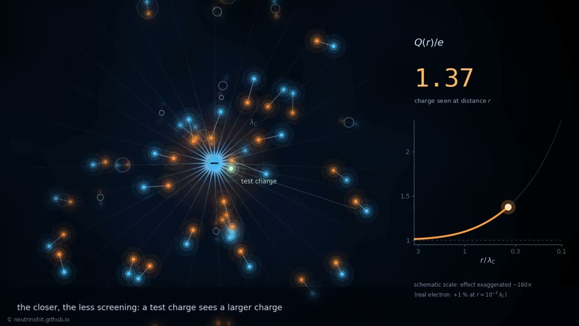<span class="anim-play" aria-hidden="true"></span></a></div>
        <h3 class="anim-title">A running charge: screening by virtual pairs</h3>
        <p class="anim-text">Virtual electron–positron pairs line up around an electron and screen its charge; a test charge flying in sees an ever larger charge. The scale of the effect is conventional.</p>
        <div class="anim-chips"><a class="anim-chip is-current" href="../assets/animations/dvnanima/fields-waves-running-charge-film-en.mp4" data-play data-poster="../assets/animations/dvnanima/fields-waves-running-charge-film-en.jpg" title="MP4, 1.1 MB">EN</a><a class="anim-chip" href="../assets/animations/dvnanima/fields-waves-running-charge-film.mp4" data-play data-poster="../assets/animations/dvnanima/fields-waves-running-charge-film.jpg" title="MP4, 1.2 MB">RU</a></div>
      </article>
      <article class="anim-card" id="animation-fields-waves-electron-kick">
        <div class="anim-media"><a class="anim-poster" href="../assets/animations/dvnanima/fields-waves-electron-kick-front-en.mp4" data-play data-poster="../assets/animations/dvnanima/fields-waves-electron-kick-front-en.jpg" aria-label="Play: A kick to an electron: the front of an electromagnetic wave">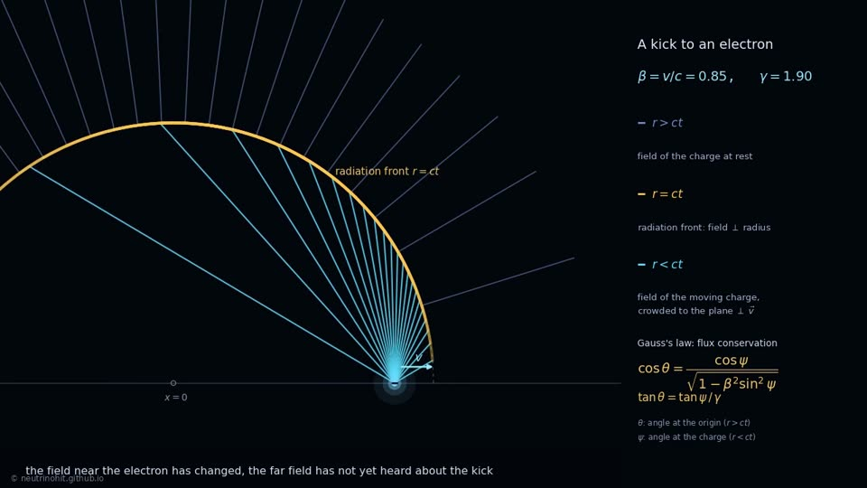<span class="anim-play" aria-hidden="true"></span></a></div>
        <h3 class="anim-title">A kick to an electron: the front of an electromagnetic wave</h3>
        <p class="anim-text">A charge suddenly gets a velocity: outside the sphere r = ct is the field of the charge at rest, inside it the field of the moving charge, and on the sphere the field lines are joined by arcs. The exact relativistic picture for β = 0.30 and 0.85.</p>
        <div class="anim-chips"><a class="anim-chip is-current" href="../assets/animations/dvnanima/fields-waves-electron-kick-front-en.mp4" data-play data-poster="../assets/animations/dvnanima/fields-waves-electron-kick-front-en.jpg" title="MP4, 1.5 MB">EN</a><a class="anim-chip" href="../assets/animations/dvnanima/fields-waves-electron-kick-front.mp4" data-play data-poster="../assets/animations/dvnanima/fields-waves-electron-kick-front.jpg" title="MP4, 1.5 MB">RU</a></div>
      </article>
      <article class="anim-card" id="animation-fields-waves-zero-point-electron">
        <div class="anim-media"><a class="anim-poster" href="../assets/animations/dvnanima/fields-waves-zero-point-electron-vacuum-field-en.mp4" data-play data-poster="../assets/animations/dvnanima/fields-waves-zero-point-electron-vacuum-field-en.jpg" aria-label="Play: An electron in the vacuum field: zero-point fluctuations">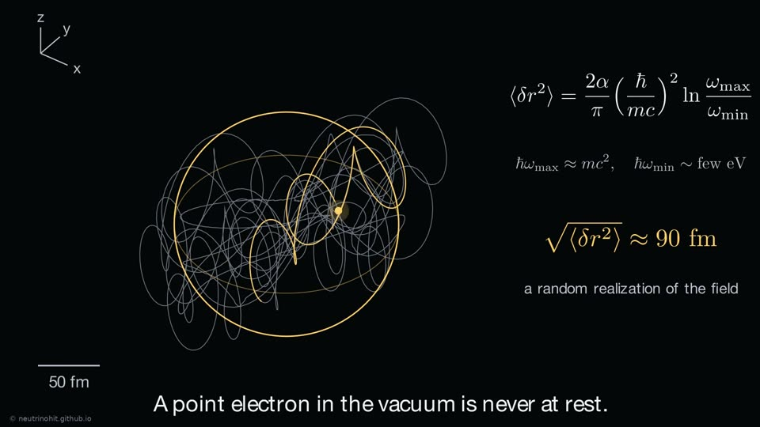<span class="anim-play" aria-hidden="true"></span></a></div>
        <h3 class="anim-title">An electron in the vacuum field: zero-point fluctuations</h3>
        <p class="anim-text">Zero-point fluctuations of the electric field: at each point the vector E goes round an ellipse at every frequency, ⟨E⟩ = 0, ⟨E²⟩ ≠ 0. The electron follows the ellipse with an amplitude ∝ E/ω²; each octave contributes equally, ⟨δr²⟩ = (2α/π)(ħ/mc)² ln 2, and the path fills a ball √⟨δr²⟩ ≈ 90 fm. Two versions: Russian and English.</p>
        <div class="anim-chips"><a class="anim-chip is-current" href="../assets/animations/dvnanima/fields-waves-zero-point-electron-vacuum-field-en.mp4" data-play data-poster="../assets/animations/dvnanima/fields-waves-zero-point-electron-vacuum-field-en.jpg" title="MP4, 3.5 MB">EN</a><a class="anim-chip" href="../assets/animations/dvnanima/fields-waves-zero-point-electron-vacuum-field.mp4" data-play data-poster="../assets/animations/dvnanima/fields-waves-zero-point-electron-vacuum-field.jpg" title="MP4, 3.5 MB">RU</a></div>
      </article>
      <article class="anim-card" id="animation-fields-waves-thomson-tube">
        <div class="anim-media"><a class="anim-poster" href="../assets/animations/dvnanima/fields-waves-thomson-tube-crossed-fields-en.mp4" data-play data-poster="../assets/animations/dvnanima/fields-waves-thomson-tube-crossed-fields-en.jpg" aria-label="Play: Thomson&#x27;s experiment: e/m">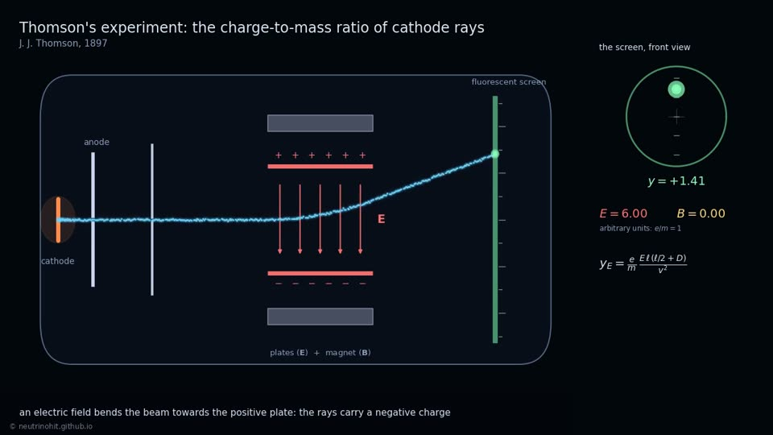<span class="anim-play" aria-hidden="true"></span></a></div>
        <h3 class="anim-title">Thomson&#x27;s experiment: e/m</h3>
        <p class="anim-text">Cathode rays in crossed E and B: deflected up by the electric field, down by the magnetic field, the balance v = E/B and the ratio e/m from the deflection. The trajectories are computed numerically. Two versions: Russian and English.</p>
        <div class="anim-chips"><a class="anim-chip is-current" href="../assets/animations/dvnanima/fields-waves-thomson-tube-crossed-fields-en.mp4" data-play data-poster="../assets/animations/dvnanima/fields-waves-thomson-tube-crossed-fields-en.jpg" title="MP4, 3.3 MB">EN</a><a class="anim-chip" href="../assets/animations/dvnanima/fields-waves-thomson-tube-crossed-fields.mp4" data-play data-poster="../assets/animations/dvnanima/fields-waves-thomson-tube-crossed-fields.jpg" title="MP4, 3.3 MB">RU</a></div>
      </article>
      <article class="anim-card" id="animation-fields-waves-oam-beams">
        <div class="anim-media"><a class="anim-poster" href="../assets/animations/dvnanima/fields-waves-oam-beams-twisted-beams-en.mp4" data-play data-poster="../assets/animations/dvnanima/fields-waves-oam-beams-twisted-beams-en.jpg" aria-label="Play: Twisted beams: orbital angular momentum">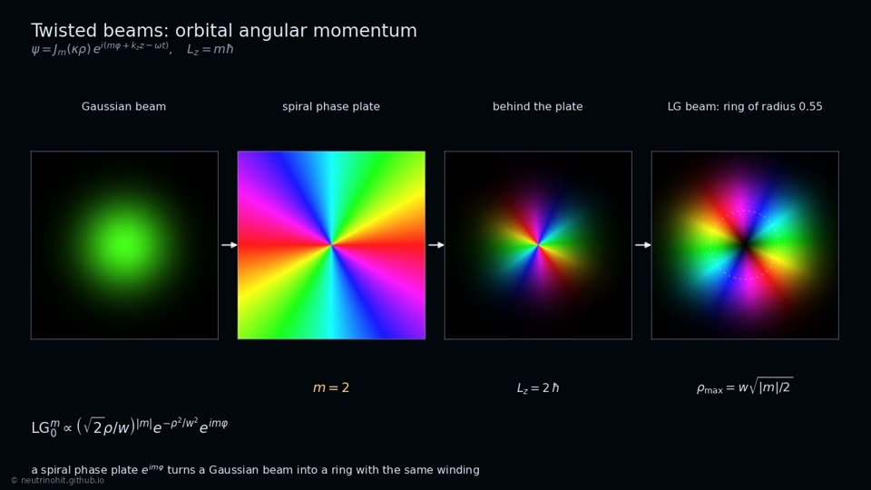<span class="anim-play" aria-hidden="true"></span></a></div>
        <h3 class="anim-title">Twisted beams: orbital angular momentum</h3>
        <p class="anim-text">The phase makes m turns around the axis, L_z = mħ; helical wavefronts with m starts; making the beam with a spiral phase plate (a Gaussian beam → a Laguerre–Gaussian mode). Two versions: Russian and English.</p>
        <div class="anim-chips"><a class="anim-chip is-current" href="../assets/animations/dvnanima/fields-waves-oam-beams-twisted-beams-en.mp4" data-play data-poster="../assets/animations/dvnanima/fields-waves-oam-beams-twisted-beams-en.jpg" title="MP4, 1.6 MB">EN</a><a class="anim-chip" href="../assets/animations/dvnanima/fields-waves-oam-beams-twisted-beams.mp4" data-play data-poster="../assets/animations/dvnanima/fields-waves-oam-beams-twisted-beams.jpg" title="MP4, 1.7 MB">RU</a></div>
      </article>
      <article class="anim-card" id="animation-fields-waves-circular-polarization">
        <div class="anim-media"><a class="anim-poster" href="../assets/animations/dvnanima/fields-waves-circular-polarization-helicity-en.mp4" data-play data-poster="../assets/animations/dvnanima/fields-waves-circular-polarization-helicity-en.jpg" aria-label="Play: Circular polarization">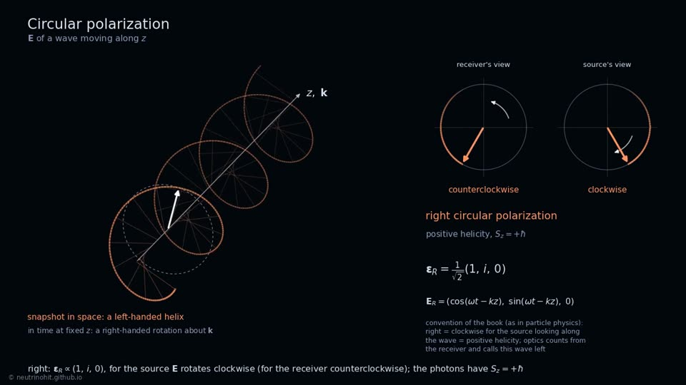<span class="anim-play" aria-hidden="true"></span></a></div>
        <h3 class="anim-title">Circular polarization</h3>
        <p class="anim-text">The rotation of E for the receiver and for the source, helicity S_z = ±ħ, an instantaneous snapshot in space (a left-handed screw) and the sum of ε_L and ε_R: linear, elliptical and circular polarizations. Two versions: Russian and English.</p>
        <div class="anim-chips"><a class="anim-chip is-current" href="../assets/animations/dvnanima/fields-waves-circular-polarization-helicity-en.mp4" data-play data-poster="../assets/animations/dvnanima/fields-waves-circular-polarization-helicity-en.jpg" title="MP4, 1.3 MB">EN</a><a class="anim-chip" href="../assets/animations/dvnanima/fields-waves-circular-polarization-helicity.mp4" data-play data-poster="../assets/animations/dvnanima/fields-waves-circular-polarization-helicity.jpg" title="MP4, 1.3 MB">RU</a></div>
      </article>
      <article class="anim-card" id="animation-fields-waves-meissner-photon-mass">
        <div class="anim-media"><a class="anim-poster" href="../assets/animations/dvnanima/fields-waves-meissner-photon-mass-film-en.mp4" data-play data-poster="../assets/animations/dvnanima/fields-waves-meissner-photon-mass-film-en.jpg" aria-label="Play: The Meissner effect and the photon mass">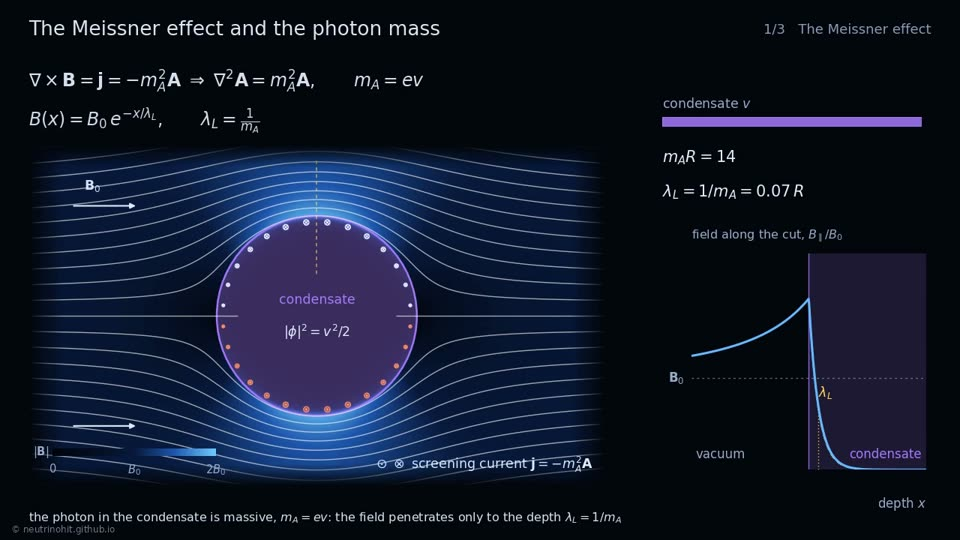<span class="anim-play" aria-hidden="true"></span></a></div>
        <h3 class="anim-title">The Meissner effect and the photon mass</h3>
        <p class="anim-text">The Higgs condensate expels the magnetic field (the Meissner effect); a packet of an electromagnetic wave is reflected from the boundary of the condensate or passes with the group velocity k/ω &lt; 1; the dispersion ω² = k² + m_A² and the count of polarizations 2 + 2 = 1 + 3.</p>
        <div class="anim-chips"><a class="anim-chip is-current" href="../assets/animations/dvnanima/fields-waves-meissner-photon-mass-film-en.mp4" data-play data-poster="../assets/animations/dvnanima/fields-waves-meissner-photon-mass-film-en.jpg" title="MP4, 3.2 MB">EN</a><a class="anim-chip" href="../assets/animations/dvnanima/fields-waves-meissner-photon-mass-film.mp4" data-play data-poster="../assets/animations/dvnanima/fields-waves-meissner-photon-mass-film.jpg" title="MP4, 3.2 MB">RU</a></div>
      </article>
      <article class="anim-card" id="animation-fields-waves-chiral-fermion-mass">
        <div class="anim-media"><a class="anim-poster" href="../assets/animations/dvnanima/fields-waves-chiral-fermion-mass-film-en.mp4" data-play data-poster="../assets/animations/dvnanima/fields-waves-chiral-fermion-mass-film-en.jpg" aria-label="Play: Chiral waves and the fermion mass">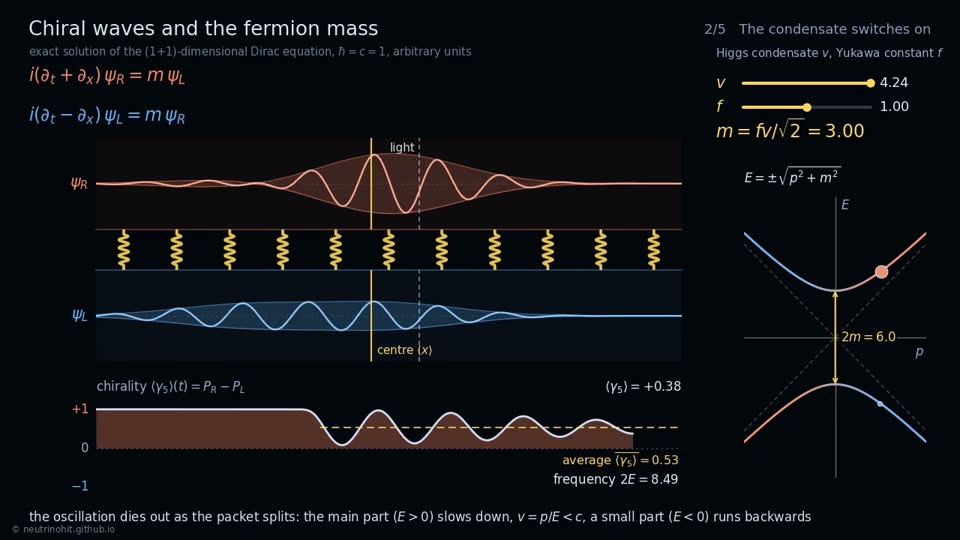<span class="anim-play" aria-hidden="true"></span></a></div>
        <h3 class="anim-title">Chiral waves and the fermion mass</h3>
        <p class="anim-text">Two chiral waves of the Dirac equation in (1+1) dimensions: the mass is the coupling of ψ_R and ψ_L through the Higgs condensate; chirality oscillations with frequency 2E, the packet slows down to p/E, the mass term forbidden in SU(2) and the Yukawa coupling.</p>
        <div class="anim-chips"><a class="anim-chip is-current" href="../assets/animations/dvnanima/fields-waves-chiral-fermion-mass-film-en.mp4" data-play data-poster="../assets/animations/dvnanima/fields-waves-chiral-fermion-mass-film-en.jpg" title="MP4, 2.0 MB">EN</a><a class="anim-chip" href="../assets/animations/dvnanima/fields-waves-chiral-fermion-mass-film.mp4" data-play data-poster="../assets/animations/dvnanima/fields-waves-chiral-fermion-mass-film.jpg" title="MP4, 2.0 MB">RU</a></div>
      </article>
      <article class="anim-card" id="animation-fields-waves-higgs-ff-spin">
        <div class="anim-media"><a class="anim-poster" href="../assets/animations/dvnanima/fields-waves-higgs-ff-spin-film-en.mp4" data-play data-poster="../assets/animations/dvnanima/fields-waves-higgs-ff-spin-film-en.jpg" aria-label="Play: Spin and orbital structure of the f f̄ pair in Higgs boson decays">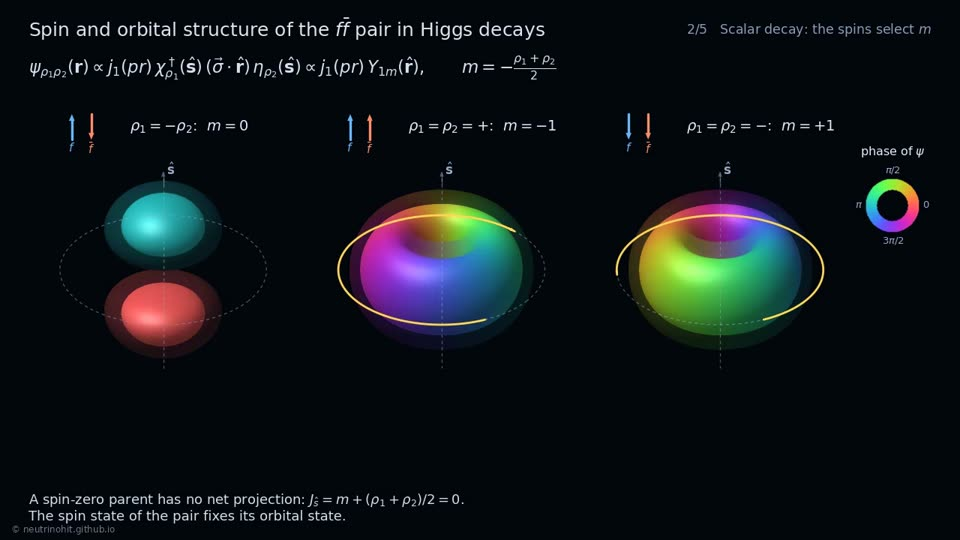<span class="anim-play" aria-hidden="true"></span></a></div>
        <h3 class="anim-title">Spin and orbital structure of the f f̄ pair in Higgs boson decays</h3>
        <p class="anim-text">The wave function of the f f̄ pair in the relative coordinate: the P-wave of a scalar decay (a vortex, the orbital projection m is chosen by the spins), the S-wave of a pseudoscalar, the tilt of the cloud from scalar–pseudoscalar interference (CP oddness) and what remains for the detector.</p>
        <div class="anim-chips"><a class="anim-chip is-current" href="../assets/animations/dvnanima/fields-waves-higgs-ff-spin-film-en.mp4" data-play data-poster="../assets/animations/dvnanima/fields-waves-higgs-ff-spin-film-en.jpg" title="MP4, 2.7 MB">EN</a><a class="anim-chip" href="../assets/animations/dvnanima/fields-waves-higgs-ff-spin-film.mp4" data-play data-poster="../assets/animations/dvnanima/fields-waves-higgs-ff-spin-film.jpg" title="MP4, 2.8 MB">RU</a></div>
      </article>
      <article class="anim-card" id="animation-fields-waves-quantum-tunneling">
        <div class="anim-media"><a class="anim-poster" href="../assets/animations/dvnanima/fields-waves-quantum-tunneling-film-en.mp4" data-play data-poster="../assets/animations/dvnanima/fields-waves-quantum-tunneling-film-en.jpg" aria-label="Play: Tunnelling: a point body and an extended one">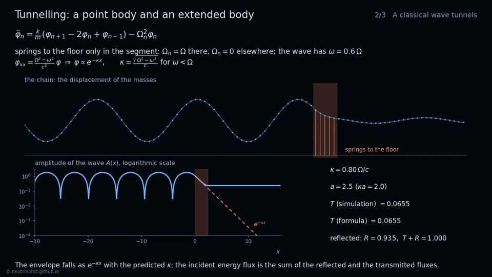<span class="anim-play" aria-hidden="true"></span></a></div>
        <h3 class="anim-title">Tunnelling: a point body and an extended one</h3>
        <p class="anim-text">A ball, a train and a wave: an extended body feels an averaged barrier; a classical wave on a chain tunnels through a segment with T ≈ exp(−2κa) without quanta; for a matter wave the equation is the same, κ = √(2m(V−E))/ħ, and T falls exponentially with mass.</p>
        <div class="anim-chips"><a class="anim-chip is-current" href="../assets/animations/dvnanima/fields-waves-quantum-tunneling-film-en.mp4" data-play data-poster="../assets/animations/dvnanima/fields-waves-quantum-tunneling-film-en.jpg" title="MP4, 3.6 MB">EN</a><a class="anim-chip" href="../assets/animations/dvnanima/fields-waves-quantum-tunneling-film.mp4" data-play data-poster="../assets/animations/dvnanima/fields-waves-quantum-tunneling-film.jpg" title="MP4, 3.6 MB">RU</a></div>
      </article>
      <article class="anim-card" id="animation-fields-waves-chiral-anomaly">
        <div class="anim-media"><a class="anim-poster" href="../assets/animations/dvnanima/fields-waves-chiral-anomaly-film-en.mp4" data-play data-poster="../assets/animations/dvnanima/fields-waves-chiral-anomaly-film-en.jpg" aria-label="Play: The chiral anomaly: where do particles come from?">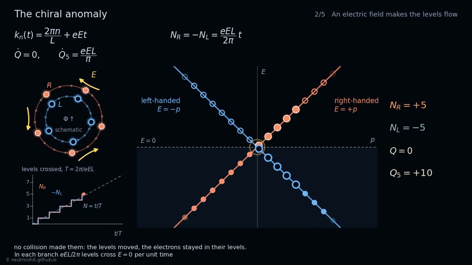<span class="anim-play" aria-hidden="true"></span></a></div>
        <h3 class="anim-title">The chiral anomaly: where do particles come from?</h3>
        <p class="anim-text">A massless fermion on a ring: an electric field shifts the levels, the levels cross E = 0 (the count gives dQ₅/dt = eEL/π); regularization and conservation of the vector current; Landau levels and e²E·B/2π²; the triangle and the decay π⁰ → γγ.</p>
        <div class="anim-chips"><a class="anim-chip is-current" href="../assets/animations/dvnanima/fields-waves-chiral-anomaly-film-en.mp4" data-play data-poster="../assets/animations/dvnanima/fields-waves-chiral-anomaly-film-en.jpg" title="MP4, 2.0 MB">EN</a><a class="anim-chip" href="../assets/animations/dvnanima/fields-waves-chiral-anomaly-film.mp4" data-play data-poster="../assets/animations/dvnanima/fields-waves-chiral-anomaly-film.jpg" title="MP4, 2.0 MB">RU</a></div>
      </article>
      <article class="anim-card" id="animation-fields-waves-gauge-principle">
        <div class="anim-media"><a class="anim-poster" href="../assets/animations/dvnanima/fields-waves-gauge-principle-film-en.mp4" data-play data-poster="../assets/animations/dvnanima/fields-waves-gauge-principle-film-en.jpg" aria-label="Play: The gauge principle: two friends and a field">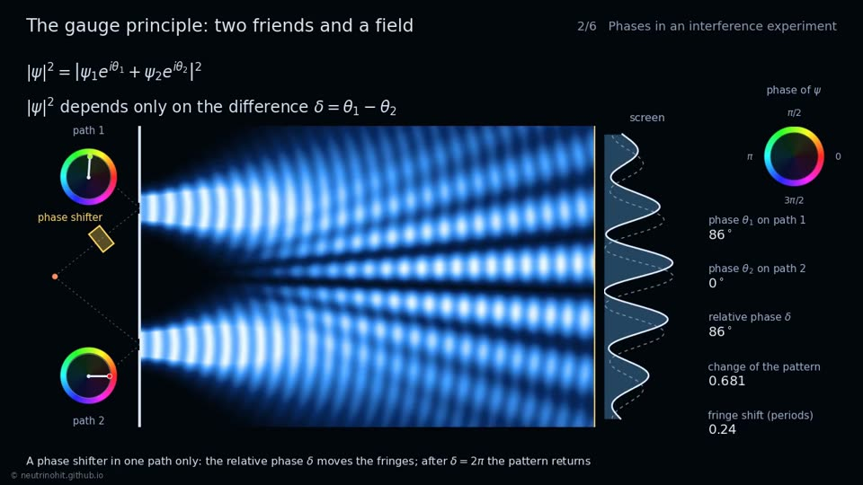<span class="anim-play" aria-hidden="true"></span></a></div>
        <h3 class="anim-title">The gauge principle: two friends and a field</h3>
        <p class="anim-text">Two friends choose the phase of the wave function independently at every point: interference, a free packet and the covariant derivative; the compensating field A_μ, the field strength F and the gauge-invariant loop.</p>
        <div class="anim-chips"><a class="anim-chip is-current" href="../assets/animations/dvnanima/fields-waves-gauge-principle-film-en.mp4" data-play data-poster="../assets/animations/dvnanima/fields-waves-gauge-principle-film-en.jpg" title="MP4, 1.6 MB">EN</a><a class="anim-chip" href="../assets/animations/dvnanima/fields-waves-gauge-principle-film.mp4" data-play data-poster="../assets/animations/dvnanima/fields-waves-gauge-principle-film.jpg" title="MP4, 1.6 MB">RU</a></div>
      </article>
    </div>
  </section>
  <section class="anim-section" id="relativity-atom-spin">
    <div class="anim-section-head">
      <span class="course-tile-status is-ready">8 stories · 16 videos</span>
      <h2>Relativity, the atom and spin</h2>
      <p>Animations for the book “Quantum Field Theory for Experimentalists and Beyond”: the relativistic image of a ball, the Rutherford experiment, a spinor and the Möbius strip.</p>
    </div>
    <div class="anim-grid">
      <article class="anim-card" id="animation-relativity-atom-spin-penrose-terrell">
        <div class="anim-media"><a class="anim-poster" href="../assets/animations/dvnanima/relativity-atom-spin-penrose-terrell-camera-en.mp4" data-play data-poster="../assets/animations/dvnanima/relativity-atom-spin-penrose-terrell-camera-en.jpg" aria-label="Play: Penrose–Terrell rotation">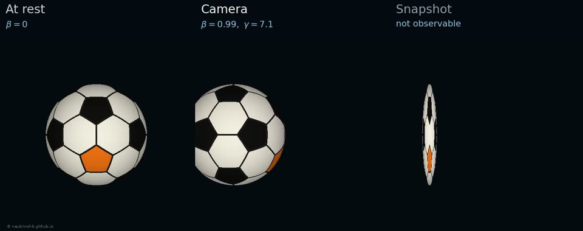<span class="anim-play" aria-hidden="true"></span></a></div>
        <h3 class="anim-title">Penrose–Terrell rotation</h3>
        <p class="anim-text">A football flies past a camera at 0.99 c. Ray tracing with retardation: the camera sees a round, rotated ball, while the instantaneous snapshot of the contracted ball cannot be observed.</p>
        <div class="anim-chips"><a class="anim-chip is-current" href="../assets/animations/dvnanima/relativity-atom-spin-penrose-terrell-camera-en.mp4" data-play data-poster="../assets/animations/dvnanima/relativity-atom-spin-penrose-terrell-camera-en.jpg" title="MP4, 527.6 KB">EN</a><a class="anim-chip" href="../assets/animations/dvnanima/relativity-atom-spin-penrose-terrell-camera.mp4" data-play data-poster="../assets/animations/dvnanima/relativity-atom-spin-penrose-terrell-camera.jpg" title="MP4, 522.5 KB">RU</a></div>
      </article>
      <article class="anim-card" id="animation-relativity-atom-spin-rutherford">
        <div class="anim-media"><a class="anim-poster" href="../assets/animations/dvnanima/relativity-atom-spin-rutherford-foil-en.mp4" data-play data-poster="../assets/animations/dvnanima/relativity-atom-spin-rutherford-foil-en.jpg" aria-label="Play: The Rutherford–Geiger–Marsden experiment">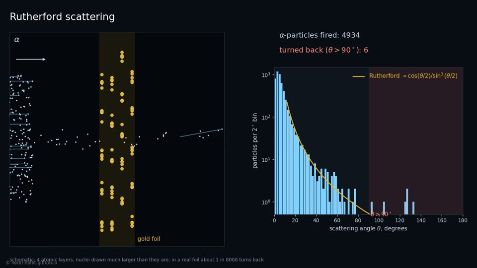<span class="anim-play" aria-hidden="true"></span></a></div>
        <h3 class="anim-title">The Rutherford–Geiger–Marsden experiment</h3>
        <p class="anim-text">Alpha particles in the Coulomb field of the nuclei of a thin foil: the trajectories are computed numerically and the angular distribution is compared with the Rutherford formula.</p>
        <div class="anim-chips"><a class="anim-chip is-current" href="../assets/animations/dvnanima/relativity-atom-spin-rutherford-foil-en.mp4" data-play data-poster="../assets/animations/dvnanima/relativity-atom-spin-rutherford-foil-en.jpg" title="MP4, 1.4 MB">EN</a><a class="anim-chip" href="../assets/animations/dvnanima/relativity-atom-spin-rutherford-foil.mp4" data-play data-poster="../assets/animations/dvnanima/relativity-atom-spin-rutherford-foil.jpg" title="MP4, 1.4 MB">RU</a></div>
      </article>
      <article class="anim-card" id="animation-relativity-atom-spin-spinor-mobius">
        <div class="anim-media"><a class="anim-poster" href="../assets/animations/dvnanima/relativity-atom-spin-spinor-mobius-strip-en.mp4" data-play data-poster="../assets/animations/dvnanima/relativity-atom-spin-spinor-mobius-strip-en.jpg" aria-label="Play: A spinor and the Möbius strip">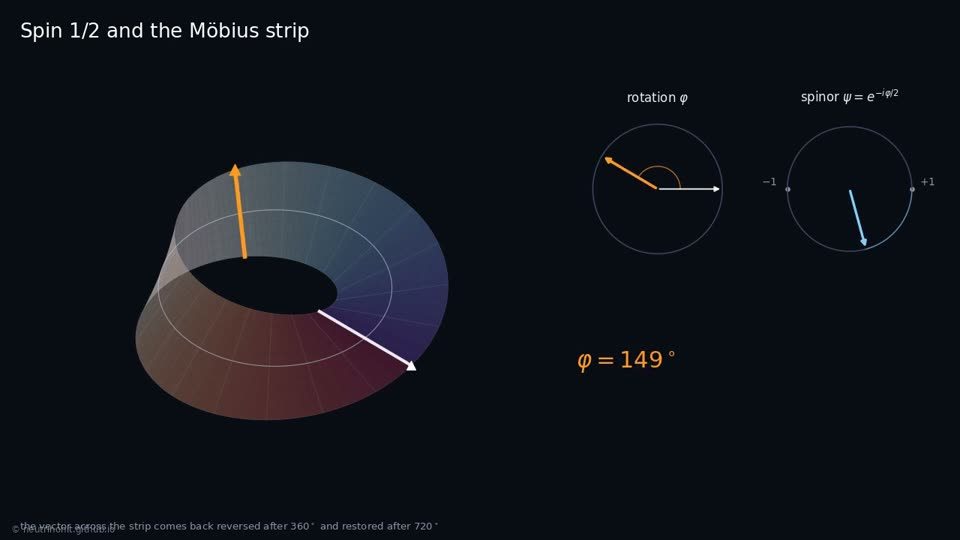<span class="anim-play" aria-hidden="true"></span></a></div>
        <h3 class="anim-title">A spinor and the Möbius strip</h3>
        <p class="anim-text">A rotation by 360° changes the sign of a spinor, a rotation by 720° brings it back: a vector on the Möbius strip and the component ψ = exp(−iφ/2).</p>
        <div class="anim-chips"><a class="anim-chip is-current" href="../assets/animations/dvnanima/relativity-atom-spin-spinor-mobius-strip-en.mp4" data-play data-poster="../assets/animations/dvnanima/relativity-atom-spin-spinor-mobius-strip-en.jpg" title="MP4, 1.1 MB">EN</a><a class="anim-chip" href="../assets/animations/dvnanima/relativity-atom-spin-spinor-mobius-strip.mp4" data-play data-poster="../assets/animations/dvnanima/relativity-atom-spin-spinor-mobius-strip.jpg" title="MP4, 1.1 MB">RU</a></div>
      </article>
      <article class="anim-card" id="animation-relativity-atom-spin-hulse-taylor">
        <div class="anim-media"><a class="anim-poster" href="../assets/animations/dvnanima/relativity-atom-spin-hulse-taylor-orbit-en.mp4" data-play data-poster="../assets/animations/dvnanima/relativity-atom-spin-hulse-taylor-orbit-en.jpg" aria-label="Play: The Hulse–Taylor binary pulsar">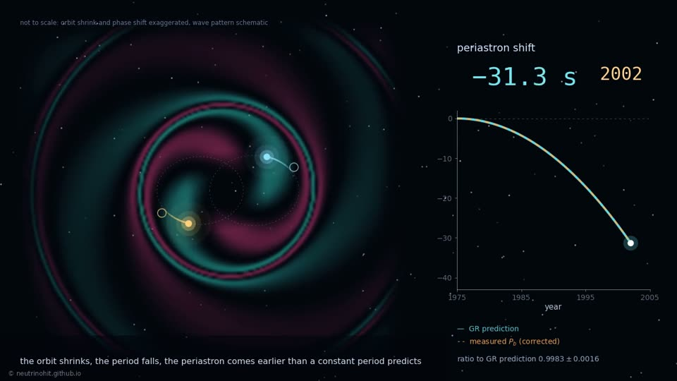<span class="anim-play" aria-hidden="true"></span></a></div>
        <h3 class="anim-title">The Hulse–Taylor binary pulsar</h3>
        <p class="anim-text">Two neutron stars on an eccentric orbit emit gravitational waves, the orbit shrinks and periastron comes ever earlier: the accumulated shift in general relativity and from the measured period derivative, 1975–2005.</p>
        <div class="anim-chips"><a class="anim-chip is-current" href="../assets/animations/dvnanima/relativity-atom-spin-hulse-taylor-orbit-en.mp4" data-play data-poster="../assets/animations/dvnanima/relativity-atom-spin-hulse-taylor-orbit-en.jpg" title="MP4, 1.6 MB">EN</a><a class="anim-chip" href="../assets/animations/dvnanima/relativity-atom-spin-hulse-taylor-orbit.mp4" data-play data-poster="../assets/animations/dvnanima/relativity-atom-spin-hulse-taylor-orbit.jpg" title="MP4, 1.6 MB">RU</a></div>
      </article>
      <article class="anim-card" id="animation-relativity-atom-spin-path-integral">
        <div class="anim-media"><a class="anim-poster" href="../assets/animations/dvnanima/relativity-atom-spin-path-integral-paths-en.mp4" data-play data-poster="../assets/animations/dvnanima/relativity-atom-spin-path-integral-paths-en.jpg" aria-label="Play: The path integral">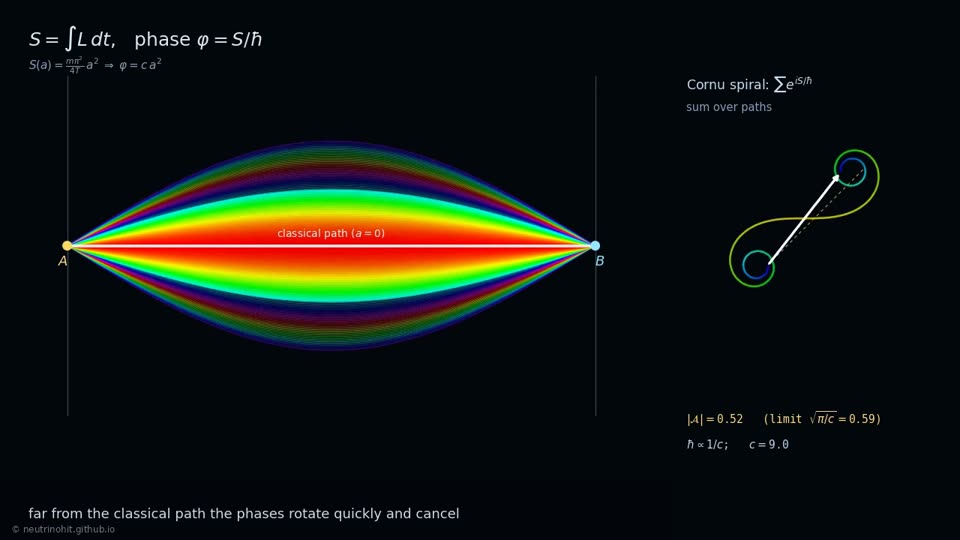<span class="anim-play" aria-hidden="true"></span></a></div>
        <h3 class="anim-title">The path integral</h3>
        <p class="anim-text">The amplitude as a sum over paths: screens with 3, 7 and 5 slits (105 paths), then all paths and the Cornu spiral, and the classical limit ħ → 0.</p>
        <div class="anim-chips"><a class="anim-chip is-current" href="../assets/animations/dvnanima/relativity-atom-spin-path-integral-paths-en.mp4" data-play data-poster="../assets/animations/dvnanima/relativity-atom-spin-path-integral-paths-en.jpg" title="MP4, 1.9 MB">EN</a><a class="anim-chip" href="../assets/animations/dvnanima/relativity-atom-spin-path-integral-paths.mp4" data-play data-poster="../assets/animations/dvnanima/relativity-atom-spin-path-integral-paths.jpg" title="MP4, 1.9 MB">RU</a></div>
      </article>
      <article class="anim-card" id="animation-relativity-atom-spin-simultaneity">
        <div class="anim-media"><a class="anim-poster" href="../assets/animations/dvnanima/relativity-atom-spin-simultaneity-minkowski-en.mp4" data-play data-poster="../assets/animations/dvnanima/relativity-atom-spin-simultaneity-minkowski-en.jpg" aria-label="Play: The relativity of simultaneity">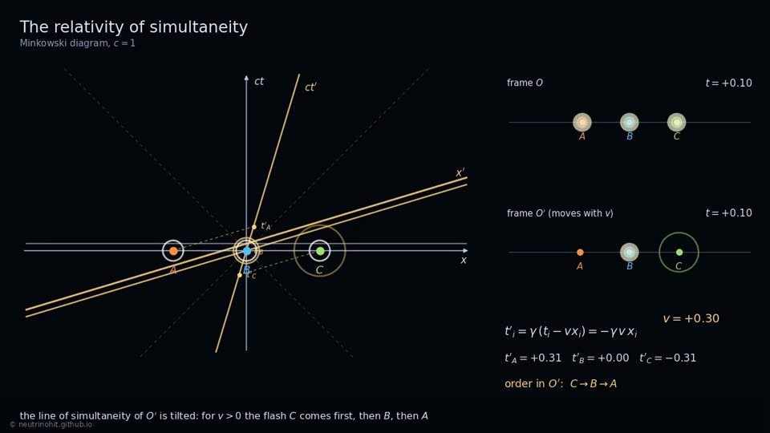<span class="anim-play" aria-hidden="true"></span></a></div>
        <h3 class="anim-title">The relativity of simultaneity</h3>
        <p class="anim-text">A Minkowski diagram: flashes A, B, C are simultaneous in O and come in the order C, B, A (v &gt; 0) or A, B, C (v &lt; 0) in O′; spacelike pairs change their order, timelike pairs never do. Two versions: Russian and English.</p>
        <div class="anim-chips"><a class="anim-chip is-current" href="../assets/animations/dvnanima/relativity-atom-spin-simultaneity-minkowski-en.mp4" data-play data-poster="../assets/animations/dvnanima/relativity-atom-spin-simultaneity-minkowski-en.jpg" title="MP4, 2.7 MB">EN</a><a class="anim-chip" href="../assets/animations/dvnanima/relativity-atom-spin-simultaneity-minkowski.mp4" data-play data-poster="../assets/animations/dvnanima/relativity-atom-spin-simultaneity-minkowski.jpg" title="MP4, 2.7 MB">RU</a></div>
      </article>
      <article class="anim-card" id="animation-relativity-atom-spin-wormhole-camera">
        <div class="anim-media"><a class="anim-poster" href="../assets/animations/dvnanima/relativity-atom-spin-wormhole-camera-camera-en.mp4" data-play data-poster="../assets/animations/dvnanima/relativity-atom-spin-wormhole-camera-camera-en.jpg" aria-label="Play: A camera at a wormhole">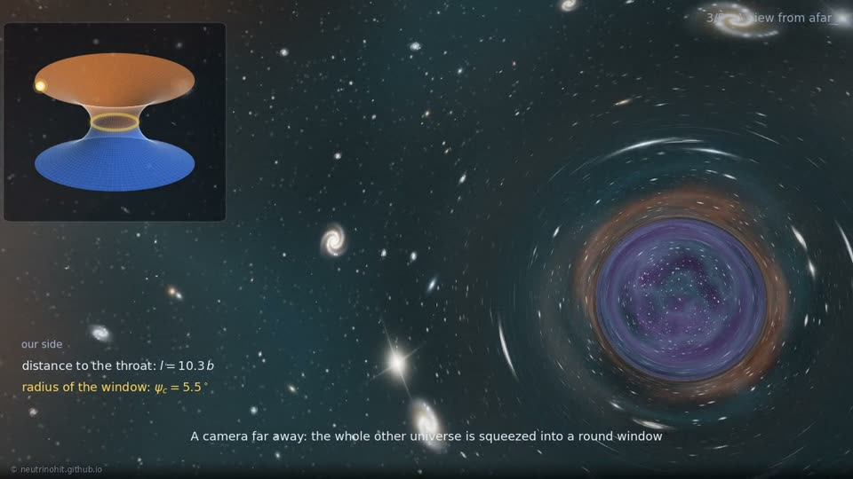<span class="anim-play" aria-hidden="true"></span></a></div>
        <h3 class="anim-title">A camera at a wormhole</h3>
        <p class="anim-text">The Morris–Thorne wormhole as a solution of the Einstein equations, light rays on its surface and the view from a camera that flies around the wormhole, passes through the throat and sees the light of the galaxies of both universes.</p>
        <div class="anim-chips"><a class="anim-chip is-current" href="../assets/animations/dvnanima/relativity-atom-spin-wormhole-camera-camera-en.mp4" data-play data-poster="../assets/animations/dvnanima/relativity-atom-spin-wormhole-camera-camera-en.jpg" title="MP4, 10.2 MB">EN</a><a class="anim-chip" href="../assets/animations/dvnanima/relativity-atom-spin-wormhole-camera-camera.mp4" data-play data-poster="../assets/animations/dvnanima/relativity-atom-spin-wormhole-camera-camera.jpg" title="MP4, 10.3 MB">RU</a></div>
      </article>
      <article class="anim-card" id="animation-relativity-atom-spin-black-hole-flyby">
        <div class="anim-media"><a class="anim-poster" href="../assets/animations/dvnanima/relativity-atom-spin-black-hole-flyby-flyby-en.mp4" data-play data-poster="../assets/animations/dvnanima/relativity-atom-spin-black-hole-flyby-flyby-en.jpg" aria-label="Play: A flight around a black hole">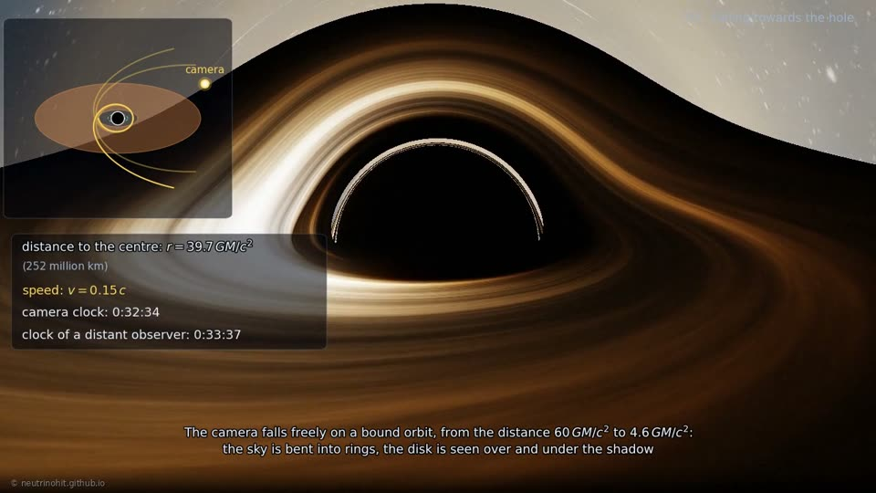<span class="anim-play" aria-hidden="true"></span></a></div>
        <h3 class="anim-title">A flight around a black hole</h3>
        <p class="anim-text">A camera falls freely on an orbit around a non-rotating black hole: light rays in the Schwarzschild metric, the shadow, the disk and its images, aberration and the frequency shift at a speed of 0.65c, the clocks of the camera and of a distant observer.</p>
        <div class="anim-chips"><a class="anim-chip is-current" href="../assets/animations/dvnanima/relativity-atom-spin-black-hole-flyby-flyby-en.mp4" data-play data-poster="../assets/animations/dvnanima/relativity-atom-spin-black-hole-flyby-flyby-en.jpg" title="MP4, 8.4 MB">EN</a><a class="anim-chip" href="../assets/animations/dvnanima/relativity-atom-spin-black-hole-flyby-flyby.mp4" data-play data-poster="../assets/animations/dvnanima/relativity-atom-spin-black-hole-flyby-flyby.jpg" title="MP4, 8.4 MB">RU</a></div>
      </article>
    </div>
  </section>
  <section class="anim-section" id="math-dynamical-systems">
    <div class="anim-section-head">
      <span class="course-tile-status is-ready">6 stories · 25 videos</span>
      <h2>Mathematics and dynamical systems</h2>
      <p>Fourier drawing, attractors, retrograde motion, spirals and complex powers.</p>
    </div>
    <div class="anim-grid">
      <article class="anim-card" id="animation-math-dynamical-systems-fourier-drawing">
        <div class="anim-media"><a class="anim-poster" href="../assets/animations/dvnanima/math-dynamical-systems-fourier-drawing-fourier-svg.mp4" data-play data-poster="../assets/animations/dvnanima/math-dynamical-systems-fourier-drawing-fourier-svg.jpg" aria-label="Play: Fourier drawing"><span class="anim-play" aria-hidden="true"></span></a></div>
        <h3 class="anim-title">Fourier drawing</h3>
        <p class="anim-text">Contours approximated by epicycles and Fourier series.</p>
        <div class="anim-chips"><a class="anim-chip is-current" href="../assets/animations/dvnanima/math-dynamical-systems-fourier-drawing-fourier-svg.mp4" data-play data-poster="../assets/animations/dvnanima/math-dynamical-systems-fourier-drawing-fourier-svg.jpg" title="MP4, 775.8 KB">Fourier SVG</a><a class="anim-chip" href="../assets/animations/dvnanima/math-dynamical-systems-fourier-drawing-pi.mp4" data-play data-poster="../assets/animations/dvnanima/math-dynamical-systems-fourier-drawing-pi.jpg" title="MP4, 794.5 KB">π</a><a class="anim-chip" href="../assets/animations/dvnanima/math-dynamical-systems-fourier-drawing-telescope.mp4" data-play data-poster="../assets/animations/dvnanima/math-dynamical-systems-fourier-drawing-telescope.jpg" title="MP4, 1.4 MB">Telescope</a><a class="anim-chip" href="../assets/animations/dvnanima/math-dynamical-systems-fourier-drawing-brain.mp4" data-play data-poster="../assets/animations/dvnanima/math-dynamical-systems-fourier-drawing-brain.jpg" title="MP4, 549.0 KB">Brain</a><a class="anim-chip" href="../assets/animations/dvnanima/math-dynamical-systems-fourier-drawing-dinosaur.mp4" data-play data-poster="../assets/animations/dvnanima/math-dynamical-systems-fourier-drawing-dinosaur.jpg" title="MP4, 1.4 MB">Dinosaur</a><a class="anim-chip" href="../assets/animations/dvnanima/math-dynamical-systems-fourier-drawing-woman-1.mp4" data-play data-poster="../assets/animations/dvnanima/math-dynamical-systems-fourier-drawing-woman-1.jpg" title="MP4, 745.3 KB">Portrait 1</a><a class="anim-chip" href="../assets/animations/dvnanima/math-dynamical-systems-fourier-drawing-woman-2.mp4" data-play data-poster="../assets/animations/dvnanima/math-dynamical-systems-fourier-drawing-woman-2.jpg" title="MP4, 858.3 KB">Portrait 2</a><a class="anim-chip" href="../assets/animations/dvnanima/math-dynamical-systems-fourier-drawing-woman-4.mp4" data-play data-poster="../assets/animations/dvnanima/math-dynamical-systems-fourier-drawing-woman-4.jpg" title="MP4, 929.4 KB">Portrait 4</a></div>
      </article>
      <article class="anim-card" id="animation-math-dynamical-systems-retrograde-motion">
        <div class="anim-media"><a class="anim-poster" href="../assets/animations/dvnanima/math-dynamical-systems-retrograde-motion-geocentric.mp4" data-play data-poster="../assets/animations/dvnanima/math-dynamical-systems-retrograde-motion-geocentric.jpg" aria-label="Play: Retrograde motion"><span class="anim-play" aria-hidden="true"></span></a></div>
        <h3 class="anim-title">Retrograde motion</h3>
        <p class="anim-text">The geocentric picture and epicycles for the planets.</p>
        <div class="anim-chips"><a class="anim-chip is-current" href="../assets/animations/dvnanima/math-dynamical-systems-retrograde-motion-geocentric.mp4" data-play data-poster="../assets/animations/dvnanima/math-dynamical-systems-retrograde-motion-geocentric.jpg" title="MP4, 955.8 KB">Geocentric path</a><a class="anim-chip" href="../assets/animations/dvnanima/math-dynamical-systems-retrograde-motion-mars.mp4" data-play data-poster="../assets/animations/dvnanima/math-dynamical-systems-retrograde-motion-mars.jpg" title="MP4, 727.2 KB">Mars</a><a class="anim-chip" href="../assets/animations/dvnanima/math-dynamical-systems-retrograde-motion-jupiter.mp4" data-play data-poster="../assets/animations/dvnanima/math-dynamical-systems-retrograde-motion-jupiter.jpg" title="MP4, 686.7 KB">Jupiter</a><a class="anim-chip" href="../assets/animations/dvnanima/math-dynamical-systems-retrograde-motion-saturn.mp4" data-play data-poster="../assets/animations/dvnanima/math-dynamical-systems-retrograde-motion-saturn.jpg" title="MP4, 747.5 KB">Saturn</a><a class="anim-chip" href="../assets/animations/dvnanima/math-dynamical-systems-retrograde-motion-mars-fourier.mp4" data-play data-poster="../assets/animations/dvnanima/math-dynamical-systems-retrograde-motion-mars-fourier.jpg" title="MP4, 1.1 MB">Mars: Fourier</a><a class="anim-chip" href="../assets/animations/dvnanima/math-dynamical-systems-retrograde-motion-saturn-fourier.mp4" data-play data-poster="../assets/animations/dvnanima/math-dynamical-systems-retrograde-motion-saturn-fourier.jpg" title="MP4, 1.3 MB">Saturn: Fourier</a><a class="anim-chip" href="../assets/animations/dvnanima/math-dynamical-systems-retrograde-motion-mars-card.mp4" data-play data-poster="../assets/animations/dvnanima/math-dynamical-systems-retrograde-motion-mars-card.jpg" title="MP4, 144.2 KB">Mars card</a><a class="anim-chip" href="../assets/animations/dvnanima/math-dynamical-systems-retrograde-motion-jupiter-card.mp4" data-play data-poster="../assets/animations/dvnanima/math-dynamical-systems-retrograde-motion-jupiter-card.jpg" title="MP4, 89.8 KB">Jupiter card</a><a class="anim-chip" href="../assets/animations/dvnanima/math-dynamical-systems-retrograde-motion-saturn-card.mp4" data-play data-poster="../assets/animations/dvnanima/math-dynamical-systems-retrograde-motion-saturn-card.jpg" title="MP4, 364.2 KB">Saturn card</a></div>
      </article>
      <article class="anim-card" id="animation-math-dynamical-systems-strange-attractors">
        <div class="anim-media"><a class="anim-poster" href="../assets/animations/dvnanima/math-dynamical-systems-strange-attractors-lorenz.mp4" data-play data-poster="../assets/animations/dvnanima/math-dynamical-systems-strange-attractors-lorenz.jpg" aria-label="Play: Strange attractors"><span class="anim-play" aria-hidden="true"></span></a></div>
        <h3 class="anim-title">Strange attractors</h3>
        <p class="anim-text">Classical dynamical systems in phase space.</p>
        <div class="anim-chips"><a class="anim-chip is-current" href="../assets/animations/dvnanima/math-dynamical-systems-strange-attractors-lorenz.mp4" data-play data-poster="../assets/animations/dvnanima/math-dynamical-systems-strange-attractors-lorenz.jpg" title="MP4, 1.4 MB">Lorenz</a><a class="anim-chip" href="../assets/animations/dvnanima/math-dynamical-systems-strange-attractors-aizawa.mp4" data-play data-poster="../assets/animations/dvnanima/math-dynamical-systems-strange-attractors-aizawa.jpg" title="MP4, 1.1 MB">Aizawa</a><a class="anim-chip" href="../assets/animations/dvnanima/math-dynamical-systems-strange-attractors-rossler.mp4" data-play data-poster="../assets/animations/dvnanima/math-dynamical-systems-strange-attractors-rossler.jpg" title="MP4, 682.2 KB">Rössler</a><a class="anim-chip" href="../assets/animations/dvnanima/math-dynamical-systems-strange-attractors-thomas.mp4" data-play data-poster="../assets/animations/dvnanima/math-dynamical-systems-strange-attractors-thomas.jpg" title="MP4, 1.7 MB">Thomas</a><a class="anim-chip" href="../assets/animations/dvnanima/math-dynamical-systems-strange-attractors-dadras.mp4" data-play data-poster="../assets/animations/dvnanima/math-dynamical-systems-strange-attractors-dadras.jpg" title="MP4, 1.3 MB">Dadras</a></div>
      </article>
      <article class="anim-card" id="animation-math-dynamical-systems-riemann-zeta">
        <div class="anim-media"><a class="anim-poster" href="../assets/animations/dvnanima/math-dynamical-systems-riemann-zeta-zeta.mp4" data-play data-poster="../assets/animations/dvnanima/math-dynamical-systems-riemann-zeta-zeta.jpg" aria-label="Play: The Riemann zeta spiral"><span class="anim-play" aria-hidden="true"></span></a></div>
        <h3 class="anim-title">The Riemann zeta spiral</h3>
        <p class="anim-text">The path of the values of the zeta function in the complex plane.</p>
      </article>
      <article class="anim-card" id="animation-math-dynamical-systems-pi-day-spiral">
        <div class="anim-media"><a class="anim-poster" href="../assets/animations/dvnanima/math-dynamical-systems-pi-day-spiral-spiral.mp4" data-play data-poster="../assets/animations/dvnanima/math-dynamical-systems-pi-day-spiral-spiral.jpg" aria-label="Play: The spiral of π"><span class="anim-play" aria-hidden="true"></span></a></div>
        <h3 class="anim-title">The spiral of π</h3>
        <p class="anim-text">The digits of π gathered into a short spiral visualization.</p>
      </article>
      <article class="anim-card" id="animation-math-dynamical-systems-imaginary-powers">
        <div class="anim-media"><a class="anim-poster" href="../assets/animations/dvnanima/math-dynamical-systems-imaginary-powers-imaginary-power.mp4" data-play data-poster="../assets/animations/dvnanima/math-dynamical-systems-imaginary-powers-imaginary-power.jpg" aria-label="Play: Complex powers"><span class="anim-play" aria-hidden="true"></span></a></div>
        <h3 class="anim-title">Complex powers</h3>
        <p class="anim-text">A visual story about the powers of the imaginary unit and motion in the complex plane.</p>
      </article>
    </div>
  </section>
  <section class="anim-section" id="accelerator-optics">
    <div class="anim-section-head">
      <span class="course-tile-status is-ready">4 stories · 4 videos</span>
      <h2>Accelerators and magnetic optics</h2>
      <p>How dipoles, quadrupoles and sextupoles steer and hold a particle beam.</p>
    </div>
    <div class="anim-grid">
      <article class="anim-card" id="animation-accelerator-optics-dipole">
        <div class="anim-media"><a class="anim-poster" href="../assets/animations/dvnanima/accelerator-optics-dipole-dipole.mp4" data-play data-poster="../assets/animations/dvnanima/accelerator-optics-dipole-dipole.jpg" aria-label="Play: Dipole: turning a particle"><span class="anim-play" aria-hidden="true"></span></a></div>
        <h3 class="anim-title">Dipole: turning a particle</h3>
        <p class="anim-text">Why a magnet turns a particle but does not increase its energy.</p>
      </article>
      <article class="anim-card" id="animation-accelerator-optics-quadrupole">
        <div class="anim-media"><a class="anim-poster" href="../assets/animations/dvnanima/accelerator-optics-quadrupole-quadrupole.mp4" data-play data-poster="../assets/animations/dvnanima/accelerator-optics-quadrupole-quadrupole.jpg" aria-label="Play: Quadrupole: a magnetic lens"><span class="anim-play" aria-hidden="true"></span></a></div>
        <h3 class="anim-title">Quadrupole: a magnetic lens</h3>
        <p class="anim-text">How alternating quadrupoles hold the beam in both planes at once.</p>
      </article>
      <article class="anim-card" id="animation-accelerator-optics-sextupole">
        <div class="anim-media"><a class="anim-poster" href="../assets/animations/dvnanima/accelerator-optics-sextupole-sextupole.mp4" data-play data-poster="../assets/animations/dvnanima/accelerator-optics-sextupole-sextupole.jpg" aria-label="Play: Sextupole: a correction for different momenta"><span class="anim-play" aria-hidden="true"></span></a></div>
        <h3 class="anim-title">Sextupole: a correction for different momenta</h3>
        <p class="anim-text">Why one quadrupole is not enough and how a sextupole corrects the momentum error.</p>
      </article>
      <article class="anim-card" id="animation-accelerator-optics-ring">
        <div class="anim-media"><a class="anim-poster" href="../assets/animations/dvnanima/accelerator-optics-ring-ring.mp4" data-play data-poster="../assets/animations/dvnanima/accelerator-optics-ring-ring.jpg" aria-label="Play: Building a storage ring"><span class="anim-play" aria-hidden="true"></span></a></div>
        <h3 class="anim-title">Building a storage ring</h3>
        <p class="anim-text">Dipoles, quadrupoles and sextupoles step by step, and then a full turn of the beam around the ring.</p>
      </article>
    </div>
  </section>
  <section class="anim-section" id="visual-stories">
    <div class="anim-section-head">
      <span class="course-tile-status is-ready">3 stories · 4 videos</span>
      <h2>Visual stories</h2>
      <p>Short stand-alone animations and popular-science visual stories.</p>
    </div>
    <div class="anim-grid">
      <article class="anim-card" id="animation-visual-stories-rose-eight">
        <div class="anim-media"><a class="anim-poster" href="../assets/animations/dvnanima/visual-stories-rose-eight-rose-eight.mp4" data-play data-poster="../assets/animations/dvnanima/visual-stories-rose-eight-rose-eight.jpg" aria-label="Play: Eight roses"><span class="anim-play" aria-hidden="true"></span></a></div>
        <h3 class="anim-title">Eight roses</h3>
        <p class="anim-text">A parametric rose and a short festive film.</p>
      </article>
      <article class="anim-card" id="animation-visual-stories-barkov">
        <div class="anim-media"><a class="anim-poster" href="../assets/animations/dvnanima/visual-stories-barkov-star-wind.mp4" data-play data-poster="../assets/animations/dvnanima/visual-stories-barkov-star-wind.jpg" aria-label="Play: A star, a wind and a cloud"><span class="anim-play" aria-hidden="true"></span></a></div>
        <h3 class="anim-title">A star, a wind and a cloud</h3>
        <p class="anim-text">Astrophysical films; the animations were provided by M. V. Barkov.</p>
        <div class="anim-chips"><a class="anim-chip is-current" href="../assets/animations/dvnanima/visual-stories-barkov-star-wind.mp4" data-play data-poster="../assets/animations/dvnanima/visual-stories-barkov-star-wind.jpg" title="MP4, 1.9 MB">Star + Wind</a><a class="anim-chip" href="../assets/animations/dvnanima/visual-stories-barkov-star-jet-cloud.mp4" data-play data-poster="../assets/animations/dvnanima/visual-stories-barkov-star-jet-cloud.jpg" title="MP4, 4.0 MB">Star Jet + Cloud</a></div>
      </article>
      <article class="anim-card" id="animation-visual-stories-galaxy-merger">
        <div class="anim-media"><a class="anim-poster" href="../assets/animations/dvnanima/visual-stories-galaxy-merger-merger.mp4" data-play data-poster="../assets/animations/dvnanima/visual-stories-galaxy-merger-merger.jpg" aria-label="Play: A galaxy merger"><span class="anim-play" aria-hidden="true"></span></a></div>
        <h3 class="anim-title">A galaxy merger</h3>
        <p class="anim-text">The collision of two disk galaxies in a restricted N-body problem with dynamical friction: tidal bridges and tails, then a rounded remnant. A calculation in the spirit of the 1972 paper by Alar and Juri Toomre.</p>
      </article>
    </div>
  </section>
</div>
<script>
document.addEventListener('click', function (event) {
  var text = event.target.closest('.anim-text');
  if (text) { text.closest('.anim-card').classList.add('is-open'); return; }
  var link = event.target.closest('.anim-card [data-play]');
  if (!link) return;
  event.preventDefault();
  var card = link.closest('.anim-card');
  var media = card.querySelector('.anim-media');
  document.querySelectorAll('.anim-media video').forEach(function (v) { v.pause(); });
  var video = document.createElement('video');
  video.controls = true; video.playsInline = true; video.autoplay = true; video.preload = 'auto';
  if (link.dataset.poster) video.poster = link.dataset.poster;
  video.src = link.getAttribute('href');
  media.replaceChildren(video);
  card.classList.add('is-open');
  card.querySelectorAll('.anim-chip').forEach(function (chip) {
    chip.classList.toggle('is-current', chip.getAttribute('href') === link.getAttribute('href'));
  });
});
</script>
<link rel="stylesheet" href="https://cdn.jsdelivr.net/npm/katex@0.16.11/dist/katex.min.css">
<script defer src="https://cdn.jsdelivr.net/npm/katex@0.16.11/dist/katex.min.js"></script>
<script defer src="https://cdn.jsdelivr.net/npm/katex@0.16.11/dist/contrib/auto-render.min.js"
 onload="renderMathInElement(document.body,{delimiters:[{left:'$$',right:'$$',display:true},{left:'$',right:'$',display:false}],throwOnError:false})"></script>
```
