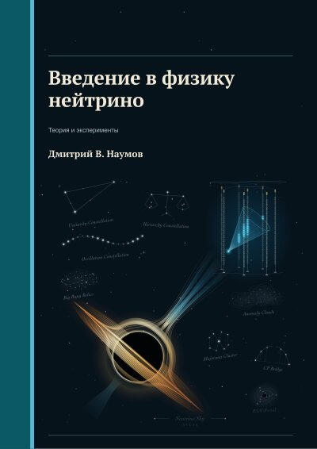
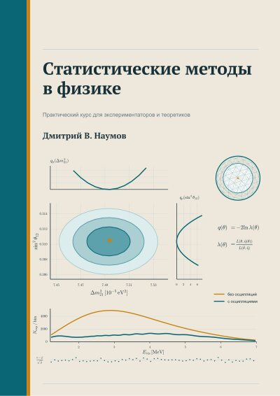
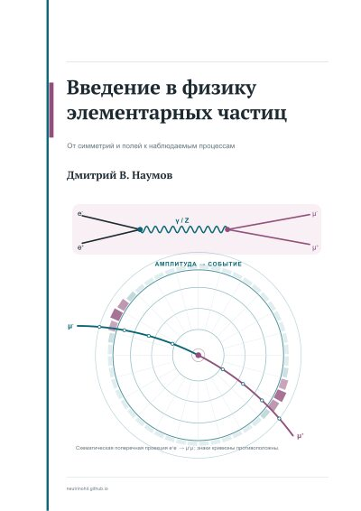
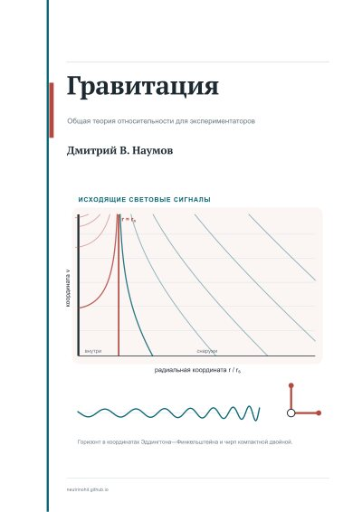
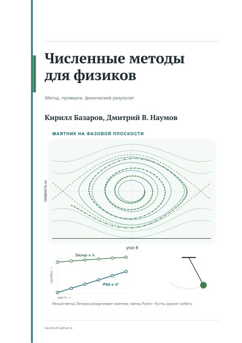

```{=html}
<div class="lecture-catalog">
  <p class="lecture-catalog-lead">
    NeutrinoHit books: published editions and books in progress.
  </p>

  <nav class="course-tiles" aria-label="Books">
    <div class="course-tile"><span class="course-tile-status is-ready">Textbook · 2 volumes · Russian</span><a class="course-tile-title" href="#qft-book">Quantum Field Theory for Experimentalists and Beyond</a><span class="course-tile-text">From the foundations to renormalization, anomalies and functional integrals, with problems.</span><span class="course-tile-meta">IKI, 2026 · <a class="course-tile-book" href="../qr/qft/">38 animations for the book online</a></span></div>
    <div class="course-tile"><span class="course-tile-status is-ready">Popular science · Russian</span><a class="course-tile-title" href="#solar-neutrino-book">Solar Neutrino</a><span class="course-tile-text">A children’s book about neutrinos, the Sun and the big physics of tiny particles.</span><span class="course-tile-meta">AVANTA/AST, 2023</span></div>
    <div class="course-tile"><span class="course-tile-status">In progress</span><a class="course-tile-title" href="#neutrino-physics-book">Introduction to Neutrino Physics</a><span class="course-tile-text">Theory and experiments.</span><span class="course-tile-meta"><a class="course-tile-book" href="../qr/neutrino-physics/">56 QR items</a></span></div>
    <div class="course-tile"><span class="course-tile-status">In progress</span><a class="course-tile-title" href="#statistics-book">Statistical Methods in Physics</a><span class="course-tile-text">A practical course for experimentalists and theorists.</span></div>
    <div class="course-tile"><span class="course-tile-status">In progress</span><a class="course-tile-title" href="#particle-physics-book">Introduction to Particle Physics</a><span class="course-tile-text">From symmetries and fields to observable processes.</span><span class="course-tile-meta"><a class="course-tile-book" href="../qr/particle-physics/">28 animations</a></span></div>
    <div class="course-tile"><span class="course-tile-status">In progress</span><a class="course-tile-title" href="#gravity-book">Gravity</a><span class="course-tile-text">General relativity for experimentalists.</span><span class="course-tile-meta"><a class="course-tile-book" href="../qr/gravity/">6 animations</a></span></div>
    <div class="course-tile"><span class="course-tile-status">In progress</span><a class="course-tile-title" href="#numerical-methods-book">Numerical Methods for Physicists</a><span class="course-tile-text">Method, check, physical result.</span></div>
  </nav>

  <section id="qft-book" class="book-showcase" aria-label="Quantum Field Theory for Experimentalists and Beyond">
    <div class="book-showcase-covers">
      
      
    </div>
    <div class="book-showcase-body">
      <span class="course-tile-status is-ready">Textbook · published in Russian</span>
      <h2>Quantum Field Theory for Experimentalists and Beyond</h2>
      <p>A textbook of quantum field theory for theorists and experimentalists, from the foundations to renormalization, anomalies and functional integrals, with emphasis on the connection to experiment, with problems and QR codes leading to animations.</p>
      <dl class="book-showcase-facts">
        <dt>Russian edition</dt>
        <dd>«Квантовая теория поля для экспериментаторов и не только», two volumes, Izhevsk: IKI, 2026, hardcover; vol. 1, 534 pp., vol. 2, 514 pp. ISBN <span class="nowrap">978-5-4344-1081-6</span> (vol. 1), <span class="nowrap">978-5-4344-1082-3</span> (vol. 2).</dd>
        <dt>Problems</dt>
        <dd>346 problems: 189 in vol. 1, 157 in vol. 2.</dd>
        <dt>English edition</dt>
        <dd>An English edition is in preparation.</dd>
        <dt>With the book</dt>
        <dd><a href="../qr/qft/">animations behind the QR codes</a> · <a href="qft-exams.html">examination projects</a> · <a href="qft-faq.html">QFT FAQ</a> · <a href="education.html#qft-course">QFT video courses (Russian)</a></dd>
      </dl>
      <div class="lecture-course-actions">
        <a class="lecture-action-primary" href="https://shop.rcd.ru/catalog/fizika/20042/">Buy vol. 1 (Russia)</a>
        <a class="lecture-action-primary" href="https://shop.rcd.ru/catalog/fizika/20097/">Buy vol. 2 (Russia)</a>
        <a href="https://rospexpublishing.com/books/qft-bundle.html?utm_source=neutrinohit&amp;utm_medium=website&amp;utm_campaign=qft_book">ROSPEX: both volumes</a>
        <a href="https://play.google.com/store/books/details?id=uLXTEQAAQBAJ">Google Play: vol. 1</a>
        <a href="https://play.google.com/store/books/details?id=KrbTEQAAQBAJ">Google Play: vol. 2</a>
      </div>
    </div>
  </section>

  <h2 class="section-inline-title">Other books</h2>
  <section class="lecture-course-list" aria-label="Books catalog">
    <div id="solar-neutrino-book" class="lecture-course book-course-solar">
      <div class="lecture-course-head">
        <span class="lecture-course-status">Popular science · published in Russian</span>
        <span class="lecture-course-title">Solar Neutrino</span>
      </div>
      <div class="lecture-course-body book-course-with-cover">
        <a class="book-cover-single" href="https://ast.ru/book/solnechnoe-neytrino-862573/">
          
        </a>
        <div>
          <p>A popular-science book for children about neutrinos, the Sun, and the big physics of tiny particles. The book is in Russian.</p>
          <div class="lecture-course-actions">
            <a class="lecture-action-primary" href="https://ast.ru/book/solnechnoe-neytrino-862573/">Buy from AST</a>
            <a href="https://www.chitai-gorod.ru/product/solnechnoe-neytrino-2917314">Chitai-gorod</a>
            <a href="https://market.yandex.ru/product/93685330">Yandex Market</a>
            <a href="https://www.podpisnie.ru/books/solnechnoe-neytrino/">Podpisnye izdaniya</a>
            <a href="https://www.litres.ru/book/d-v-naumov/solnechnoe-neytrino-70957876/">LitRes: e-book</a>
          </div>
        </div>
      </div>
    </div>
  </section>

  <h2 id="books-in-progress" class="section-inline-title">Books in progress</h2>
  <p class="book-wip-lead">Textbooks for the NeutrinoHit courses, in preparation for print.</p>
  <section class="book-wip-grid" aria-label="Books in progress">
    <article id="neutrino-physics-book" class="book-wip">
      
      <div class="book-wip-body">
        <span class="course-tile-status">In progress</span>
        <h3>Introduction to Neutrino Physics</h3>
        <p class="book-wip-sub">Theory and experiments</p>
        <div class="book-wip-links"><a href="courses/neutrino-introduction.html">Course</a> · <a href="../qr/neutrino-physics/">QR materials</a></div>
      </div>
    </article>
    <article id="statistics-book" class="book-wip">
      
      <div class="book-wip-body">
        <span class="course-tile-status">In progress</span>
        <h3>Statistical Methods in Physics</h3>
        <p class="book-wip-sub">A practical course for experimentalists and theorists</p>
        <div class="book-wip-links"><a href="courses/statistical-analysis.html">Course</a></div>
      </div>
    </article>
    <article id="particle-physics-book" class="book-wip">
      
      <div class="book-wip-body">
        <span class="course-tile-status">In progress</span>
        <h3>Introduction to Particle Physics</h3>
        <p class="book-wip-sub">From symmetries and fields to observable processes</p>
        <div class="book-wip-links"><a href="courses/particle-physics.html">Course</a> · <a href="../qr/particle-physics/">QR materials</a></div>
      </div>
    </article>
    <article id="gravity-book" class="book-wip">
      
      <div class="book-wip-body">
        <span class="course-tile-status">In progress</span>
        <h3>Gravity</h3>
        <p class="book-wip-sub">General relativity for experimentalists</p>
        <div class="book-wip-links"><a href="courses/gravity.html">Course</a> · <a href="../qr/gravity/">QR materials</a></div>
      </div>
    </article>
    <article id="numerical-methods-book" class="book-wip">
      
      <div class="book-wip-body">
        <span class="course-tile-status">In progress</span>
        <h3>Numerical Methods for Physicists</h3>
        <p class="book-wip-sub">Method, check, physical result</p>
        <p class="book-wip-authors">K. Bazarov, D. V. Naumov</p>
        <div class="book-wip-links"><a href="courses/numerical-methods.html">Course</a></div>
      </div>
    </article>
  </section>
</div>
```
