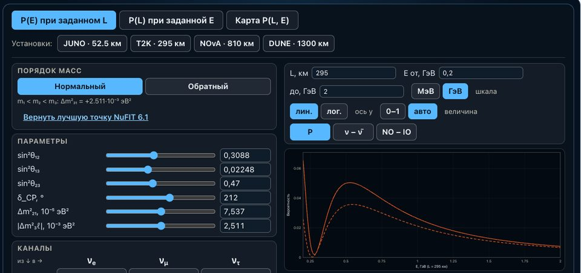

```{=html}
<div class="lecture-catalog outreach-catalog">
  <p class="lecture-catalog-lead">Software and physical models; scientific animations and interactives have tabs of their own. A title opens the material; the other links are next to it.</p>
  <div class="outreach-list">
    <div class="outreach-group" id="code">
      <div class="outreach-group-head">
        <span class="course-tile-status is-ready">Software and models</span>
        <h2 class="outreach-group-name">Code</h2>
      </div>
      <ul class="outreach-entries is-stacked">
        <li class="outreach-entry" id="lighthit"><span class="outreach-entry-main"><a class="outreach-entry-title" href="https://pypi.org/project/lighthit/" rel="noopener">LightHit</a><span class="outreach-entry-note">a Python package on PyPI: the expected number of photoelectrons that Cherenkov light of charged particles, or a calibration flash, produces in every optical module of a neutrino telescope, per time bin; spectral radiative transfer instead of photon-by-photon Monte Carlo, direct, once-scattered and multiply scattered light kept separate. Python 3.11 or newer; check the installation with lighthit-selftest</span><code class="outreach-entry-install">python -m pip install &#x27;lighthit[accelerate]&#x27;</code></span><span class="outreach-formats" aria-label="Formats"><a class="outreach-format is-pypi" href="https://pypi.org/project/lighthit/" rel="noopener">PyPI</a><a class="outreach-format is-docs" href="https://github.com/NeutrinoHit/LightHit/tree/main/docs" rel="noopener">Documentation</a><a class="outreach-format is-code" href="https://github.com/NeutrinoHit/LightHit" rel="noopener">Code</a></span></li>
        <li class="outreach-entry" id="tdse-diffraction"><span class="outreach-entry-main"><a class="outreach-entry-title" href="https://github.com/NeutrinoHit/TDSE-Diffraction" rel="noopener">TDSE-Diffraction</a><span class="outreach-entry-note">electron diffraction: split-step Fourier method in SI units, vortex beams, notebooks with animations</span></span><span class="outreach-formats" aria-label="Formats"><a class="outreach-format is-code" href="https://github.com/NeutrinoHit/TDSE-Diffraction" rel="noopener">Code</a></span></li>
        <li class="outreach-entry" id="neutrino-nucleus-coherence"><span class="outreach-entry-main"><a class="outreach-entry-title" href="https://github.com/NeutrinoHit/neutrino-nucleus-coherence" rel="noopener">neutrino-nucleus-coherence</a><span class="outreach-entry-note">the cross-section of neutrino–nucleus elastic scattering, a Jupyter notebook</span></span><span class="outreach-formats" aria-label="Formats"><a class="outreach-format is-code" href="https://github.com/NeutrinoHit/neutrino-nucleus-coherence" rel="noopener">Code</a></span></li>
        <li class="outreach-entry" id="gtracker"><span class="outreach-entry-main"><a class="outreach-entry-title" href="https://github.com/NeutrinoHit/gTracker" rel="noopener">gTracker</a><span class="outreach-entry-note">an animated map of applications by city and date from a table, exported as GIF and MP4</span></span><span class="outreach-formats" aria-label="Formats"><a class="outreach-format is-code" href="https://github.com/NeutrinoHit/gTracker" rel="noopener">Code</a></span></li>
      </ul>
    </div>
    <div class="outreach-group" id="animations">
      <div class="outreach-group-head">
        <span class="course-tile-status is-ready">Tabs</span>
        <h2 class="outreach-group-name">Animations and interactives</h2>
      </div>
      <nav class="course-tiles outreach-tiles" aria-label="Animations and interactives">
        <div class="course-tile has-cover"><span class="course-tile-status is-ready">74 stories · 148 videos</span><a class="course-tile-title" href="../en/animations.html">Animations</a><span class="course-tile-text">Scientific animations by topic; a video plays right on the page.</span></div>
        <div class="course-tile has-cover"><span class="course-tile-status is-ready">84 interactives</span><a class="course-tile-title" href="../en/interactives.html">Interactives</a><span class="course-tile-text">Applets and fits from the courses: neutrino oscillations, KATRIN, statistics and more.</span></div>
      </nav>
    </div>
  </div>
</div>
```
