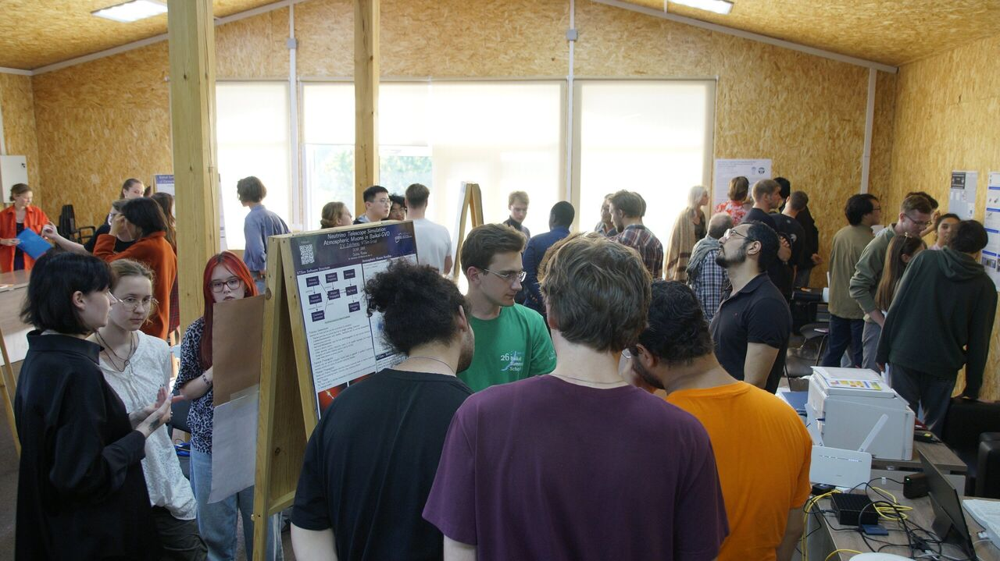
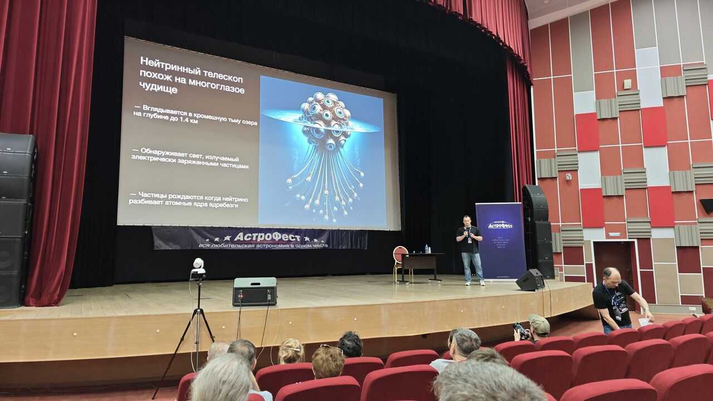
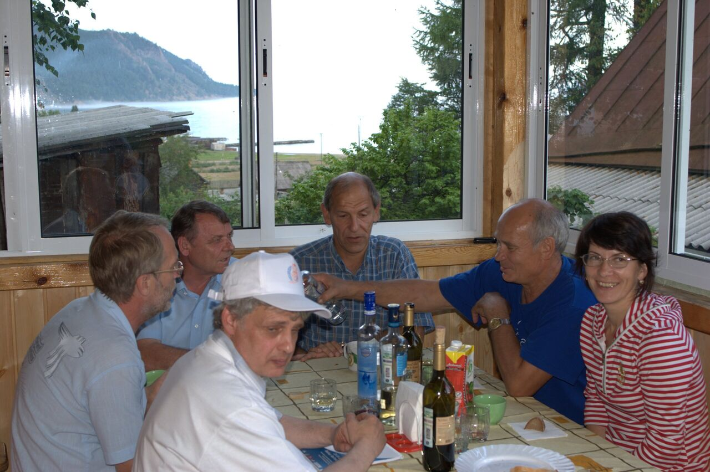

```{=html}
<div class="lecture-catalog outreach-catalog">
  <p class="lecture-catalog-lead">Photo albums of scientific life: lectures, scientific schools, trips and meetings.</p>
  <div class="outreach-list">
    <div class="outreach-group">
      <nav class="course-tiles outreach-tiles is-albums" aria-label="">
        <div class="course-tile has-cover"><span class="course-tile-status is-ready">38 photos · 3 videos</span><a class="course-tile-title" href="../albums/baikal-school-2026/index.html">Baikal Summer School on Physics of Elementary Particles and Astrophysics</a><span class="course-tile-text">Bolshie Koty, Lake Baikal · July 2026</span></div>
        <div class="course-tile has-cover"><span class="course-tile-status is-ready">10 photos</span><a class="course-tile-title" href="../albums/10-17-may-2026/index.html">A visit of colleagues from China</a><span class="course-tile-text">Wei Wang, Jianglai Liu and Yuekun Heng in Moscow, Dubna and Saint Petersburg · May 10–17, 2026</span></div>
        <div class="course-tile has-cover"><span class="course-tile-status is-ready">20 photos</span><a class="course-tile-title" href="../albums/v-a-rubakov-baikal-school-2009/index.html">V. A. Rubakov. The Baikal school</a><span class="course-tile-text">Lake Baikal · July 22–29, 2009</span></div>
      </nav>
    </div>
  </div>
</div>
```
