<!-- Generated by scripts/sync_dvnanima_gallery.py. Edit animations.catalog.json. -->

```{=html}
<div class="lecture-catalog animation-catalog">
  <p class="lecture-catalog-lead">Научные анимации NeutrinoHit по темам. Кадр запускает ролик прямо на странице; кнопки под описанием — другие ролики сюжета и версии на другом языке.</p>
  <nav class="anim-topics" aria-label="Темы галереи">
    <a href="#neutrino-particles">Нейтрино и частицы<span>27</span></a>
    <a href="#fields-waves">Поля, волны и осцилляторы<span>28</span></a>
    <a href="#relativity-atom-spin">Относительность, атом и спин<span>8</span></a>
    <a href="#math-dynamical-systems">Математика и динамические системы<span>6</span></a>
    <a href="#accelerator-optics">Ускорители и магнитная оптика<span>4</span></a>
    <a href="#visual-stories">Визуальные сюжеты<span>3</span></a>
  </nav>
  <p class="anim-total">76 сюжетов · 152 ролика</p>
  <section class="anim-section" id="neutrino-particles">
    <div class="anim-section-head">
      <span class="course-tile-status is-ready">27 сюжетов · 51 ролик</span>
      <h2>Нейтрино и частицы</h2>
      <p>Осцилляции нейтрино, каскады, ядерные процессы и диаграммы взаимодействий.</p>
    </div>
    <div class="anim-grid">
      <article class="anim-card" id="animation-neutrino-particles-neutrino-oscillations">
        <div class="anim-media"><a class="anim-poster" href="../assets/animations/dvnanima/neutrino-particles-neutrino-oscillations-triangle.mp4" data-play data-poster="../assets/animations/dvnanima/neutrino-particles-neutrino-oscillations-triangle.jpg" aria-label="Смотреть: Нейтринные осцилляции">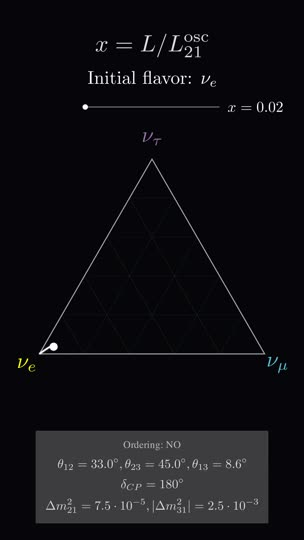<span class="anim-play" aria-hidden="true"></span></a></div>
        <h3 class="anim-title">Нейтринные осцилляции</h3>
        <p class="anim-text">Геометрическая визуализация двух- и трёхмерной картины осцилляций нейтрино.</p>
        <div class="anim-chips"><a class="anim-chip is-current" href="../assets/animations/dvnanima/neutrino-particles-neutrino-oscillations-triangle.mp4" data-play data-poster="../assets/animations/dvnanima/neutrino-particles-neutrino-oscillations-triangle.jpg" title="MP4, 1.5 MB">Общая эволюция</a><a class="anim-chip" href="../assets/animations/dvnanima/neutrino-particles-neutrino-oscillations-electron.mp4" data-play data-poster="../assets/animations/dvnanima/neutrino-particles-neutrino-oscillations-electron.jpg" title="MP4, 1.5 MB">Электронный аромат</a><a class="anim-chip" href="../assets/animations/dvnanima/neutrino-particles-neutrino-oscillations-muon.mp4" data-play data-poster="../assets/animations/dvnanima/neutrino-particles-neutrino-oscillations-muon.jpg" title="MP4, 2.1 MB">Мюонный аромат</a><a class="anim-chip" href="../assets/animations/dvnanima/neutrino-particles-neutrino-oscillations-tau.mp4" data-play data-poster="../assets/animations/dvnanima/neutrino-particles-neutrino-oscillations-tau.jpg" title="MP4, 2.1 MB">Тау-аромат</a></div>
      </article>
      <article class="anim-card" id="animation-neutrino-particles-neutrino-oscillation-phases">
        <div class="anim-media"><a class="anim-poster" href="../assets/animations/dvnanima/neutrino-particles-neutrino-oscillation-phases-phases.mp4" data-play data-poster="../assets/animations/dvnanima/neutrino-particles-neutrino-oscillation-phases-phases.jpg" aria-label="Смотреть: Осцилляции нейтрино с фазами">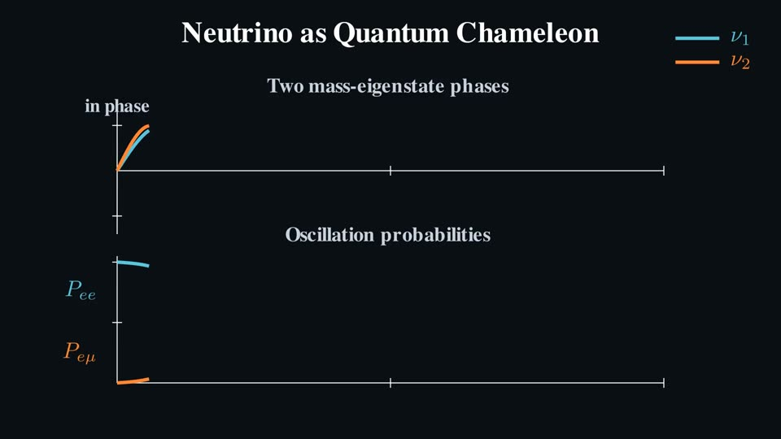<span class="anim-play" aria-hidden="true"></span></a></div>
        <h3 class="anim-title">Осцилляции нейтрино с фазами</h3>
        <p class="anim-text">Фазовая интерпретация трёхфлейворных нейтринных осцилляций.</p>
      </article>
      <article class="anim-card" id="animation-neutrino-particles-quantum-chameleon">
        <div class="anim-media"><a class="anim-poster" href="../neutrinophysics/introduction/ru/slides/assets/05_vacuum_oscillations/quantum_chameleon.mp4" data-play data-poster="../neutrinophysics/introduction/ru/slides/assets/05_vacuum_oscillations/quantum_chameleon.jpg" aria-label="Смотреть: Нейтрино — квантовый хамелеон"><span class="anim-play" aria-hidden="true"></span></a></div>
        <h3 class="anim-title">Нейтрино — квантовый хамелеон</h3>
        <p class="anim-text">Шуточная иллюстрация нейтрино как квантового хамелеона, который подстраивает окраску под окружение.</p>
        <div class="anim-chips"><a class="anim-chip is-code" href="https://github.com/NeutrinoHit/neutrinophysics/tree/main/introduction/ru/slides/assets/05_vacuum_oscillations" rel="noopener">Код</a></div>
      </article>
      <article class="anim-card" id="animation-neutrino-particles-mass-hierarchy">
        <div class="anim-media"><a class="anim-poster" href="../assets/animations/dvnanima/neutrino-particles-mass-hierarchy-scales.mp4" data-play data-poster="../assets/animations/dvnanima/neutrino-particles-mass-hierarchy-scales.jpg" aria-label="Смотреть: Иерархия масс нейтрино">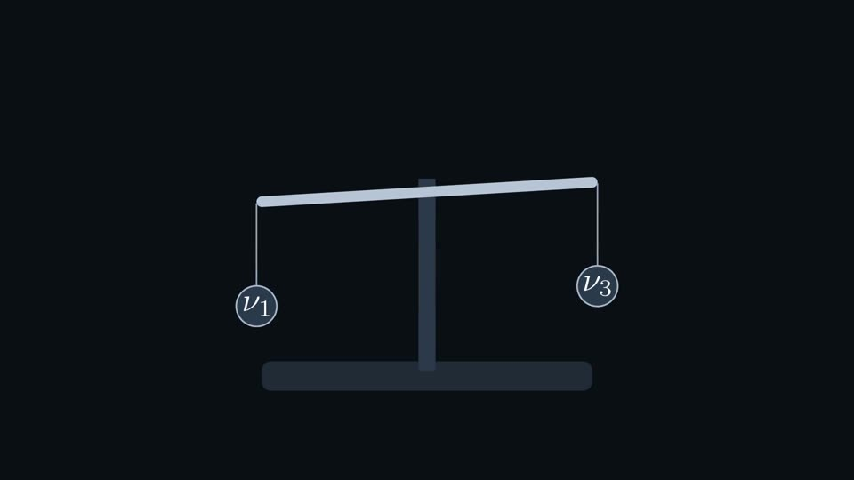<span class="anim-play" aria-hidden="true"></span></a></div>
        <h3 class="anim-title">Иерархия масс нейтрино</h3>
        <p class="anim-text">Балансная схема нормальной и обратной иерархий масс.</p>
      </article>
      <article class="anim-card" id="animation-neutrino-particles-juno">
        <div class="anim-media"><a class="anim-poster" href="../assets/animations/dvnanima/neutrino-particles-juno-survival.mp4" data-play data-poster="../assets/animations/dvnanima/neutrino-particles-juno-survival.jpg" aria-label="Смотреть: JUNO">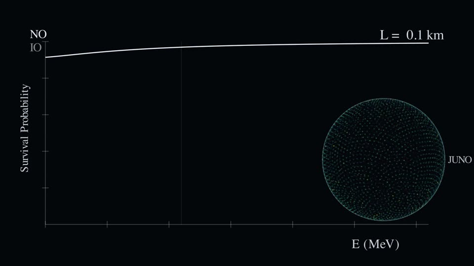<span class="anim-play" aria-hidden="true"></span></a></div>
        <h3 class="anim-title">JUNO</h3>
        <p class="anim-text">Анимации про детектор JUNO, осцилляции реакторных нейтрино и путь нейтрино к событию.</p>
      </article>
      <article class="anim-card" id="animation-neutrino-particles-air-shower">
        <div class="anim-media"><a class="anim-poster" href="../assets/animations/dvnanima/neutrino-particles-air-shower-air-shower.mp4" data-play data-poster="../assets/animations/dvnanima/neutrino-particles-air-shower-air-shower.jpg" aria-label="Смотреть: Широкий атмосферный ливень">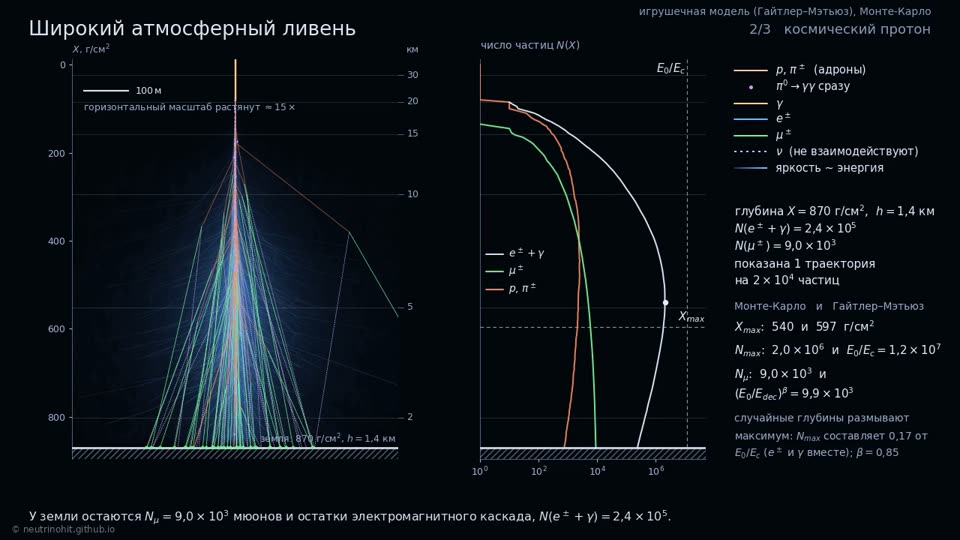<span class="anim-play" aria-hidden="true"></span></a></div>
        <h3 class="anim-title">Широкий атмосферный ливень</h3>
        <p class="anim-text">Игрушечная модель Гайтлера–Мэтьюза: электромагнитный каскад одного фотона, ливень от протона с энергией 10^15 эВ методом Монте-Карло, профиль N(X) и оценки Гайтлера, матрица детекторов на земле, флуоресценция и черенковский свет.</p>
        <div class="anim-chips"><a class="anim-chip is-current" href="../assets/animations/dvnanima/neutrino-particles-air-shower-air-shower.mp4" data-play data-poster="../assets/animations/dvnanima/neutrino-particles-air-shower-air-shower.jpg" title="MP4, 2.8 MB">RU</a><a class="anim-chip" href="../assets/animations/dvnanima/neutrino-particles-air-shower-air-shower-en.mp4" data-play data-poster="../assets/animations/dvnanima/neutrino-particles-air-shower-air-shower-en.jpg" title="MP4, 2.7 MB">EN</a></div>
      </article>
      <article class="anim-card" id="animation-neutrino-particles-earth-shield">
        <div class="anim-media"><a class="anim-poster" href="../assets/animations/dvnanima/neutrino-particles-earth-shield-earth-shield.mp4" data-play data-poster="../assets/animations/dvnanima/neutrino-particles-earth-shield-earth-shield.jpg" aria-label="Смотреть: Земля как щит: мюоны останавливаются, нейтрино проходят">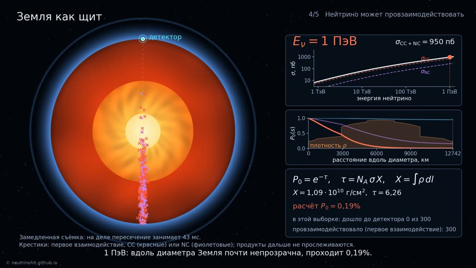<span class="anim-play" aria-hidden="true"></span></a></div>
        <h3 class="anim-title">Земля как щит: мюоны останавливаются, нейтрино проходят</h3>
        <p class="anim-text">Космические лучи и их ливни во всей атмосфере; разрез планеты по плоскости через детектор (слои PREM); мюон останавливается в нескольких километрах породы, нейтрино доходит; метод Монте-Карло: вероятность не провзаимодействовать вдоль хорды $P_0=e^{-\tau}$ при 1 ТэВ, 100 ТэВ и 1 ПэВ (сечения CSMS) и её зависимость от зенитного угла.</p>
        <div class="anim-chips"><a class="anim-chip is-current" href="../assets/animations/dvnanima/neutrino-particles-earth-shield-earth-shield.mp4" data-play data-poster="../assets/animations/dvnanima/neutrino-particles-earth-shield-earth-shield.jpg" title="MP4, 2.2 MB">RU</a><a class="anim-chip" href="../assets/animations/dvnanima/neutrino-particles-earth-shield-earth-shield-en.mp4" data-play data-poster="../assets/animations/dvnanima/neutrino-particles-earth-shield-earth-shield-en.jpg" title="MP4, 2.2 MB">EN</a></div>
      </article>
      <article class="anim-card" id="animation-neutrino-particles-jet-launch">
        <div class="anim-media"><a class="anim-poster" href="../assets/animations/dvnanima/neutrino-particles-jet-launch-jet-launch.mp4" data-play data-poster="../assets/animations/dvnanima/neutrino-particles-jet-launch-jet-launch.jpg" aria-label="Смотреть: От звезды к джету: откуда берётся мощность">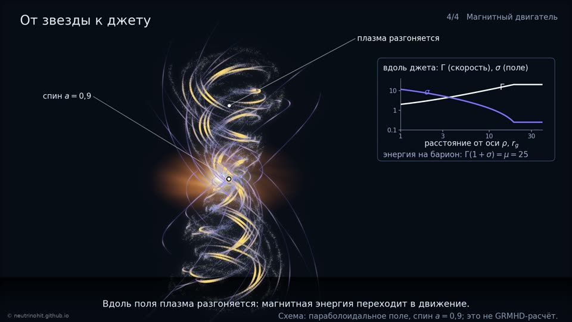<span class="anim-play" aria-hidden="true"></span></a></div>
        <h3 class="anim-title">От звезды к джету: откуда берётся мощность</h3>
        <p class="anim-text">Чёрная дыра, эргосфера и диск; звезда разрывается приливными силами, вещество возвращается по закону $t^{-5/3}$; вращающаяся дыра закручивает магнитное поле, поток Пойнтинга выносит энергию, плазма разгоняется вдоль поля (джет приливного разрушения звезды, Swift J1644+57).</p>
        <div class="anim-chips"><a class="anim-chip is-current" href="../assets/animations/dvnanima/neutrino-particles-jet-launch-jet-launch.mp4" data-play data-poster="../assets/animations/dvnanima/neutrino-particles-jet-launch-jet-launch.jpg" title="MP4, 2.2 MB">RU</a><a class="anim-chip" href="../assets/animations/dvnanima/neutrino-particles-jet-launch-jet-launch-en.mp4" data-play data-poster="../assets/animations/dvnanima/neutrino-particles-jet-launch-jet-launch-en.jpg" title="MP4, 2.1 MB">EN</a></div>
      </article>
      <article class="anim-card" id="animation-neutrino-particles-star-in-jet">
        <div class="anim-media"><a class="anim-poster" href="../assets/animations/dvnanima/neutrino-particles-star-in-jet-star-in-jet.mp4" data-play data-poster="../assets/animations/dvnanima/neutrino-particles-star-in-jet-star-in-jet.jpg" aria-label="Смотреть: Звезда в джете: один из способов родить нейтрино">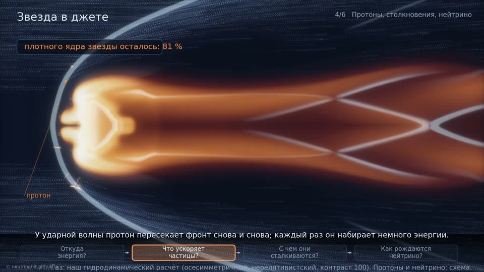<span class="anim-play" aria-hidden="true"></span></a></div>
        <h3 class="anim-title">Звезда в джете: один из способов родить нейтрино</h3>
        <p class="anim-text">Чёрная дыра с аккреционным диском запускает джет, звезда с ветром попадает в него; осесимметричный гидродинамический расчёт разрушения звезды у ударной волны; протоны, ускоренные на фронте, сталкиваются с веществом облака, рождая нейтрино и гамма-кванты; числа одного прохода $\tau_{pp}$, $\kappa\tau_{pp}$; нейтрино летят к Земле.</p>
        <div class="anim-chips"><a class="anim-chip is-current" href="../assets/animations/dvnanima/neutrino-particles-star-in-jet-star-in-jet.mp4" data-play data-poster="../assets/animations/dvnanima/neutrino-particles-star-in-jet-star-in-jet.jpg" title="MP4, 4.3 MB">RU</a><a class="anim-chip" href="../assets/animations/dvnanima/neutrino-particles-star-in-jet-star-in-jet-en.mp4" data-play data-poster="../assets/animations/dvnanima/neutrino-particles-star-in-jet-star-in-jet-en.jpg" title="MP4, 4.3 MB">EN</a></div>
      </article>
      <article class="anim-card" id="animation-neutrino-particles-milky-way-neutrinos">
        <div class="anim-media"><a class="anim-poster" href="../assets/animations/dvnanima/neutrino-particles-milky-way-neutrinos-milky-way-neutrinos.mp4" data-play data-poster="../assets/animations/dvnanima/neutrino-particles-milky-way-neutrinos-milky-way-neutrinos.jpg" aria-label="Смотреть: Млечный Путь в нейтрино">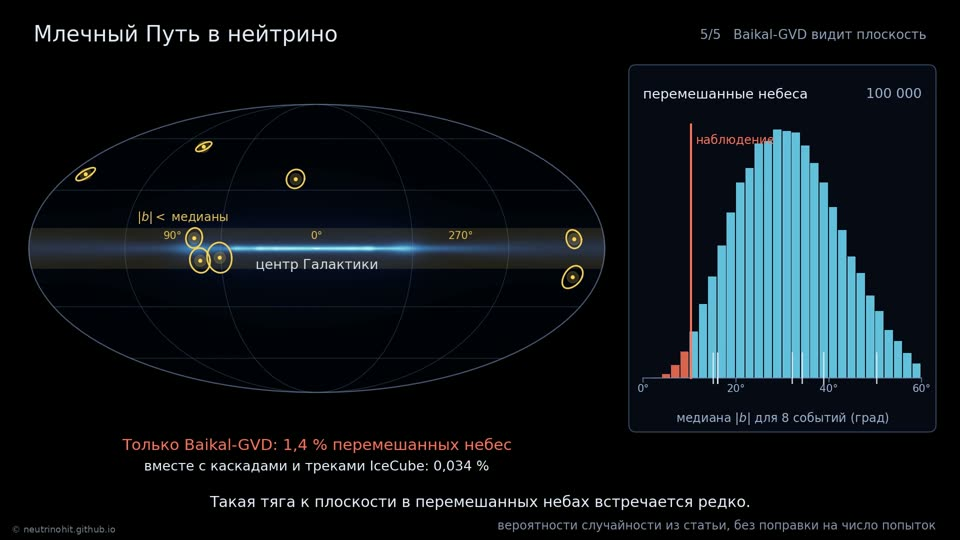<span class="anim-play" aria-hidden="true"></span></a></div>
        <h3 class="anim-title">Млечный Путь в нейтрино</h3>
        <p class="anim-text">Протоны космических лучей блуждают в диске Галактики и сталкиваются с ядрами межзвёздного газа; рождаются пионы, затем нейтрино, которые летят прямо. Изнутри диска вся Галактика видна как полоса через небо: карта — интеграл «газ × плотность космических лучей» вдоль луча зрения в иллюстративной модели. С севера центр Галактики большую часть суток под горизонтом (Baikal-GVD — 75 %, KM3NeT ARCA — 63 %, IceCube — 0 %), то есть виден сквозь Землю. Восемь каскадов Baikal-GVD выше 200 ТэВ лежат ближе к плоскости, чем в перемешанных небах: медиана $|b|$ меньше лишь в 1,4 % из них (вместе с данными IceCube — 0,034 %).</p>
        <div class="anim-chips"><a class="anim-chip is-current" href="../assets/animations/dvnanima/neutrino-particles-milky-way-neutrinos-milky-way-neutrinos.mp4" data-play data-poster="../assets/animations/dvnanima/neutrino-particles-milky-way-neutrinos-milky-way-neutrinos.jpg" title="MP4, 1.3 MB">RU</a><a class="anim-chip" href="../assets/animations/dvnanima/neutrino-particles-milky-way-neutrinos-milky-way-neutrinos-en.mp4" data-play data-poster="../assets/animations/dvnanima/neutrino-particles-milky-way-neutrinos-milky-way-neutrinos-en.jpg" title="MP4, 1.3 MB">EN</a></div>
      </article>
      <article class="anim-card" id="animation-neutrino-particles-source-emerges">
        <div class="anim-media"><a class="anim-poster" href="../assets/animations/dvnanima/neutrino-particles-source-emerges-source-emerges.mp4" data-play data-poster="../assets/animations/dvnanima/neutrino-particles-source-emerges-source-emerges.jpg" aria-label="Смотреть: Источник проступает">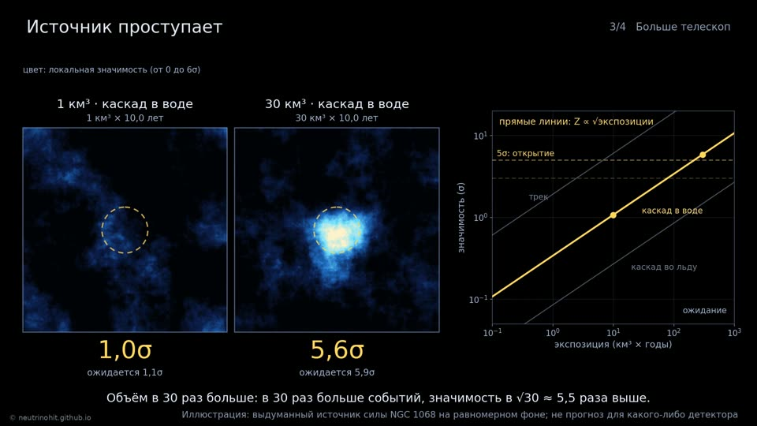<span class="anim-play" aria-hidden="true"></span></a></div>
        <h3 class="anim-title">Источник проступает</h3>
        <p class="anim-text">Нейтрино приходят по одному; почти все — атмосферный фон, немногие — от источника. Считаем события в круге вокруг источника и сравниваем с ожидаемым фоном: избыток растёт пропорционально времени, а шум — как корень из него, поэтому значимость растёт как √t. Тот же источник за те же годы виден по-разному при разной точности направлений: каскад во льду (половина событий в пределах 10°), каскад в воде (2,5°), трек (0,4°). В 30 раз больший объём даёт значимость в √30 ≈ 5,5 раза выше: каскады в воде, невидимые за 10 лет в 1 км³, выходят за 5σ в 30 км³. Правило: $Z\propto\sqrt{\text{экспозиция}}/\sigma_\theta$, пока доминирует фон.</p>
        <div class="anim-chips"><a class="anim-chip is-current" href="../assets/animations/dvnanima/neutrino-particles-source-emerges-source-emerges.mp4" data-play data-poster="../assets/animations/dvnanima/neutrino-particles-source-emerges-source-emerges.jpg" title="MP4, 1.4 MB">RU</a><a class="anim-chip" href="../assets/animations/dvnanima/neutrino-particles-source-emerges-source-emerges-en.mp4" data-play data-poster="../assets/animations/dvnanima/neutrino-particles-source-emerges-source-emerges-en.jpg" title="MP4, 1.4 MB">EN</a></div>
      </article>
      <article class="anim-card" id="animation-neutrino-particles-pp-cycle">
        <div class="anim-media"><a class="anim-poster" href="../assets/animations/dvnanima/neutrino-particles-pp-cycle-pp-to-d.mp4" data-play data-poster="../assets/animations/dvnanima/neutrino-particles-pp-cycle-pp-to-d.jpg" aria-label="Смотреть: Протон-протонный цикл">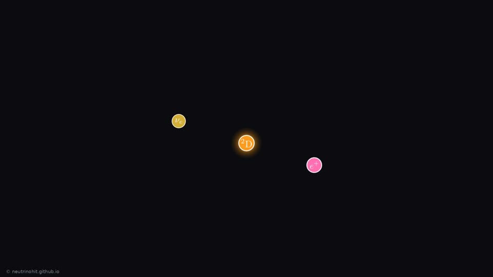<span class="anim-play" aria-hidden="true"></span></a></div>
        <h3 class="anim-title">Протон-протонный цикл</h3>
        <p class="anim-text">Три ключевых реакции солнечной pp-цепочки.</p>
        <div class="anim-chips"><a class="anim-chip is-current" href="../assets/animations/dvnanima/neutrino-particles-pp-cycle-pp-to-d.mp4" data-play data-poster="../assets/animations/dvnanima/neutrino-particles-pp-cycle-pp-to-d.jpg" title="MP4, 205.4 KB">p + p → D + e⁺ + νₑ</a><a class="anim-chip" href="../assets/animations/dvnanima/neutrino-particles-pp-cycle-d-p-he3.mp4" data-play data-poster="../assets/animations/dvnanima/neutrino-particles-pp-cycle-d-p-he3.jpg" title="MP4, 160.7 KB">D + p → ³He + γ</a><a class="anim-chip" href="../assets/animations/dvnanima/neutrino-particles-pp-cycle-he3-he3.mp4" data-play data-poster="../assets/animations/dvnanima/neutrino-particles-pp-cycle-he3-he3.jpg" title="MP4, 183.5 KB">³He + ³He → ⁴He + 2p</a></div>
      </article>
      <article class="anim-card" id="animation-neutrino-particles-solar-photon-diffusion">
        <div class="anim-media"><a class="anim-poster" href="../assets/animations/dvnanima/neutrino-particles-solar-photon-diffusion-ru.mp4" data-play data-poster="../assets/animations/dvnanima/neutrino-particles-solar-photon-diffusion-ru.jpg" aria-label="Смотреть: Как свет выходит из Солнца">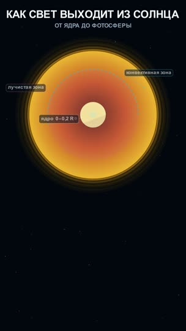<span class="anim-play" aria-hidden="true"></span></a></div>
        <h3 class="anim-title">Как свет выходит из Солнца</h3>
        <p class="anim-text">Минутная физическая визуализация переноса излучения: случайный ход в ядре, радиационная диффузия, температурный профиль и переход к конвективной зоне.</p>
        <div class="anim-chips"><a class="anim-chip is-current" href="../assets/animations/dvnanima/neutrino-particles-solar-photon-diffusion-ru.mp4" data-play data-poster="../assets/animations/dvnanima/neutrino-particles-solar-photon-diffusion-ru.jpg" title="MP4, 5.1 MB">RU</a><a class="anim-chip" href="../assets/animations/dvnanima/neutrino-particles-solar-photon-diffusion-en.mp4" data-play data-poster="../assets/animations/dvnanima/neutrino-particles-solar-photon-diffusion-en.jpg" title="MP4, 5.1 MB">EN</a></div>
      </article>
      <article class="anim-card" id="animation-neutrino-particles-bbn">
        <div class="anim-media"><a class="anim-poster" href="../assets/animations/dvnanima/neutrino-particles-bbn-bbn-animation.mp4" data-play data-poster="../assets/animations/dvnanima/neutrino-particles-bbn-bbn-animation.jpg" aria-label="Смотреть: Первичный нуклеосинтез">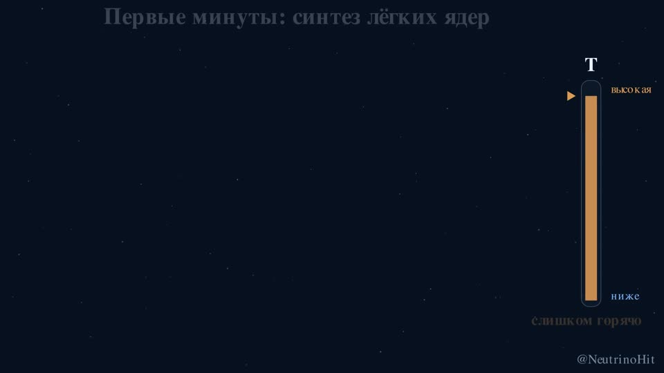<span class="anim-play" aria-hidden="true"></span></a></div>
        <h3 class="anim-title">Первичный нуклеосинтез</h3>
        <p class="anim-text">Стилизованная картина BBN: дейтериевое горлышко, окно синтеза и связывание нейтронов в He-4.</p>
      </article>
      <article class="anim-card" id="animation-neutrino-particles-feynman-scattering">
        <div class="anim-media"><a class="anim-poster" href="../assets/animations/dvnanima/neutrino-particles-feynman-scattering-nu-mu-electron.mp4" data-play data-poster="../assets/animations/dvnanima/neutrino-particles-feynman-scattering-nu-mu-electron.jpg" aria-label="Смотреть: Диаграммы рассеяния">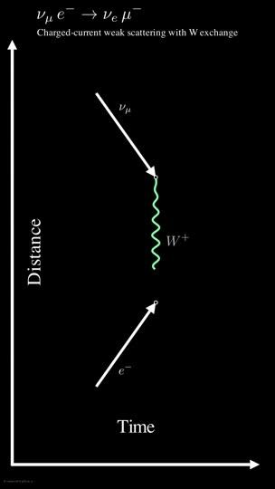<span class="anim-play" aria-hidden="true"></span></a></div>
        <h3 class="anim-title">Диаграммы рассеяния</h3>
        <p class="anim-text">Анимированные диаграммы Фейнмана для типичных процессов рассеяния.</p>
        <div class="anim-chips"><a class="anim-chip is-current" href="../assets/animations/dvnanima/neutrino-particles-feynman-scattering-nu-mu-electron.mp4" data-play data-poster="../assets/animations/dvnanima/neutrino-particles-feynman-scattering-nu-mu-electron.jpg" title="MP4, 172.6 KB">νμ + e → νe + μ</a><a class="anim-chip" href="../assets/animations/dvnanima/neutrino-particles-feynman-scattering-nu-mu-z.mp4" data-play data-poster="../assets/animations/dvnanima/neutrino-particles-feynman-scattering-nu-mu-z.jpg" title="MP4, 171.1 KB">Нейтринное рассеяние через Z</a><a class="anim-chip" href="../assets/animations/dvnanima/neutrino-particles-feynman-scattering-electron-electron.mp4" data-play data-poster="../assets/animations/dvnanima/neutrino-particles-feynman-scattering-electron-electron.jpg" title="MP4, 160.4 KB">e + e</a><a class="anim-chip" href="../assets/animations/dvnanima/neutrino-particles-feynman-scattering-quark-quark.mp4" data-play data-poster="../assets/animations/dvnanima/neutrino-particles-feynman-scattering-quark-quark.jpg" title="MP4, 182.0 KB">q + q</a></div>
      </article>
      <article class="anim-card" id="animation-neutrino-particles-nucleus-shapes">
        <div class="anim-media"><a class="anim-poster" href="../assets/animations/dvnanima/neutrino-particles-nucleus-shapes-shape-morphs.mp4" data-play data-poster="../assets/animations/dvnanima/neutrino-particles-nucleus-shapes-shape-morphs.jpg" aria-label="Смотреть: Формы ядер">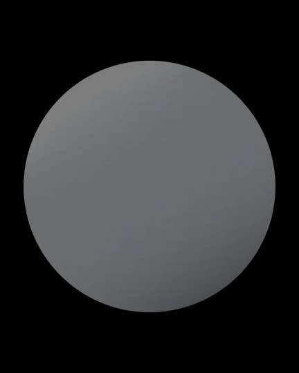<span class="anim-play" aria-hidden="true"></span></a></div>
        <h3 class="anim-title">Формы ядер</h3>
        <p class="anim-text">Морфинг сферических и деформированных ядерных форм.</p>
      </article>
      <article class="anim-card" id="animation-neutrino-particles-pmt">
        <div class="anim-media"><a class="anim-poster" href="../assets/animations/dvnanima/neutrino-particles-pmt-pmt-schematic.mp4" data-play data-poster="../assets/animations/dvnanima/neutrino-particles-pmt-pmt-schematic.jpg" aria-label="Смотреть: Фотоумножитель">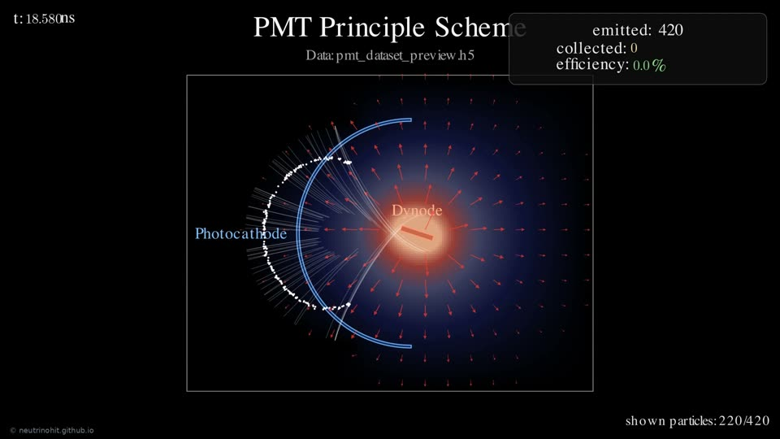<span class="anim-play" aria-hidden="true"></span></a></div>
        <h3 class="anim-title">Фотоумножитель</h3>
        <p class="anim-text">Схематическая траектория электронов в ФЭУ по численным данным.</p>
      </article>
      <article class="anim-card" id="animation-neutrino-particles-pmt-multiplication">
        <div class="anim-media"><a class="anim-poster" href="../assets/animations/dvnanima/neutrino-particles-pmt-multiplication-avalanche.mp4" data-play data-poster="../assets/animations/dvnanima/neutrino-particles-pmt-multiplication-avalanche.jpg" aria-label="Смотреть: Умножение электронов в ФЭУ">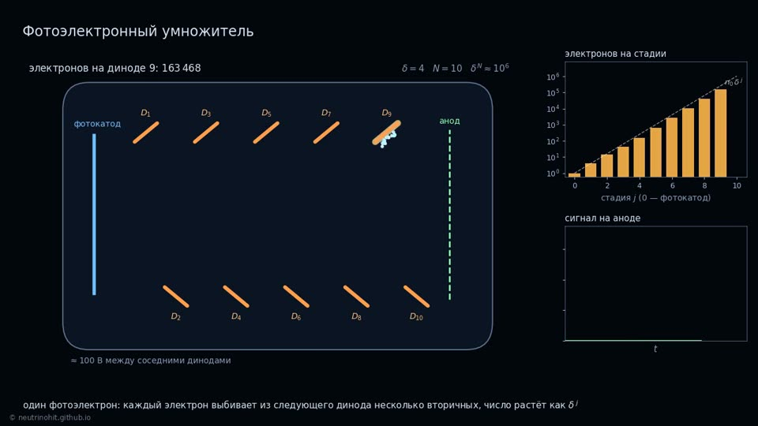<span class="anim-play" aria-hidden="true"></span></a></div>
        <h3 class="anim-title">Умножение электронов в ФЭУ</h3>
        <p class="anim-text">Один фотоэлектрон превращается в лавину: каждый динод выбивает в среднем δ = 4 вторичных электрона, десять динодов дают усиление ≈ 10⁶; затем три вспышки сцинтиллятора и амплитуда импульса, в среднем пропорциональная числу фотоэлектронов.</p>
        <div class="anim-chips"><a class="anim-chip is-current" href="../assets/animations/dvnanima/neutrino-particles-pmt-multiplication-avalanche.mp4" data-play data-poster="../assets/animations/dvnanima/neutrino-particles-pmt-multiplication-avalanche.jpg" title="MP4, 1.1 MB">RU</a><a class="anim-chip" href="../assets/animations/dvnanima/neutrino-particles-pmt-multiplication-avalanche-en.mp4" data-play data-poster="../assets/animations/dvnanima/neutrino-particles-pmt-multiplication-avalanche-en.jpg" title="MP4, 1.1 MB">EN</a></div>
      </article>
      <article class="anim-card" id="animation-neutrino-particles-mac-e-filter">
        <div class="anim-media"><a class="anim-poster" href="../assets/animations/dvnanima/neutrino-particles-mac-e-filter-uniform-field.mp4" data-play data-poster="../assets/animations/dvnanima/neutrino-particles-mac-e-filter-uniform-field.jpg" aria-label="Смотреть: Электроны в магнитном поле и MAC-E-фильтр KATRIN">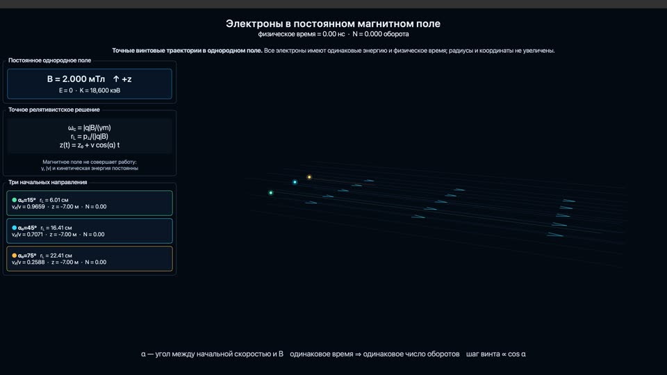<span class="anim-play" aria-hidden="true"></span></a></div>
        <h3 class="anim-title">Электроны в магнитном поле и MAC-E-фильтр KATRIN</h3>
        <p class="anim-text">Точное релятивистское винтовое движение, обратимая магнитная коллимация и электростатический анализ электронов в спектрометре KATRIN.</p>
        <div class="anim-chips"><a class="anim-chip is-current" href="../assets/animations/dvnanima/neutrino-particles-mac-e-filter-uniform-field.mp4" data-play data-poster="../assets/animations/dvnanima/neutrino-particles-mac-e-filter-uniform-field.jpg" title="MP4, 1.4 MB">Винтовое движение в однородном поле</a><a class="anim-chip" href="../assets/animations/dvnanima/neutrino-particles-mac-e-filter-katrin-collimation.mp4" data-play data-poster="../assets/animations/dvnanima/neutrino-particles-mac-e-filter-katrin-collimation.jpg" title="MP4, 645.9 KB">Магнитная коллимация KATRIN</a><a class="anim-chip" href="../assets/animations/dvnanima/neutrino-particles-mac-e-filter-katrin-electric.mp4" data-play data-poster="../assets/animations/dvnanima/neutrino-particles-mac-e-filter-katrin-electric.jpg" title="MP4, 752.9 KB">MAC-E: прохождение и отражение</a></div>
      </article>
      <article class="anim-card" id="animation-neutrino-particles-project8-cres">
        <div class="anim-media"><a class="anim-poster" href="../assets/animations/dvnanima/neutrino-particles-project8-cres-cres-event.mp4" data-play data-poster="../assets/animations/dvnanima/neutrino-particles-project8-cres-cres-event.jpg" aria-label="Смотреть: Project 8: циклотронное излучение электрона">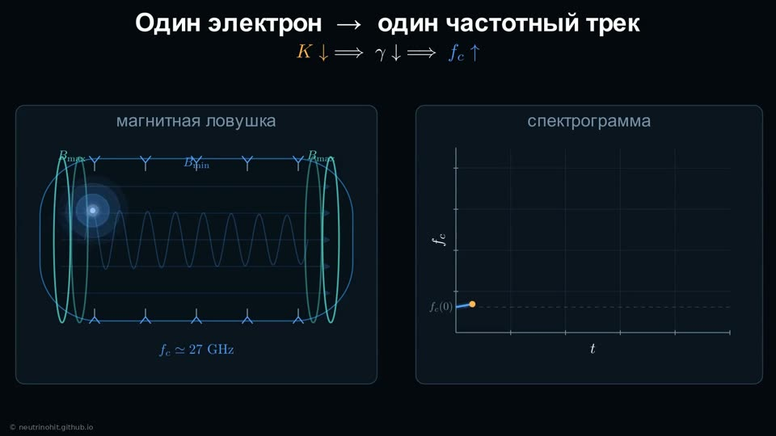<span class="anim-play" aria-hidden="true"></span></a></div>
        <h3 class="anim-title">Project 8: циклотронное излучение электрона</h3>
        <p class="anim-text">Схематическая визуализация CRES: захваченный электрон, циклотронное микроволновое излучение и возрастающий частотный трек при потере энергии.</p>
      </article>
      <article class="anim-card" id="animation-neutrino-particles-cherenkov-cone">
        <div class="anim-media"><a class="anim-poster" href="../assets/animations/dvnanima/neutrino-particles-cherenkov-cone-cylinder.mp4" data-play data-poster="../assets/animations/dvnanima/neutrino-particles-cherenkov-cone-cylinder.jpg" aria-label="Смотреть: Конус Черенкова">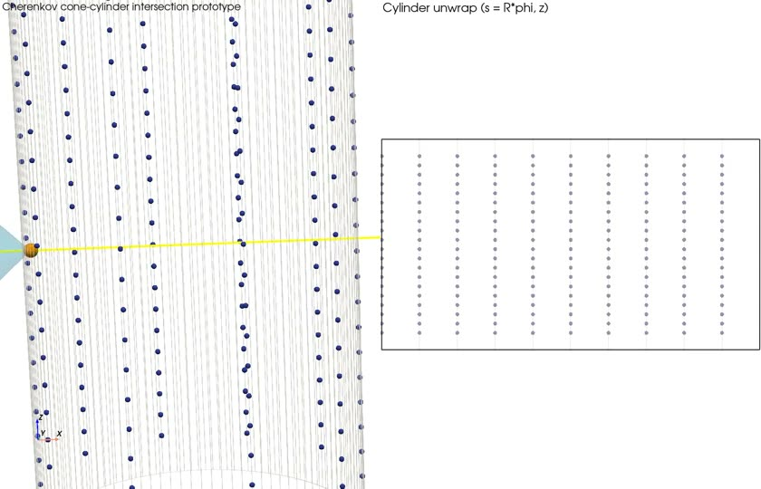<span class="anim-play" aria-hidden="true"></span></a></div>
        <h3 class="anim-title">Конус Черенкова</h3>
        <p class="anim-text">Геометрия черенковского излучения в цилиндрической сцене.</p>
      </article>
      <article class="anim-card" id="animation-neutrino-particles-cherenkov-radiation">
        <div class="anim-media"><a class="anim-poster" href="../assets/animations/dvnanima/neutrino-particles-cherenkov-radiation-huygens.mp4" data-play data-poster="../assets/animations/dvnanima/neutrino-particles-cherenkov-radiation-huygens.jpg" aria-label="Смотреть: Излучение Вавилова — Черенкова">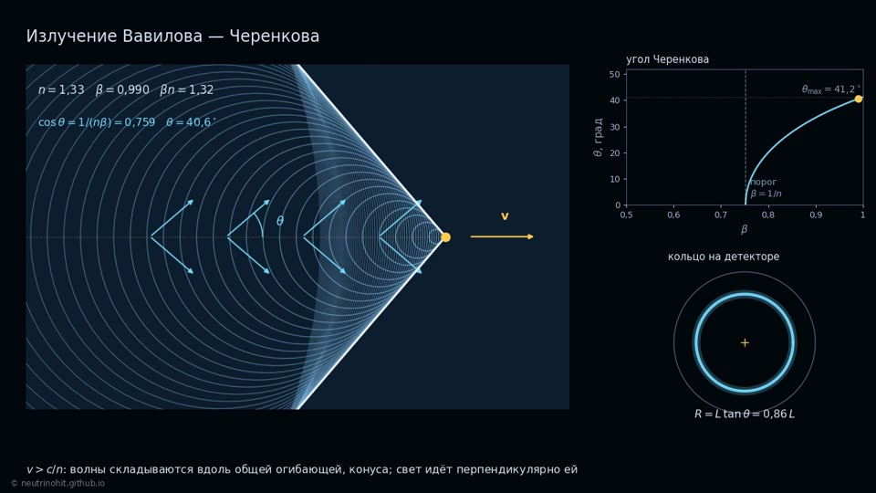<span class="anim-play" aria-hidden="true"></span></a></div>
        <h3 class="anim-title">Излучение Вавилова — Черенкова</h3>
        <p class="anim-text">Четыре волновых фронта, два отдельных опыта с постоянной скоростью и паузы для объяснения. Медленная частица остаётся внутри фронтов; быстрая обгоняет их. Общая касательная образует поверхность конуса, а свет идёт поперёк неё. Без графика и кольца на детекторе.</p>
        <div class="anim-chips"><a class="anim-chip is-current" href="../assets/animations/dvnanima/neutrino-particles-cherenkov-radiation-huygens.mp4" data-play data-poster="../assets/animations/dvnanima/neutrino-particles-cherenkov-radiation-huygens.jpg" title="MP4, 1.4 MB">RU</a><a class="anim-chip" href="../assets/animations/dvnanima/neutrino-particles-cherenkov-radiation-huygens-en.mp4" data-play data-poster="../assets/animations/dvnanima/neutrino-particles-cherenkov-radiation-huygens-en.jpg" title="MP4, 1.3 MB">EN</a></div>
      </article>
      <article class="anim-card" id="animation-neutrino-particles-scattering-experiment">
        <div class="anim-media"><a class="anim-poster" href="../assets/animations/dvnanima/neutrino-particles-scattering-experiment-collider.mp4" data-play data-poster="../assets/animations/dvnanima/neutrino-particles-scattering-experiment-collider.jpg" aria-label="Смотреть: Эксперимент по рассеянию: e⁺e⁻ → μ⁺μ⁻">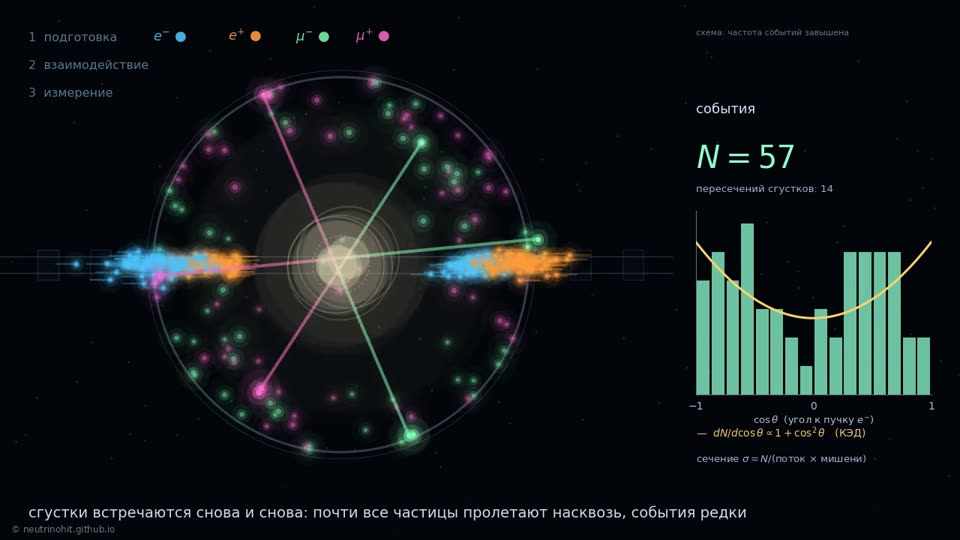<span class="anim-play" aria-hidden="true"></span></a></div>
        <h3 class="anim-title">Эксперимент по рассеянию: e⁺e⁻ → μ⁺μ⁻</h3>
        <p class="anim-text">Три стадии эксперимента на коллайдере: ускорение пучков, взаимодействие в малой области (почти все частицы пролетают насквозь), регистрация мюонов. Из многих событий растёт угловое распределение 1 + cos²θ.</p>
        <div class="anim-chips"><a class="anim-chip is-current" href="../assets/animations/dvnanima/neutrino-particles-scattering-experiment-collider.mp4" data-play data-poster="../assets/animations/dvnanima/neutrino-particles-scattering-experiment-collider.jpg" title="MP4, 2.9 MB">RU</a><a class="anim-chip" href="../assets/animations/dvnanima/neutrino-particles-scattering-experiment-collider-en.mp4" data-play data-poster="../assets/animations/dvnanima/neutrino-particles-scattering-experiment-collider-en.jpg" title="MP4, 2.9 MB">EN</a></div>
      </article>
      <article class="anim-card" id="animation-neutrino-particles-pi0-double-dalitz">
        <div class="anim-media"><a class="anim-poster" href="../assets/animations/dvnanima/neutrino-particles-pi0-double-dalitz-planes.mp4" data-play data-poster="../assets/animations/dvnanima/neutrino-particles-pi0-double-dalitz-planes.jpg" aria-label="Смотреть: Распад π⁰ → e⁺e⁻e⁺e⁻">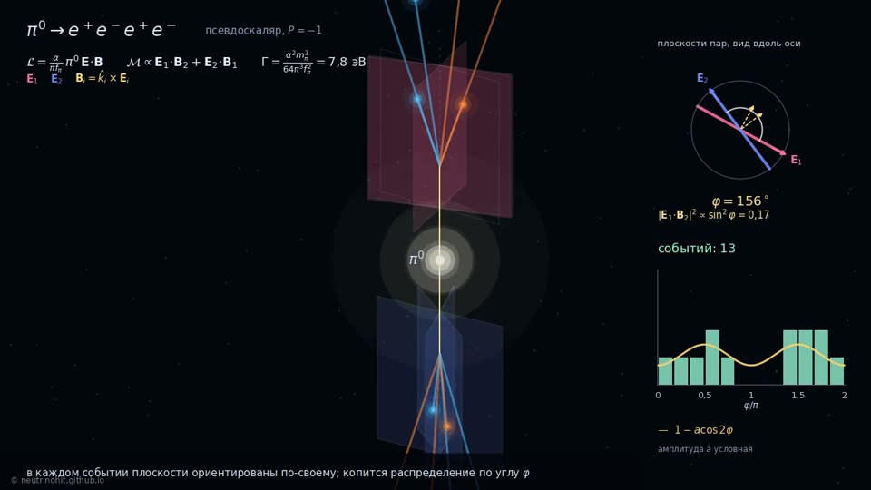<span class="anim-play" aria-hidden="true"></span></a></div>
        <h3 class="anim-title">Распад π⁰ → e⁺e⁻e⁺e⁻</h3>
        <p class="anim-text">Две пары e⁺e⁻ от виртуальных фотонов лежат в плоскостях, содержащих поляризацию (E) своего фотона. Для псевдоскаляра π⁰ амплитуда ∝ E₁·B₂ + E₂·B₁ ∝ sin φ (плоскости перпендикулярны), для скаляра ∝ E₁·E₂ − B₁·B₂ ∝ cos φ (параллельны); копится распределение по углу φ. Две версии: русская и английская.</p>
        <div class="anim-chips"><a class="anim-chip is-current" href="../assets/animations/dvnanima/neutrino-particles-pi0-double-dalitz-planes.mp4" data-play data-poster="../assets/animations/dvnanima/neutrino-particles-pi0-double-dalitz-planes.jpg" title="MP4, 1.5 MB">RU</a><a class="anim-chip" href="../assets/animations/dvnanima/neutrino-particles-pi0-double-dalitz-planes-en.mp4" data-play data-poster="../assets/animations/dvnanima/neutrino-particles-pi0-double-dalitz-planes-en.jpg" title="MP4, 1.5 MB">EN</a></div>
      </article>
      <article class="anim-card" id="animation-neutrino-particles-z-decay-asymmetry">
        <div class="anim-media"><a class="anim-poster" href="../assets/animations/dvnanima/neutrino-particles-z-decay-asymmetry-film.mp4" data-play data-poster="../assets/animations/dvnanima/neutrino-particles-z-decay-asymmetry-film.jpg" aria-label="Смотреть: Асимметрия в рождении и распаде Z-бозона">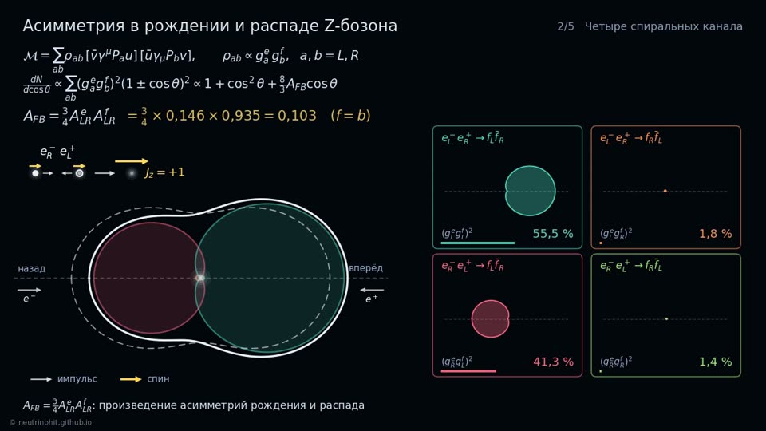<span class="anim-play" aria-hidden="true"></span></a></div>
        <h3 class="anim-title">Асимметрия в рождении и распаде Z-бозона</h3>
        <p class="anim-text">Четыре спиральных канала e⁺e⁻ → Z → f f̄ с весами (g_a g_b)², распределения (1 ± cosθ)² и их сумма, асимметрия «вперёд–назад» A_FB, события Монте-Карло и зависимость A_FB(√s) с интерференцией γ и Z.</p>
        <div class="anim-chips"><a class="anim-chip is-current" href="../assets/animations/dvnanima/neutrino-particles-z-decay-asymmetry-film.mp4" data-play data-poster="../assets/animations/dvnanima/neutrino-particles-z-decay-asymmetry-film.jpg" title="MP4, 1.7 MB">RU</a><a class="anim-chip" href="../assets/animations/dvnanima/neutrino-particles-z-decay-asymmetry-film-en.mp4" data-play data-poster="../assets/animations/dvnanima/neutrino-particles-z-decay-asymmetry-film-en.jpg" title="MP4, 1.7 MB">EN</a></div>
      </article>
      <article class="anim-card" id="animation-neutrino-particles-kaon-oscillations">
        <div class="anim-media"><a class="anim-poster" href="../assets/animations/dvnanima/neutrino-particles-kaon-oscillations-film.mp4" data-play data-poster="../assets/animations/dvnanima/neutrino-particles-kaon-oscillations-film.jpg" aria-label="Смотреть: Осцилляции нейтральных каонов">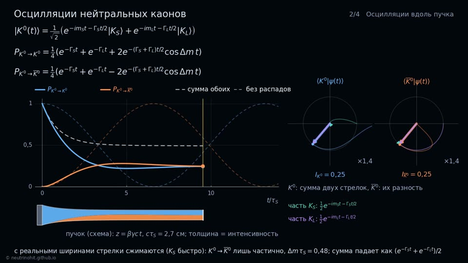<span class="anim-play" aria-hidden="true"></span></a></div>
        <h3 class="anim-title">Осцилляции нейтральных каонов</h3>
        <p class="anim-text">K⁰ рождается в сильной реакции как суперпозиция K_S и K_L; двухуровневая эволюция с H = M − iΓ/2 (интегрирование численно), осцилляции странности вдоль пучка, детектор (K̄⁰N → Λπ) и заряд лептона, регенерация K_S.</p>
        <div class="anim-chips"><a class="anim-chip is-current" href="../assets/animations/dvnanima/neutrino-particles-kaon-oscillations-film.mp4" data-play data-poster="../assets/animations/dvnanima/neutrino-particles-kaon-oscillations-film.jpg" title="MP4, 3.2 MB">RU</a><a class="anim-chip" href="../assets/animations/dvnanima/neutrino-particles-kaon-oscillations-film-en.mp4" data-play data-poster="../assets/animations/dvnanima/neutrino-particles-kaon-oscillations-film-en.jpg" title="MP4, 3.1 MB">EN</a></div>
      </article>
      <article class="anim-card" id="animation-neutrino-particles-humanity-cube">
        <div class="anim-media"><a class="anim-poster" href="../assets/animations/dvnanima/neutrino-particles-humanity-cube-ru.mp4" data-play data-poster="../assets/animations/dvnanima/neutrino-particles-humanity-cube-ru.jpg" aria-label="Смотреть: Всё человечество в половине кубического километра">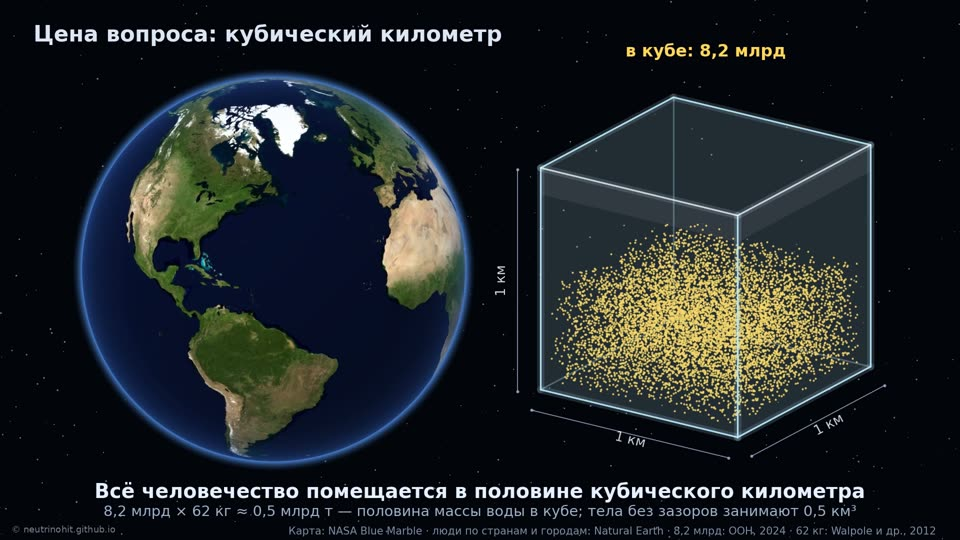<span class="anim-play" aria-hidden="true"></span></a></div>
        <h3 class="anim-title">Всё человечество в половине кубического километра</h3>
        <p class="anim-text">Нейтринному телескопу нужна мишень в кубический километр. Вращающийся глобус (NASA Blue Marble) покрывается точками там, где живут люди (страны и города Natural Earth), одна точка — миллион человек, 8200 точек — всё человечество (8,2 млрд, ООН 2024). Рядом появляется стеклянный куб со стороной 1 км (не в масштабе с планетой), и все точки одновременно втягиваются в него. При 62 кг на человека (Walpole и др., 2012) человечество весит 0,51 млрд т — половина массы воды в кубе, и тела без зазоров занимают половину куба. Затем камера ныряет в куб: точки превращаются в толпу людей со всех континентов (доли — по населению стран Natural Earth; облик людей условный).</p>
        <div class="anim-chips"><a class="anim-chip is-current" href="../assets/animations/dvnanima/neutrino-particles-humanity-cube-ru.mp4" data-play data-poster="../assets/animations/dvnanima/neutrino-particles-humanity-cube-ru.jpg" title="MP4, 24.7 MB">RU</a><a class="anim-chip" href="../assets/animations/dvnanima/neutrino-particles-humanity-cube-en.mp4" data-play data-poster="../assets/animations/dvnanima/neutrino-particles-humanity-cube-en.jpg" title="MP4, 25.1 MB">EN</a></div>
      </article>
    </div>
  </section>
  <section class="anim-section" id="fields-waves">
    <div class="anim-section-head">
      <span class="course-tile-status is-ready">28 сюжетов · 52 ролика</span>
      <h2>Поля, волны и осцилляторы</h2>
      <p>Электромагнитные поля, волновые пакеты, связанные осцилляторы и простые электронные схемы.</p>
    </div>
    <div class="anim-grid">
      <article class="anim-card" id="animation-fields-waves-scalar-qed">
        <div class="anim-media"><a class="anim-poster" href="../assets/animations/dvnanima/fields-waves-scalar-qed-single.mp4" data-play data-poster="../assets/animations/dvnanima/fields-waves-scalar-qed-single.jpg" aria-label="Смотреть: Scalar QED: волновые пакеты">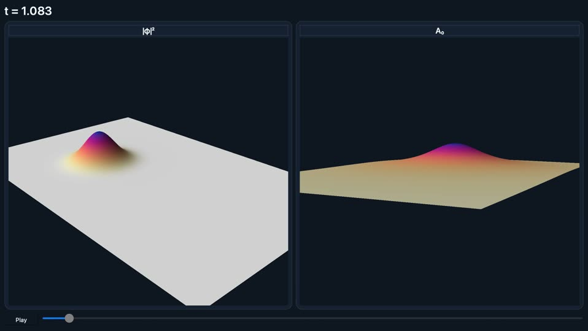<span class="anim-play" aria-hidden="true"></span></a></div>
        <h3 class="anim-title">Scalar QED: волновые пакеты</h3>
        <p class="anim-text">Притяжение и отталкивание волновых пакетов как интерференция свободной волны и волны взаимодействия: поле пакета, фаза эйконала, сдвиг распределения по импульсам.</p>
        <div class="anim-chips"><a class="anim-chip is-current" href="../assets/animations/dvnanima/fields-waves-scalar-qed-single.mp4" data-play data-poster="../assets/animations/dvnanima/fields-waves-scalar-qed-single.jpg" title="MP4, 447.1 KB">Один пакет и поле</a><a class="anim-chip" href="../assets/animations/dvnanima/fields-waves-scalar-qed-attraction.mp4" data-play data-poster="../assets/animations/dvnanima/fields-waves-scalar-qed-attraction.jpg" title="MP4, 2.0 MB">Притяжение: противоположные заряды</a><a class="anim-chip is-lang" href="../assets/animations/dvnanima/fields-waves-scalar-qed-attraction-en.mp4" data-play data-poster="../assets/animations/dvnanima/fields-waves-scalar-qed-attraction-en.jpg" title="MP4, 2.0 MB">EN</a><a class="anim-chip" href="../assets/animations/dvnanima/fields-waves-scalar-qed-repulsion.mp4" data-play data-poster="../assets/animations/dvnanima/fields-waves-scalar-qed-repulsion.jpg" title="MP4, 1.5 MB">Отталкивание: заряды одного знака</a><a class="anim-chip is-lang" href="../assets/animations/dvnanima/fields-waves-scalar-qed-repulsion-en.mp4" data-play data-poster="../assets/animations/dvnanima/fields-waves-scalar-qed-repulsion-en.jpg" title="MP4, 1.5 MB">EN</a></div>
      </article>
      <article class="anim-card" id="animation-fields-waves-standard-model-field-mattress">
        <div class="anim-media"><a class="anim-poster" href="../assets/animations/dvnanima/fields-waves-standard-model-field-mattress-field-stack.mp4" data-play data-poster="../assets/animations/dvnanima/fields-waves-standard-model-field-mattress-field-stack.jpg" aria-label="Смотреть: Поля Стандартной модели">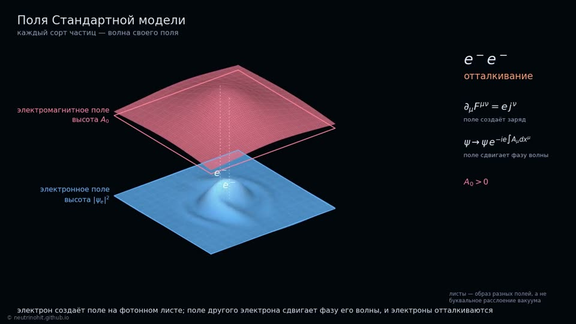<span class="anim-play" aria-hidden="true"></span></a></div>
        <h3 class="anim-title">Поля Стандартной модели</h3>
        <p class="anim-text">17 полей Стандартной модели как листы одной стопки; частица — волновой пакет на листе своего поля; два поля крупно: взаимодействие e⁻e⁻ (отталкивание) и e⁻e⁺ (притяжение) по модели скалярной КЭД, затем e⁻e⁺ ↔ γγ как перетекание энергии между полями.</p>
        <div class="anim-chips"><a class="anim-chip is-current" href="../assets/animations/dvnanima/fields-waves-standard-model-field-mattress-field-stack.mp4" data-play data-poster="../assets/animations/dvnanima/fields-waves-standard-model-field-mattress-field-stack.jpg" title="MP4, 7.4 MB">RU</a><a class="anim-chip" href="../assets/animations/dvnanima/fields-waves-standard-model-field-mattress-field-stack-en.mp4" data-play data-poster="../assets/animations/dvnanima/fields-waves-standard-model-field-mattress-field-stack-en.jpg" title="MP4, 7.4 MB">EN</a></div>
      </article>
      <article class="anim-card" id="animation-fields-waves-mediator-interaction">
        <div class="anim-media"><a class="anim-poster" href="../assets/animations/dvnanima/fields-waves-mediator-interaction-with-interaction.mp4" data-play data-poster="../assets/animations/dvnanima/fields-waves-mediator-interaction-with-interaction.jpg" aria-label="Смотреть: Взаимодействие через поле-переносчик">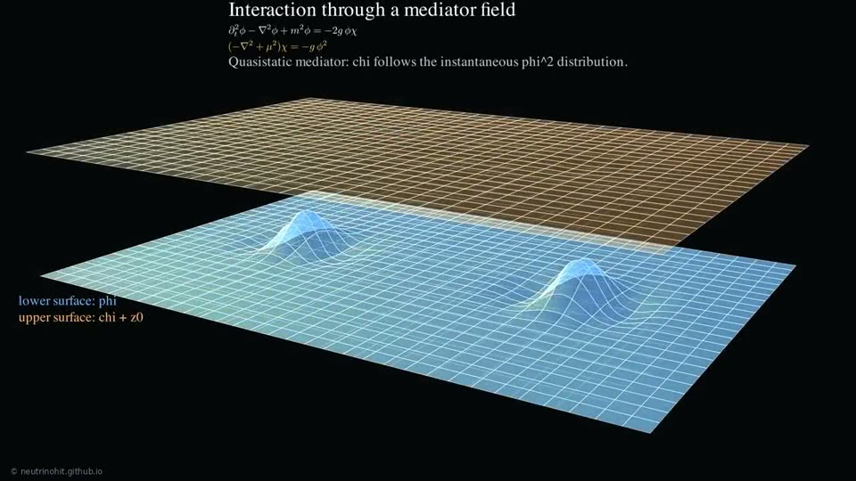<span class="anim-play" aria-hidden="true"></span></a></div>
        <h3 class="anim-title">Взаимодействие через поле-переносчик</h3>
        <p class="anim-text">Две частицы и динамическое поле, через которое проявляется взаимодействие.</p>
      </article>
      <article class="anim-card" id="animation-fields-waves-free-wavepackets">
        <div class="anim-media"><a class="anim-poster" href="../assets/animations/dvnanima/fields-waves-free-wavepackets-single.mp4" data-play data-poster="../assets/animations/dvnanima/fields-waves-free-wavepackets-single.jpg" aria-label="Смотреть: Свободные волновые пакеты">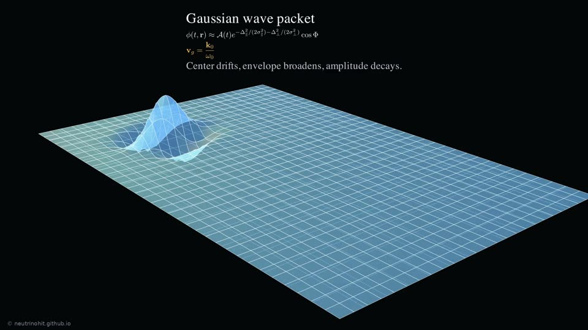<span class="anim-play" aria-hidden="true"></span></a></div>
        <h3 class="anim-title">Свободные волновые пакеты</h3>
        <p class="anim-text">Одиночный гауссов пакет и пара свободно распространяющихся пакетов.</p>
        <div class="anim-chips"><a class="anim-chip is-current" href="../assets/animations/dvnanima/fields-waves-free-wavepackets-single.mp4" data-play data-poster="../assets/animations/dvnanima/fields-waves-free-wavepackets-single.jpg" title="MP4, 5.2 MB">Один пакет</a><a class="anim-chip" href="../assets/animations/dvnanima/fields-waves-free-wavepackets-two.mp4" data-play data-poster="../assets/animations/dvnanima/fields-waves-free-wavepackets-two.jpg" title="MP4, 2.2 MB">Два пакета</a></div>
      </article>
      <article class="anim-card" id="animation-fields-waves-schrodinger-packet">
        <div class="anim-media"><a class="anim-poster" href="../assets/animations/dvnanima/fields-waves-schrodinger-packet-spreading.mp4" data-play data-poster="../assets/animations/dvnanima/fields-waves-schrodinger-packet-spreading.jpg" aria-label="Смотреть: Свободный гауссов пакет: расплывание">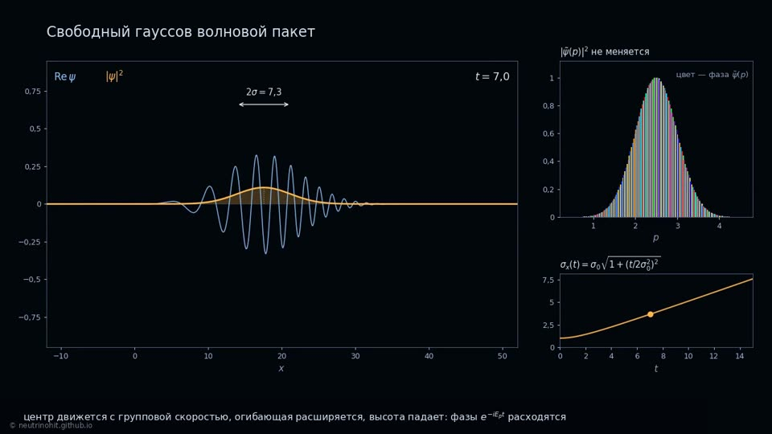<span class="anim-play" aria-hidden="true"></span></a></div>
        <h3 class="anim-title">Свободный гауссов пакет: расплывание</h3>
        <p class="anim-text">Точная эволюция гауссова пакета свободной частицы (ħ = m = 1): центр движется с групповой скоростью, ширина растёт как σ₀√(1 + (t/2σ₀²)²), а |ψ̃(p)|² не меняется; узкий пакет расплывается быстрее широкого.</p>
        <div class="anim-chips"><a class="anim-chip is-current" href="../assets/animations/dvnanima/fields-waves-schrodinger-packet-spreading.mp4" data-play data-poster="../assets/animations/dvnanima/fields-waves-schrodinger-packet-spreading.jpg" title="MP4, 1.5 MB">RU</a><a class="anim-chip" href="../assets/animations/dvnanima/fields-waves-schrodinger-packet-spreading-en.mp4" data-play data-poster="../assets/animations/dvnanima/fields-waves-schrodinger-packet-spreading-en.jpg" title="MP4, 1.5 MB">EN</a></div>
      </article>
      <article class="anim-card" id="animation-fields-waves-coupled-chain">
        <div class="anim-media"><a class="anim-poster" href="../assets/animations/dvnanima/fields-waves-coupled-chain-chain.mp4" data-play data-poster="../assets/animations/dvnanima/fields-waves-coupled-chain-chain.jpg" aria-label="Смотреть: Цепочка связанных осцилляторов">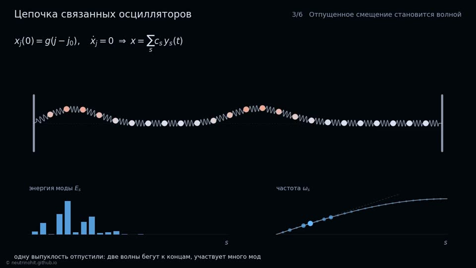<span class="anim-play" aria-hidden="true"></span></a></div>
        <h3 class="anim-title">Цепочка связанных осцилляторов</h3>
        <p class="anim-text">Цепочка из N масс: нормальные моды и дисперсия, волна от отпущенного смещения, столкновение волн в линейной цепочке (свободные частицы) и с кубическим членом (обмен энергией между модами), предел N → ∞ и поле.</p>
        <div class="anim-chips"><a class="anim-chip is-current" href="../assets/animations/dvnanima/fields-waves-coupled-chain-chain.mp4" data-play data-poster="../assets/animations/dvnanima/fields-waves-coupled-chain-chain.jpg" title="MP4, 2.1 MB">RU</a><a class="anim-chip" href="../assets/animations/dvnanima/fields-waves-coupled-chain-chain-en.mp4" data-play data-poster="../assets/animations/dvnanima/fields-waves-coupled-chain-chain-en.jpg" title="MP4, 2.1 MB">EN</a></div>
      </article>
      <article class="anim-card" id="animation-fields-waves-coupled-lattice-2d">
        <div class="anim-media"><a class="anim-poster" href="../assets/animations/dvnanima/fields-waves-coupled-lattice-2d-lattice.mp4" data-play data-poster="../assets/animations/dvnanima/fields-waves-coupled-lattice-2d-lattice.jpg" aria-label="Смотреть: Двумерная решётка связанных осцилляторов">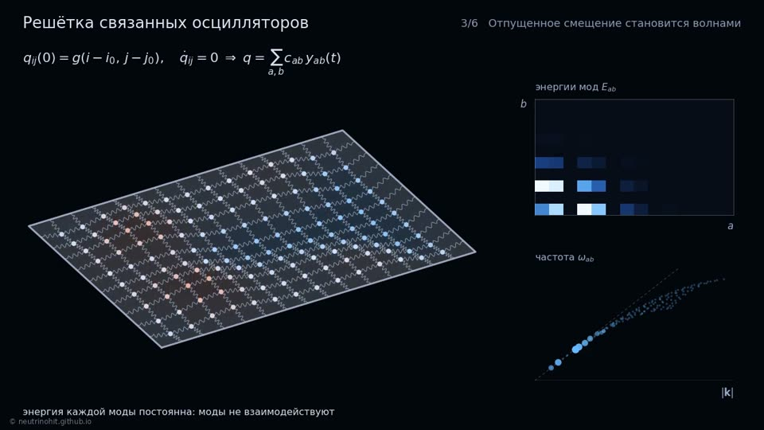<span class="anim-play" aria-hidden="true"></span></a></div>
        <h3 class="anim-title">Двумерная решётка связанных осцилляторов</h3>
        <p class="anim-text">Решётка 14×10 масс на пружинках: нормальные моды и карта их энергий, круговые волны от отпущенного смещения, столкновение волн в линейной решётке и с ангармоническими членами (перераспределение энергии между модами), предел N → ∞ и поле.</p>
        <div class="anim-chips"><a class="anim-chip is-current" href="../assets/animations/dvnanima/fields-waves-coupled-lattice-2d-lattice.mp4" data-play data-poster="../assets/animations/dvnanima/fields-waves-coupled-lattice-2d-lattice.jpg" title="MP4, 4.8 MB">RU</a><a class="anim-chip" href="../assets/animations/dvnanima/fields-waves-coupled-lattice-2d-lattice-en.mp4" data-play data-poster="../assets/animations/dvnanima/fields-waves-coupled-lattice-2d-lattice-en.jpg" title="MP4, 4.8 MB">EN</a></div>
      </article>
      <article class="anim-card" id="animation-fields-waves-coupled-lattice-3d">
        <div class="anim-media"><a class="anim-poster" href="../assets/animations/dvnanima/fields-waves-coupled-lattice-3d-lattice.mp4" data-play data-poster="../assets/animations/dvnanima/fields-waves-coupled-lattice-3d-lattice.jpg" aria-label="Смотреть: Трёхмерная решётка связанных осцилляторов">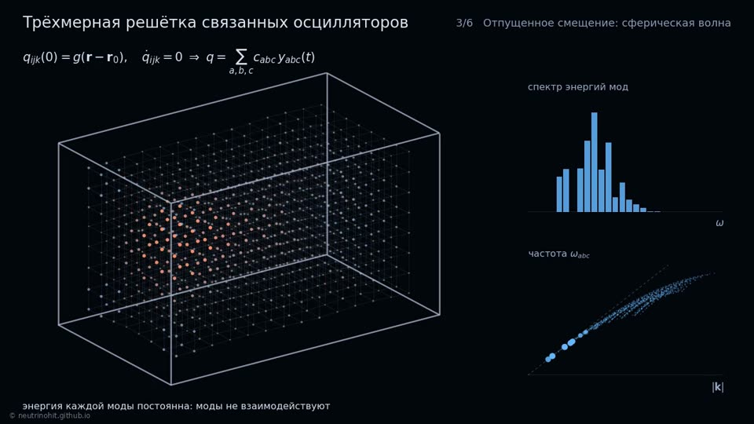<span class="anim-play" aria-hidden="true"></span></a></div>
        <h3 class="anim-title">Трёхмерная решётка связанных осцилляторов</h3>
        <p class="anim-text">Ящик 14×8×8 масс на пружинках: нормальные моды и спектр их энергий, сферическая волна от отпущенного смещения, столкновение волн в линейной решётке и с ангармоническими членами (перераспределение энергии между модами), предел N → ∞ и поле.</p>
        <div class="anim-chips"><a class="anim-chip is-current" href="../assets/animations/dvnanima/fields-waves-coupled-lattice-3d-lattice.mp4" data-play data-poster="../assets/animations/dvnanima/fields-waves-coupled-lattice-3d-lattice.jpg" title="MP4, 5.7 MB">RU</a><a class="anim-chip" href="../assets/animations/dvnanima/fields-waves-coupled-lattice-3d-lattice-en.mp4" data-play data-poster="../assets/animations/dvnanima/fields-waves-coupled-lattice-3d-lattice-en.jpg" title="MP4, 5.6 MB">EN</a></div>
      </article>
      <article class="anim-card" id="animation-fields-waves-radiating-charge">
        <div class="anim-media"><a class="anim-poster" href="../assets/animations/dvnanima/fields-waves-radiating-charge-three-dimensional.mp4" data-play data-poster="../assets/animations/dvnanima/fields-waves-radiating-charge-three-dimensional.jpg" aria-label="Смотреть: Излучающий заряд">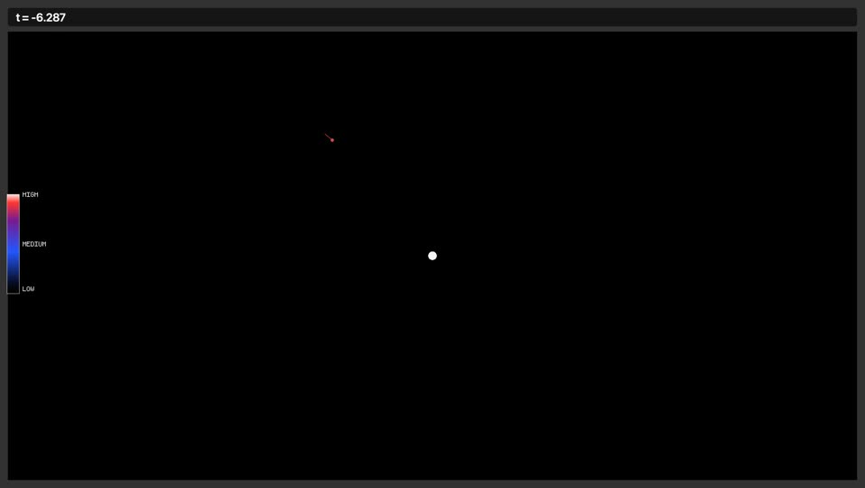<span class="anim-play" aria-hidden="true"></span></a></div>
        <h3 class="anim-title">Излучающий заряд</h3>
        <p class="anim-text">Численная визуализация поля движущегося заряда в 3D.</p>
      </article>
      <article class="anim-card" id="animation-fields-waves-coupled-pendulums">
        <div class="anim-media"><a class="anim-poster" href="../assets/animations/dvnanima/fields-waves-coupled-pendulums-pendulums.mp4" data-play data-poster="../assets/animations/dvnanima/fields-waves-coupled-pendulums-pendulums.jpg" aria-label="Смотреть: Связанные маятники">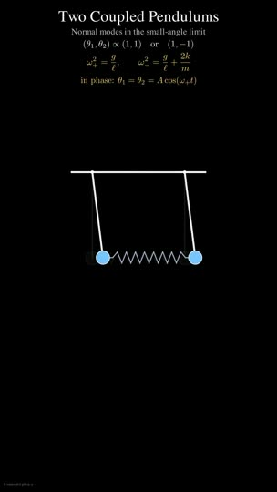<span class="anim-play" aria-hidden="true"></span></a></div>
        <h3 class="anim-title">Связанные маятники</h3>
        <p class="anim-text">Передача энергии между двумя связанными маятниками.</p>
      </article>
      <article class="anim-card" id="animation-fields-waves-capacitor">
        <div class="anim-media"><a class="anim-poster" href="../assets/animations/dvnanima/fields-waves-capacitor-capacitor.mp4" data-play data-poster="../assets/animations/dvnanima/fields-waves-capacitor-capacitor.jpg" aria-label="Смотреть: Конденсатор в переменном токе">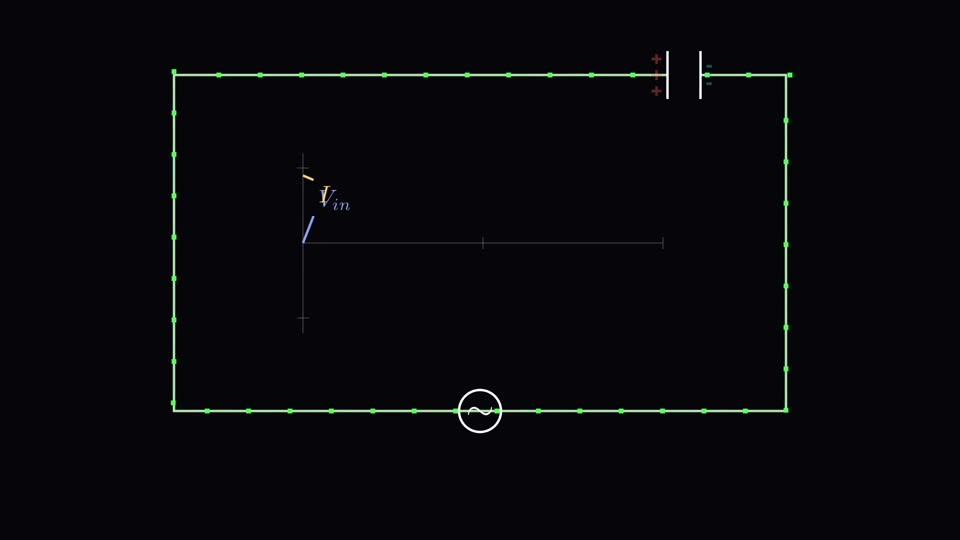<span class="anim-play" aria-hidden="true"></span></a></div>
        <h3 class="anim-title">Конденсатор в переменном токе</h3>
        <p class="anim-text">Фазовые соотношения и зарядка конденсатора в AC-цепи.</p>
      </article>
      <article class="anim-card" id="animation-fields-waves-diode">
        <div class="anim-media"><a class="anim-poster" href="../assets/animations/dvnanima/fields-waves-diode-diode.mp4" data-play data-poster="../assets/animations/dvnanima/fields-waves-diode-diode.jpg" aria-label="Смотреть: Диод в переменном токе">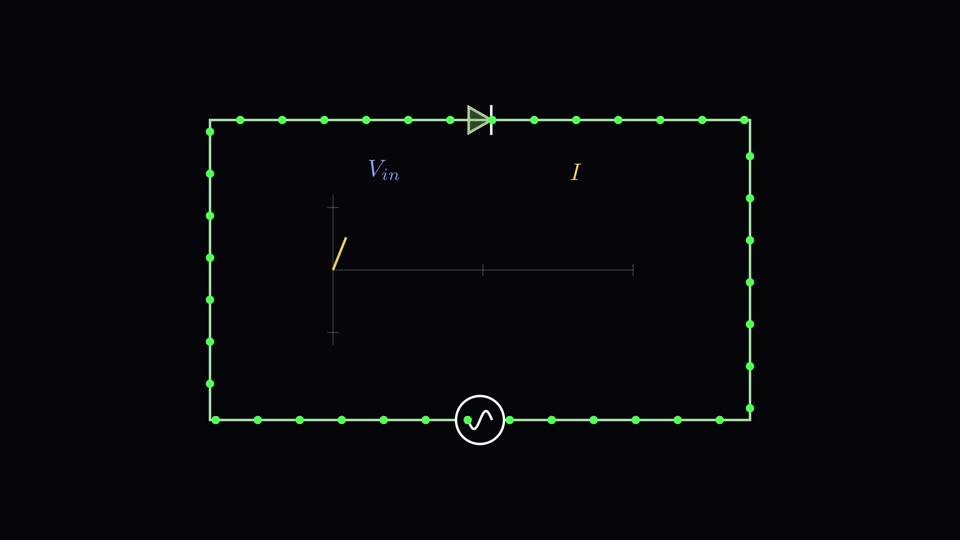<span class="anim-play" aria-hidden="true"></span></a></div>
        <h3 class="anim-title">Диод в переменном токе</h3>
        <p class="anim-text">Однополупериодное выпрямление и работа диода в AC-цепи.</p>
      </article>
      <article class="anim-card" id="animation-fields-waves-peak-detector">
        <div class="anim-media"><a class="anim-poster" href="../assets/animations/dvnanima/fields-waves-peak-detector-peak-detector.mp4" data-play data-poster="../assets/animations/dvnanima/fields-waves-peak-detector-peak-detector.jpg" aria-label="Смотреть: Пиковый детектор">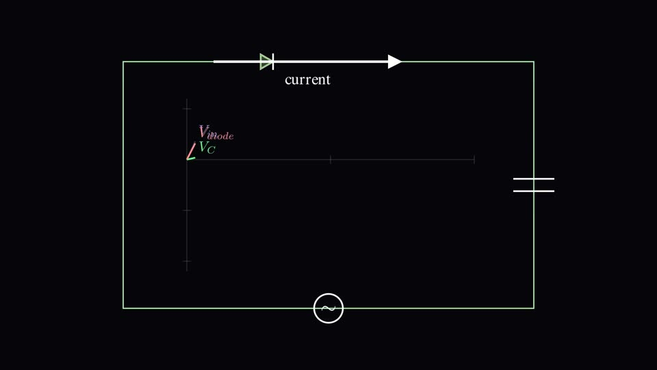<span class="anim-play" aria-hidden="true"></span></a></div>
        <h3 class="anim-title">Пиковый детектор</h3>
        <p class="anim-text">Принцип работы пикового детектора на диоде и конденсаторе.</p>
      </article>
      <article class="anim-card" id="animation-fields-waves-cockcroft-walton">
        <div class="anim-media"><a class="anim-poster" href="../assets/animations/dvnanima/fields-waves-cockcroft-walton-cascade.mp4" data-play data-poster="../assets/animations/dvnanima/fields-waves-cockcroft-walton-cascade.jpg" aria-label="Смотреть: Генератор Кокрофта-Уолтона">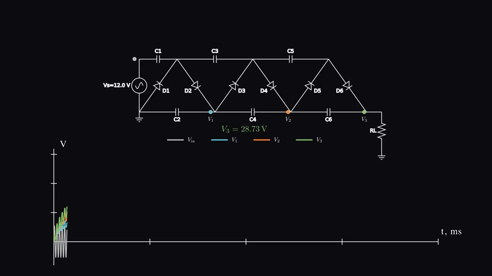<span class="anim-play" aria-hidden="true"></span></a></div>
        <h3 class="anim-title">Генератор Кокрофта-Уолтона</h3>
        <p class="anim-text">Схема умножителя напряжения и последовательная зарядка каскадов.</p>
      </article>
      <article class="anim-card" id="animation-fields-waves-running-charge">
        <div class="anim-media"><a class="anim-poster" href="../assets/animations/dvnanima/fields-waves-running-charge-film.mp4" data-play data-poster="../assets/animations/dvnanima/fields-waves-running-charge-film.jpg" aria-label="Смотреть: Бегущий заряд: экранировка виртуальными парами">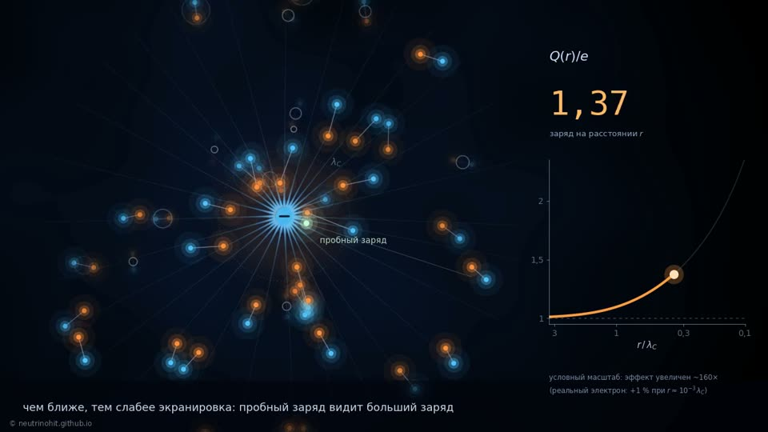<span class="anim-play" aria-hidden="true"></span></a></div>
        <h3 class="anim-title">Бегущий заряд: экранировка виртуальными парами</h3>
        <p class="anim-text">Виртуальные электрон-позитронные пары выстраиваются вокруг электрона и экранируют его заряд; пробный заряд, подлетая, видит заряд всё больший. Масштаб эффекта условный.</p>
        <div class="anim-chips"><a class="anim-chip is-current" href="../assets/animations/dvnanima/fields-waves-running-charge-film.mp4" data-play data-poster="../assets/animations/dvnanima/fields-waves-running-charge-film.jpg" title="MP4, 1.2 MB">RU</a><a class="anim-chip" href="../assets/animations/dvnanima/fields-waves-running-charge-film-en.mp4" data-play data-poster="../assets/animations/dvnanima/fields-waves-running-charge-film-en.jpg" title="MP4, 1.1 MB">EN</a></div>
      </article>
      <article class="anim-card" id="animation-fields-waves-electron-kick">
        <div class="anim-media"><a class="anim-poster" href="../assets/animations/dvnanima/fields-waves-electron-kick-front.mp4" data-play data-poster="../assets/animations/dvnanima/fields-waves-electron-kick-front.jpg" aria-label="Смотреть: Пинок электрону: фронт электромагнитной волны">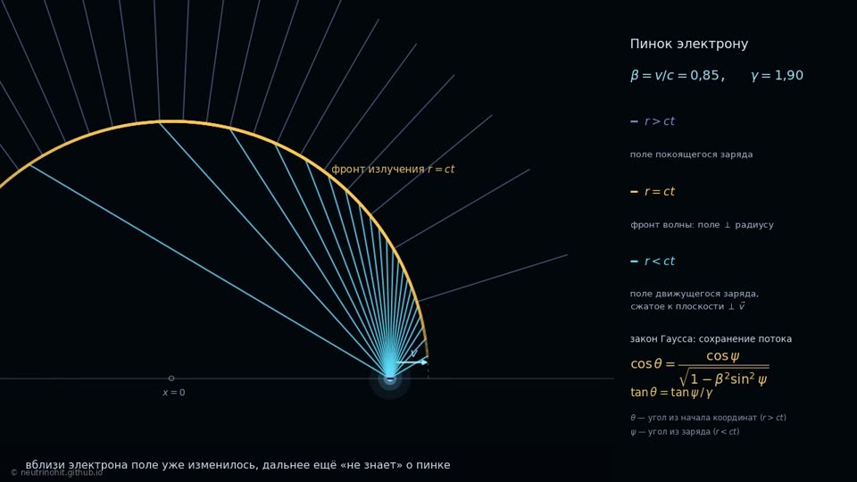<span class="anim-play" aria-hidden="true"></span></a></div>
        <h3 class="anim-title">Пинок электрону: фронт электромагнитной волны</h3>
        <p class="anim-text">Заряд мгновенно получает скорость: вне сферы r = ct поле покоящегося заряда, внутри — поле движущегося, на сфере силовые линии соединяются дугами. Точная релятивистская картина для β = 0,30 и 0,85.</p>
        <div class="anim-chips"><a class="anim-chip is-current" href="../assets/animations/dvnanima/fields-waves-electron-kick-front.mp4" data-play data-poster="../assets/animations/dvnanima/fields-waves-electron-kick-front.jpg" title="MP4, 1.5 MB">RU</a><a class="anim-chip" href="../assets/animations/dvnanima/fields-waves-electron-kick-front-en.mp4" data-play data-poster="../assets/animations/dvnanima/fields-waves-electron-kick-front-en.jpg" title="MP4, 1.5 MB">EN</a></div>
      </article>
      <article class="anim-card" id="animation-fields-waves-zero-point-electron">
        <div class="anim-media"><a class="anim-poster" href="../assets/animations/dvnanima/fields-waves-zero-point-electron-vacuum-field.mp4" data-play data-poster="../assets/animations/dvnanima/fields-waves-zero-point-electron-vacuum-field.jpg" aria-label="Смотреть: Электрон в вакуумном поле: нулевые колебания">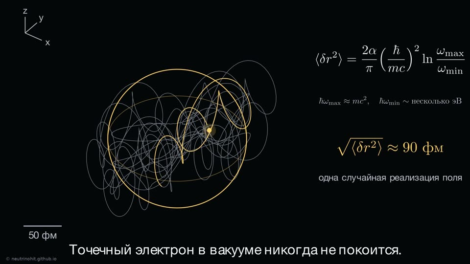<span class="anim-play" aria-hidden="true"></span></a></div>
        <h3 class="anim-title">Электрон в вакуумном поле: нулевые колебания</h3>
        <p class="anim-text">Нулевые колебания электрического поля: в каждой точке вектор E вращается по эллипсу на каждой частоте, ⟨E⟩ = 0, ⟨E²⟩ ≠ 0. Электрон повторяет эллипс с амплитудой ∝ E/ω²; каждая октава вносит равный вклад ⟨δr²⟩ = (2α/π)(ħ/mc)² ln 2, путь заполняет шар √⟨δr²⟩ ≈ 90 фм. Две версии: русская и английская.</p>
        <div class="anim-chips"><a class="anim-chip is-current" href="../assets/animations/dvnanima/fields-waves-zero-point-electron-vacuum-field.mp4" data-play data-poster="../assets/animations/dvnanima/fields-waves-zero-point-electron-vacuum-field.jpg" title="MP4, 3.5 MB">RU</a><a class="anim-chip" href="../assets/animations/dvnanima/fields-waves-zero-point-electron-vacuum-field-en.mp4" data-play data-poster="../assets/animations/dvnanima/fields-waves-zero-point-electron-vacuum-field-en.jpg" title="MP4, 3.5 MB">EN</a></div>
      </article>
      <article class="anim-card" id="animation-fields-waves-thomson-tube">
        <div class="anim-media"><a class="anim-poster" href="../assets/animations/dvnanima/fields-waves-thomson-tube-crossed-fields.mp4" data-play data-poster="../assets/animations/dvnanima/fields-waves-thomson-tube-crossed-fields.jpg" aria-label="Смотреть: Опыт Томсона: e/m">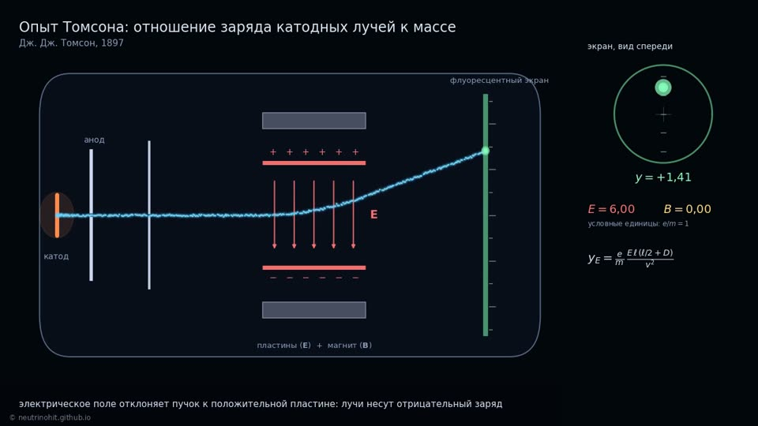<span class="anim-play" aria-hidden="true"></span></a></div>
        <h3 class="anim-title">Опыт Томсона: e/m</h3>
        <p class="anim-text">Катодные лучи в скрещённых E и B: отклонение вверх электрическим полем, вниз магнитным, баланс v = E/B и отношение e/m по отклонению. Траектории рассчитаны численно. Две версии: русская и английская.</p>
        <div class="anim-chips"><a class="anim-chip is-current" href="../assets/animations/dvnanima/fields-waves-thomson-tube-crossed-fields.mp4" data-play data-poster="../assets/animations/dvnanima/fields-waves-thomson-tube-crossed-fields.jpg" title="MP4, 3.3 MB">RU</a><a class="anim-chip" href="../assets/animations/dvnanima/fields-waves-thomson-tube-crossed-fields-en.mp4" data-play data-poster="../assets/animations/dvnanima/fields-waves-thomson-tube-crossed-fields-en.jpg" title="MP4, 3.3 MB">EN</a></div>
      </article>
      <article class="anim-card" id="animation-fields-waves-oam-beams">
        <div class="anim-media"><a class="anim-poster" href="../assets/animations/dvnanima/fields-waves-oam-beams-twisted-beams.mp4" data-play data-poster="../assets/animations/dvnanima/fields-waves-oam-beams-twisted-beams.jpg" aria-label="Смотреть: Закрученные пучки: орбитальный угловой момент">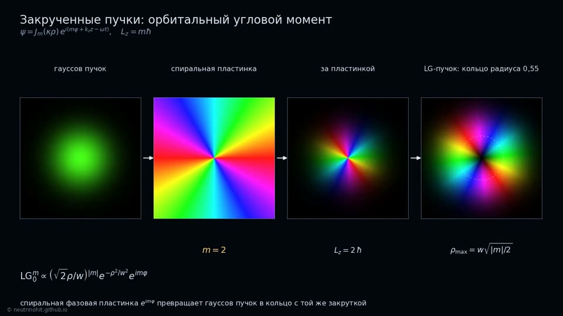<span class="anim-play" aria-hidden="true"></span></a></div>
        <h3 class="anim-title">Закрученные пучки: орбитальный угловой момент</h3>
        <p class="anim-text">Фаза делает m оборотов вокруг оси, L_z = mħ; винтовые волновые фронты с m заходами; получение пучка спиральной фазовой пластинкой (гауссов пучок → мода Лагерра — Гаусса). Две версии: русская и английская.</p>
        <div class="anim-chips"><a class="anim-chip is-current" href="../assets/animations/dvnanima/fields-waves-oam-beams-twisted-beams.mp4" data-play data-poster="../assets/animations/dvnanima/fields-waves-oam-beams-twisted-beams.jpg" title="MP4, 1.7 MB">RU</a><a class="anim-chip" href="../assets/animations/dvnanima/fields-waves-oam-beams-twisted-beams-en.mp4" data-play data-poster="../assets/animations/dvnanima/fields-waves-oam-beams-twisted-beams-en.jpg" title="MP4, 1.6 MB">EN</a></div>
      </article>
      <article class="anim-card" id="animation-fields-waves-circular-polarization">
        <div class="anim-media"><a class="anim-poster" href="../assets/animations/dvnanima/fields-waves-circular-polarization-helicity.mp4" data-play data-poster="../assets/animations/dvnanima/fields-waves-circular-polarization-helicity.jpg" aria-label="Смотреть: Круговая поляризация">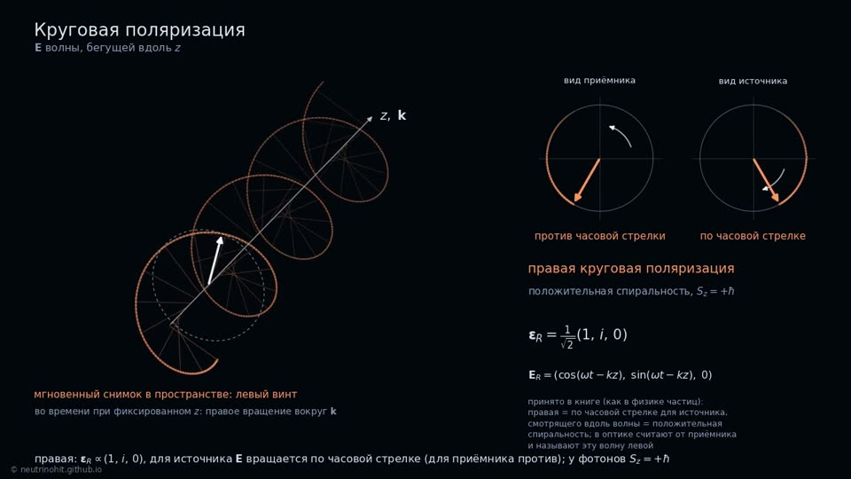<span class="anim-play" aria-hidden="true"></span></a></div>
        <h3 class="anim-title">Круговая поляризация</h3>
        <p class="anim-text">Вращение E для приёмника и источника, спиральность S_z = ±ħ, мгновенный снимок в пространстве (левый винт) и сложение ε_L и ε_R: линейная, эллиптическая и круговая поляризации. Две версии: русская и английская.</p>
        <div class="anim-chips"><a class="anim-chip is-current" href="../assets/animations/dvnanima/fields-waves-circular-polarization-helicity.mp4" data-play data-poster="../assets/animations/dvnanima/fields-waves-circular-polarization-helicity.jpg" title="MP4, 1.3 MB">RU</a><a class="anim-chip" href="../assets/animations/dvnanima/fields-waves-circular-polarization-helicity-en.mp4" data-play data-poster="../assets/animations/dvnanima/fields-waves-circular-polarization-helicity-en.jpg" title="MP4, 1.3 MB">EN</a></div>
      </article>
      <article class="anim-card" id="animation-fields-waves-meissner-photon-mass">
        <div class="anim-media"><a class="anim-poster" href="../assets/animations/dvnanima/fields-waves-meissner-photon-mass-film.mp4" data-play data-poster="../assets/animations/dvnanima/fields-waves-meissner-photon-mass-film.jpg" aria-label="Смотреть: Эффект Мейснера и масса фотона">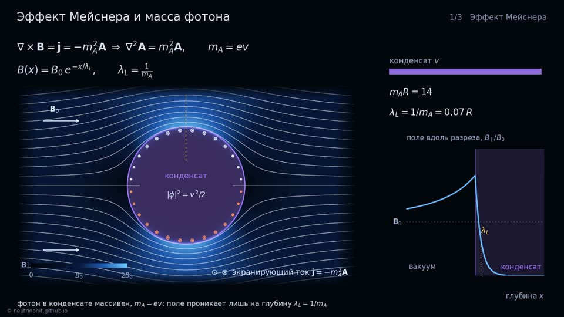<span class="anim-play" aria-hidden="true"></span></a></div>
        <h3 class="anim-title">Эффект Мейснера и масса фотона</h3>
        <p class="anim-text">Конденсат Хиггса выталкивает магнитное поле (эффект Мейснера), пакет электромагнитной волны отражается от границы конденсата или проходит с групповой скоростью k/ω &lt; 1; дисперсия ω² = k² + m_A² и счёт поляризаций 2 + 2 = 1 + 3.</p>
        <div class="anim-chips"><a class="anim-chip is-current" href="../assets/animations/dvnanima/fields-waves-meissner-photon-mass-film.mp4" data-play data-poster="../assets/animations/dvnanima/fields-waves-meissner-photon-mass-film.jpg" title="MP4, 3.2 MB">RU</a><a class="anim-chip" href="../assets/animations/dvnanima/fields-waves-meissner-photon-mass-film-en.mp4" data-play data-poster="../assets/animations/dvnanima/fields-waves-meissner-photon-mass-film-en.jpg" title="MP4, 3.2 MB">EN</a></div>
      </article>
      <article class="anim-card" id="animation-fields-waves-chiral-fermion-mass">
        <div class="anim-media"><a class="anim-poster" href="../assets/animations/dvnanima/fields-waves-chiral-fermion-mass-film.mp4" data-play data-poster="../assets/animations/dvnanima/fields-waves-chiral-fermion-mass-film.jpg" aria-label="Смотреть: Киральные волны и масса фермиона">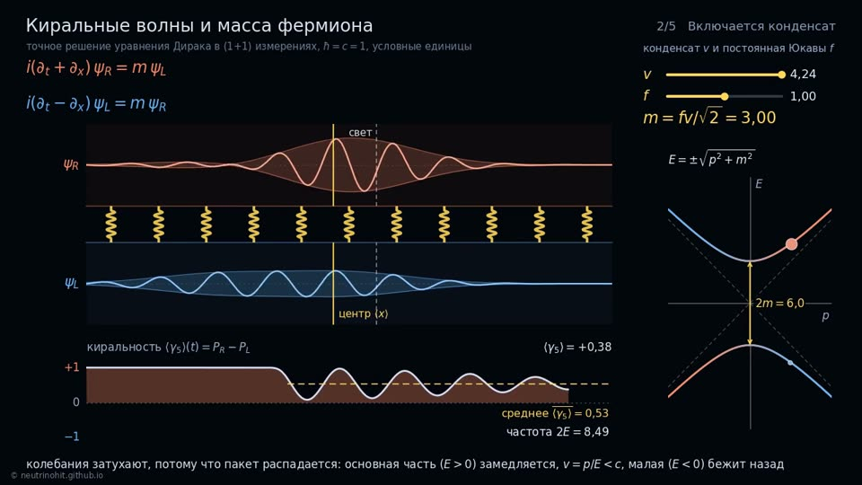<span class="anim-play" aria-hidden="true"></span></a></div>
        <h3 class="anim-title">Киральные волны и масса фермиона</h3>
        <p class="anim-text">Две киральные волны уравнения Дирака в (1+1) измерениях: масса — это связь ψ_R и ψ_L через хиггсовский конденсат; осцилляции киральности с частотой 2E, замедление пакета до p/E, запрет массового члена в SU(2) и юкавская связь.</p>
        <div class="anim-chips"><a class="anim-chip is-current" href="../assets/animations/dvnanima/fields-waves-chiral-fermion-mass-film.mp4" data-play data-poster="../assets/animations/dvnanima/fields-waves-chiral-fermion-mass-film.jpg" title="MP4, 2.0 MB">RU</a><a class="anim-chip" href="../assets/animations/dvnanima/fields-waves-chiral-fermion-mass-film-en.mp4" data-play data-poster="../assets/animations/dvnanima/fields-waves-chiral-fermion-mass-film-en.jpg" title="MP4, 2.0 MB">EN</a></div>
      </article>
      <article class="anim-card" id="animation-fields-waves-higgs-ff-spin">
        <div class="anim-media"><a class="anim-poster" href="../assets/animations/dvnanima/fields-waves-higgs-ff-spin-film.mp4" data-play data-poster="../assets/animations/dvnanima/fields-waves-higgs-ff-spin-film.jpg" aria-label="Смотреть: Спиновая и орбитальная структура пары f f̄ в распадах бозона Хиггса">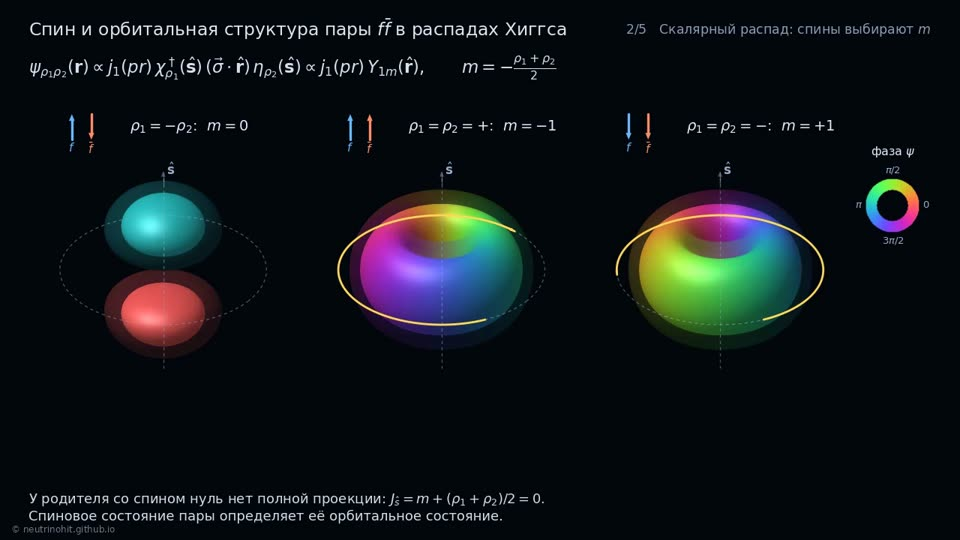<span class="anim-play" aria-hidden="true"></span></a></div>
        <h3 class="anim-title">Спиновая и орбитальная структура пары f f̄ в распадах бозона Хиггса</h3>
        <p class="anim-text">Волновая функция пары f f̄ относительной координаты: P-волна скалярного распада (вихрь, орбитальная проекция m выбирается спинами), S-волна псевдоскаляра, наклон облака от интерференции скаляра и псевдоскаляра (CP-нечётность) и то, что остаётся для детектора.</p>
        <div class="anim-chips"><a class="anim-chip is-current" href="../assets/animations/dvnanima/fields-waves-higgs-ff-spin-film.mp4" data-play data-poster="../assets/animations/dvnanima/fields-waves-higgs-ff-spin-film.jpg" title="MP4, 2.8 MB">RU</a><a class="anim-chip" href="../assets/animations/dvnanima/fields-waves-higgs-ff-spin-film-en.mp4" data-play data-poster="../assets/animations/dvnanima/fields-waves-higgs-ff-spin-film-en.jpg" title="MP4, 2.7 MB">EN</a></div>
      </article>
      <article class="anim-card" id="animation-fields-waves-quantum-tunneling">
        <div class="anim-media"><a class="anim-poster" href="../assets/animations/dvnanima/fields-waves-quantum-tunneling-film.mp4" data-play data-poster="../assets/animations/dvnanima/fields-waves-quantum-tunneling-film.jpg" aria-label="Смотреть: Туннельный эффект: точечное и протяжённое тело">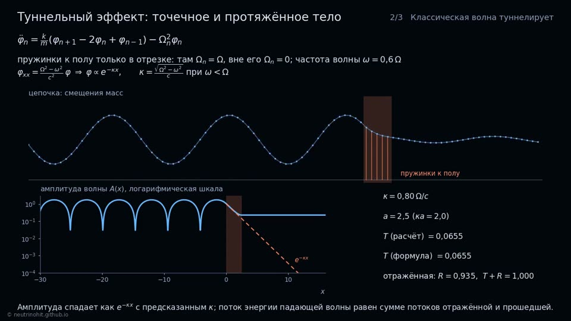<span class="anim-play" aria-hidden="true"></span></a></div>
        <h3 class="anim-title">Туннельный эффект: точечное и протяжённое тело</h3>
        <p class="anim-text">Шар, поезд и волна: протяжённое тело ощущает усреднённый барьер; классическая волна на цепочке туннелирует через отрезок с T ≈ exp(−2κa) без квантов; для волны материи то же уравнение, κ = √(2m(V−E))/ħ, и T падает экспоненциально с массой.</p>
        <div class="anim-chips"><a class="anim-chip is-current" href="../assets/animations/dvnanima/fields-waves-quantum-tunneling-film.mp4" data-play data-poster="../assets/animations/dvnanima/fields-waves-quantum-tunneling-film.jpg" title="MP4, 3.6 MB">RU</a><a class="anim-chip" href="../assets/animations/dvnanima/fields-waves-quantum-tunneling-film-en.mp4" data-play data-poster="../assets/animations/dvnanima/fields-waves-quantum-tunneling-film-en.jpg" title="MP4, 3.6 MB">EN</a></div>
      </article>
      <article class="anim-card" id="animation-fields-waves-chiral-anomaly">
        <div class="anim-media"><a class="anim-poster" href="../assets/animations/dvnanima/fields-waves-chiral-anomaly-film.mp4" data-play data-poster="../assets/animations/dvnanima/fields-waves-chiral-anomaly-film.jpg" aria-label="Смотреть: Киральная аномалия: откуда берутся частицы?"><span class="anim-play" aria-hidden="true"></span></a></div>
        <h3 class="anim-title">Киральная аномалия: откуда берутся частицы?</h3>
        <p class="anim-text">Безмассовый фермион на кольце: электрическое поле сдвигает уровни, уровни пересекают E = 0 (подсчёт даёт dQ₅/dt = eEL/π); регуляризация и сохранение векторного тока; уровни Ландау и e²E·B/2π²; треугольник и распад π⁰ → γγ.</p>
        <div class="anim-chips"><a class="anim-chip is-current" href="../assets/animations/dvnanima/fields-waves-chiral-anomaly-film.mp4" data-play data-poster="../assets/animations/dvnanima/fields-waves-chiral-anomaly-film.jpg" title="MP4, 2.0 MB">RU</a><a class="anim-chip" href="../assets/animations/dvnanima/fields-waves-chiral-anomaly-film-en.mp4" data-play data-poster="../assets/animations/dvnanima/fields-waves-chiral-anomaly-film-en.jpg" title="MP4, 2.0 MB">EN</a></div>
      </article>
      <article class="anim-card" id="animation-fields-waves-gauge-principle">
        <div class="anim-media"><a class="anim-poster" href="../assets/animations/dvnanima/fields-waves-gauge-principle-film.mp4" data-play data-poster="../assets/animations/dvnanima/fields-waves-gauge-principle-film.jpg" aria-label="Смотреть: Калибровочный принцип: два друга и поле"><span class="anim-play" aria-hidden="true"></span></a></div>
        <h3 class="anim-title">Калибровочный принцип: два друга и поле</h3>
        <p class="anim-text">Два друга выбирают фазу волновой функции независимо в каждой точке: интерференция, свободный пакет и ковариантная производная; компенсирующее поле A_μ, напряжённость F и калибровочно инвариантная петля.</p>
        <div class="anim-chips"><a class="anim-chip is-current" href="../assets/animations/dvnanima/fields-waves-gauge-principle-film.mp4" data-play data-poster="../assets/animations/dvnanima/fields-waves-gauge-principle-film.jpg" title="MP4, 1.6 MB">RU</a><a class="anim-chip" href="../assets/animations/dvnanima/fields-waves-gauge-principle-film-en.mp4" data-play data-poster="../assets/animations/dvnanima/fields-waves-gauge-principle-film-en.jpg" title="MP4, 1.6 MB">EN</a></div>
      </article>
      <article class="anim-card" id="animation-fields-waves-susy-packets">
        <div class="anim-media"><a class="anim-poster" href="../assets/animations/dvnanima/fields-waves-susy-packets-ru.mp4" data-play data-poster="../assets/animations/dvnanima/fields-waves-susy-packets-ru.jpg" aria-label="Смотреть: Суперсимметрия: две пары пакетов — одна физика"><span class="anim-play" aria-hidden="true"></span></a></div>
        <h3 class="anim-title">Суперсимметрия: две пары пакетов — одна физика</h3>
        <p class="anim-text">Суперсимметричная квантовая механика с W(x) = x (осциллятор), ħ = 2m = 1. Волновой пакет «бозона» f и пакет «фермиона» g разной формы поворачиваются суперсимметрией U(θ) = exp(iθK) в другую пару пакетов. Формы и доля бозона меняются (0,40 → 0,58 при θ = 0,5), а распределение энергии, ⟨H⟩, ⟨K⟩ и вся эволюция во времени — нет: «повернуть, потом подождать» и «подождать, потом повернуть» совпадают. В конце мягкое нарушение в секторе фермиона раздвигает пары уровней, и два порядка расходятся. Всё точно в базисе осциллятора. Оговорка: в полной теории поля параметр — грассманово число, а суперпозиция бозона и фермиона запрещена; здесь параметр вещественный.</p>
        <div class="anim-chips"><a class="anim-chip is-current" href="../assets/animations/dvnanima/fields-waves-susy-packets-ru.mp4" data-play data-poster="../assets/animations/dvnanima/fields-waves-susy-packets-ru.jpg" title="MP4, 2.9 MB">RU</a><a class="anim-chip" href="../assets/animations/dvnanima/fields-waves-susy-packets-en.mp4" data-play data-poster="../assets/animations/dvnanima/fields-waves-susy-packets-en.jpg" title="MP4, 2.8 MB">EN</a></div>
      </article>
      <article class="anim-card" id="animation-fields-waves-higgs-honey">
        <div class="anim-media"><a class="anim-poster" href="../assets/animations/dvnanima/fields-waves-higgs-honey-ru.mp4" data-play data-poster="../assets/animations/dvnanima/fields-waves-higgs-honey-ru.jpg" aria-label="Смотреть: Поле Хиггса как мёд"><span class="anim-play" aria-hidden="true"></span></a></div>
        <h3 class="anim-title">Поле Хиггса как мёд</h3>
        <p class="anim-text">Образ из первой главы книги. Пчёлы летят сквозь космос со скоростью света. В прозрачный куб наливается мёд: его растекание считается по уравнению тонкого вязкого слоя, объём сохраняется точно. Пчёлы в мёде летят медленнее, v/c = √(1 − (mc²/E)²): 0,60c, а когда мёд густеет — 0,31c; выйдя из мёда, они снова летят со скоростью c. Оговорка: это лишь образ — поле Хиггса не тормозит частицу, как вязкая среда, а даёт ей массу.</p>
        <div class="anim-chips"><a class="anim-chip is-current" href="../assets/animations/dvnanima/fields-waves-higgs-honey-ru.mp4" data-play data-poster="../assets/animations/dvnanima/fields-waves-higgs-honey-ru.jpg" title="MP4, 8.4 MB">RU</a><a class="anim-chip" href="../assets/animations/dvnanima/fields-waves-higgs-honey-en.mp4" data-play data-poster="../assets/animations/dvnanima/fields-waves-higgs-honey-en.jpg" title="MP4, 8.5 MB">EN</a></div>
      </article>
    </div>
  </section>
  <section class="anim-section" id="relativity-atom-spin">
    <div class="anim-section-head">
      <span class="course-tile-status is-ready">8 сюжетов · 16 роликов</span>
      <h2>Относительность, атом и спин</h2>
      <p>Анимации к книге «Квантовая теория поля для экспериментаторов и не только»: релятивистское изображение шара, опыт Резерфорда, спинор и лента Мёбиуса.</p>
    </div>
    <div class="anim-grid">
      <article class="anim-card" id="animation-relativity-atom-spin-penrose-terrell">
        <div class="anim-media"><a class="anim-poster" href="../assets/animations/dvnanima/relativity-atom-spin-penrose-terrell-camera.mp4" data-play data-poster="../assets/animations/dvnanima/relativity-atom-spin-penrose-terrell-camera.jpg" aria-label="Смотреть: Вращение Пенроуза — Террелла"><span class="anim-play" aria-hidden="true"></span></a></div>
        <h3 class="anim-title">Вращение Пенроуза — Террелла</h3>
        <p class="anim-text">Футбольный мяч летит мимо камеры со скоростью 0,99 c. Трассировка лучей с запаздыванием: камера видит круглый, повёрнутый мяч, а мгновенный снимок сжатого шара ненаблюдаем.</p>
        <div class="anim-chips"><a class="anim-chip is-current" href="../assets/animations/dvnanima/relativity-atom-spin-penrose-terrell-camera.mp4" data-play data-poster="../assets/animations/dvnanima/relativity-atom-spin-penrose-terrell-camera.jpg" title="MP4, 522.5 KB">RU</a><a class="anim-chip" href="../assets/animations/dvnanima/relativity-atom-spin-penrose-terrell-camera-en.mp4" data-play data-poster="../assets/animations/dvnanima/relativity-atom-spin-penrose-terrell-camera-en.jpg" title="MP4, 527.6 KB">EN</a></div>
      </article>
      <article class="anim-card" id="animation-relativity-atom-spin-rutherford">
        <div class="anim-media"><a class="anim-poster" href="../assets/animations/dvnanima/relativity-atom-spin-rutherford-foil.mp4" data-play data-poster="../assets/animations/dvnanima/relativity-atom-spin-rutherford-foil.jpg" aria-label="Смотреть: Опыт Резерфорда — Гейгера — Марсдена"><span class="anim-play" aria-hidden="true"></span></a></div>
        <h3 class="anim-title">Опыт Резерфорда — Гейгера — Марсдена</h3>
        <p class="anim-text">Альфа-частицы в кулоновском поле ядер тонкой фольги: траектории рассчитаны численно, угловое распределение сравнивается с формулой Резерфорда.</p>
        <div class="anim-chips"><a class="anim-chip is-current" href="../assets/animations/dvnanima/relativity-atom-spin-rutherford-foil.mp4" data-play data-poster="../assets/animations/dvnanima/relativity-atom-spin-rutherford-foil.jpg" title="MP4, 1.4 MB">RU</a><a class="anim-chip" href="../assets/animations/dvnanima/relativity-atom-spin-rutherford-foil-en.mp4" data-play data-poster="../assets/animations/dvnanima/relativity-atom-spin-rutherford-foil-en.jpg" title="MP4, 1.4 MB">EN</a></div>
      </article>
      <article class="anim-card" id="animation-relativity-atom-spin-spinor-mobius">
        <div class="anim-media"><a class="anim-poster" href="../assets/animations/dvnanima/relativity-atom-spin-spinor-mobius-strip.mp4" data-play data-poster="../assets/animations/dvnanima/relativity-atom-spin-spinor-mobius-strip.jpg" aria-label="Смотреть: Спинор и лента Мёбиуса"><span class="anim-play" aria-hidden="true"></span></a></div>
        <h3 class="anim-title">Спинор и лента Мёбиуса</h3>
        <p class="anim-text">Поворот на 360° меняет знак спинора, поворот на 720° возвращает его: вектор на ленте Мёбиуса и компонента ψ = exp(−iφ/2).</p>
        <div class="anim-chips"><a class="anim-chip is-current" href="../assets/animations/dvnanima/relativity-atom-spin-spinor-mobius-strip.mp4" data-play data-poster="../assets/animations/dvnanima/relativity-atom-spin-spinor-mobius-strip.jpg" title="MP4, 1.1 MB">RU</a><a class="anim-chip" href="../assets/animations/dvnanima/relativity-atom-spin-spinor-mobius-strip-en.mp4" data-play data-poster="../assets/animations/dvnanima/relativity-atom-spin-spinor-mobius-strip-en.jpg" title="MP4, 1.1 MB">EN</a></div>
      </article>
      <article class="anim-card" id="animation-relativity-atom-spin-hulse-taylor">
        <div class="anim-media"><a class="anim-poster" href="../assets/animations/dvnanima/relativity-atom-spin-hulse-taylor-orbit.mp4" data-play data-poster="../assets/animations/dvnanima/relativity-atom-spin-hulse-taylor-orbit.jpg" aria-label="Смотреть: Двойной пульсар Халса — Тейлора"><span class="anim-play" aria-hidden="true"></span></a></div>
        <h3 class="anim-title">Двойной пульсар Халса — Тейлора</h3>
        <p class="anim-text">Две нейтронные звезды на эксцентрической орбите излучают гравитационные волны, орбита сжимается, а периастр приходит всё раньше: накопленный сдвиг по ОТО и по измеренной производной периода, 1975–2005.</p>
        <div class="anim-chips"><a class="anim-chip is-current" href="../assets/animations/dvnanima/relativity-atom-spin-hulse-taylor-orbit.mp4" data-play data-poster="../assets/animations/dvnanima/relativity-atom-spin-hulse-taylor-orbit.jpg" title="MP4, 1.6 MB">RU</a><a class="anim-chip" href="../assets/animations/dvnanima/relativity-atom-spin-hulse-taylor-orbit-en.mp4" data-play data-poster="../assets/animations/dvnanima/relativity-atom-spin-hulse-taylor-orbit-en.jpg" title="MP4, 1.6 MB">EN</a></div>
      </article>
      <article class="anim-card" id="animation-relativity-atom-spin-path-integral">
        <div class="anim-media"><a class="anim-poster" href="../assets/animations/dvnanima/relativity-atom-spin-path-integral-paths.mp4" data-play data-poster="../assets/animations/dvnanima/relativity-atom-spin-path-integral-paths.jpg" aria-label="Смотреть: Интеграл по траекториям"><span class="anim-play" aria-hidden="true"></span></a></div>
        <h3 class="anim-title">Интеграл по траекториям</h3>
        <p class="anim-text">Амплитуда как сумма по путям: экраны с 3, 7 и 5 щелями (105 путей), затем все пути и спираль Корню, и классический предел ħ → 0.</p>
        <div class="anim-chips"><a class="anim-chip is-current" href="../assets/animations/dvnanima/relativity-atom-spin-path-integral-paths.mp4" data-play data-poster="../assets/animations/dvnanima/relativity-atom-spin-path-integral-paths.jpg" title="MP4, 1.9 MB">RU</a><a class="anim-chip" href="../assets/animations/dvnanima/relativity-atom-spin-path-integral-paths-en.mp4" data-play data-poster="../assets/animations/dvnanima/relativity-atom-spin-path-integral-paths-en.jpg" title="MP4, 1.9 MB">EN</a></div>
      </article>
      <article class="anim-card" id="animation-relativity-atom-spin-simultaneity">
        <div class="anim-media"><a class="anim-poster" href="../assets/animations/dvnanima/relativity-atom-spin-simultaneity-minkowski.mp4" data-play data-poster="../assets/animations/dvnanima/relativity-atom-spin-simultaneity-minkowski.jpg" aria-label="Смотреть: Относительность одновременности"><span class="anim-play" aria-hidden="true"></span></a></div>
        <h3 class="anim-title">Относительность одновременности</h3>
        <p class="anim-text">Диаграмма Минковского: вспышки A, B, C одновременны в O и идут в порядке C, B, A (v &gt; 0) или A, B, C (v &lt; 0) в O′; пространственноподобные пары меняют порядок, временноподобные никогда. Две версии: русская и английская.</p>
        <div class="anim-chips"><a class="anim-chip is-current" href="../assets/animations/dvnanima/relativity-atom-spin-simultaneity-minkowski.mp4" data-play data-poster="../assets/animations/dvnanima/relativity-atom-spin-simultaneity-minkowski.jpg" title="MP4, 2.7 MB">RU</a><a class="anim-chip" href="../assets/animations/dvnanima/relativity-atom-spin-simultaneity-minkowski-en.mp4" data-play data-poster="../assets/animations/dvnanima/relativity-atom-spin-simultaneity-minkowski-en.jpg" title="MP4, 2.7 MB">EN</a></div>
      </article>
      <article class="anim-card" id="animation-relativity-atom-spin-wormhole-camera">
        <div class="anim-media"><a class="anim-poster" href="../assets/animations/dvnanima/relativity-atom-spin-wormhole-camera-camera.mp4" data-play data-poster="../assets/animations/dvnanima/relativity-atom-spin-wormhole-camera-camera.jpg" aria-label="Смотреть: Камера у кротовой норы"><span class="anim-play" aria-hidden="true"></span></a></div>
        <h3 class="anim-title">Камера у кротовой норы</h3>
        <p class="anim-text">Кротовая нора Морриса и Торна как решение уравнений Эйнштейна, ход лучей по её поверхности и вид из камеры, которая облетает нору, пролетает через горловину и видит свет галактик обеих Вселенных.</p>
        <div class="anim-chips"><a class="anim-chip is-current" href="../assets/animations/dvnanima/relativity-atom-spin-wormhole-camera-camera.mp4" data-play data-poster="../assets/animations/dvnanima/relativity-atom-spin-wormhole-camera-camera.jpg" title="MP4, 10.3 MB">RU</a><a class="anim-chip" href="../assets/animations/dvnanima/relativity-atom-spin-wormhole-camera-camera-en.mp4" data-play data-poster="../assets/animations/dvnanima/relativity-atom-spin-wormhole-camera-camera-en.jpg" title="MP4, 10.2 MB">EN</a></div>
      </article>
      <article class="anim-card" id="animation-relativity-atom-spin-black-hole-flyby">
        <div class="anim-media"><a class="anim-poster" href="../assets/animations/dvnanima/relativity-atom-spin-black-hole-flyby-flyby.mp4" data-play data-poster="../assets/animations/dvnanima/relativity-atom-spin-black-hole-flyby-flyby.jpg" aria-label="Смотреть: Облёт чёрной дыры"><span class="anim-play" aria-hidden="true"></span></a></div>
        <h3 class="anim-title">Облёт чёрной дыры</h3>
        <p class="anim-text">Камера свободно падает по орбите вокруг невращающейся чёрной дыры: ход лучей света в метрике Шварцшильда, тень, диск и его изображения, аберрация и сдвиг частоты при скорости 0,65c, часы камеры и далёкого наблюдателя.</p>
        <div class="anim-chips"><a class="anim-chip is-current" href="../assets/animations/dvnanima/relativity-atom-spin-black-hole-flyby-flyby.mp4" data-play data-poster="../assets/animations/dvnanima/relativity-atom-spin-black-hole-flyby-flyby.jpg" title="MP4, 8.4 MB">RU</a><a class="anim-chip" href="../assets/animations/dvnanima/relativity-atom-spin-black-hole-flyby-flyby-en.mp4" data-play data-poster="../assets/animations/dvnanima/relativity-atom-spin-black-hole-flyby-flyby-en.jpg" title="MP4, 8.4 MB">EN</a></div>
      </article>
    </div>
  </section>
  <section class="anim-section" id="math-dynamical-systems">
    <div class="anim-section-head">
      <span class="course-tile-status is-ready">6 сюжетов · 25 роликов</span>
      <h2>Математика и динамические системы</h2>
      <p>Фурье-рисование, аттракторы, ретроградное движение, спирали и комплексные степени.</p>
    </div>
    <div class="anim-grid">
      <article class="anim-card" id="animation-math-dynamical-systems-fourier-drawing">
        <div class="anim-media"><a class="anim-poster" href="../assets/animations/dvnanima/math-dynamical-systems-fourier-drawing-fourier-svg.mp4" data-play data-poster="../assets/animations/dvnanima/math-dynamical-systems-fourier-drawing-fourier-svg.jpg" aria-label="Смотреть: Фурье-рисование"><span class="anim-play" aria-hidden="true"></span></a></div>
        <h3 class="anim-title">Фурье-рисование</h3>
        <p class="anim-text">Аппроксимация контуров эпициклами и рядами Фурье.</p>
        <div class="anim-chips"><a class="anim-chip is-current" href="../assets/animations/dvnanima/math-dynamical-systems-fourier-drawing-fourier-svg.mp4" data-play data-poster="../assets/animations/dvnanima/math-dynamical-systems-fourier-drawing-fourier-svg.jpg" title="MP4, 775.8 KB">Fourier SVG</a><a class="anim-chip" href="../assets/animations/dvnanima/math-dynamical-systems-fourier-drawing-pi.mp4" data-play data-poster="../assets/animations/dvnanima/math-dynamical-systems-fourier-drawing-pi.jpg" title="MP4, 794.5 KB">π</a><a class="anim-chip" href="../assets/animations/dvnanima/math-dynamical-systems-fourier-drawing-telescope.mp4" data-play data-poster="../assets/animations/dvnanima/math-dynamical-systems-fourier-drawing-telescope.jpg" title="MP4, 1.4 MB">Телескоп</a><a class="anim-chip" href="../assets/animations/dvnanima/math-dynamical-systems-fourier-drawing-brain.mp4" data-play data-poster="../assets/animations/dvnanima/math-dynamical-systems-fourier-drawing-brain.jpg" title="MP4, 549.0 KB">Мозг</a><a class="anim-chip" href="../assets/animations/dvnanima/math-dynamical-systems-fourier-drawing-dinosaur.mp4" data-play data-poster="../assets/animations/dvnanima/math-dynamical-systems-fourier-drawing-dinosaur.jpg" title="MP4, 1.4 MB">Динозавр</a><a class="anim-chip" href="../assets/animations/dvnanima/math-dynamical-systems-fourier-drawing-woman-1.mp4" data-play data-poster="../assets/animations/dvnanima/math-dynamical-systems-fourier-drawing-woman-1.jpg" title="MP4, 745.3 KB">Портрет 1</a><a class="anim-chip" href="../assets/animations/dvnanima/math-dynamical-systems-fourier-drawing-woman-2.mp4" data-play data-poster="../assets/animations/dvnanima/math-dynamical-systems-fourier-drawing-woman-2.jpg" title="MP4, 858.3 KB">Портрет 2</a><a class="anim-chip" href="../assets/animations/dvnanima/math-dynamical-systems-fourier-drawing-woman-4.mp4" data-play data-poster="../assets/animations/dvnanima/math-dynamical-systems-fourier-drawing-woman-4.jpg" title="MP4, 929.4 KB">Портрет 4</a></div>
      </article>
      <article class="anim-card" id="animation-math-dynamical-systems-retrograde-motion">
        <div class="anim-media"><a class="anim-poster" href="../assets/animations/dvnanima/math-dynamical-systems-retrograde-motion-geocentric.mp4" data-play data-poster="../assets/animations/dvnanima/math-dynamical-systems-retrograde-motion-geocentric.jpg" aria-label="Смотреть: Ретроградное движение"><span class="anim-play" aria-hidden="true"></span></a></div>
        <h3 class="anim-title">Ретроградное движение</h3>
        <p class="anim-text">Геоцентрическая картина и эпициклы для планет.</p>
        <div class="anim-chips"><a class="anim-chip is-current" href="../assets/animations/dvnanima/math-dynamical-systems-retrograde-motion-geocentric.mp4" data-play data-poster="../assets/animations/dvnanima/math-dynamical-systems-retrograde-motion-geocentric.jpg" title="MP4, 955.8 KB">Геоцентрическая траектория</a><a class="anim-chip" href="../assets/animations/dvnanima/math-dynamical-systems-retrograde-motion-mars.mp4" data-play data-poster="../assets/animations/dvnanima/math-dynamical-systems-retrograde-motion-mars.jpg" title="MP4, 727.2 KB">Марс</a><a class="anim-chip" href="../assets/animations/dvnanima/math-dynamical-systems-retrograde-motion-jupiter.mp4" data-play data-poster="../assets/animations/dvnanima/math-dynamical-systems-retrograde-motion-jupiter.jpg" title="MP4, 686.7 KB">Юпитер</a><a class="anim-chip" href="../assets/animations/dvnanima/math-dynamical-systems-retrograde-motion-saturn.mp4" data-play data-poster="../assets/animations/dvnanima/math-dynamical-systems-retrograde-motion-saturn.jpg" title="MP4, 747.5 KB">Сатурн</a><a class="anim-chip" href="../assets/animations/dvnanima/math-dynamical-systems-retrograde-motion-mars-fourier.mp4" data-play data-poster="../assets/animations/dvnanima/math-dynamical-systems-retrograde-motion-mars-fourier.jpg" title="MP4, 1.1 MB">Марс: Фурье</a><a class="anim-chip" href="../assets/animations/dvnanima/math-dynamical-systems-retrograde-motion-saturn-fourier.mp4" data-play data-poster="../assets/animations/dvnanima/math-dynamical-systems-retrograde-motion-saturn-fourier.jpg" title="MP4, 1.3 MB">Сатурн: Фурье</a><a class="anim-chip" href="../assets/animations/dvnanima/math-dynamical-systems-retrograde-motion-mars-card.mp4" data-play data-poster="../assets/animations/dvnanima/math-dynamical-systems-retrograde-motion-mars-card.jpg" title="MP4, 144.2 KB">Карточка Марса</a><a class="anim-chip" href="../assets/animations/dvnanima/math-dynamical-systems-retrograde-motion-jupiter-card.mp4" data-play data-poster="../assets/animations/dvnanima/math-dynamical-systems-retrograde-motion-jupiter-card.jpg" title="MP4, 89.8 KB">Карточка Юпитера</a><a class="anim-chip" href="../assets/animations/dvnanima/math-dynamical-systems-retrograde-motion-saturn-card.mp4" data-play data-poster="../assets/animations/dvnanima/math-dynamical-systems-retrograde-motion-saturn-card.jpg" title="MP4, 364.2 KB">Карточка Сатурна</a></div>
      </article>
      <article class="anim-card" id="animation-math-dynamical-systems-strange-attractors">
        <div class="anim-media"><a class="anim-poster" href="../assets/animations/dvnanima/math-dynamical-systems-strange-attractors-lorenz.mp4" data-play data-poster="../assets/animations/dvnanima/math-dynamical-systems-strange-attractors-lorenz.jpg" aria-label="Смотреть: Странные аттракторы"><span class="anim-play" aria-hidden="true"></span></a></div>
        <h3 class="anim-title">Странные аттракторы</h3>
        <p class="anim-text">Классические динамические системы в фазовом пространстве.</p>
        <div class="anim-chips"><a class="anim-chip is-current" href="../assets/animations/dvnanima/math-dynamical-systems-strange-attractors-lorenz.mp4" data-play data-poster="../assets/animations/dvnanima/math-dynamical-systems-strange-attractors-lorenz.jpg" title="MP4, 1.4 MB">Lorenz</a><a class="anim-chip" href="../assets/animations/dvnanima/math-dynamical-systems-strange-attractors-aizawa.mp4" data-play data-poster="../assets/animations/dvnanima/math-dynamical-systems-strange-attractors-aizawa.jpg" title="MP4, 1.1 MB">Aizawa</a><a class="anim-chip" href="../assets/animations/dvnanima/math-dynamical-systems-strange-attractors-rossler.mp4" data-play data-poster="../assets/animations/dvnanima/math-dynamical-systems-strange-attractors-rossler.jpg" title="MP4, 682.2 KB">Rössler</a><a class="anim-chip" href="../assets/animations/dvnanima/math-dynamical-systems-strange-attractors-thomas.mp4" data-play data-poster="../assets/animations/dvnanima/math-dynamical-systems-strange-attractors-thomas.jpg" title="MP4, 1.7 MB">Thomas</a><a class="anim-chip" href="../assets/animations/dvnanima/math-dynamical-systems-strange-attractors-dadras.mp4" data-play data-poster="../assets/animations/dvnanima/math-dynamical-systems-strange-attractors-dadras.jpg" title="MP4, 1.3 MB">Dadras</a></div>
      </article>
      <article class="anim-card" id="animation-math-dynamical-systems-riemann-zeta">
        <div class="anim-media"><a class="anim-poster" href="../assets/animations/dvnanima/math-dynamical-systems-riemann-zeta-zeta.mp4" data-play data-poster="../assets/animations/dvnanima/math-dynamical-systems-riemann-zeta-zeta.jpg" aria-label="Смотреть: Спираль дзета-функции Римана"><span class="anim-play" aria-hidden="true"></span></a></div>
        <h3 class="anim-title">Спираль дзета-функции Римана</h3>
        <p class="anim-text">Визуализация траектории значений дзета-функции в комплексной плоскости.</p>
      </article>
      <article class="anim-card" id="animation-math-dynamical-systems-pi-day-spiral">
        <div class="anim-media"><a class="anim-poster" href="../assets/animations/dvnanima/math-dynamical-systems-pi-day-spiral-spiral.mp4" data-play data-poster="../assets/animations/dvnanima/math-dynamical-systems-pi-day-spiral-spiral.jpg" aria-label="Смотреть: Спираль числа π"><span class="anim-play" aria-hidden="true"></span></a></div>
        <h3 class="anim-title">Спираль числа π</h3>
        <p class="anim-text">Цифры числа π, собранные в короткую спиральную визуализацию.</p>
      </article>
      <article class="anim-card" id="animation-math-dynamical-systems-imaginary-powers">
        <div class="anim-media"><a class="anim-poster" href="../assets/animations/dvnanima/math-dynamical-systems-imaginary-powers-imaginary-power.mp4" data-play data-poster="../assets/animations/dvnanima/math-dynamical-systems-imaginary-powers-imaginary-power.jpg" aria-label="Смотреть: Комплексные степени"><span class="anim-play" aria-hidden="true"></span></a></div>
        <h3 class="anim-title">Комплексные степени</h3>
        <p class="anim-text">Визуальная история про степени мнимой единицы и движение в комплексной плоскости.</p>
      </article>
    </div>
  </section>
  <section class="anim-section" id="accelerator-optics">
    <div class="anim-section-head">
      <span class="course-tile-status is-ready">4 сюжета · 4 ролика</span>
      <h2>Ускорители и магнитная оптика</h2>
      <p>Как диполи, квадруполи и секступоли направляют и удерживают пучок частиц.</p>
    </div>
    <div class="anim-grid">
      <article class="anim-card" id="animation-accelerator-optics-dipole">
        <div class="anim-media"><a class="anim-poster" href="../assets/animations/dvnanima/accelerator-optics-dipole-dipole.mp4" data-play data-poster="../assets/animations/dvnanima/accelerator-optics-dipole-dipole.jpg" aria-label="Смотреть: Диполь: поворот частицы"><span class="anim-play" aria-hidden="true"></span></a></div>
        <h3 class="anim-title">Диполь: поворот частицы</h3>
        <p class="anim-text">Почему магнит поворачивает частицу, но не увеличивает её энергию.</p>
      </article>
      <article class="anim-card" id="animation-accelerator-optics-quadrupole">
        <div class="anim-media"><a class="anim-poster" href="../assets/animations/dvnanima/accelerator-optics-quadrupole-quadrupole.mp4" data-play data-poster="../assets/animations/dvnanima/accelerator-optics-quadrupole-quadrupole.jpg" aria-label="Смотреть: Квадруполь: магнитная линза"><span class="anim-play" aria-hidden="true"></span></a></div>
        <h3 class="anim-title">Квадруполь: магнитная линза</h3>
        <p class="anim-text">Как чередующиеся квадруполи удерживают пучок сразу в двух плоскостях.</p>
      </article>
      <article class="anim-card" id="animation-accelerator-optics-sextupole">
        <div class="anim-media"><a class="anim-poster" href="../assets/animations/dvnanima/accelerator-optics-sextupole-sextupole.mp4" data-play data-poster="../assets/animations/dvnanima/accelerator-optics-sextupole-sextupole.jpg" aria-label="Смотреть: Секступоль: поправка для разных импульсов"><span class="anim-play" aria-hidden="true"></span></a></div>
        <h3 class="anim-title">Секступоль: поправка для разных импульсов</h3>
        <p class="anim-text">Почему одного квадруполя недостаточно и как секступоль исправляет импульсную ошибку.</p>
      </article>
      <article class="anim-card" id="animation-accelerator-optics-ring">
        <div class="anim-media"><a class="anim-poster" href="../assets/animations/dvnanima/accelerator-optics-ring-ring.mp4" data-play data-poster="../assets/animations/dvnanima/accelerator-optics-ring-ring.jpg" aria-label="Смотреть: Собираем накопительное кольцо"><span class="anim-play" aria-hidden="true"></span></a></div>
        <h3 class="anim-title">Собираем накопительное кольцо</h3>
        <p class="anim-text">Диполи, квадруполи и секступоли по шагам, а затем полный оборот пучка по кольцу.</p>
      </article>
    </div>
  </section>
  <section class="anim-section" id="visual-stories">
    <div class="anim-section-head">
      <span class="course-tile-status is-ready">3 сюжета · 4 ролика</span>
      <h2>Визуальные сюжеты</h2>
      <p>Короткие самостоятельные анимации и научно-популярные визуальные истории.</p>
    </div>
    <div class="anim-grid">
      <article class="anim-card" id="animation-visual-stories-rose-eight">
        <div class="anim-media"><a class="anim-poster" href="../assets/animations/dvnanima/visual-stories-rose-eight-rose-eight.mp4" data-play data-poster="../assets/animations/dvnanima/visual-stories-rose-eight-rose-eight.jpg" aria-label="Смотреть: Восьмёрка роз"><span class="anim-play" aria-hidden="true"></span></a></div>
        <h3 class="anim-title">Восьмёрка роз</h3>
        <p class="anim-text">Параметрическая роза и праздничный короткий ролик.</p>
      </article>
      <article class="anim-card" id="animation-visual-stories-barkov">
        <div class="anim-media"><a class="anim-poster" href="../assets/animations/dvnanima/visual-stories-barkov-star-wind.mp4" data-play data-poster="../assets/animations/dvnanima/visual-stories-barkov-star-wind.jpg" aria-label="Смотреть: Звезда, ветер и облако"><span class="anim-play" aria-hidden="true"></span></a></div>
        <h3 class="anim-title">Звезда, ветер и облако</h3>
        <p class="anim-text">Астрофизические ролики; анимации переданы автору М. В. Барковым.</p>
        <div class="anim-chips"><a class="anim-chip is-current" href="../assets/animations/dvnanima/visual-stories-barkov-star-wind.mp4" data-play data-poster="../assets/animations/dvnanima/visual-stories-barkov-star-wind.jpg" title="MP4, 1.9 MB">Star + Wind</a><a class="anim-chip" href="../assets/animations/dvnanima/visual-stories-barkov-star-jet-cloud.mp4" data-play data-poster="../assets/animations/dvnanima/visual-stories-barkov-star-jet-cloud.jpg" title="MP4, 4.0 MB">Star Jet + Cloud</a></div>
      </article>
      <article class="anim-card" id="animation-visual-stories-galaxy-merger">
        <div class="anim-media"><a class="anim-poster" href="../assets/animations/dvnanima/visual-stories-galaxy-merger-merger.mp4" data-play data-poster="../assets/animations/dvnanima/visual-stories-galaxy-merger-merger.jpg" aria-label="Смотреть: Слияние галактик"><span class="anim-play" aria-hidden="true"></span></a></div>
        <h3 class="anim-title">Слияние галактик</h3>
        <p class="anim-text">Столкновение двух дисковых галактик в ограниченной задаче N тел с динамическим трением: приливные мосты и хвосты, затем округлый остаток. Расчёт в духе работы Алара и Юри Тумре 1972 года.</p>
      </article>
    </div>
  </section>
</div>
<script>
document.addEventListener('click', function (event) {
  var text = event.target.closest('.anim-text');
  if (text) { text.closest('.anim-card').classList.add('is-open'); return; }
  var link = event.target.closest('.anim-card [data-play]');
  if (!link) return;
  event.preventDefault();
  var card = link.closest('.anim-card');
  var media = card.querySelector('.anim-media');
  document.querySelectorAll('.anim-media video').forEach(function (v) { v.pause(); });
  var video = document.createElement('video');
  video.controls = true; video.playsInline = true; video.autoplay = true; video.preload = 'auto';
  if (link.dataset.poster) video.poster = link.dataset.poster;
  video.src = link.getAttribute('href');
  media.replaceChildren(video);
  card.classList.add('is-open');
  card.querySelectorAll('.anim-chip').forEach(function (chip) {
    chip.classList.toggle('is-current', chip.getAttribute('href') === link.getAttribute('href'));
  });
});
</script>
<link rel="stylesheet" href="https://cdn.jsdelivr.net/npm/katex@0.16.11/dist/katex.min.css">
<script defer src="https://cdn.jsdelivr.net/npm/katex@0.16.11/dist/katex.min.js"></script>
<script defer src="https://cdn.jsdelivr.net/npm/katex@0.16.11/dist/contrib/auto-render.min.js"
 onload="renderMathInElement(document.body,{delimiters:[{left:'$$',right:'$$',display:true},{left:'$',right:'$',display:false}],throwOnError:false})"></script>
```
