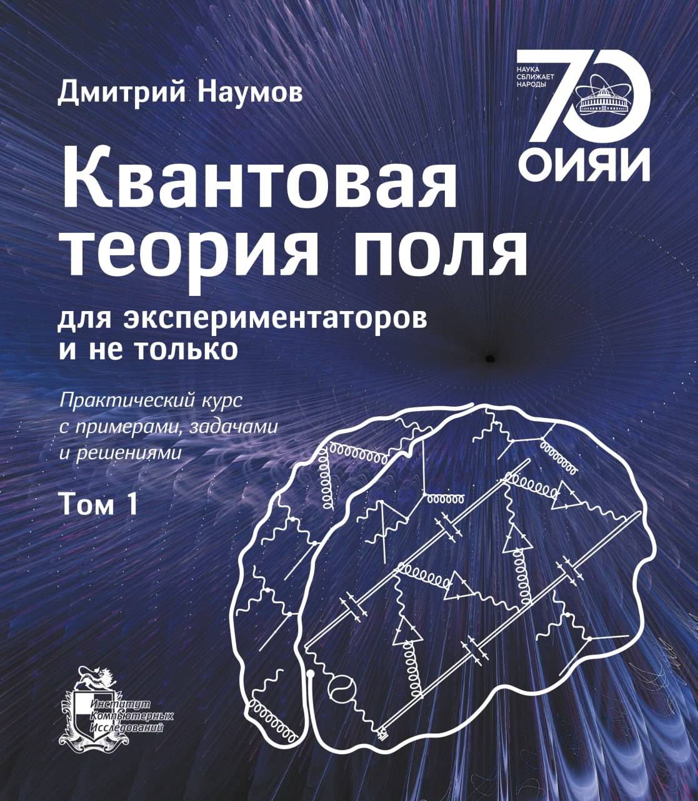
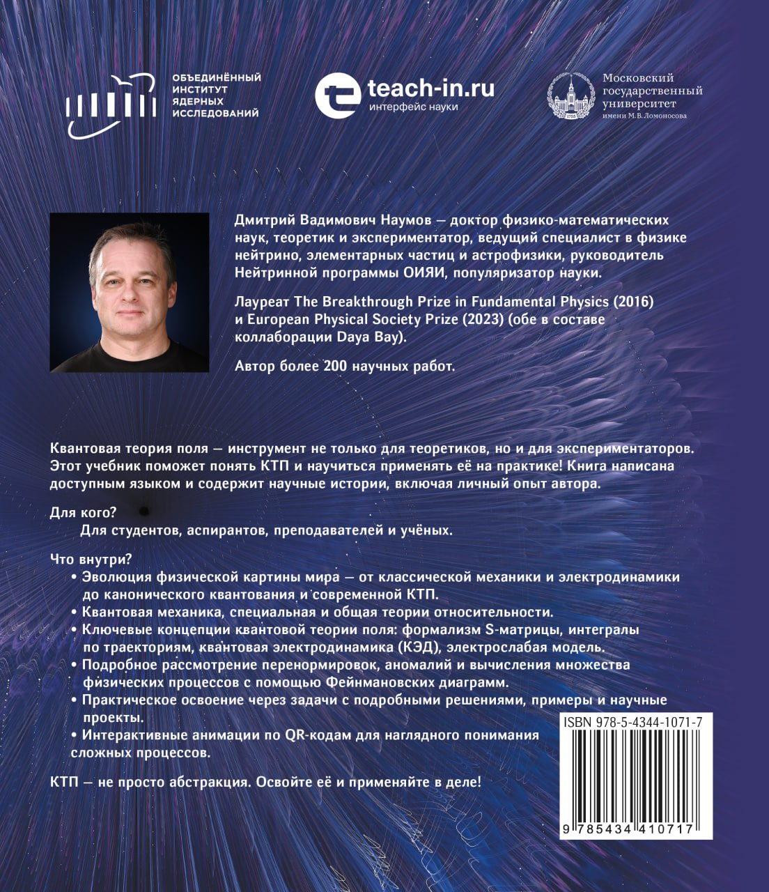

```{=html}
<div class="lecture-catalog">
  <p class="lecture-catalog-lead">
    Курсы, образовательные программы, учебники и материалы для самостоятельной работы
    по физике нейтрино, астрофизике частиц, КТП, физике частиц и статистическому анализу данных.
  </p>

  <section class="lecture-course-list" aria-label="Образовательные разделы">
    <details class="lecture-course program-course-teachin">
      <summary>
        <span class="lecture-course-status">Онлайн-программа</span>
        <span class="lecture-course-title">Физика нейтрино и астрофизика частиц</span>
      </summary>
      <div class="lecture-course-body education-program-detail">
        <div>
          <p>
            Образовательная программа Teach-in по физике нейтрино и астрофизике частиц.
          </p>
          <dl class="education-program-meta">
            <dt>Куратор программы</dt>
            <dd>Надежда Кузнецова</dd>
            <dt>Программный директор</dt>
            <dd>Дмитрий Наумов</dd>
            <dt>Контакты</dt>
            <dd><a href="mailto:fn@teach-in.ru">fn@teach-in.ru</a></dd>
          </dl>
          <div class="lecture-course-actions">
            <a class="lecture-action-primary" href="https://teach-in.ru/program">Открыть программу</a>
            <a href="../assets/programs/teach-in-program.pdf">Презентация</a>
            <a href="https://teach-in.ru/lecturer/naumov-dv">Профиль лектора</a>
          </div>
        </div>
        
        <figure class="education-program-map">
          <video controls muted playsinline preload="metadata" poster="../assets/programs/teach-in-applications-map-poster.jpg">
            <source src="../assets/programs/teach-in-applications-map.mp4" type="video/mp4">
          </video>
          <figcaption>География заявок на программу по городам</figcaption>
        </figure>
      </div>
    </details>
  </section>

  <h2 class="section-inline-title">Курсы лекций</h2>
  <section class="lecture-course-list" aria-label="Каталог курсов">
    <details id="qft" class="lecture-course lecture-course-qft">
      <summary>
        <span class="lecture-course-status">Материалы опубликованы</span>
        <span class="lecture-course-title">Квантовая теория поля</span>
      </summary>
      <div class="lecture-course-body">
        <p>Курсы по КТП, Стандартной модели, ренормировке, ускоренным системам отсчёта и вакууму квантового поля.</p>
        <div class="lecture-material-list">
          <details id="qft-textbook" class="lecture-material">
            <summary>Учебник</summary>
            <div class="lecture-material-body">
              <p>Двухтомный учебник «Квантовая теория поля для экспериментаторов и не только»: примеры, задачи, решения и практический взгляд на КТП. Русское издание опубликовано; английское готовится.</p>
              <div class="book-cover-spread" aria-label="Обложка учебника по квантовой теории поля">
                
                
              </div>
              <div class="lecture-material-list">
                <details class="lecture-material">
                  <summary>Бумажная версия для России</summary>
                  <div class="lecture-material-body">
                    <div class="lecture-course-actions">
                      <a class="lecture-action-primary" href="https://shop.rcd.ru/catalog/fizika/20042/">Том 1</a>
                      <a href="https://shop.rcd.ru/catalog/fizika/20097/">Том 2</a>
                    </div>
                  </div>
                </details>
                <details class="lecture-material">
                  <summary>ROSPEX Publishing</summary>
                  <div class="lecture-material-body">
                    <div class="lecture-course-actions">
                      <a href="https://rospexpublishing.com/books/qft-volume-1.html?utm_source=neutrinohit&amp;utm_medium=website&amp;utm_campaign=qft_book">Том 1</a>
                      <a href="https://rospexpublishing.com/books/qft-volume-2.html?utm_source=neutrinohit&amp;utm_medium=website&amp;utm_campaign=qft_book">Том 2</a>
                      <a class="lecture-action-primary" href="https://rospexpublishing.com/books/qft-bundle.html?utm_source=neutrinohit&amp;utm_medium=website&amp;utm_campaign=qft_book">Комплект</a>
                    </div>
                  </div>
                </details>
                <details class="lecture-material">
                  <summary>Google Play Books</summary>
                  <div class="lecture-material-body">
                    <div class="lecture-course-actions">
                      <a class="lecture-action-primary" href="https://play.google.com/store/books/details?id=uLXTEQAAQBAJ">Том 1</a>
                      <a href="https://play.google.com/store/books/details?id=KrbTEQAAQBAJ">Том 2</a>
                    </div>
                  </div>
                </details>
                <details class="lecture-material">
                  <summary>English edition</summary>
                  <div class="lecture-material-body">
                    <p>Готовится.</p>
                  </div>
                </details>
              </div>
            </div>
          </details>
          <details id="qft-course" class="lecture-material">
            <summary>Курс лекций «Квантовая теория поля»</summary>
            <div class="lecture-material-body">
              <p>Базовый курс: конспект и видеозаписи.</p>
              <div class="lecture-course-actions">
                <a href="https://teach-in.ru/file/synopsis/pdf/quantum-field-theory-naumov-MKv0.pdf">Конспект</a>
                <a href="https://www.youtube.com/playlist?list=PL28BG43DETPR-fdQGsm0qO2YhMWVsNa29">YouTube</a>
                <a href="https://rutube.ru/plst/1531108/">RuTube</a>
                <a href="https://vkvideo.ru/playlist/-235607329_5">VK</a>
                <a href="https://teach-in.ru/course/quantum-field-theory-naumov">Teach-in</a>
              </div>
              <div class="course-lectures">
                <article class="course-lecture-card">
                  <a href="https://youtu.be/pcOLUI9Z-mk"></a>
                  <div class="course-lecture-card-body"><h3 class="course-lecture-title">1.1. Волны внутри нас</h3><div class="lecture-course-actions"><a class="lecture-action-primary" href="https://youtu.be/pcOLUI9Z-mk">YouTube</a></div></div>
                </article>
                <article class="course-lecture-card">
                  <a href="https://youtu.be/wak3QOjD5II"></a>
                  <div class="course-lecture-card-body"><h3 class="course-lecture-title">1.2. Век открытий</h3><div class="lecture-course-actions"><a class="lecture-action-primary" href="https://youtu.be/wak3QOjD5II">YouTube</a></div></div>
                </article>
                <article class="course-lecture-card">
                  <a href="https://youtu.be/mO3TToWcGuI"></a>
                  <div class="course-lecture-card-body"><h3 class="course-lecture-title">1.3. Уравнение Клейна-Фока-Гордона</h3><div class="lecture-course-actions"><a class="lecture-action-primary" href="https://youtu.be/mO3TToWcGuI">YouTube</a></div></div>
                </article>
                <article class="course-lecture-card">
                  <a href="https://youtu.be/ZJnQGFpdYD4"></a>
                  <div class="course-lecture-card-body"><h3 class="course-lecture-title">1.4. Парадокс Клейна</h3><div class="lecture-course-actions"><a class="lecture-action-primary" href="https://youtu.be/ZJnQGFpdYD4">YouTube</a></div></div>
                </article>
                <article class="course-lecture-card">
                  <a href="https://youtu.be/1wtPiZTVcYo"></a>
                  <div class="course-lecture-card-body"><h3 class="course-lecture-title">1.5. Уравнение Дирака</h3><div class="lecture-course-actions"><a class="lecture-action-primary" href="https://youtu.be/1wtPiZTVcYo">YouTube</a></div></div>
                </article>
                <article class="course-lecture-card">
                  <a href="https://youtu.be/vGh_hRiByn0"></a>
                  <div class="course-lecture-card-body"><h3 class="course-lecture-title">1.6. Спин и орбитальный момент в уравнении Дирака</h3><div class="lecture-course-actions"><a class="lecture-action-primary" href="https://youtu.be/vGh_hRiByn0">YouTube</a></div></div>
                </article>
                <article class="course-lecture-card">
                  <a href="https://youtu.be/cz5remCD0yY"></a>
                  <div class="course-lecture-card-body"><h3 class="course-lecture-title">1.7. γ-матрицы Дирака</h3><div class="lecture-course-actions"><a class="lecture-action-primary" href="https://youtu.be/cz5remCD0yY">YouTube</a></div></div>
                </article>
                <article class="course-lecture-card">
                  <a href="https://youtu.be/sfH49H0lCgA"></a>
                  <div class="course-lecture-card-body"><h3 class="course-lecture-title">1.8. Решение свободного уравнения Дирака</h3><div class="lecture-course-actions"><a class="lecture-action-primary" href="https://youtu.be/sfH49H0lCgA">YouTube</a></div></div>
                </article>
                <article class="course-lecture-card">
                  <a href="https://youtu.be/Fjxb1Ne2Kkc"></a>
                  <div class="course-lecture-card-body"><h3 class="course-lecture-title">1.9. Античастицы в уравнении Дирака</h3><div class="lecture-course-actions"><a class="lecture-action-primary" href="https://youtu.be/Fjxb1Ne2Kkc">YouTube</a></div></div>
                </article>
                <article class="course-lecture-card">
                  <a href="https://youtu.be/pBEpxm5HoEo"></a>
                  <div class="course-lecture-card-body"><h3 class="course-lecture-title">1.10. Вычисление энергии атома водорода</h3><div class="lecture-course-actions"><a class="lecture-action-primary" href="https://youtu.be/pBEpxm5HoEo">YouTube</a></div></div>
                </article>
                <article class="course-lecture-card">
                  <a href="https://youtu.be/XrVgdGu0pow"></a>
                  <div class="course-lecture-card-body"><h3 class="course-lecture-title">1.11. Частица в плоской э/м волне</h3><div class="lecture-course-actions"><a class="lecture-action-primary" href="https://youtu.be/XrVgdGu0pow">YouTube</a></div></div>
                </article>
                <article class="course-lecture-card">
                  <a href="https://youtu.be/dxAK4hfcTEo"></a>
                  <div class="course-lecture-card-body"><h3 class="course-lecture-title">1.12. Киральные операторы</h3><div class="lecture-course-actions"><a class="lecture-action-primary" href="https://youtu.be/dxAK4hfcTEo">YouTube</a></div></div>
                </article>
                <article class="course-lecture-card">
                  <a href="https://youtu.be/UPZOfsZe78w"></a>
                  <div class="course-lecture-card-body"><h3 class="course-lecture-title">1.13. Обсуждение релятивистской квантовой механики</h3><div class="lecture-course-actions"><a class="lecture-action-primary" href="https://youtu.be/UPZOfsZe78w">YouTube</a></div></div>
                </article>
                <article class="course-lecture-card">
                  <a href="https://youtu.be/oKJOfjNydA4"></a>
                  <div class="course-lecture-card-body"><h3 class="course-lecture-title">1.14. Основы классической теории поля</h3><div class="lecture-course-actions"><a class="lecture-action-primary" href="https://youtu.be/oKJOfjNydA4">YouTube</a></div></div>
                </article>
                <article class="course-lecture-card">
                  <a href="https://youtu.be/wjQXmoBRZ8w"></a>
                  <div class="course-lecture-card-body"><h3 class="course-lecture-title">1.15. Теорема Нётер</h3><div class="lecture-course-actions"><a class="lecture-action-primary" href="https://youtu.be/wjQXmoBRZ8w">YouTube</a></div></div>
                </article>
                <article class="course-lecture-card">
                  <a href="https://youtu.be/bCPa8SWhjIc"></a>
                  <div class="course-lecture-card-body"><h3 class="course-lecture-title">1.16. Комплексное скалярное и электромагнитное поле</h3><div class="lecture-course-actions"><a class="lecture-action-primary" href="https://youtu.be/bCPa8SWhjIc">YouTube</a></div></div>
                </article>
                <article class="course-lecture-card">
                  <a href="https://youtu.be/dWDWD0q1EDI"></a>
                  <div class="course-lecture-card-body"><h3 class="course-lecture-title">1.17. Вектор поляризации. Энергия-импульс э/м поля</h3><div class="lecture-course-actions"><a class="lecture-action-primary" href="https://youtu.be/dWDWD0q1EDI">YouTube</a></div></div>
                </article>
                <article class="course-lecture-card">
                  <a href="https://youtu.be/koBfOzUrjJQ"></a>
                  <div class="course-lecture-card-body"><h3 class="course-lecture-title">1.18. Фермионное поле и функции Грина</h3><div class="lecture-course-actions"><a class="lecture-action-primary" href="https://youtu.be/koBfOzUrjJQ">YouTube</a></div></div>
                </article>
                <article class="course-lecture-card">
                  <a href="https://youtu.be/sZgZOZBsWMY"></a>
                  <div class="course-lecture-card-body"><h3 class="course-lecture-title">1.19. Дифракция. Функции Грина некоторых уравнений</h3><div class="lecture-course-actions"><a class="lecture-action-primary" href="https://youtu.be/sZgZOZBsWMY">YouTube</a></div></div>
                </article>
                <article class="course-lecture-card">
                  <a href="https://youtu.be/wBnQHAy2dfM"></a>
                  <div class="course-lecture-card-body"><h3 class="course-lecture-title">1.20. Поле квантуется раз!</h3><div class="lecture-course-actions"><a class="lecture-action-primary" href="https://youtu.be/wBnQHAy2dfM">YouTube</a></div></div>
                </article>
                <article class="course-lecture-card">
                  <a href="https://youtu.be/bY1QdjR9XqI"></a>
                  <div class="course-lecture-card-body"><h3 class="course-lecture-title">1.21. Квантовая статистика. Нормальное упорядочение</h3><div class="lecture-course-actions"><a class="lecture-action-primary" href="https://youtu.be/bY1QdjR9XqI">YouTube</a></div></div>
                </article>
                <article class="course-lecture-card">
                  <a href="https://youtu.be/gE5wsYuAt3g"></a>
                  <div class="course-lecture-card-body"><h3 class="course-lecture-title">1.22. Поле квантуется два!</h3><div class="lecture-course-actions"><a class="lecture-action-primary" href="https://youtu.be/gE5wsYuAt3g">YouTube</a></div></div>
                </article>
                <article class="course-lecture-card">
                  <a href="https://youtu.be/vWa4t3D-OZY"></a>
                  <div class="course-lecture-card-body"><h3 class="course-lecture-title">1.23. Пропагатор</h3><div class="lecture-course-actions"><a class="lecture-action-primary" href="https://youtu.be/vWa4t3D-OZY">YouTube</a></div></div>
                </article>
                <article class="course-lecture-card">
                  <a href="https://youtu.be/x6lhdZXpEwg"></a>
                  <div class="course-lecture-card-body"><h3 class="course-lecture-title">1.24. S-матрица</h3><div class="lecture-course-actions"><a class="lecture-action-primary" href="https://youtu.be/x6lhdZXpEwg">YouTube</a></div></div>
                </article>
                <article class="course-lecture-card">
                  <a href="https://youtu.be/sp7xIWP3mJY"></a>
                  <div class="course-lecture-card-body"><h3 class="course-lecture-title">1.25. Оператор эволюции и теоремы Вика</h3><div class="lecture-course-actions"><a class="lecture-action-primary" href="https://youtu.be/sp7xIWP3mJY">YouTube</a></div></div>
                </article>
                <article class="course-lecture-card">
                  <a href="https://youtu.be/mw-z66p28bg"></a>
                  <div class="course-lecture-card-body"><h3 class="course-lecture-title">1.26. Притяжение и отталкивание</h3><div class="lecture-course-actions"><a class="lecture-action-primary" href="https://youtu.be/mw-z66p28bg">YouTube</a></div></div>
                </article>
              </div>
            </div>
          </details>
          <details id="standard-model-course" class="lecture-material">
            <summary>Курс лекций «Стандартная модель»</summary>
            <div class="lecture-material-body">
              <p>Введение в Стандартную модель: конспект и видеоматериалы.</p>
              <div class="lecture-course-actions">
                <a href="https://teach-in.ru/file/synopsis/pdf/introduction-to-the-standard-model-MKv0.pdf">Конспект</a>
                <a href="https://www.youtube.com/playlist?list=PL28BG43DETPT6A-H6fUtZvOJl0lv-YPZV">YouTube</a>
                <a href="https://rutube.ru/plst/1538123">RuTube</a>
                <a href="https://vkvideo.ru/playlist/-235607329_6">VK</a>
                <a href="https://teach-in.ru/course/introduction-to-the-standard-model">Teach-in</a>
              </div>
              <div class="course-lectures">
                <article class="course-lecture-card">
                  <a href="https://youtu.be/7aRjHq7DZdM"></a>
                  <div class="course-lecture-card-body"><h3 class="course-lecture-title">2.1. Рассеяние электронов за счет обмена скалярной частицей</h3><div class="lecture-course-actions"><a class="lecture-action-primary" href="https://youtu.be/7aRjHq7DZdM">YouTube</a></div></div>
                </article>
                <article class="course-lecture-card">
                  <a href="https://youtu.be/BDeqda7RyHE"></a>
                  <div class="course-lecture-card-body"><h3 class="course-lecture-title">2.2. Процесс рассеяния электрона на электроне</h3><div class="lecture-course-actions"><a class="lecture-action-primary" href="https://youtu.be/BDeqda7RyHE">YouTube</a></div></div>
                </article>
                <article class="course-lecture-card">
                  <a href="https://youtu.be/d_PCRHeSZqo"></a>
                  <div class="course-lecture-card-body"><h3 class="course-lecture-title">2.3. Потенциальная энергия в квантовой теории поля</h3><div class="lecture-course-actions"><a class="lecture-action-primary" href="https://youtu.be/d_PCRHeSZqo">YouTube</a></div></div>
                </article>
                <article class="course-lecture-card">
                  <a href="https://youtu.be/R5vvOcfTaXg"></a>
                  <div class="course-lecture-card-body"><h3 class="course-lecture-title">2.4. Притяжение и отталкивание в квантовой электродинамике</h3><div class="lecture-course-actions"><a class="lecture-action-primary" href="https://youtu.be/R5vvOcfTaXg">YouTube</a></div></div>
                </article>
                <article class="course-lecture-card">
                  <a href="https://youtu.be/44oVByqPxuQ"></a>
                  <div class="course-lecture-card-body"><h3 class="course-lecture-title">2.5. Сечение рассеяния Резерфорда (Мотта)</h3><div class="lecture-course-actions"><a class="lecture-action-primary" href="https://youtu.be/44oVByqPxuQ">YouTube</a></div></div>
                </article>
                <article class="course-lecture-card">
                  <a href="https://youtu.be/_wf0nrM1QmI"></a>
                  <div class="course-lecture-card-body"><h3 class="course-lecture-title">2.6. Сечение рассеяния пары электронов и позитронов</h3><div class="lecture-course-actions"><a class="lecture-action-primary" href="https://youtu.be/_wf0nrM1QmI">YouTube</a></div></div>
                </article>
                <article class="course-lecture-card">
                  <a href="https://youtu.be/g2ONUlR-4Bk"></a>
                  <div class="course-lecture-card-body"><h3 class="course-lecture-title">2.7. Эффект Комптона</h3><div class="lecture-course-actions"><a class="lecture-action-primary" href="https://youtu.be/g2ONUlR-4Bk">YouTube</a></div></div>
                </article>
                <article class="course-lecture-card">
                  <a href="https://youtu.be/oTvxQ46TIRw"></a>
                  <div class="course-lecture-card-body"><h3 class="course-lecture-title">2.8. Комптоновское рассеяние</h3><div class="lecture-course-actions"><a class="lecture-action-primary" href="https://youtu.be/oTvxQ46TIRw">YouTube</a></div></div>
                </article>
                <article class="course-lecture-card">
                  <a href="https://youtu.be/4MH88ptEghw"></a>
                  <div class="course-lecture-card-body"><h3 class="course-lecture-title">2.9. Рассеяние Баба</h3><div class="lecture-course-actions"><a class="lecture-action-primary" href="https://youtu.be/4MH88ptEghw">YouTube</a></div></div>
                </article>
                <article class="course-lecture-card">
                  <a href="https://youtu.be/LgbSEJslNUI"></a>
                  <div class="course-lecture-card-body"><h3 class="course-lecture-title">2.10. Калибровочная симметрия</h3><div class="lecture-course-actions"><a class="lecture-action-primary" href="https://youtu.be/LgbSEJslNUI">YouTube</a></div></div>
                </article>
                <article class="course-lecture-card">
                  <a href="https://youtu.be/nXnNyYbiONA"></a>
                  <div class="course-lecture-card-body"><h3 class="course-lecture-title">2.11. Спонтанное нарушение симметрии и природа массы</h3><div class="lecture-course-actions"><a class="lecture-action-primary" href="https://youtu.be/nXnNyYbiONA">YouTube</a></div></div>
                </article>
                <article class="course-lecture-card">
                  <a href="https://youtu.be/9GyjcdtqDkM"></a>
                  <div class="course-lecture-card-body"><h3 class="course-lecture-title">2.12. Физика механизма Хиггса генерации фермионных масс</h3><div class="lecture-course-actions"><a class="lecture-action-primary" href="https://youtu.be/9GyjcdtqDkM">YouTube</a></div></div>
                </article>
                <article class="course-lecture-card">
                  <a href="https://youtu.be/SJgnWifg_MY"></a>
                  <div class="course-lecture-card-body"><h3 class="course-lecture-title">2.13. Стандартная модель</h3><div class="lecture-course-actions"><a class="lecture-action-primary" href="https://youtu.be/SJgnWifg_MY">YouTube</a></div></div>
                </article>
                <article class="course-lecture-card">
                  <a href="https://youtu.be/mAAc6QaMCgw"></a>
                  <div class="course-lecture-card-body"><h3 class="course-lecture-title">2.14. Взаимодействия Стандартной модели</h3><div class="lecture-course-actions"><a class="lecture-action-primary" href="https://youtu.be/mAAc6QaMCgw">YouTube</a></div></div>
                </article>
                <article class="course-lecture-card">
                  <a href="https://youtu.be/kTLfcI8wbfE"></a>
                  <div class="course-lecture-card-body"><h3 class="course-lecture-title">2.15. Распад мюона</h3><div class="lecture-course-actions"><a class="lecture-action-primary" href="https://youtu.be/kTLfcI8wbfE">YouTube</a></div></div>
                </article>
                <article class="course-lecture-card">
                  <a href="https://youtu.be/bYNpbdQHSEU"></a>
                  <div class="course-lecture-card-body"><h3 class="course-lecture-title">2.16. Распад пи-мезона</h3><div class="lecture-course-actions"><a class="lecture-action-primary" href="https://youtu.be/bYNpbdQHSEU">YouTube</a></div></div>
                </article>
                <article class="course-lecture-card">
                  <a href="https://youtu.be/lHQlNjm3mzs"></a>
                  <div class="course-lecture-card-body"><h3 class="course-lecture-title">2.17. Распад нейтрона</h3><div class="lecture-course-actions"><a class="lecture-action-primary" href="https://youtu.be/lHQlNjm3mzs">YouTube</a></div></div>
                </article>
                <article class="course-lecture-card">
                  <a href="https://youtu.be/kzkOiXW2VkQ"></a>
                  <div class="course-lecture-card-body"><h3 class="course-lecture-title">2.18. Распады тау-лептонов, W-бозонов и Z-бозонов</h3><div class="lecture-course-actions"><a class="lecture-action-primary" href="https://youtu.be/kzkOiXW2VkQ">YouTube</a></div></div>
                </article>
                <article class="course-lecture-card">
                  <a href="https://youtu.be/IeUO8Kzko9I"></a>
                  <div class="course-lecture-card-body"><h3 class="course-lecture-title">2.19. Бозон Хиггса — распады. Реакция: нейтрино + электрон</h3><div class="lecture-course-actions"><a class="lecture-action-primary" href="https://youtu.be/IeUO8Kzko9I">YouTube</a></div></div>
                </article>
                <article class="course-lecture-card">
                  <a href="https://youtu.be/qyaHqgkjNXI"></a>
                  <div class="course-lecture-card-body"><h3 class="course-lecture-title">2.20. Рассеяние лептонов на элементарных заряженных частицах</h3><div class="lecture-course-actions"><a class="lecture-action-primary" href="https://youtu.be/qyaHqgkjNXI">YouTube</a></div></div>
                </article>
                <article class="course-lecture-card">
                  <a href="https://youtu.be/8RauxAlKaIE"></a>
                  <div class="course-lecture-card-body"><h3 class="course-lecture-title">2.21. Нейтральный ток в рассеянии нейтрино на электроне</h3><div class="lecture-course-actions"><a class="lecture-action-primary" href="https://youtu.be/8RauxAlKaIE">YouTube</a></div></div>
                </article>
                <article class="course-lecture-card">
                  <a href="https://youtu.be/c_kbsM8rWzc"></a>
                  <div class="course-lecture-card-body"><h3 class="course-lecture-title">2.22. Упругое рассеяние электрона на нуклоне</h3><div class="lecture-course-actions"><a class="lecture-action-primary" href="https://youtu.be/c_kbsM8rWzc">YouTube</a></div></div>
                </article>
                <article class="course-lecture-card">
                  <a href="https://youtu.be/xoc-pEj0BNM"></a>
                  <div class="course-lecture-card-body"><h3 class="course-lecture-title">2.23. Глубоко-неупругое рассеяние</h3><div class="lecture-course-actions"><a class="lecture-action-primary" href="https://youtu.be/xoc-pEj0BNM">YouTube</a></div></div>
                </article>
              </div>
            </div>
          </details>
          <details id="qft-renormalization-course" class="lecture-material">
            <summary>Курс лекций «Ренормировка в квантовой теории поля»</summary>
            <div class="lecture-material-body">
              <p>Конспект курса и видеоплейлисты по ренормировке.</p>
              <div class="lecture-course-actions">
                <a href="https://teach-in.ru/file/synopsis/pdf/renormalization-in-qft-M.pdf">Конспект</a>
                <a href="https://www.youtube.com/playlist?list=PL28BG43DETPT4L04sUPUNvZC93w4b60wG">YouTube</a>
                <a href="https://rutube.ru/plst/1530811">RuTube</a>
                <a href="https://vkvideo.ru/playlist/-235607329_4">VK</a>
                <a href="https://teach-in.ru/course/renormalization-in-qft">Teach-in</a>
              </div>
              <div class="course-lectures">
                <article class="course-lecture-card">
                  <a href="https://youtu.be/9NxS1EzFSrc"></a>
                  <div class="course-lecture-card-body"><h3 class="course-lecture-title">3.1. Введение в идею ренормировки</h3><div class="lecture-course-actions"><a class="lecture-action-primary" href="https://youtu.be/9NxS1EzFSrc">YouTube</a></div></div>
                </article>
                <article class="course-lecture-card">
                  <a href="https://youtu.be/U7GuBzlgNwo"></a>
                  <div class="course-lecture-card-body"><h3 class="course-lecture-title">3.2. Метод размерной регуляризации</h3><div class="lecture-course-actions"><a class="lecture-action-primary" href="https://youtu.be/U7GuBzlgNwo">YouTube</a></div></div>
                </article>
                <article class="course-lecture-card">
                  <a href="https://youtu.be/o060mihnDz8"></a>
                  <div class="course-lecture-card-body"><h3 class="course-lecture-title">3.3. Ренормировка без тумана</h3><div class="lecture-course-actions"><a class="lecture-action-primary" href="https://youtu.be/o060mihnDz8">YouTube</a></div></div>
                </article>
                <article class="course-lecture-card">
                  <a href="https://youtu.be/K1ThexLCdTU"></a>
                  <div class="course-lecture-card-body"><h3 class="course-lecture-title">3.4. Собственная энергия электрона. Часть 1</h3><div class="lecture-course-actions"><a class="lecture-action-primary" href="https://youtu.be/K1ThexLCdTU">YouTube</a></div></div>
                </article>
                <article class="course-lecture-card">
                  <a href="https://youtu.be/DwftfFPjZ5o"></a>
                  <div class="course-lecture-card-body"><h3 class="course-lecture-title">3.5. Собственная энергия электрона. Часть 2</h3><div class="lecture-course-actions"><a class="lecture-action-primary" href="https://youtu.be/DwftfFPjZ5o">YouTube</a></div></div>
                </article>
                <article class="course-lecture-card">
                  <a href="https://youtu.be/R8mzNHtF2Jw"></a>
                  <div class="course-lecture-card-body"><h3 class="course-lecture-title">3.6. Собственная энергия электрона. Часть 3</h3><div class="lecture-course-actions"><a class="lecture-action-primary" href="https://youtu.be/R8mzNHtF2Jw">YouTube</a></div></div>
                </article>
                <article class="course-lecture-card">
                  <a href="https://youtu.be/478Br_okxzg"></a>
                  <div class="course-lecture-card-body"><h3 class="course-lecture-title">3.7. Ренормировка пропагатора электрона с ненулевой массой</h3><div class="lecture-course-actions"><a class="lecture-action-primary" href="https://youtu.be/478Br_okxzg">YouTube</a></div></div>
                </article>
                <article class="course-lecture-card">
                  <a href="https://youtu.be/_R2vs5PlZaY"></a>
                  <div class="course-lecture-card-body"><h3 class="course-lecture-title">3.8. Поляризация вакуума. Часть 1</h3><div class="lecture-course-actions"><a class="lecture-action-primary" href="https://youtu.be/_R2vs5PlZaY">YouTube</a></div></div>
                </article>
                <article class="course-lecture-card">
                  <a href="https://youtu.be/Ujs93m1aCc0"></a>
                  <div class="course-lecture-card-body"><h3 class="course-lecture-title">3.9. Поляризация вакуума. Часть 2</h3><div class="lecture-course-actions"><a class="lecture-action-primary" href="https://youtu.be/Ujs93m1aCc0">YouTube</a></div></div>
                </article>
                <article class="course-lecture-card">
                  <a href="https://youtu.be/16EzKn-1kFo"></a>
                  <div class="course-lecture-card-body"><h3 class="course-lecture-title">3.10. Потенциал Юлинга</h3><div class="lecture-course-actions"><a class="lecture-action-primary" href="https://youtu.be/16EzKn-1kFo">YouTube</a></div></div>
                </article>
                <article class="course-lecture-card">
                  <a href="https://youtu.be/pEuFscT7J7g"></a>
                  <div class="course-lecture-card-body"><h3 class="course-lecture-title">3.11. Вычисление g−2. Часть 1</h3><div class="lecture-course-actions"><a class="lecture-action-primary" href="https://youtu.be/pEuFscT7J7g">YouTube</a></div></div>
                </article>
                <article class="course-lecture-card">
                  <a href="https://youtu.be/DsVpGKcCAGE"></a>
                  <div class="course-lecture-card-body"><h3 class="course-lecture-title">3.12. Вычисление g−2. Часть 2</h3><div class="lecture-course-actions"><a class="lecture-action-primary" href="https://youtu.be/DsVpGKcCAGE">YouTube</a></div></div>
                </article>
                <article class="course-lecture-card">
                  <a href="https://youtu.be/ow51lg7L6CE"></a>
                  <div class="course-lecture-card-body"><h3 class="course-lecture-title">3.13. Загадки нейтральных каонов. Часть 1</h3><div class="lecture-course-actions"><a class="lecture-action-primary" href="https://youtu.be/ow51lg7L6CE">YouTube</a></div></div>
                </article>
                <article class="course-lecture-card">
                  <a href="https://youtu.be/d5jMezMdLa0"></a>
                  <div class="course-lecture-card-body"><h3 class="course-lecture-title">3.14. Загадки нейтральных каонов. Часть 2</h3><div class="lecture-course-actions"><a class="lecture-action-primary" href="https://youtu.be/d5jMezMdLa0">YouTube</a></div></div>
                </article>
                <article class="course-lecture-card">
                  <a href="https://youtu.be/EY-T96l1C04"></a>
                  <div class="course-lecture-card-body"><h3 class="course-lecture-title">3.15. Загадки нейтральных каонов. Часть 3</h3><div class="lecture-course-actions"><a class="lecture-action-primary" href="https://youtu.be/EY-T96l1C04">YouTube</a></div></div>
                </article>
                <article class="course-lecture-card">
                  <a href="https://youtu.be/vzmLG5IopYc"></a>
                  <div class="course-lecture-card-body"><h3 class="course-lecture-title">3.16. Квантовые аномалии</h3><div class="lecture-course-actions"><a class="lecture-action-primary" href="https://youtu.be/vzmLG5IopYc">YouTube</a></div></div>
                </article>
                <article class="course-lecture-card">
                  <a href="https://youtu.be/IjiE2jihcBc"></a>
                  <div class="course-lecture-card-body"><h3 class="course-lecture-title">3.17. Распад π⁰→γγ</h3><div class="lecture-course-actions"><a class="lecture-action-primary" href="https://youtu.be/IjiE2jihcBc">YouTube</a></div></div>
                </article>
                <article class="course-lecture-card">
                  <a href="https://youtu.be/U8toFdOZyqY"></a>
                  <div class="course-lecture-card-body"><h3 class="course-lecture-title">3.18. Математические приёмы</h3><div class="lecture-course-actions"><a class="lecture-action-primary" href="https://youtu.be/U8toFdOZyqY">YouTube</a></div></div>
                </article>
                <article class="course-lecture-card">
                  <a href="https://youtu.be/p5js5hn_hto"></a>
                  <div class="course-lecture-card-body"><h3 class="course-lecture-title">3.19. Сечение рассеяния с волновыми пакетами. Часть 1</h3><div class="lecture-course-actions"><a class="lecture-action-primary" href="https://youtu.be/p5js5hn_hto">YouTube</a></div></div>
                </article>
                <article class="course-lecture-card">
                  <a href="https://youtu.be/KV3zsUNE0RM"></a>
                  <div class="course-lecture-card-body"><h3 class="course-lecture-title">3.20. Сечение рассеяния с волновыми пакетами. Часть 2</h3><div class="lecture-course-actions"><a class="lecture-action-primary" href="https://youtu.be/KV3zsUNE0RM">YouTube</a></div></div>
                </article>
              </div>
            </div>
          </details>
          <details id="unruh-course" class="lecture-material">
            <summary>Ускоренные системы отсчёта и эффект Унру</summary>
            <div class="lecture-material-body">
              <p>Пять HTML-лекций: от координат Риндлера и энтропии запутанности до эффекта Унру для скалярного и фермионного полей.</p>
              <div class="lecture-course-actions">
                <a class="lecture-action-primary" href="../qft-lectures/unruh/">Открыть мини-курс</a>
              </div>
            </div>
          </details>
          <details id="qft-vacuum-course" class="lecture-material">
            <summary>Вакуум квантового поля</summary>
            <div class="lecture-material-body">
              <p>Мини-курс о вакууме КТП. Первая HTML-лекция: волновой функционал свободного скалярного поля, гауссов вакуум и отличие вакуумных конфигураций от белого шума.</p>
              <p>Готовится.</p>
            </div>
          </details>
          <details id="qft-attraction-repulsion" class="lecture-material">
            <summary>Attraction and Repulsion in Quantum Field Theory</summary>
            <div class="lecture-material-body">
              <p>Отдельная лекция по scalar QED и волновым пакетам: как в КТП кодируются притяжение и отталкивание.</p>
              <div class="lecture-course-actions">
                <a class="lecture-action-primary" href="../qft-lectures/en/slides/ScalarQEDAttractionRepulsion.html">HTML-слайды</a>
              </div>
            </div>
          </details>
        </div>
      </div>
    </details>

    <details id="stat" class="lecture-course lecture-course-stat">
      <summary>
        <span class="lecture-course-status">13 лекций опубликованы</span>
        <span class="lecture-course-title">Статистический анализ данных</span>
      </summary>
      <div class="lecture-course-body">
        <p>Практический курс для физики высоких энергий, астрофизики и анализа экспериментальных данных: тринадцать лекций от мотивации до статистических тестов. Все материалы открываются прямо отсюда.</p>
        <div class="lecture-course-actions">
          <a class="lecture-action-primary" href="../statistical-analysis-course/ru/book/index.html">Онлайн-книга</a>
          <a href="../statistical-analysis-course/ru/slides/applets.html">Апплеты</a>
          <a href="../statistical-analysis-course/ru/slides/exercises/index.html">Все задачи</a>
          <a href="../statistical-analysis-course/ru/slides/exam_projects/index.html">Экзаменационные проекты</a>
          <a href="https://www.youtube.com/playlist?list=PLGGzOVFWOf3s">YouTube</a>
          <a href="https://rutube.ru/plst/1807652">RuTube</a>
          <a href="https://vkvideo.ru/playlist/-235607329_10">VK</a>
          <a href="https://teach-in.ru/course/statistical-methods-of-data-analysis-naumov">Teach-in</a>
        </div>
        <div class="lecture-material-list">
          <details id="stat-01" class="lecture-material">
            <summary>01. Мотивация и обзор курса</summary>
            <div class="lecture-material-body">
              <p>Зачем физику статистика и какие вопросы решает курс.</p>
              <div class="lecture-course-actions">
                <a class="lecture-action-primary" href="../statistical-analysis-course/ru/slides/01_introduction.html">Открыть лекцию</a>
                <a href="../statistical-analysis-course/ru/slides/exercises/01_introduction_exercises.html">Задачи</a>
                <a href="../statistical-analysis-course/ru/book/chapters/01_why_statistics.pdf">Конспект PDF</a>
                <a href="../statistical-analysis-course/ru/book/chapters/01_why_statistics.html">Глава книги</a>
              </div>
              <div class="course-lectures course-lectures-single">
                <article class="course-lecture-card">
                  <a href="https://youtu.be/OLDuaktf_xk"></a>
                  <div class="course-lecture-card-body"><h3 class="course-lecture-title">Видеозапись лекции</h3><div class="lecture-course-actions"><a class="lecture-action-primary" href="https://youtu.be/OLDuaktf_xk">YouTube</a></div></div>
                </article>
              </div>
            </div>
          </details>
          <details id="stat-02" class="lecture-material">
            <summary>02. Случайные величины, распределения, моменты</summary>
            <div class="lecture-material-body">
              <p>Вероятности, плотности, кумулятивная функция распределения и моменты.</p>
              <div class="lecture-course-actions">
                <a class="lecture-action-primary" href="../statistical-analysis-course/ru/slides/02_random_distributions.html">Открыть лекцию</a>
                <a href="../statistical-analysis-course/ru/slides/exercises/02_random_distributions_exercises.html">Задачи</a>
                <a href="../statistical-analysis-course/ru/book/chapters/02_random_distributions.pdf">Конспект PDF</a>
                <a href="../statistical-analysis-course/ru/book/chapters/02_random_distributions.html">Глава книги</a>
              </div>
              <div class="course-lectures course-lectures-single">
                <article class="course-lecture-card">
                  <a href="https://youtu.be/Vvdj7pOVBGo"></a>
                  <div class="course-lecture-card-body"><h3 class="course-lecture-title">Видеозапись лекции</h3><div class="lecture-course-actions"><a class="lecture-action-primary" href="https://youtu.be/Vvdj7pOVBGo">YouTube</a></div></div>
                </article>
              </div>
            </div>
          </details>
          <details id="stat-03" class="lecture-material">
            <summary>03. Характеристические функции и суммы случайных величин</summary>
            <div class="lecture-material-body">
              <p>Преобразование Фурье распределения, свёртки, независимые суммы, моменты, кумулянты и мост к ЦПТ.</p>
              <div class="lecture-course-actions">
                <a class="lecture-action-primary" href="../statistical-analysis-course/ru/slides/03_characteristic_functions.html">Открыть лекцию</a>
                <a href="../statistical-analysis-course/ru/slides/exercises/03_characteristic_functions_exercises.html">Задачи</a>
                <a href="../statistical-analysis-course/ru/book/chapters/03_characteristic_functions.pdf">Конспект PDF</a>
                <a href="../statistical-analysis-course/ru/book/chapters/03_characteristic_functions.html">Глава книги</a>
              </div>
              <div class="course-lectures course-lectures-single">
                <article class="course-lecture-card">
                  <a href="https://youtu.be/qYEK6F2h7sc"></a>
                  <div class="course-lecture-card-body"><h3 class="course-lecture-title">Видеозапись лекции</h3><div class="lecture-course-actions"><a class="lecture-action-primary" href="https://youtu.be/qYEK6F2h7sc">YouTube</a></div></div>
                </article>
              </div>
            </div>
          </details>
          <details id="stat-04" class="lecture-material">
            <summary>04. Центральная предельная теорема и нормальное распределение</summary>
            <div class="lecture-material-body">
              <p>Почему возникает гаусс, как читать квантили и как проверять совместимость измерений.</p>
              <div class="lecture-course-actions">
                <a class="lecture-action-primary" href="../statistical-analysis-course/ru/slides/04_central_limit_theorem.html">Открыть лекцию</a>
                <a href="../statistical-analysis-course/ru/slides/exercises/04_central_limit_theorem_exercises.html">Задачи</a>
                <a href="../statistical-analysis-course/ru/book/chapters/04_central_limit_theorem.pdf">Конспект PDF</a>
                <a href="../statistical-analysis-course/ru/book/chapters/04_central_limit_theorem.html">Глава книги</a>
              </div>
              <div class="course-lectures course-lectures-single">
                <article class="course-lecture-card">
                  <a href="https://youtu.be/XMpp4KFtO8c"></a>
                  <div class="course-lecture-card-body"><h3 class="course-lecture-title">Видеозапись лекции</h3><div class="lecture-course-actions"><a class="lecture-action-primary" href="https://youtu.be/XMpp4KFtO8c">YouTube</a></div></div>
                </article>
              </div>
            </div>
          </details>
          <details id="stat-05" class="lecture-material">
            <summary>05. Когда гаусс не возникает</summary>
            <div class="lecture-material-body">
              <p>Границы применимости ЦПТ: тяжёлые хвосты, корреляции, смеси распределений, пороги и малые счёты.</p>
              <div class="lecture-course-actions">
                <a class="lecture-action-primary" href="../statistical-analysis-course/ru/slides/05_non_gaussian_clt_violations.html">Открыть лекцию</a>
                <a href="../statistical-analysis-course/ru/slides/exercises/05_non_gaussian_clt_violations_exercises.html">Задачи</a>
                <a href="../statistical-analysis-course/ru/book/chapters/05_non_gaussian_clt_violations.pdf">Конспект PDF</a>
                <a href="../statistical-analysis-course/ru/book/chapters/05_non_gaussian_clt_violations.html">Глава книги</a>
              </div>
              <div class="course-lectures course-lectures-single">
                <article class="course-lecture-card">
                  <a href="https://youtu.be/3_B_CiVg5_o"></a>
                  <div class="course-lecture-card-body"><h3 class="course-lecture-title">Видеозапись лекции</h3><div class="lecture-course-actions"><a class="lecture-action-primary" href="https://youtu.be/3_B_CiVg5_o">YouTube</a></div></div>
                </article>
              </div>
            </div>
          </details>
          <details id="stat-06" class="lecture-material">
            <summary>06. Распространение ошибок</summary>
            <div class="lecture-material-body">
              <p>Линейное распространение ошибок, нелинейные функции, оценки среднего, дисперсии, стандартного отклонения и ковариации.</p>
              <div class="lecture-course-actions">
                <a class="lecture-action-primary" href="../statistical-analysis-course/ru/slides/06_error_propagation.html">Открыть лекцию</a>
                <a href="../statistical-analysis-course/ru/slides/exercises/06_error_propagation_exercises.html">Задачи</a>
                <a href="../statistical-analysis-course/ru/book/chapters/06_error_propagation.pdf">Конспект PDF</a>
                <a href="../statistical-analysis-course/ru/book/chapters/06_error_propagation.html">Глава книги</a>
              </div>
            </div>
          </details>
          <details id="stat-07" class="lecture-material">
            <summary>07. Двумерный гаусс</summary>
            <div class="lecture-material-body">
              <p>Ковариационная матрица, корреляция, двумерный гаусс, эллипсы, контуры и практические применения.</p>
              <div class="lecture-course-actions">
                <a class="lecture-action-primary" href="../statistical-analysis-course/ru/slides/07_two_dimensional_gaussian.html">Открыть лекцию</a>
                <a href="../statistical-analysis-course/ru/slides/exercises/07_two_dimensional_gaussian_exercises.html">Задачи</a>
                <a href="../statistical-analysis-course/ru/book/chapters/07_two_dimensional_gaussian.pdf">Конспект PDF</a>
                <a href="../statistical-analysis-course/ru/book/chapters/07_two_dimensional_gaussian.html">Глава книги</a>
              </div>
            </div>
          </details>
          <details id="stat-08" class="lecture-material">
            <summary>08. Метод Монте-Карло и псевдоэксперименты</summary>
            <div class="lecture-material-body">
              <p>Генерация распределений, численное интегрирование, псевдоэксперименты и моделирование детектора.</p>
              <div class="lecture-course-actions">
                <a class="lecture-action-primary" href="../statistical-analysis-course/ru/slides/08_monte_carlo_method.html">Открыть лекцию</a>
                <a href="../statistical-analysis-course/ru/slides/exercises/08_monte_carlo_method_exercises.html">Задачи</a>
                <a href="../statistical-analysis-course/ru/book/chapters/08_monte_carlo_method.pdf">Конспект PDF</a>
                <a href="../statistical-analysis-course/ru/book/chapters/08_monte_carlo_method.html">Глава книги</a>
                <a href="../statistical-analysis-course/ru/slides/notebooks/mc_vegas_notebook.html">Ноутбук VEGAS</a>
              </div>
            </div>
          </details>
          <details id="stat-09" class="lecture-material">
            <summary>09. Правдоподобие и оценки максимального правдоподобия</summary>
            <div class="lecture-material-body">
              <p>Функция правдоподобия, логарифм правдоподобия, ММП и первые примеры оценивания параметров.</p>
              <div class="lecture-course-actions">
                <a class="lecture-action-primary" href="../statistical-analysis-course/ru/slides/09_maximum_likelihood.html">Открыть лекцию</a>
                <a href="../statistical-analysis-course/ru/slides/exercises/09_maximum_likelihood_exercises.html">Задачи</a>
                <a href="../statistical-analysis-course/ru/book/chapters/09_maximum_likelihood.pdf">Конспект PDF</a>
                <a href="../statistical-analysis-course/ru/book/chapters/09_maximum_likelihood.html">Глава книги</a>
              </div>
            </div>
          </details>
          <details id="stat-10" class="lecture-material">
            <summary>10. Свойства оценок, профильное правдоподобие и примеры анализа данных</summary>
            <div class="lecture-material-body">
              <p>Смещение, дисперсия, информация Фишера, форма правдоподобия, профилирование и диагностика подгонки.</p>
              <div class="lecture-course-actions">
                <a class="lecture-action-primary" href="../statistical-analysis-course/ru/slides/10_estimator_properties_profile_likelihood.html">Открыть лекцию</a>
                <a href="../statistical-analysis-course/ru/slides/exercises/10_estimator_properties_profile_likelihood_exercises.html">Задачи</a>
                <a href="../statistical-analysis-course/ru/book/chapters/10_estimator_properties_profile_likelihood.pdf">Конспект PDF</a>
                <a href="../statistical-analysis-course/ru/book/chapters/10_estimator_properties_profile_likelihood.html">Глава книги</a>
              </div>
            </div>
          </details>
          <details id="stat-11" class="lecture-material">
            <summary>11. Метод наименьших квадратов и линейная подгонка</summary>
            <div class="lecture-material-body">
              <p>Связь МНК с гауссовым правдоподобием, линейная модель, нормальные уравнения, ковариации параметров и остатки.</p>
              <div class="lecture-course-actions">
                <a class="lecture-action-primary" href="../statistical-analysis-course/ru/slides/11_least_squares_linear_fit.html">Открыть лекцию</a>
                <a href="../statistical-analysis-course/ru/slides/exercises/11_least_squares_linear_fit_exercises.html">Задачи</a>
                <a href="../statistical-analysis-course/ru/book/chapters/11_least_squares_linear_fit.pdf">Конспект PDF</a>
                <a href="../statistical-analysis-course/ru/book/chapters/11_least_squares_linear_fit.html">Глава книги</a>
              </div>
            </div>
          </details>
          <details id="stat-12" class="lecture-material">
            <summary>12. χ²-интервалы, систематики и практический рецепт МНК</summary>
            <div class="lecture-material-body">
              <p>Общий матричный случай, интервалы из формы χ², систематические неопределённости, нормировка и практический рецепт анализа.</p>
              <div class="lecture-course-actions">
                <a class="lecture-action-primary" href="../statistical-analysis-course/ru/slides/12_least_squares_systematics.html">Открыть лекцию</a>
                <a href="../statistical-analysis-course/ru/slides/exercises/12_least_squares_systematics_exercises.html">Задачи</a>
                <a href="../statistical-analysis-course/ru/book/chapters/12_least_squares_systematics.pdf">Конспект PDF</a>
                <a href="../statistical-analysis-course/ru/book/chapters/12_least_squares_systematics.html">Глава книги</a>
              </div>
            </div>
          </details>
          <details id="stat-13" class="lecture-material">
            <summary>13. Качество согласия и статистическая значимость</summary>
            <div class="lecture-material-body">
              <p>Остатки, распределение χ², число степеней свободы, p-значение, перевод в Z и калибровка псевдоэкспериментами.</p>
              <div class="lecture-course-actions">
                <a class="lecture-action-primary" href="../statistical-analysis-course/ru/slides/13_goodness_of_fit_and_significance.html">Открыть лекцию</a>
                <a href="../statistical-analysis-course/ru/slides/exercises/13_goodness_of_fit_and_significance_exercises.html">Задачи</a>
                <a href="../statistical-analysis-course/ru/book/chapters/13_goodness_of_fit_and_significance.pdf">Конспект PDF</a>
                <a href="../statistical-analysis-course/ru/book/chapters/13_goodness_of_fit_and_significance.html">Глава книги</a>
              </div>
            </div>
          </details>
        </div>
      </div>
    </details>

    <details id="neutrino" class="lecture-course lecture-course-neutrino">
      <summary>
        <span class="lecture-course-status">Курсы и мастер-классы опубликованы</span>
        <span class="lecture-course-title">Физика нейтрино</span>
      </summary>
      <div class="lecture-course-body">
        <p>Вводный курс, солнечный мастер-класс и мини-курс по осцилляциям: лекции, проект и данные открываются прямо отсюда.</p>
        <div class="lecture-material-list">
          <details id="neutrino-introduction" class="lecture-material">
            <summary>Введение в физику нейтрино</summary>
            <div class="lecture-material-body">
              <p>Опубликовано 15 лекций. Курс пополняется по мере записи лекций.</p>
              <div class="lecture-course-actions">
                <a class="lecture-action-primary" href="../neutrinophysics/introduction/index.html">Открыть курс</a>
                <a href="../neutrinophysics/introduction/ru/exercises/index.html">Все задачи</a>
                <a href="../neutrinophysics/introduction/ru/applets/index.html">Интерактивные апплеты</a>
              </div>
              <div class="lecture-material-list">
                <details id="neutrino-literature" class="lecture-material reference-row">
                  <summary>Рекомендуемая литература</summary>
                  <div class="lecture-material-body reference-row-body">
```



```{=html}
                  </div>
                </details>
                <details class="lecture-material">
                  <summary>01. Нейтрино. Первое знакомство</summary>
                  <div class="lecture-material-body">
                    <p>Основные свойства, история открытия и открытые вопросы.</p>
                    <div class="lecture-course-actions">
                      <a class="lecture-action-primary" href="../neutrinophysics/introduction/ru/slides/01_neutrino_first_contact.html">Открыть лекцию</a>
                      <a href="../neutrinophysics/introduction/ru/exercises/01_neutrino_first_contact_exercises.html">Задачи</a>
                    </div>
                  </div>
                </details>
                <details class="lecture-material">
                  <summary>02. Слабое взаимодействие. Нарушение пространственной чётности</summary>
                  <div class="lecture-material-body">
                    <p>Пространственная чётность, слабое взаимодействие и опыт Ву.</p>
                    <div class="lecture-course-actions">
                      <a class="lecture-action-primary" href="../neutrinophysics/introduction/ru/slides/02_parity_violation.html">Открыть лекцию</a>
                      <a href="../neutrinophysics/introduction/ru/exercises/02_parity_violation_exercises.html">Задачи</a>
                    </div>
                  </div>
                </details>
                <details class="lecture-material">
                  <summary>03. Спин нейтрино. Спиральность и поляризация</summary>
                  <div class="lecture-material-body">
                    <p>Спин, поляризация, спиральность и опыт Голдхабера.</p>
                    <div class="lecture-course-actions">
                      <a class="lecture-action-primary" href="../neutrinophysics/introduction/ru/slides/03_neutrino_spin.html">Открыть лекцию</a>
                      <a href="../neutrinophysics/introduction/ru/exercises/03_neutrino_spin_exercises.html">Задачи</a>
                      <a href="../neutrinophysics/introduction/ru/applets/resonance-filter.html">Ядерный резонанс</a>
                    </div>
                  </div>
                </details>
                <details class="lecture-material">
                  <summary>04. Прямое измерение массы нейтрино. Кинематика β-спектра</summary>
                  <div class="lecture-material-body">
                    <p>Конец β-спектра, функция Ферми, эффективная масса и график Кури.</p>
                    <div class="lecture-course-actions">
                      <a class="lecture-action-primary" href="../neutrinophysics/introduction/ru/slides/04_neutrino_mass_kinematics.html">Открыть лекцию</a>
                      <a href="../neutrinophysics/introduction/ru/exercises/04_neutrino_mass_kinematics_exercises.html">Задачи</a>
                      <a href="../neutrinophysics/introduction/ru/applets/fermi-function.html">Функция Ферми</a>
                      <a href="../neutrinophysics/introduction/ru/applets/mass-spectrum.html">Массовые пороги</a>
                      <a href="../neutrinophysics/introduction/ru/applets/beta-endpoint-resolution.html">Конец β-спектра</a>
                    </div>
                  </div>
                </details>
                <details class="lecture-material">
                  <summary>05. Прямое измерение массы нейтрино. Ведём электрон к детектору</summary>
                  <div class="lecture-material-body">
                    <p>Сбор изотропных распадов, движение электрона в магнитном поле и адиабатический инвариант.</p>
                    <div class="lecture-course-actions">
                      <a class="lecture-action-primary" href="../neutrinophysics/introduction/ru/slides/05_electron_to_detector.html">Открыть лекцию</a>
                      <a href="../neutrinophysics/introduction/ru/exercises/05_electron_to_detector_exercises.html">Задачи</a>
                      <a href="../neutrinophysics/introduction/ru/applets/cyclotron-motion.html">Циклотронное движение</a>
                      <a href="../neutrinophysics/introduction/ru/applets/planar-rotor.html">Плоский ротатор</a>
                    </div>
                  </div>
                </details>
                <details class="lecture-material">
                  <summary>06. Прямое измерение массы нейтрино. MAC-E-спектрометр</summary>
                  <div class="lecture-material-body">
                    <p>Магнитная коллимация, электростатический фильтр, акцептанс и разрешение.</p>
                    <div class="lecture-course-actions">
                      <a class="lecture-action-primary" href="../neutrinophysics/introduction/ru/slides/06_mac_e_spectrometer.html">Открыть лекцию</a>
                      <a href="../neutrinophysics/introduction/ru/exercises/06_mac_e_spectrometer_exercises.html">Задачи</a>
                      <a href="../neutrinophysics/introduction/ru/applets/adiabatic-trough.html">Адиабатический инвариант</a>
                      <a href="../neutrinophysics/introduction/ru/applets/radiation-belts.html">Радиационные пояса</a>
                    </div>
                  </div>
                </details>
                <details class="lecture-material">
                  <summary>07. Прямое измерение массы нейтрино. Эксперимент KATRIN</summary>
                  <div class="lecture-material-body">
                    <p>Установка, функция отклика, статистическая модель, систематики и результат.</p>
                    <div class="lecture-course-actions">
                      <a class="lecture-action-primary" href="../neutrinophysics/introduction/ru/slides/07_katrin.html">Открыть лекцию</a>
                      <a href="../neutrinophysics/introduction/ru/exercises/07_katrin_exercises.html">Задачи</a>
                      <a href="../neutrinophysics/introduction/ru/applets/katrin-integral-spectrum.html">Интегральный спектр</a>
                    </div>
                  </div>
                </details>
                <details class="lecture-material">
                  <summary>08. Прямое измерение массы нейтрино. Другие способы взвесить нейтрино</summary>
                  <div class="lecture-material-body">
                    <p>Project 8, калориметрия гольмия и кинематические методы для других флэйворов.</p>
                    <div class="lecture-course-actions">
                      <a class="lecture-action-primary" href="../neutrinophysics/introduction/ru/slides/08_alternative_neutrino_mass.html">Открыть лекцию</a>
                      <a href="../neutrinophysics/introduction/ru/exercises/08_alternative_neutrino_mass_exercises.html">Задачи</a>
                      <a href="../neutrinophysics/introduction/ru/applets/cres-observables.html">Модели CRES</a>
                      <a href="../neutrinophysics/introduction/ru/applets/cres-sidebands.html">Боковые частоты</a>
                      <a href="../neutrinophysics/introduction/ru/applets/cres-frequency-track.html">Частотный трек</a>
                      <a href="../neutrinophysics/introduction/ru/applets/sn-mass-likelihood.html">Времена прилёта</a>
                    </div>
                  </div>
                </details>
                <details class="lecture-material">
                  <summary>09. Осцилляции в вакууме. Два флэйвора</summary>
                  <div class="lecture-material-body">
                    <p>Квантовая природа осцилляций, двухфлэйворный вывод и механическая модель.</p>
                    <div class="lecture-course-actions">
                      <a class="lecture-action-primary" href="../neutrinophysics/introduction/ru/slides/09_vacuum_two_flavors.html">Открыть лекцию</a>
                      <a href="../neutrinophysics/introduction/ru/exercises/09_vacuum_oscillations_exercises.html">Задачи</a>
                      <a href="../neutrinophysics/introduction/ru/applets/two-flavor-oscillations.html">Апплеты</a>
                    </div>
                  </div>
                </details>
                <details class="lecture-material">
                  <summary>10. Осцилляции в вакууме. Три флэйвора и матрица PMNS</summary>
                  <div class="lecture-material-body">
                    <p>Матрица PMNS, полная вероятность, CP-нарушение и параметры NuFIT.</p>
                    <div class="lecture-course-actions">
                      <a class="lecture-action-primary" href="../neutrinophysics/introduction/ru/slides/10_vacuum_pmns.html">Открыть лекцию</a>
                      <a href="../neutrinophysics/introduction/ru/exercises/10_vacuum_pmns_exercises.html">Задачи</a>
                      <a href="../neutrinophysics/introduction/ru/applets/flavor-triangle.html">Апплет</a>
                    </div>
                  </div>
                </details>
                <details class="lecture-material">
                  <summary>11. Осцилляции в веществе. Откуда берётся преломление</summary>
                  <div class="lecture-material-body">
                    <p>Когерентное рассеяние вперёд, показатель преломления и потенциал вещества.</p>
                    <div class="lecture-course-actions">
                      <a class="lecture-action-primary" href="../neutrinophysics/introduction/ru/slides/11_matter_refraction.html">Открыть лекцию</a>
                    </div>
                  </div>
                </details>
                <details class="lecture-material">
                  <summary>12. Осцилляции в веществе. Постоянная плотность</summary>
                  <div class="lecture-material-body">
                    <p>Гамильтониан в веществе, три базиса и точное решение для однородного слоя.</p>
                    <div class="lecture-course-actions">
                      <a class="lecture-action-primary" href="../neutrinophysics/introduction/ru/slides/12_matter_constant_density.html">Открыть лекцию</a>
                      <a href="../neutrinophysics/introduction/ru/applets/matter-constant.html">Апплет</a>
                    </div>
                  </div>
                </details>
                <details class="lecture-material">
                  <summary>13. Осцилляции в веществе. Адиабатический MSW-эффект</summary>
                  <div class="lecture-material-body">
                    <p>Мгновенный базис, критерий адиабатичности и солнечный MSW-переход.</p>
                    <div class="lecture-course-actions">
                      <a class="lecture-action-primary" href="../neutrinophysics/introduction/ru/slides/13_matter_adiabatic_msw.html">Открыть лекцию</a>
                      <a href="../neutrinophysics/introduction/ru/applets/matter-adiabatic.html">Апплет</a>
                    </div>
                  </div>
                </details>
                <details class="lecture-material">
                  <summary>14. Осцилляции в веществе. Интерференция и маятники</summary>
                  <div class="lecture-material-body">
                    <p>Интерференция в массовом базисе и механическая аналогия со связанными маятниками.</p>
                    <div class="lecture-course-actions">
                      <a class="lecture-action-primary" href="../neutrinophysics/introduction/ru/slides/14_matter_interference_pendulums.html">Открыть лекцию</a>
                    </div>
                  </div>
                </details>
                <details class="lecture-material">
                  <summary>15. Осцилляции в веществе. Три флэйвора</summary>
                  <div class="lecture-material-body">
                    <p>Трёхфлэйворный гамильтониан, эффект день–ночь и связь с данными.</p>
                    <div class="lecture-course-actions">
                      <a class="lecture-action-primary" href="../neutrinophysics/introduction/ru/slides/15_matter_three_flavors.html">Открыть лекцию</a>
                    </div>
                  </div>
                </details>
              </div>
            </div>
          </details>
          <details id="solar-neutrino-masterclass" class="lecture-material">
            <summary>Солнечные нейтрино</summary>
            <div class="lecture-material-body">
              <p>Мини-курс по источникам солнечных нейтрино, осцилляциям, MSW-эффекту, детекторной статистике и SK-подобному фитированию.</p>
              <div class="lecture-material-list">
                <details class="lecture-material">
                  <summary>00. Solar Neutrinos and Oscillations</summary>
                  <div class="lecture-material-body">
                    <p>Обзор солнечных нейтрино, осцилляций и базовой феноменологии.</p>
                    <div class="lecture-course-actions">
                      <a class="lecture-action-primary" href="../neutrinophysics/solar-neutrino-masterclass/slides/00_solar_neutrino_physics.html">Открыть лекцию</a>
                      <a href="../neutrinophysics/solar-neutrino-masterclass/slides/00_solar_neutrino_physics_appendix.html">Appendix</a>
                    </div>
                  </div>
                </details>
                <details class="lecture-material">
                  <summary>01. Fluxes, event rates, normalization fit</summary>
                  <div class="lecture-material-body">
                    <p>Потоки солнечных нейтрино, скорости событий и нормировочный фит.</p>
                    <div class="lecture-course-actions">
                      <a class="lecture-action-primary" href="../neutrinophysics/solar-neutrino-masterclass/slides/01_solar_sources.html">Открыть лекцию</a>
                      <a href="../neutrinophysics/solar-neutrino-masterclass/data/masterclass1/masterclass1_data.zip">Данные мастер-класса 1</a>
                    </div>
                  </div>
                </details>
                <details class="lecture-material">
                  <summary>02. Oscillations and fit</summary>
                  <div class="lecture-material-body">
                    <p>MSW-физика, детекторная статистика и фит SK-like спектра.</p>
                    <div class="lecture-course-actions">
                      <a class="lecture-action-primary" href="../neutrinophysics/solar-neutrino-masterclass/slides/02_msw_detector_statistics.html">Открыть лекцию</a>
                      <a href="../neutrinophysics/solar-neutrino-masterclass/data/masterclass2/masterclass2_data.zip">Данные мастер-класса 2</a>
                    </div>
                  </div>
                </details>
                <details class="lecture-material">
                  <summary>Проект. SK-like fit</summary>
                  <div class="lecture-material-body">
                    <p>Итоговый проект с воспроизводимыми данными.</p>
                    <div class="lecture-course-actions">
                      <a class="lecture-action-primary" href="../neutrinophysics/solar-neutrino-masterclass/assignments/sk_integrated_project.html">Открыть проект</a>
                      <a href="../neutrinophysics/solar-neutrino-masterclass/data/project/solar_neutrino_project_data.zip">Данные проекта</a>
                    </div>
                  </div>
                </details>
              </div>
            </div>
          </details>
          <details id="oscillations-minicourse" class="lecture-material">
            <summary>Мини-курс: осцилляции нейтрино от вакуума до ядра Земли (англ.)</summary>
            <div class="lecture-material-body">
              <p>Три лекции на английском для студентов физики частиц и геофизиков: осцилляции в вакууме, вещество и Солнце, нейтринные зонды недр Земли; апплеты и анимации.</p>
              <div class="lecture-course-actions">
                <a class="lecture-action-primary" href="../neutrinophysics/oscillations-minicourse/index.html">Открыть мини-курс</a>
                <a href="../neutrinophysics/oscillations-minicourse/en/slides/01_vacuum.html">I. Vacuum</a>
                <a href="../neutrinophysics/oscillations-minicourse/en/slides/02_matter_sun.html">II. Matter and the Sun</a>
                <a href="../neutrinophysics/oscillations-minicourse/en/slides/03_earth.html">III. The Earth</a>
              </div>
            </div>
          </details>
        </div>
      </div>
    </details>

    <details id="particles" class="lecture-course lecture-course-particles">
      <summary>
        <span class="lecture-course-status">Мини-курс опубликован</span>
        <span class="lecture-course-title">Физика элементарных частиц</span>
      </summary>
      <div class="lecture-course-body">
        <p>Карта дает короткий вход в материалы, а рабочие страницы курсов остаются отдельными сайтами с собственными лекциями, заданиями и дополнительными материалами.</p>
        <div class="lecture-material-list">
          <details id="particle-physics-mini-course" class="lecture-material">
            <summary>Мини-курс: введение в физику элементарных частиц</summary>
            <div class="lecture-material-body">
              <p>Две вводные лекции: частицы, поля, взаимодействия, калибровочная инвариантность, происхождение масс и слабый распад.</p>
              <div class="lecture-course-actions">
                <a class="lecture-action-primary" href="../particlephysics/IntroParticlePhysicsBaikal/index.html">Открыть мини-курс</a>
                <a href="../particlephysics/IntroParticlePhysicsBaikal/slides/01_particles_fields_interactions.html">01. Частицы, поля и взаимодействия</a>
                <a href="../particlephysics/IntroParticlePhysicsBaikal/slides/02_standard_model.html">02. Стандартная модель</a>
              </div>
            </div>
          </details>
          <details id="particle-physics-course" class="lecture-material">
            <summary>Большой курс: введение в физику элементарных частиц</summary>
            <div class="lecture-material-body">
              <p>Рабочая страница будущего полного курса: русские слайды, книга и заготовки для задач, applets и экзаменационных проектов.</p>
              <div class="lecture-course-actions">
                <a class="lecture-action-primary" href="../particlephysics/ParticlePhysics/index.html">Открыть сайт курса</a>
                <a href="../particlephysics/ParticlePhysics/ru/slides/index.html">Слайды RU</a>
                <a href="../particlephysics/ParticlePhysics/ru/book/index.html">Книга RU</a>
              </div>
            </div>
          </details>
        </div>
      </div>
    </details>

    <details id="gravity" class="lecture-course lecture-course-gravity">
      <summary>
        <span class="lecture-course-status">Курс готовится · первая лекция — черновик</span>
        <span class="lecture-course-title">Гравитация</span>
      </summary>
      <div class="lecture-course-body">
        <p>Рабочий сайт будущего курса по гравитации и общей теории относительности. Первая лекция посвящена световым сигналам между свободно падающими объектами у горизонта чёрной дыры.</p>
        <div class="lecture-course-actions">
          <a class="lecture-action-primary" href="../gravity/">Открыть сайт курса</a>
          <a href="../gravity/ru/slides/01_radial_signals.html">01. Световые сигналы у горизонта</a>
        </div>
      </div>
    </details>

    <details id="light-propagation" class="lecture-course lecture-course-light">
      <summary>
        <span class="lecture-course-status">Курс готовится · RU</span>
        <span class="lecture-course-title">Распространение света в среде</span>
      </summary>
      <div class="lecture-course-body">
        <p>Курс лекций о переносе света в рассеивающей и поглощающей среде: от баланса фотонов и уравнения переноса (RTE) до ожидаемого сигнала оптического модуля.</p>
        <div class="lecture-course-actions">
          <a class="lecture-action-primary" href="../rte_lectures/">Открыть сайт курса</a>
        </div>
      </div>
    </details>

    <details id="numerical-methods" class="lecture-course lecture-course-numerical">
      <summary>
        <span class="lecture-course-status">Курс готовится · RU / EN</span>
        <span class="lecture-course-title">Численные методы для физиков</span>
      </summary>
      <div class="lecture-course-body">
        <p>Как физик решает задачи, которые не берутся аналитически: одна лекция — одна физическая задача, нужные методы вводятся тогда, когда без них задача не решается. Python с Numba, лекции, задачи и онлайн-книга.</p>
        <div class="lecture-course-actions">
          <a class="lecture-action-primary" href="../numerical_methods/">Открыть сайт курса</a>
        </div>
      </div>
    </details>

    <details id="oscillations" class="lecture-course lecture-course-oscillations">
      <summary>
        <span class="lecture-course-status">Планируется</span>
        <span class="lecture-course-title">Теория осцилляций нейтрино в КТП</span>
      </summary>
      <div class="lecture-course-body">
        <p>Будущий специализированный курс по квантово-полевому описанию нейтринных осцилляций.</p>
      </div>
    </details>
  </section>

</div>
```
