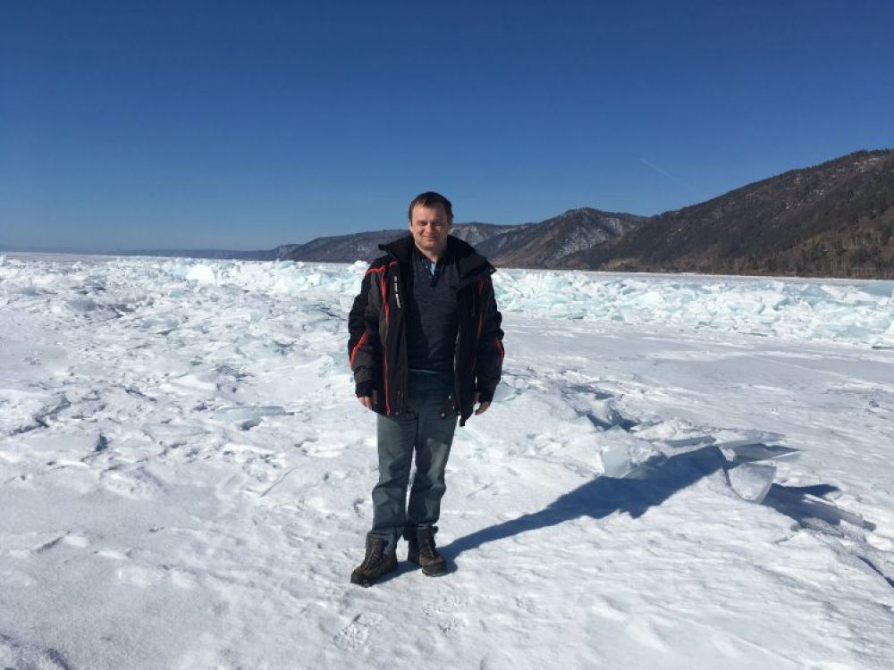

[← Интервью и подкасты](../interviews.html){.interview-back}

::: {.interview-source}
[«Научная Россия»](https://scientificrussia.ru/articles/dmitrij-naumov-bajkalskij-teleskop-unikalnyj-instrument-nejtrinnoj-astronomii), 16 марта 2021 года. Материал Минобрнауки России
:::

{.interview-hero fig-alt=""}

::: {.interview-lead}
На Байкале в рамках Года науки и технологий запустили крупнейший в Северном полушарии подводный нейтринный телескоп Baikal-GVD. По словам ученых, благодаря этой установке мы сможем узнать, как эволюционировала наша Вселенная и развивались галактики. О том, какую роль эта мегасайенс-установка играет для науки и человека, мы поговорили с Дмитрием Наумовым, доктором физико-математических наук, руководителем Нейтринной программы ОИЯИ, заместителем директора по научной работе Лаборатории ядерных проблем им. В. П. Джелепова Объединенного института ядерных исследований.
:::

***Как бы вы объяснили обычному человеку, для чего нам нужен Байкальский нейтринный телескоп?***

Этот прибор со всех сторон сканирует пространство вокруг нас в поисках нейтрино сверхвысоких энергий. Фактически это новый астрономический инструмент, позволяющий видеть космические объекты в нейтринных лучах. Эта наука только что возникла, буквально несколько лет назад, и байкальский телескоп призван стать важнейшим инструментом в этой области.

Он сможет разглядеть в «нейтринном свете» такие удивительные объекты, как активное галактическое ядро - сверхмассивная черная дыра с массой до миллиардов масс Солнца, пожирающая окружающие ее звезды. Важные подробности этой драмы никаким другим способом, кроме нейтринного сканера, получить невозможно.

***Зачем нам изучать вещи, которые настолько далеко от нас, с которыми мы вряд ли когда-нибудь сможем соприкоснуться?***

Ученых, которые работают в области фундаментальной науки, как правило, больше интересуют фундаментальные вопросы, чем вопросы практического применения их открытий. Понимание устройства нашей Вселенной и управляющих ею физических законов важно не только на фундаментальном уровне, но и имеет множество практических применений. Например, если бы Генрих Герц не открыл электромагнитные волны, сегодня не было бы телевидения, радио, сотового телефона и множества других вещей, без которых наша современная жизнь немыслима. Когда Герца спрашивали, какая практическая польза от его открытия, он отвечал: «Понятия не имею». Точно так же и физики, которые сегодня исследуют Вселенную, как она устроена, в первую очередь думают о фундаментальных законах природы. Но это не значит, что практического применения нет.

Во-первых, нейтринный телескоп очень чувствителен к свету, который рождает нейтрино во время взаимодействия. Сами по себе эти приборы увидят любой свет - не важно, нейтрино его породило или что-то другое. Озеро Байкал постоянно светится из-за разных процессов, которые внутри него происходят, из-за микроорганизмов, которые там живут, все это постоянно движется в разных слоях, что-то поднимается вверх, что-то опускается вниз. И мы с помощью телескопа все эти вещи наблюдаем 24/7. Для экологов это абсолютно уникальные данные, которые своими приборами они получить не смогут, потому что у них они менее чувствительные. То есть благодаря телескопу мы получаем новые уникальные знания про озеро Байкал.

Кроме того, нейтрино позволяют просканировать Землю и сделать томограмму ее структуры. При помощи такого тонкого квантового эффекта, как нейтринные осцилляции (Нобелевская премия 2015), предсказанного в свое время дубненским ученым Бруно Понтекорво, можно будет измерить даже атомный состав внутренности Земли. Никаким другим способом это сделать невозможно.

***Оказывает ли какое-то влияние работа телескопа на подводный мир Байкала - позитивное или негативное?***

Что из себя представляет байкальский нейтринный телескоп? Это стеклянные сферы и нержавеющие тросы - ничего опасного для озера. Вся электроника находится внутри стеклянных сфер.

Обитателям озера, омулю, нерпам и другим байкальским эндемикам, скорее всего, это даже нравится. Наверное, их забавляют эти стеклянные шарики. Если серьезнее, то наш телескоп оказывает положительное влияние на озеро, поскольку позволяет в круглосуточном режиме отслеживать его состояние. Это ценная информация для ученых лимнологов, экологов.

**Справка**

*Впервые идея создания нейтринного подводного телескопа была высказана в 1960 году советским академиком Моисеем Александровичем Марковым. Её воплощение началось только через 20 лет командой советских ученых под руководством Григория Владимировича Домогацкого. Только в 1990 году началось строительство нейтринного телескопа на Байкале, оно было завершено в 1994 году - тогда это был первый нейтринный телескоп в мире. Установка на Байкале первой смогла зарегистрировать нейтрино. Идея М.А. Маркова воплотилась в новый астрофизический инструмент. Самоотверженная пионерская работа ученых на Байкале и на Южном полюсе (установка AMANDA) в девяностых годах прошлого века определила развитие нейтринной астрофизики в мире.*

*С 2014 года на Байкале ведётся строительство нейтринного телескопа кубокилометрового объема. В апреле 2015 года был введен в эксплуатацию первый кластер нового телескопа “Дубна”. В 2020 году байкальский телескоп насчитывал уже семь кластеров, в каждом из которых было по 288 оптических модулей. В апреле 2021 года будет введен в строй восьмой кластер, что позволит байкальскому нейтринному телескопу догнать самый крупный на сегодняшний день нейтринный телескоп IceCube.*

[← Интервью и подкасты](../interviews.html){.interview-back}
