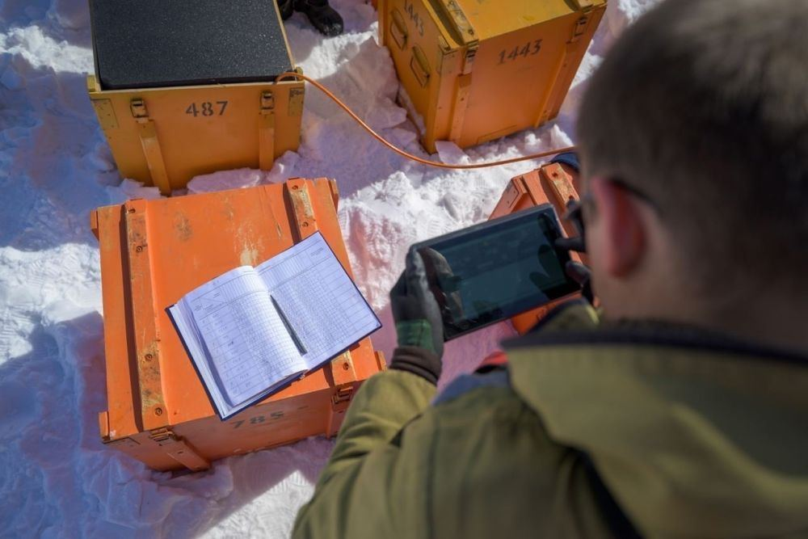

[← Интервью и подкасты](../interviews.html){.interview-back}

::: {.interview-source}
Интервью. Текст: Юрий Дризе
:::

{.interview-hero fig-alt=""}

::: {.interview-lead}
Дмитрий Наумов недавно вернулся с Байкала, где в торжественной обстановке открыли один из крупнейших в мире глубоководных нейтринных телескопов. Дмитрий Вадимович – заместитель директора лаборатории ядерных проблем им. В.П. Джелепова Объединенного института ядерных исследований, доктор физико-математических наук, руководитель нейтринной программой ОИЯИ.
:::

***– Что несут путешествующие во Вселенной, буквально пронизывающие Землю и людей крохотные частицы, нейтрино? Зачем их «отлавливают» и почему астрофизики делают это именно на Байкале?***

– Начну издалека. Открыл нейтрино еще в 1930 году австрийский теоретик Вольфганг Паули. Он предположил, что в слабых радиоактивных распадах рождается невидимая нейтральная частица с очень маленькой массой. И назвал ее нейтроном (тогда он еще не был открыт). Затем настоящий нейтрон обнаружили экспериментально, он оказался очень тяжелым и не годился на роль, предложенную Паули. Тогда другой великий физик – Энрико Ферми – предложил переименовать «нейтрон Паули» в «маленький нейтрон» – на итальянский манер – «нейтрино». Сегодня физикам известны три их типа, главное объединяющее их свойство: они очень слабо взаимодействуют с веществом, для них прозрачны люди, наша Земля и Солнце.

Но сразу встал вопрос: как изучать частицы, если их почти невозможно обнаружить? Нейтрино даже стали называть «призраком». Действительно, частица существует, но как ее зарегистрировать? И все же через некоторое время экспериментаторы научились с ней работать. Оказалось, что хотя взаимодействуют они слабо, зато рождаются в огромном количестве. И вместо того чтобы строить отлавливающие их огромные и дорогостоящие телескопы, советский физик М.Марков еще в 1960 году предложил использовать в качестве детектора моря, океаны и даже озера. Тогда нейтринный телескоп станет мощным инструментом познания Вселенной, выбраться из которой из-за слабости взаимодействия могут только эти крохотные частицы и принести нам ценнейшую информацию.

Телескопы регистрируют нейтрино, предположительно, рожденные в сверхплотных областях Вселенной, так называемых активных галактических ядрах – сверхмассивных черных дырах. Находятся они в центре далеких от нас галактик и буквально пожирают звезды вокруг себя, так что их масса вырастает до миллиона, а иногда и миллиарда масс нашего Солнца. Это самые яркие объекты во Вселенной. Вещество по спирали крутится вокруг черной дыры и падает в нее, как в воронку. Но по непонятной до конца причине часть вещества выбрасывается в сторону в виде мощной струи газа гигантских размеров – до миллиона парсек (в километрах это число с 19 нулями). Здесь и рождаются нейтрино сверхвысоких энергий. Они прошивают Землю, оказываясь в том числе и в Байкале. Телескоп их фиксирует, и мы определяем направление, откуда частички к нам попали. А проверить точность «адреса» помогает оптический телескоп.

***– Выходит, нейтрино – своего рода «разведчики», сообщающие ученым о том, что происходит в недрах звезд и черных дырах? Это едва ли не единственной источник бесценной информации?***

– Верно. Они дают представление о прошлом нашей Вселенной 4-6 миллиардов лет назад. А события тогда происходили драматичные – шло образование сверхмассивных черных дыр. Об этом благодаря телескопу нам и расскажут нейтрино.

***– Много ли стран в состоянии их изучать?***

– Не все государства готовы строить очень большие и дорогие детекторы. Поэтому существует элитный клуб стран, развивающих нейтринную физику. В него входят Япония, Китай, США, Россия и Евросоюз.

***– Почему так важен Байкал? Почему именно там вы строите ловушки для нейтрино?***

– Чтобы изучать их, необходимо накопить большой массив статистических данных, значит, нужен исследуемый детекторами огромный объем вещества, который мы должны просматривать. Поэтому и нужна прозрачная среда: вода или лед. При их взаимодействии с частицами возникает эффект, открытый советскими физиками П.Черенковым и С.Вавиловым. За это открытие трое наших соотечественников П.Черенков, И.Франк и И.Тамм получили Нобелевскую премию. Известно, что свет в воде движется примерно на 25% медленнее, чем в вакууме, так возникает «черенковское излучение». В прозрачной среде его довольно легко обнаружить.

Американские физики установили свои детекторы прямо во льду. Это было очень непросто. В Антарктиду доставили массу оборудования и дизельного топлива. Протопили во льду лунки диаметром чуть меньше метра и глубиной аж до 3 км. Думаю, стоимость их телескопа раз в 20 выше нашего. Байкал для астрофизиков – подарок природы. У него огромные преимущества перед всеми другими средами. Помимо прозрачной воды он более двух месяцев покрыт почти метровым слоем льда, выдерживающим даже тяжелую технику. С ее помощью мы опускаем под воду гирлянды со стеклянными оптическими модулями. Внутри стеклянной сферы, выдерживающей огромное давление, – фотоумножитель, регистрирующий свет, и электроника, обрабатывающая сигнал и передающая его по кабелю «на материк». Здесь ученые круглосуточно следят за работой приборов. Устанавливают кластеры, закрепляя их якорями и тросами, в феврале-марте. Один-два кластера за зиму.

Нейтринный телескоп расположен на расстоянии 3,5 км от берега и на глубине около 1,5 км. Это район 106-го км Кругобайкальской железной дороги, построенной в конце XIX – начале XX века. Сегодня ее используют в туристических целях, а также для доставки нашего оборудования. Здесь же находится нейтринная деревня со старым научным центром, он размещается в бывшем здании вокзала. Но есть и новый, современный. Рядом – домики и вагончики (балки) на двух человек. Всего в деревне во время экспедиции живут примерно 35-50 человек. Условия вполне комфортные. Вагончики удобные, есть даже сушка для одежды. Хотя она у нас специальная, но в конце дня часто намокает, и сушка нас выручает.

***– Почему нужно постоянно наращивать мощность телескопа?***

– Мы стремимся зарегистрировать не одно случайное нейтрино, а набрать статистику с данными разных энергий. Это поможет нам лучше понять механизмы ускорения, узнать другие интересующие нас важные подробности, касающиеся Вселенной. Поэтому масса детектора должна быть как можно больше. Наша задача – довести объем телескопа до 1 кубического км. Величина огромная! Представьте, на нашей планете примерно 7,5 миллиарда человек. Помножим на средний вес человека – получим объем, который занимают люди. Он невелик – всего 0,4 кубического км. А когда достроим телескоп, достигнув требуемого размера, он будет в два раза превышать массу населения Земли. Но если посмотреть на карту Байкала, а он огромен, то наш телескоп на ней – всего лишь точка.

***– Вернемся в день сегодняшний. Чему посвящались торжества на Байкале?***

– Мы установили седьмой кластер. Таким образом, наш телескоп стал самым крупным в Северном полушарии. Примерно 10 апреля кластеров станет восемь, и мы догоним американцев. В апреле лед становится уже тонким, и работать на нем долго не получится. Это здорово нас мобилизует. Во время экспедиции в лагере царит атмосфера взаимовыручки: все друг другу помогают, и мы работаем слаженно, быстро, четко. Благодаря совершенной технике и инструментам мы делаем в разы больше, чем, скажем, в начале 90-х годов прошлого века, когда началось строительство телескопа. Пионером в этой области астрофизики в нашей стране и мире стал легендарный ученый, профессор Григорий Владимирович Домогацкий. (Институт ядерных исследований Академии наук СССР, сегодня – ИЯИ РАН.)

***– Все замечательно. Вы черпаете из Байкала массу информации, а есть кому ее обрабатывать и анализировать? Выходят ли статьи в ведущих иностранных изданиях?***

– Действительно, несколько лет назад, когда мы только разворачивались, специалистов, способных на мировом уровне оценить и проанализировать данные, было не так много. Но за несколько последних лет в байкальской коллаборации выросло новое поколение молодых ученых. У них горят глаза, они достигли высокого научного уровня, и обработка данных сегодня идет очень активно. И статьи выходят, и сотрудничество наших ученых с иностранными коллегами развивается. Пока в этой области доминируют американцы, что вполне объяснимо. Их телескоп на Южном полюсе действует с 2010 года, и сегодня коллеги сосредоточились в основном на анализе собранных данных. Мы же фактически строим новый телескоп с 2015 года, а установку первого кластера завершили в 2016-м. Строимся, одновременно накапливаем данные и производим их обработку. Зафиксировали 12 перспективных событий, их анализу и посвятим новые публикации. Обработав статистику, постараемся определить, что происходило в источниках нейтрино миллиарды лет назад. Это поможет нам проверить физические законы в самых отдаленных уголках Вселенной. Никаким другим способом, кроме как призвав на помощь нейтрино, узнать об этом невозможно. А это очень важно! Мы сможем выяснить, как возникают черные дыры, как они набирают массу, как образуются естественные ускорители. Пока это загадка. Но, разобравшись в механизмах, действовавших в галактиках в прошлом, придем к пониманию, как они, наш Млечный путь, да и вся Вселенная будут эволюционировать через миллиарды лет.

Автор: Юрий Дризе.

[← Интервью и подкасты](../interviews.html){.interview-back}
