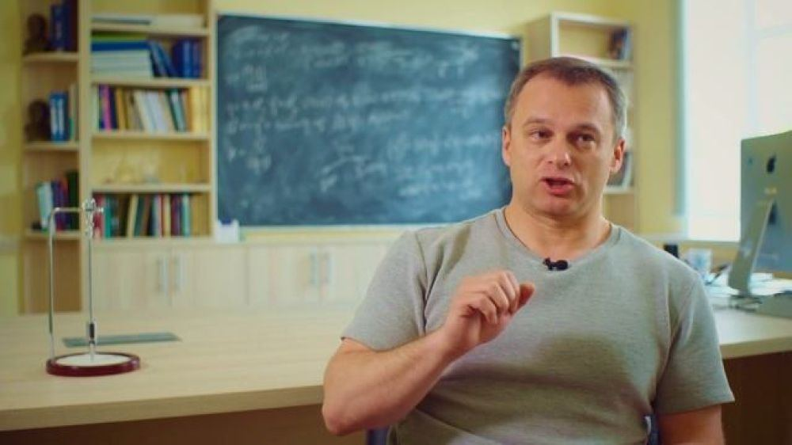

[← Интервью и подкасты](../interviews.html){.interview-back}

::: {.interview-source}
«Троицкий вариант — Наука», № 14 (308), 14 июля 2020 года. Беседовал Ян Махонин
:::

{.interview-hero fig-alt=""}

::: {.interview-lead}
Почему нейтрино почти не взаимодействует с обычным веществом и прошивает насквозь миллиарды звезд? Могут ли нейтрино быть частицами загадочной темной материи? Какую информацию они нам сообщают об эволюции галактик и Вселенной? В чем польза от исследования нейтрино для «народного хозяйства»? Помогут ли детекторы нейтрино проконтролировать производство ядерного оружия? Когда будет достроена крупнейшая нейтринная обсерватория в Северном полушарии, расположенная на Байкале? И как поймать нейтрино, рожденные в недрах Земли?
:::

Об этом и многом другом журналист Ян Махонин поговорил с докт. физ.-мат. наук Дмитрием Наумовым, зам. директора по научной работе Лаборатории ядерных проблем Объединенного института ядерных исследований (ОИЯИ) в Дубне.

В интервью он рассказал не только о физике нейтрино, но и о своем жизненном пути, исследовательской и административной деятельности и о том, как институт выжил в девяностые годы и как функционирует сейчас.

### Роль нейтрино в эволюции Вселенной и галактик

***— Сегодня изучение свойств нейтрино является одним из ключевых направлений исследований физики частиц. Почему?***

— Гипотеза о существовании нейтрино была предложена Вольфгангом Паули в 1930-е годы для того, чтобы спасти закон сохранения энергии. Нейтрино выступило на сцену как спаситель этой важнейшей концепции в науке. Позже, когда нейтрино открыли и когда изучили некоторые его свойства, было обнаружено, что физика нейтрино в нашем мире и в «кэрролловском зазеркалье» сильно различается. Это натолкнуло создателей Стандартной модели на идею ее правильного построения. С тех пор прошло уже порядка 50 лет, и физики понимают, что, несмотря на успешность Стандартной модели, остаются две загадки: темная энергия и темная материя. Необходима новая теория. И сейчас надеются, что если мы сможем аккуратно измерить все свойства нейтрино, то оно снова укажет нам путь, на этот раз за пределы Стандартной модели.

***— Что мы знаем на данный момент о роли нейтрино в эволюции Вселенной?***

— В эволюции нашей Вселенной нейтрино играет довольно серьезную роль. Например, после Большого взрыва, считающегося рождением Вселенной, в первые доли секунды нейтрино вместе с фотонами, электронами, протонами, нейтронами и т. д. образовали «горячий суп» из частиц. Если бы число типов нейтрино в газе было другим, то у этого газа были бы несколько другие свойства, и это привело бы к несколько другой эволюции Вселенной. Нам известно, что масса нейтрино составляет не более одного электронвольта (эВ). Если бы, скажем, масса нейтрино была 50 эВ, то наша Вселенная уже давно сколлапсировала бы обратно в точку, в так называемую сингулярность.

***— Какую роль играет нейтрино в возникновении галактик? Претендует ли оно на роль частиц темной материи?***

— Согласно современным представлениям, галактики не могли образовываться самостоятельно. Звезды находятся слишком далеко друг от друга, чтобы объединиться в галактику. Возможным решением проблемы является гипотеза темной материи, заполняющей пространство между звездами и усиливающей действие гравитационного поля. Нейтрино по-прежнему играет роль возможного кандидата на роль темной материи. И снова всё зависит от того, какие у нейтрино свойства и масса. Если бы масса нейтрино была слишком маленькая, то такая темная материя приводила бы, на­оборот, к тому, что никакие галактики не могли бы образоваться. Если масса нейтрино потяжелее, они могли бы играть роль темной материи.

***— Можете ли вы привести такой пример важности нейтрино, который касался бы непосредственно нас всех?***

— Рассмотрим наше Солнце. Если бы нейтрино не существовали, то Солнце бы вообще не горело. Самая первая реакция, благодаря которой Солнце зажигается, — это когда два протона сливаются друг с другом, превращаются в дейтрон, позитрон и нейтрино. Без нейтрино такой реакции не было бы, Солнце не горело бы и, соответственно, не было бы жизни на Земле.

***— Исследуя нейтрино сверхвысоких энергий, сможем ли мы понять, что было с нашей планетой и с нашей Галактикой в момент их возникновения?***

— К ответу на этот вопрос стремится, например, эксперимент Baikal-GVD, который исследует нейтрино с очень большими энергиями. Оказывается, когда образуются галактики, в их центре практически всегда возникает черная дыра. Сначала она небольшая, но постепенно начинает пожирать вещество вокруг и разрастается до миллионов масс нашего Солнца, иногда даже до миллиардов. То есть заметная доля массы всей галактики может сидеть в одной черной дыре.

Эта черная дыра пожирает вещество звезд вокруг себя, постоянно увеличиваясь в размерах. Вещество от этих звезд закручивается вокруг черной дыры, образуя аккреционный диск, нагревается и ярко светится. Это красивое и драматическое явление. Сама черная дыра, конечно, не может излучать свет, но ­благодаря этому светящемуся газу она становится одним из самых ярких объектов во Вселенной. Газ закручивается в определенной плоскости, и в направлении, перпендикулярном этой плоскости, черная дыра иногда вы­брасывает мощную струю газа, которую не смогла «переварить». В этой струе возникает самый мощный ускоритель, который существует во Вселенной. Он ускоряет частицы до совершенно безумных энергий. В том числе там возникают такие прозаические для земных ускорителей частицы, как пионы, каоны и другие, которые ускоряются и при своих распадах частенько дают нейтрино. Мы на Земле такие ускорители построить не можем.

Кроме того, для нас важно слабое взаимодействие нейтрино. Если выстроить миллиард солнц по порядку, одно за другим, нейтрино с энергией 1 млн эВ, пролетая сквозь этот строй, провзаимодействует с веществом всего один раз. Так что оно без проблем покидает область черной дыры, проходит через половину Вселенной и может прий­ти к нам и принести информацию о том, как и где оно родилось. По пути оно не отклоняется ни электромагнитными, ни гравитационными взаимодействиями.

***— Значит, нам больше не нужен обычный телескоп? Мы можем читать информацию о галактиках прямо с помощью нейтрино?***

— Есть такие места во Вселенной, про которые мы не сможем надежно ничего сказать без регистрации нейтринного сигнала оттуда. Нейтринная астрономия возможна при условии, что мы на Земле сможем аккуратно установить, откуда к нам пришло нейтрино. А сделать мы это можем потому, что у нейтрино очень большая энергия, и все частицы, которые оно рождает, когда взаимодействует в детекторе, будут лететь строго в том же направлении, откуда нейтрино само пришло. Например, наш байкальский телескоп Baikal-GVD регистрирует черенковское излучение, которое генерируют эти заряженные частицы, и может достаточно хорошо, с точностью лучше одного градуса, определить направление нейтрино. Однако рождение новой науки — нейтринной астрономии — не отменяет обычную астрономию с классическими телескопами, которые остаются лучшими приборами для менее труднодоступных мест во Вселенной.

### Физики-теоретики и физики-экспериментаторы

***— Исследование нейтрино стоит на перекрестке физики частиц, космологии и астрофизики. В ОИЯИ применяется междисциплинарный подход?***

— В ОИЯИ пока мало астрономов или космологов, которые бы занимались исследованием нейтрино. Но мы работаем в большой международной команде, и, конечно, есть коллеги-астрофизики, которые используют наши результаты. В итоге нам не так уж важно, где числится или работает человек. Все эти результаты мгновенно становятся известны, и, действительно, очень важно, что работа ведется в такой междисциплинарной области. Это значит, что результаты, которые мы получаем, изучая нейтрино, переосмысливаются в более глобальном контексте. Это, к примеру, позволяет понять, что происходило во Вселенной в целом, как образовывались галактики, какие механизмы приводили к тому, что возникали активные галактические ядра, как нейтрино проходит через плотное вещество. То есть при помощи этих сверхэнергичных нейтрино мы, фактически, восстанавливаем прошлое, заглядываем примерно на 4–5 млрд лет назад и восстанавливаем тогдашнюю ситуацию.

***— В исследованиях нейтрино вы с коллегами придерживаетесь какой-нибудь конкретной теории Новой физики?***

— Нет. В этом смысле экспериментальная физика хороша тем, что мы просто получаем экспериментальный результат, а потом теоретики в рамках разных теорий или моделей пытаются этот результат проверить и осмыслить, определить, вписывается ли он в ту или иную теорию или нет. На прецизионное измерение тонких свойств нейтрино нацелен, например, международный проект JUNO (Jiangmen Underground Neutrino Observatory). Это как раз тот самый путь к Новой физике. JUNO уже рутинным образом будет использовать явление нейтринных осцилляций для исследования свойств нейтрино. Важнейшую роль в установлении самого явления нейтринных осцилляций сыграл эксперимент Daya Bay. За это, кстати, многие участники коллаборации Daya Bay были удостоены самой крупной премии в науке — «Прорыв в фундаментальной физике» за 2016 год. Оба этих эксперимента проводятся с ядерными реакторами в Китае, и в обоих принимают активное участие ученые из ОИЯИ.

***— Как вы взаимодействуете с физиками-теоретиками? Чешско-французский физик Франтишек Легар, работавший в 1960-е годы в ОИЯИ, делил их на более и менее «полезных» для физиков-экспериментаторов. Вы бы с ним согласились?***

— Вообще, разделение на теоретиков и экспериментаторов для меня лично достаточно условное. Более правильно говорить — хороший и плохой физик. Потому что, когда кто-то говорит: «Я экспериментатор, я формулы писать не умею» и вообще не знает, как интерпретировать то, чем он занимается, его заключения для меня не имеют большого значения. И точно так же, когда теоретик говорит: «Я не представляю как измерить то, что я посчитал», это означает, что он не разобрался в явлении. По-моему, если человек понимает физику, он способен объяснить ее на пальцах любому, включая ребенка, и он может предложить метод измерения, пускай самый простой, и понять, как интерпретировать результаты этого измерения. Кто-то лучше пишет формулы, кто-то лучше работает с приборами, но хорошие физики всегда находят общий язык.

Древние античные философы полагали, что можно чисто умозрительно, без эксперимента, понять, как устроена Вселенная. Позже, уже во времена Галилея, ученые осознали, что единственный верный путь — ставить эксперименты. Хорошая теория должна быть способна объяснить не только старый, накопленный материал, но и новый. Наша конечная цель — получить правильную картину физического явления. Современные эксперименты уже, как правило, настолько сложны, что всё то, что мы наблюдаем, всегда нуждается в теоретическом описании. Нельзя, например, сказать, что мы в каком-то эксперименте «увидели» бозон Хиггса. На самом деле мы реконструируем очень косвенные характеристики определенного явления. Мы смотрим на следы, которые оно оставляет.

Точно так же, только еще сложнее, обстоят дела и в астрофизике. Проект Baikal-GVD позволяет нам рассматривать сигналы из оптических модулей. Затем в рамках теоретической модели, которая основана на том, что существует черенковское излучение, мы пытаемся реконструировать направление прилета той или иной частицы. Дальше вместе с теоретиками мы должны понять, где ее источник, какие механизмы могли бы приводить к рождению этих высокоэнергетических нейтрино и так далее. Без теоретиков и теоретического осмысления невозможно получить настоящий результат.

### Польза от нейтрино «для народного хозяйства»

***— Что вы можете сказать о прикладных исследованиях в области нейтринной физики?***

— Меня очень часто спрашивают, какую пользу можно извлечь из этих исследований. На это можно посмотреть с разных точек зрения. Первая — это очевидная практическая польза. Можно ли нейтрино, так сказать, использовать в народном хозяйстве? Можно. Например, есть ядерные реакторы, которые излучают антинейтрино. Это происходит просто потому, что обычные ядра, когда они разваливаются и выделяют энергию, переходят в ядра, богатые нейтронами. Эти ядра нестабильные, они распадаются сами по себе и генерируют антинейтрино. Людям, которые работают на ядерных реакторах, в каком-то смысле нет дела до нейтрино. Их интересует только ядерная энергия. Однако ядерный реактор в то же время является и очень интенсивным источником антинейтрино, причем бесплатным. Можно поставить недалеко свой детектор, измеряющий нейтрино, — он уже есть, например, на ­Калининской атомной станции в Тверской области.

***— В какой обстановке проводятся эти эксперименты?***

— На Калининской АЭС находятся четыре реактора, и под каждым из них согласно проекту существует пустая комната. ОИЯИ и Институту теоретической и экспериментальной физики (ИТЭФ) благодаря договоренностям с Росатомом было разрешено поставить в эту комнату научное оборудование. Таким образом, получилось создать лабораторию с самым маленьким расстоянием до центра ядерного реактора — порядка 8 метров.

***— Это не опасно?***

— Там существует надежная защита от всего ядерного излучения. От нейтрино защититься нельзя, но оно и не может навредить здоровью. Детектор массой около тонны может регистрировать огромные потоки нейтрино, собирая большую статистику данных — порядка пяти тысяч событий в день. Один из экспериментов — это поиск стерильных нейтрино, другой — поиск возможного магнитного момента у нейтрино, третий — исследование и измерение вероятности когерентного рассеяния нейтрино на ядре.

***— Поясните, пожалуйста, о чем идет речь.***

— Процесс когерентного рассеяния весьма интересен, поскольку на фундаментальном уровне нейтрино взаимодействует с протонами и нейтронами, из которых состоит ядро. Еще точнее — с кварками, из которых состоят протоны и нейтроны. Так вот, при энергиях нейтрино порядка нескольких миллионов электронвольт оказывается, что вероятность взаимодействия нейтрино с ядром, содержащим N нейтронов, больше соответствующей вероятности взаимодействия с одним нейтроном в N2 раз! Этот эффект возникает в результате когерентного сложения амплитуд вероятности и служит замечательной иллюстрацией законов квантовой механики. Недавно этот процесс был обнаружен коллаборацией COHERENT.

***— Каково практическое значение таких экспериментов?***

— Могу привести пример. В процессе работы промышленного ядерного реактора вырабатываются не только полезная энергия, но и ядра плутония-239. Теоретически он может быть использован для создания ядерного оружия. Поэтому очень важно контролировать его производство, и общество тратит на это немалые средства и силы. Регистрация антинейтрино от ядерного реактора является, среди прочего, надежным способом измерения количества ядер плутония-239 в реакторе.

Не менее, а, может быть, даже более важна польза от развития технологий, связанных с исследованием нейтрино, необходимых для того, чтобы сделать следующий шаг в науке.

***— То есть с помощью нейтрино можно осуществлять контроль за ядерной безопасностью?***

— Да. К тому же нейтрино невозможно обмануть. Какой способ используется сейчас? Ядерные компании обязаны сообщать, какая мощность вырабатывается у реактора в каждый момент времени. А дальше, в рамках теоретических моделей, можно эту мощность пересчитать в количество плутония, которое там произведено. Но если компания по какой-то причине сообщает неправильные значения мощности, то вы будете делать ошибочное заключение о количестве плутония — например, считать, что его произведено меньше, чем на самом деле. А ведь излишки могут пойти на создание атомного оружия.

Методика, использующая нейтрино для оценки количества рожденного плутония-239, сейчас в стадии разработки. В рамках международного эксперимента на АЭС Daya Bay в Китае мы с коллегами надежно доказали, что это работает. Мы этот эффект увидели, и в разных научных центрах исследуются возможности его прикладного применения.

***— Как еще может практически применяться нейтрино?***

— Поскольку нейтрино довольно слабо взаимодействует с веществом, оно может без проблем пройти сквозь Землю. Но чем больше вещества, тем чаще нейтрино с ним взаимодействует. Более того, число взаимодействий нейтрино внутри нашей планеты будет зависеть от типа атомов тех или иных веществ, от того, сколько протонов и нейтронов в ядрах этих атомов. Никаких других надежных способов проникнуть внутрь и узнать, из каких химических элементов состоит Земля, пока не существует. Для томографии Земли можно использовать атмосферные нейтрино.

***— Откуда они берутся?***

— На Землю постоянно падают космические протоны, они взаимодействуют с ядрами азота, кислорода и других элементов атмосферы и рождают пионы, каоны и другие частицы, которые иногда распадаются с рождением нейтрино. Поэтому вся атмосфера светится нейтрино. Со всех сторон они падают на Землю, проходят сквозь Землю, и, если поставить достаточное число детекторов и измерить, сколько нейтрино проходит с той или иной ее стороны, можно просканировать Землю.

***— Развитие нейтринной физики сопровождается созданием новых установок и оборудования. Насколько они применимы в других областях науки и в повседневной жизни?***

— Любой физический эксперимент, в том числе с нейтрино, находится на переднем крае науки. Соответственно, каждый следующий шаг всегда требует новых технологий. А потом этими технологиями пользуется всё человечество, уже без всякой связи с нейтрино.

***— Можете привести пример?***

— Скажем, высокочувствительные фотоэлектронные умножители. Их можно использовать в медицине, в томографии.

### Нейтринный телескоп на Байкале

***— На какой стадии находится строительство Байкальского нейтринного телескопа?***

— На озере Байкал мы вместе с Институтом ядерных исследований Российской академии наук в составе международной коллаборации строим подводный нейтринный телескоп, который в следующем году будет размером в половину кубического километра, а потом и в полтора кубических километра. Уже на сегодняшний день построено 0,35 км3. Эта установка — крупнейший нейтринный телескоп в Северном полушарии. Сегодня он состоит из семи независимых кластеров. Сейчас в создание телескопа вкладывается очень много сил и денег. Мы верим, что в ближайшее время он начнет давать очень интересные физические результаты.

***— Что конкретно достигнуто?***

— В основном силы коллаборации сейчас брошены именно на строительство экспериментального прибора. Параллельно ведутся серьезные работы, связанные с анализом экспериментальных данных. Уже сейчас есть некоторые интересные кандидаты на нейтринное взаимодействие с огромными энергиями.

***— Какое значение для вашей работы имеет обнаружение нейтрино ультравысоких энергий в 2013 году в рамках эксперимента IceCube в Антарктиде?***

— Это важнейшее открытие играет ключевую роль. Мы теперь знаем, что наш телескоп обязательно увидит нейтрино из космоса, а значит, инвестиции будут не напрасны. Отличные свойства байкальской воды могут позволить нам определить источники нейтрино сверхвысоких энергий.

***— Входит ли в ваши планы создание на Байкале полноценной нейтринной обсерватории, сравнимой с IceCube?***

— Конечно. На 106-м километре Кругобайкальской железной дороги есть станция, где находится наш нейтринный Береговой центр. Центр серьезным образом модернизируется, появляются новые жилые домики, новая береговая станция для сбора информации с нейтринного телескопа. Там очень красиво, туда приятно будет приезжать, жить там и работать. Он станет очень важным мировым центром нейтринной физики.

Нейтрино из глубин Земли — Что такое геонейтрино?

— Если копать вглубь Земли, она становится всё более и более горячей. В самом центре Земли находится очень горячее железное ядро. Это знает, наверное, каждый школьник. Но вот почему к центру Земли становится всё горячее — никто не знает наверняка.

Существуют две модели, объясняющие это явление.

Первая: когда планета была еще холодная, более тяжелые элементы начали опускаться вниз, более легкие всплывали к поверхности. В результате такой гравитационной дифференциации начало выделяться тепло, которое нагревало внутренность Земли.

Вторая модель предполагает, что внутри нашей планеты находятся радиоактивные элементы, такие как уран или торий. В распадах этих радио­активных ядер, как и в ядерном реакторе, выделяется тепло, и оно идет на то, чтобы нагревать планету. Чтобы проверить вторую гипотезу, можно воспользоваться тем, что в таких ядерных распадах обязательно должны рождаться антинейтрино. Если мы сможем увидеть антинейтрино, идущие прямо из глубин Земли с энергиями, характерными для распадов ядер, то мы сможем определить вклад этого механизма в разогрев планеты.

Два эксперимента несколько лет назад обнаружили антинейтрино, идущие из глубин Земли. Это эксперимент KamLAND в Японии и эксперимент Borexino в Италии. В последнем эксперименте принимают участие ученые из ОИЯИ. Хотя само существование геонейтрино надежно подтверждается данными обоих экспериментов, точность измерения потоков пока не очень высока; общее число наблюдаемых событий около двух сотен. Тем не менее это позволяет говорить о том, что такой сигнал есть. Интерпретация результатов экспериментов показывает, что примерно половина тепла Земли приходится на радиоактивные распады ядер. В итоге мы теперь принципиально по-новому понимаем, что происходило с нашей планетой и что находится внутри нее.

### Личная история

***— Теперь расскажите, пожалуйста, о себе. Откуда вы родом?***

— Я родился в Кемерово, но прожил там всего полгода. Моя семья переехала в Иркутск, и там прошли первые двадцать лет моей жизни. Образование я получил в Иркутском государственном университете.

***— Так что Байкал — это ваш дом?***

— Да, это мое родное место.

***— Как Вы попали в ОИЯИ?***

— Когда я закончил четвертый курс, к нам в Иркутск приехал профессор Владимир Борисович Беляев из Лаборатории теоретической физики (ЛТФ) ОИЯИ. Он посетил Байкал, организовал у нас семинар, и мой научный руководитель — профессор Александр Николаевич Валл — представил ему меня и мою однокурсницу Нину Шевченко. Владимир Борисович с нами поговорил и пригласил нас приехать в Дубну на дипломную практику.

Так мы оказались в ОИЯИ. После этого я остался в Дубне. Нина тоже некоторое время работала в Дубне. Сейчас она работает в Чехии, в Институте ядерной физики Академии наук Чешской Республики в городе Ржеж, она там успешный физик и регулярно приезжает в Дубну как лектор.

С тех пор я несколько раз менял свое научное направление. В ЛТФ ОИЯИ я занимался квантовыми системами из нескольких частиц — это была чистая ядерная физика. Потом я заинтересовался нейтрино и пришел в Лабораторию ядерных проблем (ЛЯП). С тех пор, начиная с аспирантуры, я в ЛЯП и работаю.

***— Вы учились в девяностые годы. Каковы были перспективы у молодого ученого в ельцинской России? Вы не задумывались об отъезде из страны?***

— Для меня девяностые годы — это прежде всего годы моей юности. Поэтому, что бы там ни было, я их вспоминаю с теплотой. Несмотря на то, что материальная ситуация в стране была очень тяжелая, мои родители сделали максимум для того, чтобы я и мой младший брат ни в чем не нуждались. Благодаря родителям мы были окружены большой заботой и уютом.

Однако люди старше меня на десять, двадцать лет должны были зарабатывать деньги сами, и сделать это тогда было очень сложно. В науке это было практически невозможно. Очень многие из-за этого покинули науку, ушли в бизнес или другие области, а те, кто хотел остаться в науке, постарались уехать за границу. Время от времени мы видимся за рубежом. Когда материальная ситуация выровнялась, некоторые из них вернулись в страну, правда, немногие. Например, мой отец как раз относится к поколению, сильно ощутившему на себе реалии девяностых. Он многие годы проработал за границей, зарабатывая на наше счастливое детство. А потом вернулся в Россию и сейчас работает руководителем сектора в ЛТФ ОИЯИ.

***— Как в девяностые выживал ОИЯИ?***

— Директором в ОИЯИ в то время был сначала академик РАН Владимир Георгиевич Кадышевский, а с 2006 года – академик РАН Алексей Норайрович Сисакян. В девяностые годы основные усилия они тратили на то, чтобы сохранить наш институт. Они понимали, что много людей из ОИЯИ, как и со всей страны, уезжает на Запад, и они, тем не менее, пытались сделать максимум для того, чтобы институт сохранился и чтобы там работала молодежь.

Им удалось это сделать и даже заложить важнейший фундамент для развития ОИЯИ сегодня. Хорошо работающих молодых ученых поддерживали. У нас тогда основным источником дохода были командировочные деньги, которые нам выдавали, когда мы ездили в CERN. Если мы проводили в CERN два месяца, этого в принципе хватало на целый год. Алексей Норайрович с коллегами заложили серьезный фундамент для развития ОИЯИ.

***— Почему вы в эти годы не уехали из ОИЯИ и не остались работать на Западе?***

— На самом деле, мне в ОИЯИ было интересно. У меня была очень интересная физическая задача, я этим делом занимался с большим удовольствием, и опять же – мои родители меня финансово поддерживали, и я, в принципе, никогда не был в ситуации, когда у меня не было бы денег на еду, на основные нужды.

***— Каким примерам вы следовали во время учебы? Вы чувствуете себя сторонником какой-нибудь школы, конкретной традиции, связанной с конкретными личностями?***

— В моей жизни, конечно, были люди, которые помогли мне стать тем, кто я есть. Важную роль в моей жизни сыграл мой первый научный руководитель профессор Александр Николаевич Валл. Мне в нем очень импонировало то, что в любом сложном физическом вопросе, которым он занимался, он всегда пытался разобраться настолько, что вопрос оказывался тривиальным. Он его всегда очень по-простому мог излагать. И любую тему он всегда излагал по-своему.

Важнейшую роль в моем становлении сыграл мой отец – физик-теоретик, очень талантливый человек с глубоким пониманием науки и энциклопедическими познаниями.

Очень многому я научился из книг. В студенческие годы я был под сильным впечатлением от американского физика Ричарда Фейнмана. Я читал и изучал его книги. Мне очень нравился и до сих пор нравится его научный стиль, который отличает ясность, простота и отсутствие скуки.

Сегодня развиваться дальше мне помогает общение с моими учениками и молодыми сотрудниками.

***— Вы провели несколько лет за границей — во Франции, в Италии…***

— После того, как я в Дубне получил степень кандидата физико-математических наук, я решил сделать следующий шаг, еще раз сменить поле деятельности. Во время аспирантуры я занимался экспериментами в CERN с ускорительными нейтрино и достаточно хорошо изучил эту физику. Но потом решил, что надо изучить что-нибудь новое, и это была физика космических лучей, астрофизика. Я подал заявку на постдок-позицию во Францию, в город Анси-ле-Вье (Annecy-le-Vieux), выиграл ее и проработал там полтора года. За это время я выучил французский язык.

Потом я получил постдоковскую позицию для иностранных специалистов в Италии. Я был первым в списке отобранных ученых, поэтому мог сам выбрать город и институт, где работать. Так получилось, что одновременно я выиграл позицию в Германии, в Мюнхене. Несмотря на то, что там предлагали зарплату в полтора раза больше, я выбрал Италию, Флоренцию. С этим городом у меня давние связи. Мой отец тоже там работал, и наша семья там прожила несколько лет. Кроме того, я хотел поработать с моим другом, флорентийцем Серджио Боттаи. Поэтому я решил, что лучше быть на более скромной зарплате, но заниматься делом, которое больше нравится.

***— После Вашего европейского опыта чувствуете себя «западником»? Почему вы не уехали из России?***

— Я по своему характеру демократически настроенный человек, и мне близки западные ценности. Но близки они мне не потому, что я поработал за границей и «заразился» западными ценностями, а, скорее всего, по складу моего характера. Я за мир, я против коррупции, против всего плохого и за всё хорошее. При всем при этом я люблю свою страну и поэтому вернулся сюда. Еще сравнительно молодым, в возрасте 25-28 лет, я получал довольно заманчивые предложения, например, стать профессором физики в США. Это даже льстило моему самолюбию, но на тот момент я руководил группой молодых ребят в Дубне, и я ни в коем случае не хотел их бросать, так что решил никуда не уезжать и старался здесь, в Дубне, построить свой мир.

[← Интервью и подкасты](../interviews.html){.interview-back}
