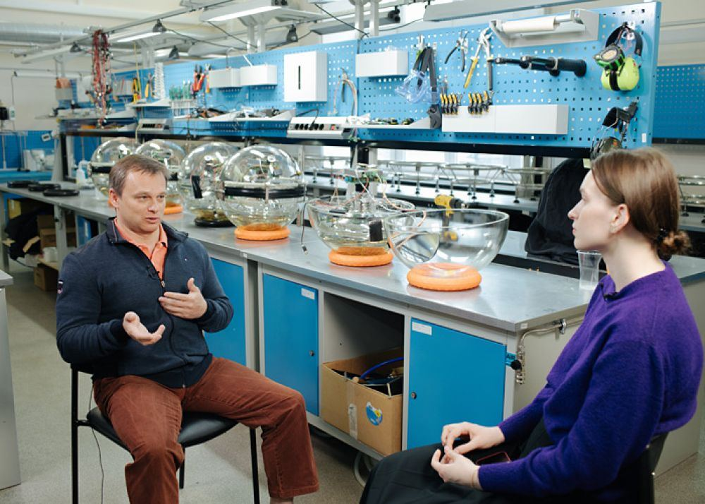

[← Интервью и подкасты](../interviews.html){.interview-back}

::: {.interview-source}
Еженедельник «Дубна: наука, содружество, прогресс», [№ 40](http://jinrmag.jinr.ru/2021/40/nk40.htm) (7 октября 2021 года) и [№ 41](http://jinrmag.jinr.ru/2021/41/nk41.htm) (14 октября 2021 года). Беседовала Галина Мялковская
:::

{.interview-hero fig-alt=""}

::: {.interview-lead}
Восьмого сентября в Лаборатории ядерных проблем состоялся семинар "Группа научных коммуникаций: поделиться знаниями, объяснить происходящее, сохранить историю". Вел семинар заместитель директора ЛЯП по научной работе Дмитрий Наумов. Руководитель группы Елена Дубовик рассказывала об итогах работы за полтора года, о действующих проектах и планах. Кроме того, к обсуждению подключился известный популяризатор науки, физик-теоретик, сотрудник ЛЯП Игорь Иванов. И поскольку вопросы на семинаре задавали, за незначительным исключением, сотрудники ЛЯП, редакция обратилась с просьбой к группе подробнее рассказать о ее деятельности. Надеемся, этот опыт пригодится и другим подразделениям ОИЯИ.
:::

***Сначала вопросы к Дмитрию Вадимовичу - инициатору и организатору группы. В ОИЯИ это не первая деятельность по распространению информации об Институте, но первая по использованию современных средств и профессиональному подходу. Такое возможно только при поддержке со стороны руководства. Энтузиазм, например, молодых ученых, не сможет охватить столько направлений. Как формулировалась задача при создании группы? По каким критериям отбирались участники команды? Какие ресурсы задействованы?***

Научная коммуникация - это новая тема не только для нашего Института, но и для России в целом. В некоторых странах необходимость уметь правильно и интересно освещать деятельность научных центров появилась раньше, и поэтому они уже ушли вперед. "Зачем вообще нужна научная коммуникация? Ведь мы же жили раньше без этого. И вроде бы неплохо". Мне не раз приходилось слышать подобные вопросы, и я бы хотел поделиться с вами своими соображениями.

Научные знания - основа развития общества. Без них не будет движения вперед. Сегодня объем таких знаний колоссален, и сейчас мы живем в эпоху его экспоненциального роста. Время сжалось, и крупнейшие открытия в науке происходят со все возрастающей скоростью. Например, открытия гравитационных волн ждали сто лет, бозона Хиггса и нейтрино из далекого космоса - 50 лет. Все эти открытия были сделаны совсем недавно и почти одновременно, в очень узком временном окне.

В мире насчитывается почти девять миллионов научных работников. Они производят научные знания, и никто в мире не в состоянии сделать общий обзор этих знаний. Если задаться целью прочитать лекцию про научные достижения за год работы всех ученых, потратив на каждого не более трех секунд, лекция затянется на год. Поэтому освещение научных достижений сегодня - это умение, которое требует глубоких и широких научных знаний, понимания важности результатов, определенного литературного таланта, а также способности донести суть этих достижений до широкой аудитории без искажений и в доступной форме.

Кроме благородной миссии нести знания миру, научная коммуникация важна и как инструмент привлечения молодежи в науку. Сегодня борьба за умы стала одной из отличительных черт нашего времени. Нет никакого смысла делать открытия, если через 10-15 лет их забудут, или не смогут понять их суть, или никто не будет их применять. В таком случае научные знания покроются пылью или превратятся в мифы и легенды. Приток молодежи в науку абсолютно необходим. Жизнь изменилась. Сегодня у молодых есть многократно большие возможности для применения своей энергии и талантов. Да, у научной коммуникации есть и такой прагматичный интерес.

Наконец, сравним две гипотетические научные организации. Одна из них ясно, просто и увлекательно рассказывает всеми доступными средствами о своих достижениях. Она открыта и постоянно развивается. Вторая тоже работает в науке, но никак в публичном поле не проявляется. Как они смотрятся относительно друга друга в глазах общества, научной среды, бизнеса?

Мы в дирекции ЛЯП исходили из того, что научная коммуникация чрезвычайно важна, а научные знания могут быть, во-первых, интересны широкому кругу людей (от детей, их родителей, бабушек и дедушек до чиновников). Во-вторых, должны быть корректными с научной точки зрения, и в-третьих, должны быть правильно рассказаны аудитории с использованием современных средств визуализации.

Очевидно, что для реализации таких требований нужна серьезная и профессиональная работа целого коллектива. И это не может быть любительская и случайная деятельность какого-нибудь отдельно взятого ученого, этим не может заниматься журналист, который просто берет у ученых интервью, или администратор, который дает ученым указания написать гениальный текст. В этих случаях речь не шла бы о профессиональном подходе к распространению научных знаний внутри научного сообщества и за его пределами.

В ЦЕРН, Фермилабе, ИНФН и других крупных научных центрах созданы большие отделы научной коммуникации: профессиональные копирайтеры пишут для разных аудиторий научно-популярные тексты, сценаристы создают сценарии для образовательных роликов, а еще есть PR-служба, студия дизайна и компьютерного моделирования и т. п. На мой взгляд, рано или поздно мы в ОИЯИ к этому тоже придем. Очень надеюсь, что качество материалов станет при этом главным критерием работы такой службы.

Поскольку мы в ЛЯП были первыми, кто взялся за эту работу, нам пришлось многое узнать и многому научиться. Главными требованиями к руководителю службы научных коммуникаций стали: ученая степень, широкий кругозор и умение хорошо писать. Нам очень повезло, что кандидат физико-математических наук Елена Николаевна Дубовик согласилась с нами работать в этой области. Первые два с половиной года она честно тянула эту лямку одна, постоянно повышая свою квалификацию. Время шло, нам хотелось большего, и мы понимали, что это большее возможно. Тогда стало очевидным, что один человек не способен осуществить все задумки. Нам не хватало дизайнеров, 3D-аниматоров, художников, переводчиков, научных редакторов, web-программистов, специалистов по SEO.

Тогда дирекция ЛЯП приняла решение - его поддержал Виктор Анатольевич Матвеев, в то время директор ОИЯИ, - о создании в ЛЯП Группы научных коммуникаций. В эту группу вошли сотрудники, которые пишут качественные научно-популярные тексты, хорошо их редактируют и переводят, владеют web-программированием, продвигают информацию в соцсетях, пишут сценарии, снимают фильмы и ролики, профессионально занимаются художественным дизайном. Они обладают и другими компетенциями. Группа также взаимодействует с многочисленными СМИ и информационными порталами.

***Часто в Институте создание новостных текстов для газет, журналов, сайтов поручается самим сотрудникам. Считаете ли вы, что этим должно заниматься отдельное подразделение специалистов, обладающих соответствующими знаниями?***

Я считаю, что контент новостных материалов должен определяться компетентными учеными, но сам материал должен создаваться специально обученными для этого людьми. Эти люди должны уметь правильно вычленять суть научной информации и ярко и доходчиво доносить ее до читателя. При этом необходимо учитывать политику Института и все тонкости его работы.

Это очень деликатная тема. Для многих ученых, особенно старшего поколения, она болезненная. Нередко встречается неверная оценка своих сил, в частности способности четко и понятно писать про науку для широкой публики.

Интернет переполнен информацией. Причем качественной информации очень много. Есть ресурсы, которые задают высокие стандарты качества. Реалии таковы, что плохой контент не будет никому интересен. Более того, достаточно одного некачественного материала, чтобы отбросить медиарейтинг научного института далеко назад. Возвращаться на исходную точку тяжело, дорого и долго. Можно бессильно ругаться, клеймить интернет и его обитателей. Правда такова, что выпускаемые Институтом материалы должны модерироваться настоящими экспертами. Подчеркну, это не должно быть "хобби" какого-то высокого начальника. Это работа профессионала, отвечающего за свою работу.

***В социальных группах зачастую происходит обсуждение в комментариях того или иного события. Очевидно, что отвечать на вопросы должен уполномоченный сотрудник, который разбирается не только в науке, но и в политике Института или лаборатории. Мне приходилось читать комментарии наших "пиарщиков", за которые становится стыдно. Кто, на ваш взгляд, имеет право вещать от имени Института? Нужна ли какая-то компетенция или разрешение?***

Это довольно трудный вопрос. С одной стороны, мне как человеку, для которого свобода выражения своего мнения - одно из важнейших завоеваний цивилизации, тяжело запретить кому бы то ни было говорить все что хочется, в том числе и про Институт. С другой стороны, находясь на административном посту, я понимаю, что комментарии, за которые стыдно, могут нанести ущерб репутации Института. Правда, если человек некомпетентен в каком-то вопросе, это сразу видно. Доверие к такому человеку со временем падает, и большого вреда репутации Института он нанести не должен. Поэтому высказываться всем тем, кто хочет, я бы запрещать не стал. Но рядом обязательно должно быть опубликовано и экспертное мнение организации.

***Спасибо, Дмитрий Вадимович. На следующие вопросы я попрошу ответить Елену Николаевну. В наше время нет необходимости изобретать велосипед. По крайней мере в области пиара. Много технологий - ищи, покупай, пользуйся. С чего вы начинали, как пришли к необходимости, например, иметь свой шрифт для сайта или мониторить прессу?***

Необходимость иметь свой шрифт пришла вместе с пониманием необходимости разработки фирменного стиля нашей лаборатории. Фирменный стиль - это визуальная идентификация, отличительная черта, которая выделяет организацию из множества других. Он напрямую связан с ее деятельностью и транслирует в общество то, что она хочет о себе рассказать. Базовый набор элементов фирменного стиля включает логотип, фирменные цвета и шрифты. Все эти компоненты и свод правил по их использованию определяют лицо организации на всех носителях информации от бумажных до цифровых (сайт, социальные сети, презентации, видео). А поскольку мы научно-исследовательская лаборатория, то при выборе гарнитуры учитывалось, что в типографском арсенале должен быть весь набор символов, которые используются в формулах. Кроме того, этот шрифт должен поддерживать многоязычность, так как в разных языках есть свои уникальные буквы. Выбранные нами шрифты имеют низкий контраст и чистый дизайн, прекрасно читаются в мелком наборе и хорошо смотрятся в крупных заголовках. Они идеальны для научных и официальных документов. Буквы имеют немного исторический стиль, что в нашем случае было важно, потому что лаборатория имеет свою историю, и бренд должен ее транслировать.

Что касается необходимости мониторить прессу, то это было напрямую связано с нашим активным взаимодействием со СМИ, а кроме того, это инструмент отслеживания результатов работы нашей группы. Использование специализированных программ, таких как СКАН-Интерфакс, Медиалогия, Интегрум и пр., позволяет производить поиск опубликованных материалов, статей, комментариев к ним как в печатной прессе, радио и ТВ, так и на интернет-ресурсах. При проведении мониторинга мы можем оценить и количество, и качество, и корректность информации, тональность статей, своевременно отреагировать на негативные публикации о нашем инфоповоде, понять охват аудитории. Таким образом, мониторинг СМИ позволяет нам оценить не только степень информированности читателей о нашей работе в количестве публикаций, но и качество этой информированности и в соответствии с этим корректировать свою работу.

Мониторинг средств массовой информации также позволяет своевременно выявлять СМИ, которые нарушили эмбарго. Не секрет, что всех журналистов интересуют только самые "свежие" новости, поэтому часто пресс-релизы по научным статьям выходят одновременно вместе со статьей в научном журнале, а иногда и раньше, чтобы у журналистов была возможность собрать необходимый материал, взять интервью. И, чтобы не получилось так, что в СМИ сообщение о каком-то открытии или научном достижении вышло раньше, чем в рецензируемом журнале, журналистам ставится условие не публиковать эту информацию раньше специально оговоренного срока - это называется "наложить эмбарго". Как правило, никто из них не готов нарушить кодекс профессиональных принципов прессы, но, как известно, в каждом правиле есть свои исключения, и мониторинг позволяет нам выявлять таких недобросовестных товарищей и "призывать" их к порядку.

***Мне очень понравилась идея с пресс-релизами. Она не нова, конечно, но, на мой взгляд, ее недооценивают. Это ведь опорная информация по событию, возможность для журналистов правильно написать названия, фамилии, особенно аббревиатуры проектов и зарубежных институтов. Расскажите, как это делают в ГНК – кто занимается, как утверждают и т.д. Учились ли вы специально этому? Как говорится, пресс-релиз пишется для того, чтобы быть опубликованным. Каков результат, какие издания публиковали ваши пресс-релизы – и это было для вас неожиданностью?***

Пресс-релизы позволяют как раз донести до журналистов информацию в корректном виде. Чаще всего пресс-релиз у нас – это продукт нашей совместной работы с авторами той научной статьи, по которой он пишется. После написания пресс-релиз согласовывается со всеми участниками коллаборации, если речь идет о статье, написанной в рамках какого-то международного научного проекта, и утверждается нашей дирекцией. После этого он рассылается в СМИ. За несколько лет работы у меня уже сложились доверительные отношения с журналистами научных отделов известных информационных агентств и изданий. Будет релиз опубликован или нет, возьмут ли его журналисты в работу – здесь все зависит от того, насколько тема интересна широкой публике. Когда речь идет об определении гена долголетия, то, конечно, это интересно всем. Когда мы рассказываем о новом конструкционном материале для детектора, то понятно, что это не всех заинтересует. Пожалуй, самым неожиданным было включение нашего релиза о регистрации коллаборацией Borexino солнечных нейтрино из CNO-цикла в топ РИА Новости. Благодаря чему это открытие попало в список важнейших достижений российской науки в 2020 году.

Училась ли я специально работать с пресс-релизами? Да, особенности работы с ними стояли в центре внимания и на журфаке МГУ, где я проходила обучение по программе профессиональной переподготовки как специалист по связям с общественностью, и в Национальном фонде подготовки кадров по коммуникации и продвижению научных исследований.

***Научные исследования, как правило, протяженны во времени, часто ученые считают публикации преждевременными, боятся негативного общественного мнения. На ваш взгляд, когда научная новость считается «созревшей», по какому поводу может быть публикация исследования, если это не громкое научное открытие, конечно?***

У нас есть строгое правило: если речь идет о каком-то научном достижении или открытии, то новость о нем появляется только после публикации в научном рецензируемом журнале. Это ограждает читателей от методологических ошибок и фальсификаций.

***В Институте часто обсуждается научный пиар, но никогда не обсуждалась респектабельность. В частности, тексты порой выкладываются в интернет «сырые», с ошибками и опечатками (особенно в социальных группах). У вас этого не наблюдается. Вы редактируете контент? Что, на ваш взгляд, непозволительно публиковать? Есть ли железный принцип или табу на какие-то тексты или изображения?***

Даже если в социальных сетях правила общения свободные, ошибки в постах все равно режут глаза и вызывают недоверие к автору. А если речь идет об официальном аккаунте научной лаборатории, то стилистические, логические или пунктуационные изъяны просто недопустимы. Да, мы редактируем наш контент. Мы стараемся, чтобы наши тексты были достойны внимания самой требовательной аудитории. Каких-то готовых железных принципов или табу у нас нет. В спорных случаях мы всегда думаем о наших читателях и репутации лаборатории. Любой материал проходит этап тщательного обсуждения и подготовки. Решения по материалам часто принимаются коллегиально. В нашей группе собрались специалисты из разных областей, что и гарантирует определенную степень объективности этих решений.

Каких-то готовых железных принципов или табу у нас нет. В спорных случаях мы всегда думаем о наших читателях и репутации лаборатории. Любой материал проходит этап тщательного обсуждения и подготовки. Решения по материалам часто принимаются коллегиально. В нашей группе собрались специалисты из разных областей, что и гарантирует определенную степень объективности этих решений.

***Для ЛЯП, конечно, выигрышный момент – проект Baikal-GVD, зрелищный, наглядный. Как вы создаете иллюстрации для других проектов? Есть идеи, как делать научные новости визуально привлекательными в интернете? Поделитесь с общественностью.***

Есть такое направление «Красивая наука». Это про эстетику в визуализации научной информации. Когда внутренняя красота содержания передается через внешнюю. Ученые знают, что наука – это завораживающе красиво. Поэтому хочется найти такие инструменты, которые бы передавали всю эту красоту во всей ее полноте – это и фото, и видео, и инфографика, и анимация и пр.

Например, строительство нейтринного телескопа на Байкале ведется уже почти 40 лет. Это один из флагманских проектов ОИЯИ и ИЯИ РАН, который развивается благодаря энтузиазму ученых, поддержке Министерства науки и высшего образования, помощи дирекций обоих институтов. Зрелищным и наглядным этот проект сделали прекрасные фотографии Баира Шайбонова, потрясающие видео Михаила Жукова, замечательная анимация Семена Гурского и Никиты Сидорова, многочисленные научно-популярные ролики, статьи, рассказы – всё медиасопровождение проекта. Совсем недавно в нашем штате появился профессиональный дизайнер Марина Мищенко, и я очень надеюсь, что с ее приходом наш визуальный контент станет более ярким. У нас в планах проекты по созданию научнопопулярных мультфильмов, роликов, комиксов, совместный проект с ИТМО по проведению летней школы на Байкале «Art&Science».

***Сайт прежде всего лабораторный, поэтому встречаются сообщения о конкретных сотрудниках. Это всегда приятно, сближает коллектив, мотивирует. На ваш взгляд, по какому поводу должны быть такие публикации (в социальных группах часто поздравляют участников с днем рождения, отмечают другие события, уместно ли это)?***

Новости, которые появляются на нашем сайте и в социальных сетях, не всегда отражают только научную и исследовательскую функции лаборатории. Они могут быть и ситуационными, и событийными. Мы поздравляем наших коллег с получением грантов, премий и подчеркиваем таким образом значимость их работы. Также отмечаем юбилейные даты наших старейшин, высказывая так уважение к их заслугам. Рубрика на сайте и в соцсетях «ХХ век. Повседневная жизнь научного сотрудника» вызвала у наших читателей большой интерес, поэтому мы продолжили знакомить наших подписчиков с уникальными историческими и архивными документами нашей лаборатории в новом разделе «Хронограф». Все это помогает сохранить нашу уникальную историю.

***Игорь Пьерович, давно хочу спросить опытного докладчика. Есть мнение, что популяризация науки на Западе очень близка к явлениям, изделиям и процессам, окружающим людей в жизни: быт, жилище, семья. А на постсоветском пространстве научная публицистика ориентируется на зрителей и читателей более искушенных, желающих разобраться в вопросах мироздания, больших открытий и т.д. Так ли это? Адаптируете ли вы свои лекции для разных государств?***

На Западе действительно встречаются публикации, лекции, книги, где о науке рассказывают на максимально простом, буквально «кухонном» уровне. Но это не значит, что только этим западный научпоп и ограничивается. Там есть и вполне серьезные образовательные книги, издаются и интересные серьезные научно-популярные журналы. На Западе, кстати, есть категория онлайн- и офлайн-изданий на уровне где-то посередине между научпопом для широкой публики и полноценными научными статьями. Это такие журналы, как CERN Courier, LIGO Magazine, Nuclear Physics News, издание Physics от Американского физического общества и другие. Эти журналы ориентированы на читателей, не обязательно специалистов, которые, тем не менее, достаточно подкованы в этой области и хотят держать руку на пульсе науки. На мой взгляд, в РФ эта ниша практически не занята, хотя отдельные издания порой выдают серии материалов такого сорта (раздел новостей Большого адронного коллайдера на «Элементах», раздел новостей больших нейтринных телескопов на сайте ЛЯП – из того, что приходит на ум).

Вообще, надо понимать, что в целом на Западе научпопом занимается гораздо больше людей, потому и материалов там можно встретить очень много и на любой вкус: и для искушенной публики, и для детей, и для простых работяг. Так что, даже если небольшая корреляция и существует, я бы не стал так четко противопоставлять западный и постсоветский научпоп по уровню изложения.

Лекции, конечно, адаптируются – но не к странам, а к аудитории. Если бы я поехал с научно-популярной лекцией, скажем, в Египет, то я бы ее прочитал на чуть более простом уровне, чем ту же лекцию в Новосибирском госуниверситете. Но это специфика не страны, а ожидаемой аудитории; я представляю, кто может прийти на мою лекцию в НГУ, а кто – в Египте.

***Еще один вопрос-предложение к Елене – это создание институтского глоссария. Может, и здесь вы будете первыми. Хорошо бы иметь свод правил для перевода и правильного написания проектов, научных направлений, названий структурных подразделений ОИЯИ. Вы сталкивались с этой проблемой, с необходимостью унифицировать сообщения?***

Наш Институт международный и все подразделения так или иначе переводят на английский язык информацию и о своих проектах, и о научных направлениях, используя названия своих структурных подразделений: у всех сайтов Института есть англоязычная версия. Это значит, что работа по определению лучшего варианта перевода уже проведена. Через поисковик эта информация ищется достаточно просто. Насколько целесообразно собирать ее в одном месте?

Я согласна с вами в одном: каждому подразделению стоит создать свой отдельный раздел-глоссарий для облегчения поиска принятых эквивалентов названий. Мы на своем сайте это обязательно сделаем. Было бы здорово, если бы мы смогли добавить в этот раздел и ссылки на разделы-глоссарии других подразделений. Тогда поиск ограничился бы вообще одним кликом. Это, действительно, было бы очень удобно. Большое спасибо за эту идею!

Со своей стороны мы могли бы предложить консультативную помощь тем группам, в которых еще не решены вопросы строгого соответствия при переводе необходимых названий. Наш небольшой штат переводчиков готов обсуждать варианты, предлагать решения и поддерживать всех по мере сил. К нам вы всегда можете обратиться по любому лингвистическому вопросу. Мы поможем.

Вообще наша деятельность имеет смысл лишь в тесном сотрудничестве с учеными, в обоюдной помощи и поддержке, во взаимном интересе к тому, что каждый из нас делает. Мы бы хотели создать команду энтузиастов – активных людей, которым есть что сказать миру.

Если кто-то из наших коллег захочет рассказать о том, как устроены эксперименты, как продвигаются проекты и какую прикладную пользу приносят фундаментальные исследования, если есть нереализованные идеи или простое, но стойкое желание делиться научными знаниями в любой форме: устно, письменно, через блоги, подкасты, видеоканалы, семинары, лекции или слэмы, – мы будем очень рады и, со своей стороны, поможем на всех этапах подготовки и воплощения идеи. Если будет необходимо, мы организуем обучающие курсы, семинары, участие в конференциях, общение с учеными и лекторами или обмен опытом с ведущими учеными лаборатории.

**Беседовала Галина МЯЛКОВСКАЯ**

Статья опубликована в еженедельнике "Дубна: наука, содружество, прогресс" в номере 40 и в номере 41.

[← Интервью и подкасты](../interviews.html){.interview-back}
