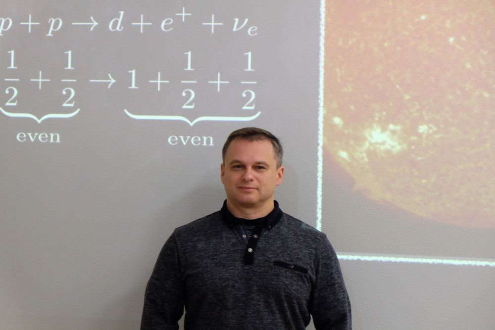

[← Интервью и подкасты](../interviews.html){.interview-back}

::: {.interview-source}
«Российская газета», 3 марта 2021 года. Текст: Юрий Медведев
:::

{.interview-hero fig-alt=""}

::: {.interview-lead}
Одним из самых значимых событий Года науки должен стать пуск гигантского нейтринного телескопа на озере Байкал. Он должен состояться 12 марта. О значении этой установки для российской и мировой науки "РГ" рассказал заместитель директора Лаборатории ядерных проблем Объединенного института ядерных исследований доктор физико-математических наук Дмитрий Наумов.
:::

***Дмитрий Вадимович, чтобы налогоплательщик понял и согласился потратить почти 10 миллиардов долларов на создание знаменитого Большого адронного коллайдера, ученые упаковали бозон Хиггса в красивую обертку - образ "божественной частицы". Она закрыла знаменитую Стандартную модель, которая признана самым выдающимся достижением теоретической физики XX века, объяснила, откуда берется масса. А как нас убедить, что надо пустить миллионы на охоту за каким-то непонятным нейтрино. У этой частицы даже массы почти нет. Словом, зачем в глубинах Байкала ловят нейтрино?***

Дмитрий Наумов: Я бы привел такую аналогию. Археологи ведут раскопки, чтобы разобраться с эволюцией человечества, понять нашу далекую историю. Так вот нейтрино позволит заглянуть в историю Вселенной. Узнать, что в ней происходило миллионы и даже миллиарды лет назад. Как рождались и развивались галактики. Инструментом для реконструкции этих давних событий может стать именно нейтрино.

***А разве гигантским наземным телескопам и размещенным в космосе обсерваториям это не под силу?***

Дмитрий Наумов: Во-первых, такие телескопы не все могут увидеть. Дело в том, что из плотных и горячих областей Вселенной свет может не выбраться или сигнал изменится до неузнаваемости. Во-вторых, чтобы оптическим телескопам было куда смотреть, им нужно указать точный адрес. Ведь небо огромно, телескопы не могут себе позволить шарить по бесконечному небу в поисках интересных объектов. Им нужны как можно более точные адреса, чтобы именно там максимально сосредоточиться и изо дня в день, из месяца в месяц вести наблюдения. Это долгий и тщательный процесс. Так вот наводчиками на космические адреса как раз и являются нейтрино. По сути, на наших глазах рождается новая наука - нейтринная астрономия. Еще совсем недавно это казалось фантастикой, а сейчас это уже реальность.

***Нейтрино называют самой разыскиваемой в истории физики элементарной частицей. Она подозревается в нарушении почти всех законов физики. От нее ждут ответа на множество вопросов, например, почему материи в ней больше, чем антиматерии, хотя после Большого взрыва их было поровну. Нейтрино уже прославилась: четыре нобелевские премии были вручены за открытия в нейтринной физике. А теперь она будет помогать в космических раскопках, указывая на определенные космические адреса. Как конкретно это происходит?***

Дмитрий Наумов: Игра идет на главной особенности нейтрино - она очень слабо взаимодействует с материей, которая для этой частицы почти прозрачна. Как ее ловить, если она избегает любых контактов? Скажем, от Солнца эти частицы долетают до Земли, и через каждый квадратный сантиметр проходят триллионы нейтрино в секунду. Но мы их совершенно не замечаем. Мы для них как пустое место. А скажем, чтобы поймать половину нейтрино, излучаемых Солнцем, потребовалось бы залить свинцом всю область космического пространства от нас до ближайшей звезды Альфа Центавра.

Нейтрино позволит заглянуть в историю Вселенной, узнать, что происходило в ней миллионы и даже миллиарды лет назад, как рождались и развивались галактики

Такая слабость взаимодействия ставила физиков в тупик - как же ее увидеть, как с ней работать? Немецкий физик, лауреат Нобелевской премии Вольфганг Паули, придумавший нейтрино чисто теоретически, вообще считал, что мы никогда не сможем увидеть эту частицу. Но не стоит недооценивать изобретательность экспериментаторов! Они научились ловить эту удивительную частицу и реконструировать историю Вселенной. Причем слабость взаимодействия нейтрино оказалась очень даже полезной!

***Как же удалось обратить этот недостаток в достоинство?***

Дмитрий Наумов: Здесь надо вернуться на миллиарды лет назад, когда в нашей Вселенной только зарождались первые галактики. Тогда каждая звезда отчаянно боролась за свое существование. Более удачливые пожирали своих маленьких соседей и становились еще больше. Так происходило до тех пор, пока ненасытная звезда не превращалась в черную дыру, которая уже почти не светится. Но уже невидимая она продолжает пожирать своих соседей, увеличивая массу до миллионов и даже миллиардов масс Солнца. Причем падающее на дыру вещество нагревается и очень сильно светится. Называется это чудо света "активное галактическое ядро".

Что важно подчеркнуть? Выбраться из такого пекла, не растеряв изначальные энергию и направление движения, не могут ни электромагнитные волны, ни протоны, ни электроны, ничто другое. Только нейтрино. В этом их феномен. Вот почему слабость их взаимодействия это огромное преимущество. Самое главное, что нейтрино летят на Землю в неизменном виде, а значит, несут ценную информацию о происходивших миллиарды лет назад событиях во Вселенной, а также их адреса.

Уже почти десять лет в Антарктиде ловит нейтрино американский телескоп IceCube. За эти годы улов, прямо скажем, небогатый, около 100 частиц. Что по ним можно реконструировать?

Дмитрий Наумов: Эксперименту на Южном полюсе удалось сделать замечательное открытие. Ученые обнаружили, что нейтрино с огромными энергиями, превышающими энергии солнечных нейтрино в сотни миллионов и даже миллиарды раз, действительно существуют. Значит, где-то во Вселенной работают природные ускорители, способные разгонять частицы до таких энергий, на которые мы на Земле с нашими ускорителями совершенно не способны. Это важное открытие?

***Думаю, да.***

Дмитрий Наумов: Так вот для него достаточно даже одного нейтрино, а 100 уже просто подарок природы. Но где находятся эти природные ускорители? Какие физические механизмы ими управляют? Пока есть разные гипотезы. И мы надеемся, что пойманные нами нейтрино смогут точно указать направление, куда смотреть обычным телескопам.

Эксперимент на южном полюсе использует лед в качестве среды, с которой взаимодействует нейтрино. Но лед сильно перерассеивает свет, поэтому пока сложно с высокой точностью указать адрес, где родилось нейтрино. Вот тут-то и вступает в игру байкальский нейтринный телескоп. У него точность определения адреса в несколько раз лучше, чем в ледовом телескопе. И есть надежда найти источники нейтрино!

***Как вообще наш телескоп смотрится рядом с американским IceCube?***

Дмитрий Наумов: Смотрится достойно. Мы начали строить телескоп в 2015 году, а IceCube начал работать в 2010-м. Поэтому мы пока меньше, но совсем чуть-чуть. Байкальский нейтринный телескоп уже самый крупный в Северном полушарии с эффективным объемом 0,35 кубического километра. В этом году по этому показателю мы догоним "южанина", доведя объем до 0,4 кубического километра. В перспективе эта цифра у нас составит около одного кубического километра. При этом, как я уже сказал, точность определения направления у байкальского телескопа в разы лучше.

Хочу подчеркнуть принципиальный момент. Хотя конкуренция всегда существует, так уж устроен современный мир, ученые понимают, что намного эффективней работать сообща. Поэтому и наш байкальский телескоп, и американский, а также строящийся телескоп в Средиземном море KM3NeT все вместе делают общее дело. Мы объединены в единую Глобальную нейтринную сеть.

***Американский телескоп стоит 270 млн долл., а наш в несколько раз меньше. Почему?***

Дмитрий Наумов: Нам просто повезло. На Байкале два месяца в году поверхность озера покрыта метровым слоем льда. Это позволяет нам дешево и просто проводить монтаж телескопа и даже ремонтировать вышедшие из строя части. На Южном полюсе коллегам приходится протапливать отверстия во льду диаметром около метра и глубиной почти три км, чтобы погрузить туда свои детекторы. Это очень дорого. Также доставка детекторов на Байкал с развитой железнодорожной инфраструктурой гораздо легче и дешевле, чем спецоперации по доставке оборудования на Южный полюс.

***Кто участвовал в создании нашего телескопа?***

Дмитрий Наумов: Пионерами в нашей стране и в мире были ученые из московского Института ядерных исследований РАН. Они создавали это направление исследований еще с 1980-х годов. И сейчас вместе с Объединенным институтом ядерных исследований из Дубны играют ведущую роль в проекте. Кроме того, в большой команде создателей этого телескопа принимают участие ученые и инженеры из Иркутского государственного университета, Нижегородского государственного технического университета, Санкт-Петербургского государственного морского технического университета, Института экспериментальной и прикладной физики Чешского технического университета (Прага, Чехия), факультета математики, физики и информатики Университета имени Я.А. Коменского (Братислава, Словакия), Института ядерной физики Польской академии наук (Краков, Польша), компания EvoLogics GmbH (Берлин, ФРГ). Основными организаторами работ являются Институт ядерных исследований РАН и Объединенный институт ядерных исследований в Дубне.

### О чем говорят

**Как телескоп ловит нейтрино**

Чтобы поймать нейтрино, нужен большой объем максимально прозрачного вещества, с которым оно взаимодействует. Кроме того, телескоп надо защитить от различных фоновых процессов. Для этого установка погружается на глубину от 750 м до 1,4 км. Гирлянда из 36 оптических модулей (фотоумножитель и электроника) крепится якорями ко дну озера. При прохождении частиц через толщу воды часть нейтрино "споткнется" об ядро молекулы воды. В результате этого взаимодействия родятся новые частицы, которые будут светиться голубоватым черенковским излучением. Его и регистрируют оптические модули телескопа. Сейчас эффективный объем воды установки, который участвует в поиске нейтрино, составил 0,35 кубических км, а в перспективе он вырастет до одного кубического км. Общее число оптических модулей превысит 2300 штук.

**Нейтрино в шампанском**

Вокруг нейтрино в научном мире бушуют нешуточные страсти. Дело в том, что физики более десятка лет не могли понять, почему не выполняется закон сохранения энергии в одном из самых принципиальных физических явлений. Вопрос стоял настолько остро, что в 1931 году знаменитый датский физик Нильс Бор выступил с революционной идеей о несохранении энергии. Однако было и другое объяснение - "потерянную" энергию уносит какая-то неизвестная и незаметная частица. Гипотезу о ее существовании выдвинул в 1930 году немецкий теоретик Вольфганг Паули. Но она никогда не будет обнаружена, так как ни с чем не взаимодействует. Об этом ученый заключил пари на ящик шампанского со своим приятелем. И вот 15 июня 1956 года он получил телеграмму от американских физиков Райнеса и Коуэна, что они обнаружили новую частицу - нейтрино. Так что через 26 лет Паули пришлось признать свой проигрыш.

[← Интервью и подкасты](../interviews.html){.interview-back}
